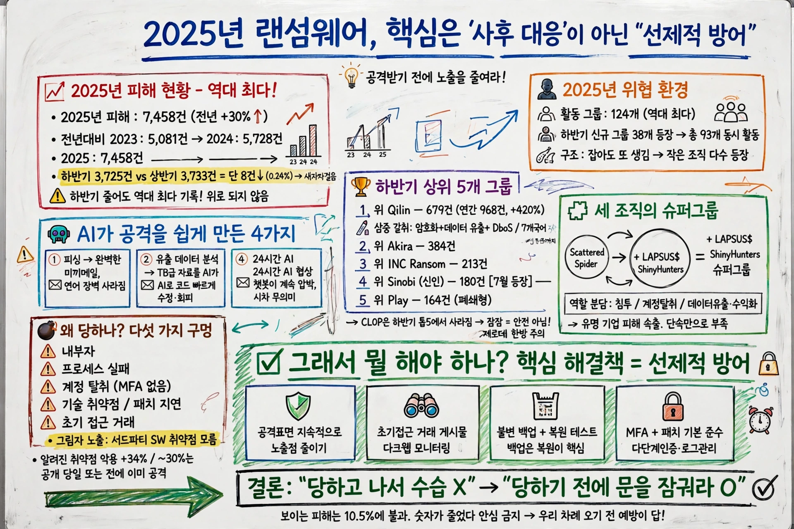
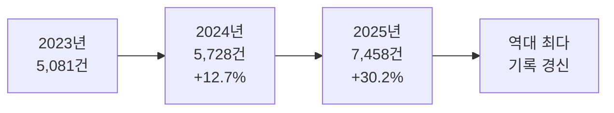
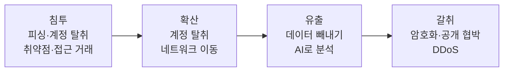

# 2025년 랜섬웨어 피해 7,458건, 역대 최다입니다. 하반기 줄었다고 안심하면 안 됩니다

> **Summary**
> 2025년 랜섬웨어 피해는 전년보다 30% 늘어난 7,458건으로 역대 최다를 기록했으며, 하반기 감소는 사실상 미미했습니다. AI를 활용한 공격과 다중 갈취, 취약점 악용이 확산되고 있어 단속이나 사후 대응만으로는 부족합니다. 공격 표면과 유출 정보를 꾸준히 점검하고, 패치·다단계 인증·불변 백업으로 선제 방어해야 합니다.

---

- 2025년 랜섬웨어 피해는 7,458건으로 역대 최다를 기록했습니다. 전년보다 30% 늘었습니다.
- 하반기 피해가 상반기보다 8건 줄었다고 해서 상황이 나아진 건 아닙니다. 사실상 제자리걸음이었습니다.
- 이기는 방법은 사후 대응이 아니라, 공격받기 전에 노출을 줄이는 선제적 방어입니다.

월요일 아침, 보안팀 메신저에 이런 메시지가 뜬 적 있으시죠? "파일이 안 열립니다. 화면에 영어로 된 메모가 떴어요." 그 순간부터 회사는 멈춥니다. 파일은 잠겼고, 메모에는 비트코인 주소가 적혀 있습니다. 이 장면이 2025년에만 7,458번 벌어졌습니다. 다크웹 유출 사이트에 이름이 올라간 피해만 세어도 그렇습니다!

🎥 [동영상 보기](https://www.youtube.com/watch?v=EDyN1QYdsFw)

## 하반기 피해가 줄었다고요? 숫자부터 다시 보겠습니다

상반기 3,733건, 하반기 3,725건. 차이는 고작 8건, 0.24% 감소입니다. 겉으로 보면 안정된 것처럼 보입니다. 그런데 연 단위로 보면 전혀 다른 그림이 나옵니다. 2023년 5,081건, 2024년 5,728건, 2025년 7,458건. 전년 대비 증가율이 12.7%에서 30.2%로 뛰었습니다. 하반기는 2023년 이후 두 번째로 피해가 많은 반기였습니다. 줄었다는 말은, 역대 최다라는 사실 앞에서는 위로가 되지 않습니다.

활동 중인 그룹 수도 역대 최다였습니다. 2025년에만 124개 그룹이 피해자를 올렸고, 하반기에는 93개 그룹이 동시에 활동했습니다. 새로 생긴 그룹도 73개로, 하반기 38개가 한꺼번에 등장했습니다. 잡으면 또 생기는 구조입니다. 큰 조직이 단속으로 무너지면, 그 자리에 작은 조직들이 여럿 생깁니다. 이게 2025년 랜섬웨어의 얼굴입니다.

## 누가 주도했나요? 상위 5개 그룹을 보겠습니다

하반기 피해 1위는 `Qilin`이었습니다. 679건입니다. 연간으로는 968건, 전년보다 420% 늘었습니다. 2022년 중반 `Agenda`라는 이름으로 시작해 이름을 바꾼 뒤, 사회공학으로 들어와 `Windows`·`Linux`·`ESXi`를 노렸습니다. 암호화만 하지 않습니다. 데이터를 빼내 공개하겠다고 협박하고, 여기에 `DDoS` 공격까지 얹는 삼중 갈취를 씁니다. 피해자·고객과 통화할 7개 언어 콜센터까지 열겠다고 했습니다. 협박도 사업처럼 굴리는 셈입니다.

2위는 `Akira` 384건, 3위는 `INC Ransom` 213건이었습니다. 4위 `Sinobi`는 2025년 7월에 처음 나타난 신인인데, 반년 만에 180건을 올렸습니다. 이름은 일본어로 닌자라는 뜻입니다. 제조업처럼 멈추면 손해가 큰 곳을 노렸습니다. 5위 `Play`는 164건으로, 가입자를 받지 않는 폐쇄형 조직입니다. 그런데 상반기 1위였던 `CL0P`은 하반기 상위 5개에서 사라졌습니다. 제로데이 취약점을 노리는 조직이라, 조용하다가 한 번에 터뜨리는 방식입니다. 2025년 2월 파일 전송 제품의 제로데이로 수백 건을 한 번에 올린 적이 있습니다. 잠잠하다고 끝난 게 아닙니다!

## AI가 공격자의 손을 빌려줍니다

AI는 랜섬웨어의 진입 장벽을 낮췄습니다. 네 가지로 정리됩니다. 첫째, 피싱입니다. 언어 모델이 문법이 완벽한 미끼 메일을 어떤 언어로든 써줍니다. 어색한 문장이라는 예전의 신호가 사라졌습니다. 둘째, 유출 데이터 분석입니다. 테라바이트 단위로 훔친 자료에서 법률 문서·재무 기록·계정 정보를 AI가 골라냅니다. 셋째, 악성코드 다듬기입니다. AI에게 검토·디버깅을 시켜 보안 패치에 맞춰 코드를 빠르게 고칩니다. 넷째, 협상입니다. AI 챗봇이 피해자와 24시간 대화하며 압박합니다. 사람이 잘 필요가 없어졌으니, 협박은 시차를 가리지 않고 계속됩니다.

## 세 그룹이 합치면 어떻게 될까요?

2025년에는 `Scattered Spider`, `LAPSUS$`, `ShinyHunters` 세 조직이 합쳐진 슈퍼그룹이 등장했습니다. 침투는 첫 번째가, 계정 탈취는 두 번째가, 데이터 유출과 수익화는 세 번째가 맡았습니다. 각자 잘하는 것만 모았더니, 하반기 내내 유명 기업들의 이름이 유출 사이트에 올랐습니다. 법 집행도 손을 놓고 있지는 않았습니다. 2025년 7월에는 `BlackSuit` 조직의 유출 사이트가 압수됐습니다. 그런데도 피해는 역대 최다였습니다. 단속만으로는 판을 뒤집지 못한다는 뜻입니다.

## 왜 당하나요? 다섯 가지 구멍을 보겠습니다

보고서가 꼽은 원인은 다섯 가지입니다. 내부자, 프로세스 실패, 계정 탈취, 기술 취약점, 그리고 초기 접근 거래입니다. 패치 주기가 느리거나, 중요 서비스에 다단계 인증이 없거나, 로그 관리가 허술하면 그 틈으로 들어옵니다. 가장 무서운 건 그림자 노출입니다. 정식으로 들여온 서드파티 소프트웨어의 취약점이 보안팀 눈에 안 보이는 겁니다. 2025년에는 알려진 취약점의 악용이 34% 늘었고, 악용된 취약점의 약 30%는 공개되기 전이나 공개 당일에 이미 공격에 쓰였습니다. 패치하러 달려가는 속도보다 공격이 더 빨랐습니다!

## 그래서 뭘 하면 되나요?

결론은 하나입니다. 공격을 당한 뒤에 수습하는 방식으로는 안 됩니다. 공격받기 전에 노출을 줄이는 쪽으로 가야 합니다. 공격 표면을 계속 들여다보고, 초기 접근 거래 게시물을 감시하고, 유출된 데이터에 우리 정보가 있는지 확인하는 겁니다. 백업은 복원이 되는 불변 백업으로, 다단계 인증과 패치는 기본으로 챙겨야 합니다. 피해 사실을 공개하는 곳은 전체의 10.5%에 불과하다는 조사도 있습니다. 보이는 숫자가 전부가 아니라는 뜻입니다. 숫자가 줄었다는 소식에 안심하기보다, 우리 차례가 오기 전에 문을 잠그는 쪽이 낫습니다!

