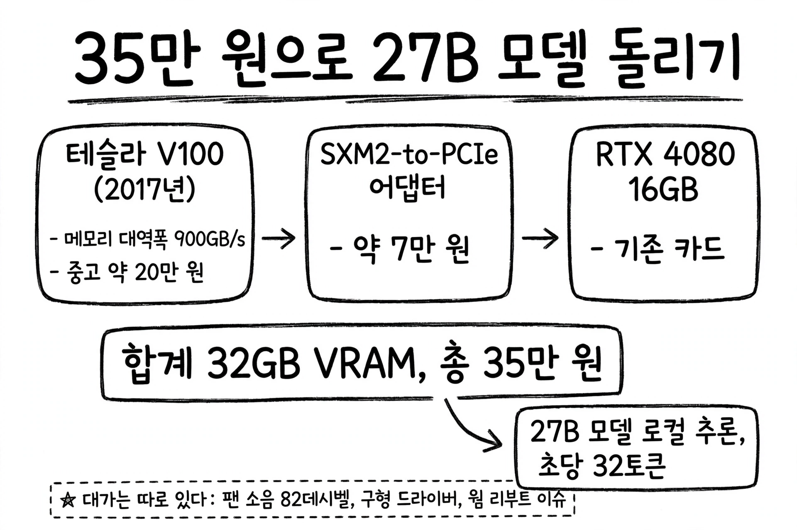
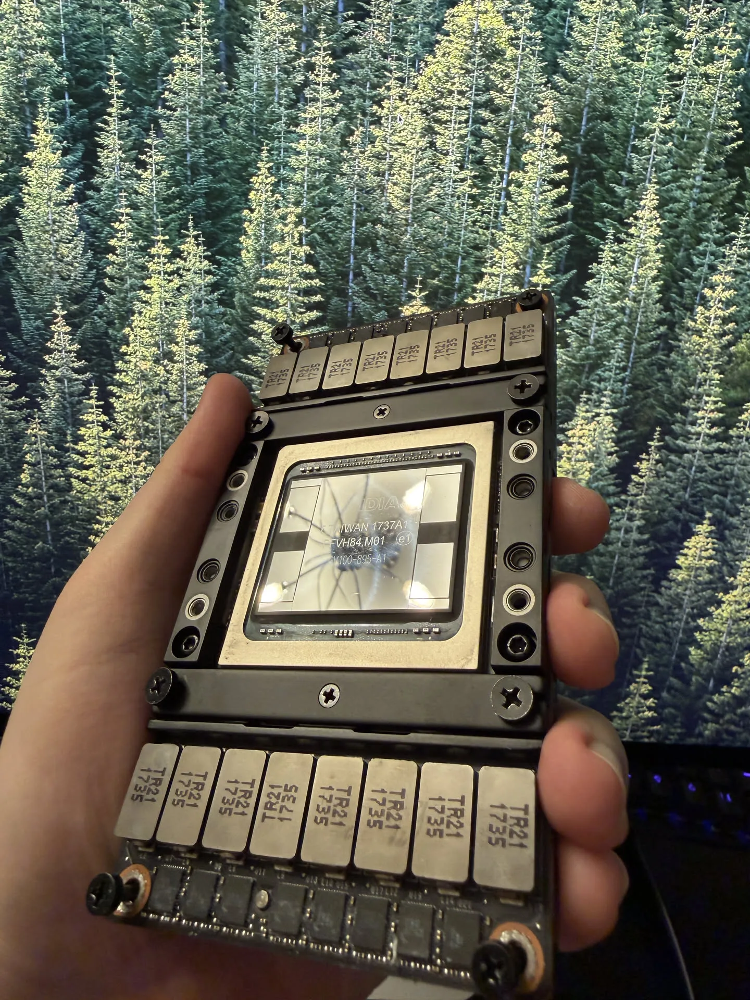
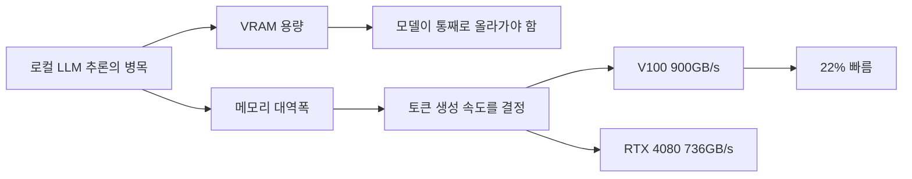
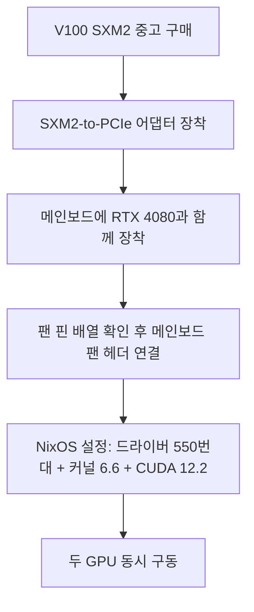
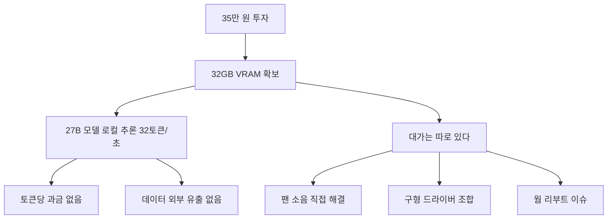

# 35만 원짜리 중고 데이터센터 GPU, 게이밍 PC에 꽂으면 27B 모델이 집에서 돌아갑니다

> **Summary**
> 기존 RTX 4080에 약 35만 원을 추가해 중고 테슬라 V100을 장착하면 32GB VRAM으로 27B 모델을 초당 약 32토큰으로 로컬 실행할 수 있습니다. 높은 메모리 대역폭과 낮은 비용이 장점이지만, 팬 소음 해결과 구형 드라이버 설정, 재부팅 문제가 따릅니다.

---

- 2017년 데이터센터 GPU를 중고로 사서 게이밍 PC에 꽂으면, 32GB VRAM을 약 35만 원에 확보할 수 있습니다.
- 비결은 가격표가 아니라 메모리 대역폭입니다. 9년 된 서버 GPU가 2022년 소비자 GPU보다 22% 빠릅니다.
- 27B 모델이 초당 32토큰으로 집에서 돌아갑니다. 단, 소음과 구형 드라이버라는 대가는 따로 있습니다.

집에서 큰 언어 모델을 돌리고 싶은데, VRAM이 발목을 잡은 적 있으시죠? 16GB 카드로는 27B 모델이 통째로 안 올라가고, 32GB짜리 최신 카드는 300만 원이 넘습니다. 그런데 데이터센터에서 퇴역한 GPU를 중고로 사서 게이밍 PC에 꽂으면, 35만 원으로 해결됩니다.

🎥 [동영상 보기](https://www.youtube.com/watch?v=7DAPd5MGodY)

## 왜 VRAM이 문제일까요?

로컬에서 LLM을 돌릴 때 가장 중요한 자원은 연산 성능이 아닙니다. VRAM 용량과 메모리 대역폭입니다. 모델 전체가 GPU 메모리에 올라가야 빠르게 추론할 수 있고, 메모리에서 데이터를 읽어오는 속도가 토큰 생성 속도를 정합니다. 문제는 소비자용 GPU에서 VRAM을 늘리려면 비용이 몇 배로 뛴다는 점입니다. 그래서 누군가는 데이터센터에서 퇴역한 2017년산 서버 GPU를 중고 시장에서 약 20만 원에 사는 길을 택했습니다.

## 2017년 GPU가 2022년 GPU를 이기는 지점은?

이 GPU의 강점은 `HBM2` 메모리입니다. 칩을 수직으로 쌓은 기술로, 버스 폭 4096비트에 대역폭 900GB/s가 나옵니다.

| GPU | 메모리 대역폭 | 가격대 |
| --- | --- | --- |
| 테슬라 V100 (2017) | 900 GB/s | 약 20만 원 |
| RTX 4080 (2022) | 736 GB/s | 약 150만 원 |
| RTX 5090 (2025) | 1,792 GB/s | 약 300만 원+ |

2017년 서버 GPU가 2022년 소비자 GPU보다 대역폭이 22% 높습니다. LLM 추론에서 대역폭이 토큰 생성 속도의 병목인 만큼, 이 중고 GPU의 가성비는 상당히 높습니다. `AMD RX 7900 XTX`는 960GB/s로 대역폭 자체는 앞섭니다. 하지만 가격이 5배 이상이고, `ROCm`의 LLM 추론 지원이 `CUDA`만큼 안정적이지 않습니다.

## 꽂는 것부터가 문제 아닐까요?

맞습니다. 이 GPU는 `SXM2`라는 서버 전용 규격이라 일반 PC의 `PCIe` 슬롯에 꽂을 수 없고, 모니터 출력 단자도, 일반 전원 커넥터도 없습니다. 그런데 누군가가 만든 `SXM2-to-PCIe` 어댑터가 있습니다. 한쪽은 `SXM2` 소켓, 다른 한쪽은 `PCIe` 커넥터인 맨몸 기판으로, 공식 지원은 아무도 안 하고 가격은 약 7만 원입니다. 이걸 쓰면 메인보드에 장착되고, 기존 `RTX 4080` 16GB에 이 카드 16GB를 더하면 32GB가 됩니다.

## 팬 소음 82데시벨, 어떻게 잡았을까요?

서버 GPU의 최대 난관은 소음입니다. 원래 2U 서버 랙 안에서 산업용 냉각으로 식히도록 설계됐고, 어댑터에 달린 팬은 제어 없이 항상 100%로 돕니다. 측정된 소음은 82데시벨, 쓰레기 분쇄기와 잔디 깎는 기계 사이 수준입니다. `nvidia-smi`로도, 리눅스에서도, 윈도우 조절 프로그램으로도 속도를 제어할 수 없었습니다. 이 팬은 제어되도록 설계된 적이 없습니다.

해결 방법은 하드웨어 수준의 역공학이었습니다. 팬 커넥터 핀 배열이 표준 PC 팬과 같은 구조라 가정하고, 점퍼 와이어를 전원과 접지 핀에 꽂은 뒤 9V 건전지를 연결했더니 팬이 돌았습니다. 12V 정격보다 낮은 전압이라 훨씬 조용했습니다. 핀 배열이 표준과 같다는 것을 확인한 뒤, 회전수 감지와 `PWM` 핀을 메인보드 팬 헤더에 연결했습니다. 10%로 설정하니 풀로드에서도 50도를 넘지 않았습니다. 점퍼 케이블 하나, 약 3천 원입니다.

## 소프트웨어는 어떻게 맞췄을까요?

서로 다른 세대 GPU 두 장을 동시에 구동하려면 드라이버 호환성을 맞춰야 합니다. 이 카드는 `Volta`, `RTX 4080`은 `Ada`입니다. 드라이버 560번대부터 `Volta` 지원이 중단됐기 때문에, 둘 다 지원하는 마지막 드라이버인 550번대를 써야 합니다. 이 드라이버는 `CUDA 12.2`까지만 지원하고 커널도 6.6이어야 합니다. `NixOS`에서는 이 모든 제약이 설정 파일 몇 줄로 해결됩니다.

비직관적인 점이 있습니다. 모니터도 연결하지 않는 순수 추론 서버인데, `X` 서버를 켜야 `NVIDIA` 커널 모듈이 로드됩니다. 운영체제 전체는 외장 `USB-C NVMe` 드라이브에서 부팅합니다. 게임할 때는 드라이브를 뽑고 윈도우로, LLM을 돌릴 때는 꽂고 `NixOS`로 부팅합니다. 듀얼 부트 메뉴 없이 물리적으로 드라이브를 바꾸는 방식입니다.

## 27B 모델, 실제로 얼마나 빠를까요?

이 구성에서 돌리는 모델은 `Qwen3.6-27B-MTP`입니다. `Q5_K_M` 양자화로 약 19GB이며, `llama.cpp`로 두 GPU에 나눠 로드합니다. 추론 속도는 초당 약 32토큰, 컨텍스트 128K 토큰, 프롬프트 처리는 초당 133~160토큰입니다. 대화형 사용에 충분하고, 네트워크 지연을 감안하면 대부분 클라우드 `API`보다 체감 속도가 빠를 수 있습니다.

모델명의 `MTP`는 다중 토큰 예측입니다. 토큰을 하나씩 만드는 대신 여러 개를 동시에 예측하고, 맞은 것은 채택하고 틀린 것만 재생성해 정확도 손실 없이 1.5~2배 빠릅니다. 약 928MB의 멀티모달 프로젝터 파일을 추가하면 이미지 입력도 됩니다.

성능이 어느 수준일까요? 이 모델은 한 벤치마크에서 최신 상용 모델과 동점이고, 다른 두 벤치마크에서는 이깁니다. 하지만 최상위 모델을 20분 정도 집중적으로 쓰는 비용이 이 GPU와 어댑터 전체 구매 비용을 넘습니다. 로컬에서 돌리면 토큰당 과금이 없고, 데이터가 네트워크 밖으로 나가지 않습니다!

## 한계는 없을까요?

있습니다. 첫째, 웜 리부트 후 이 카드가 `lspci`와 `nvidia-smi`에서 간헐적으로 사라집니다. 전원을 물리적으로 끄고 다시 켜면 항상 복구됩니다. 둘째, `bfloat16`을 지원하지 않습니다. 로컬 추론에서는 체감 영향이 크지 않지만 세대적 한계가 다가오고 있다는 신호입니다. 셋째, 프롬프트 처리 속도가 에이전트 워크로드의 실질적 병목입니다. 10만 토큰 컨텍스트 처리에 약 11분이 걸립니다. 대화형 사용에는 문제없지만, 긴 컨텍스트 반복 처리에는 실용성이 떨어집니다.

가격 이야기도 정확히 해야 합니다. 35만 원은 기존 `RTX 4080`을 이미 갖고 있다는 전제입니다. "VRAM을 두 배로 늘린 업그레이드"와 "처음부터 32GB를 구성하는 비용"은 구분해서 봐야 합니다.

## 확장하면 어디까지 갈까요?

이 카드에는 32GB 변형도 있습니다. 16GB 모델의 두 배 이상 가격이지만 수십만 원 수준이고, 32GB 두 장이면 64GB VRAM을 최신 32GB 카드 가격의 약 20%로 확보할 수 있습니다. `SXM2`는 `NVLink`를 기본 지원합니다. `P40`은 24GB를 비슷한 가격에 주지만 텐서 코어가 없어 느리고, `MI100` 32GB는 약 130만 원으로 비싸지만 최신 `ROCm` 지원이 살아있습니다.

이 사례가 흥미로운 이유는 35만 원이라는 숫자보다, 로컬 LLM 추론의 경제학이 변하고 있다는 점에 있습니다. 클라우드 `API`는 쓸수록 비용이 선형으로 늘지만, 중고 서버 GPU는 초기 투자 후 한계 비용이 0입니다. 동시에 27B급 오픈 모델이 최신 상용 모델과 벤치마크에서 경쟁하는 수준에 도달했습니다. 하드웨어 가격 하락과 모델 성능 상승이 교차하는 지점에서 "로컬에서 충분히 좋은 모델을 무제한으로 돌린다"는 선택지가 실현 가능해지고 있습니다. 물론 팬 소음, 드라이버 호환성, 웜 리부트 이슈처럼 편의성의 대가는 분명히 존재합니다. 이 트레이드오프를 받아들일 수 있는 사람에게만 성립하는 경로입니다!

