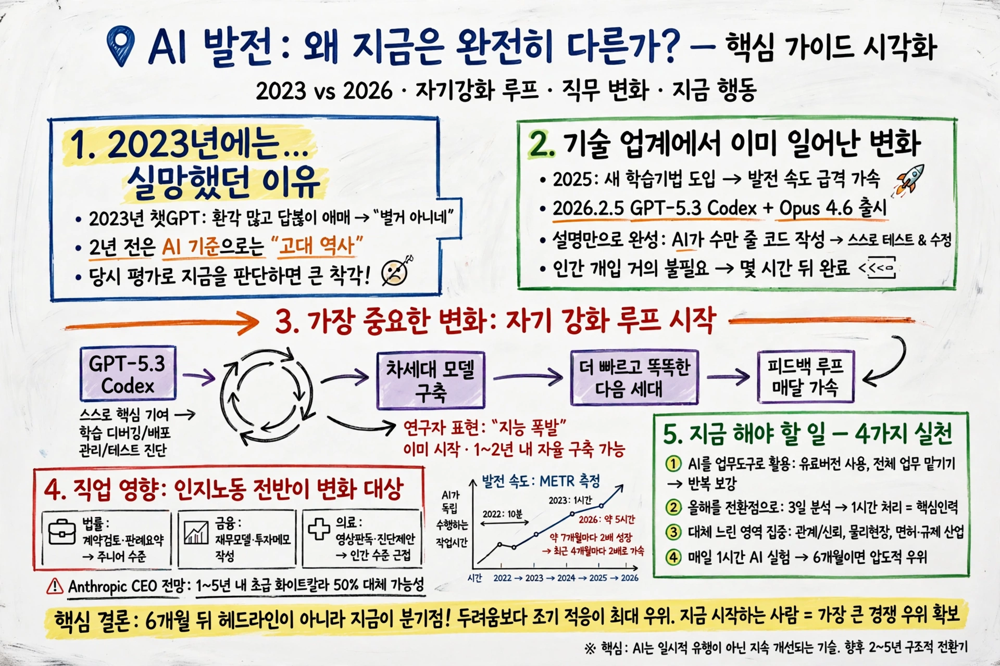
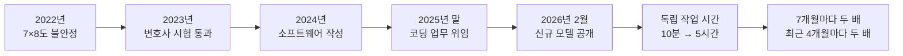
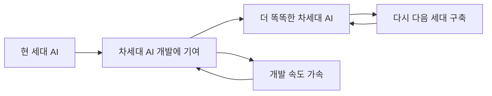
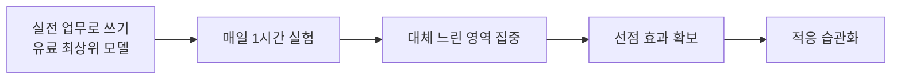

# AGI가 왔다고요? 이미 일하는 방식이 바뀌고 있습니다

> **Summary**
> AI 모델의 발전 속도가 급격히 빨라지면서 기술 업계에서는 이미 직무 구조 변화가 현실이 되고 있습니다. GPT-5.3 Codex와 Opus 4.6 공개 이후 개발 업무는 설명만으로 완성되는 수준에 도달했고, AI가 스스로 차세대 AI를 만드는 자기 강화 루프까지 형성됐습니다. 법률·금융·의료 등 화면 기반 인지 노동 전반으로 확산 중이며, 초급 화이트칼라 직무의 절반이 1~5년 내 대체될 수 있다는 전망도 나옵니다. 두려움보다 조기 적응이 우위입니다.

---

- AI 모델의 발전 속도가 급격히 빨라지면서, 기술 업계에서는 이미 직무 구조 변화가 현실이 되고 있습니다.
- GPT-5.3 Codex와 Opus 4.6 공개 이후 개발 업무는 설명만으로 완성되는 수준에 도달했고, AI가 스스로 차세대 AI를 만드는 자기 강화 루프까지 형성됐습니다.
- 법률·금융·의료 등 화면 기반 인지 노동 전반으로 확산 중이며, 지금 적응하는 사람이 가장 큰 우위를 갖습니다.

## 2023년에 챗GPT 써보고 실망하셨던 적 있으시죠?

2023년에 챗GPT를 써보고 "생각보다 별거 아니네" 하고 접으셨던 적 있으시죠? 환각도 심하고, 인상적인 답도 안 나왔고요. 그때의 기억으로 AI를 평가하고 있다면, 지금 벌어지는 일은 전혀 다른 풍경입니다. 2년이라는 시간이 AI에게는 고대 역사나 다름없으니까요.

🎥 [동영상 보기](https://www.youtube.com/watch?v=x2VHFgyawPE)

## 이미 기술 업계에서 일어난 일

AI가 일자리를 대체할 거라는 말, 미래 예측으로 들으셨나요? 기술 업계에서는 이미 벌어진 변화입니다. 2025년 새로운 학습 기법이 도입된 뒤 발전 속도가 급격히 빨라졌고, 모델 간 성능 격차는 벌어지고 출시 주기는 짧아졌습니다. 2026년 2월 5일, GPT-5.3 Codex와 Opus 4.6이 공개된 뒤로는 기술 업무에서 인간 개입이 거의 필요 없다는 체감이 나옵니다. 원하는 결과를 평문 영어로 설명하면 완성도 높은 산출물이 바로 나오고, 몇 시간 뒤 돌아오면 작업이 마무리돼 있습니다. 앱 개발을 요청하면 AI가 수만 줄 코드를 쓰고, 직접 앱을 실행해 버튼을 누르며 기능을 점검하고, 만족할 때까지 스스로 수정합니다. 단순 실행을 넘어 판단력과 감각에 가까운 의사결정까지 보인다는 평가도 나옵니다!

## "AI 써봤는데 별로였다"는 인식, 왜 틀렸을까요?

2023~2024년 초 챗GPT를 써보고 실망했다면, 당시로서는 타당한 평가였습니다. 그런데 2년 전은 AI 발전 속도를 기준으로 보면 고대 역사에 가깝습니다. AI가 성능 한계에 도달했다는 논쟁은 사실상 끝났습니다. 여전히 그렇게 말하는 경우는 최신 모델을 쓰지 않았거나 2024년 경험에 머물러 있는 경우입니다. 핵심은 무료 버전과 유료 버전의 격차입니다. 무료 모델은 유료보다 1년 이상 뒤처진 버전을 제공합니다. 이걸 기준으로 AI를 평가하는 건 스마트폰 시대에 폴더폰으로 기술 수준을 판단하는 것과 비슷합니다. 한 대형 로펌의 매니징 파트너는 매일 수 시간 AI를 쓰며, 주니어 어소시에이트 팀을 즉시 확보한 것과 같은 효과라고 평가합니다. 수개월마다 업무 수행 능력이 눈에 띄게 좋아지고 있다고요.

## 발전 속도, 숫자로 보면?

2022년에는 기본 산술도 불안정했습니다. 7×8을 54라고 답하던 수준이었죠. 2023년에는 미국 변호사 시험을 통과할 수 있는 수준이 됐고, 2024년에는 실제로 작동하는 소프트웨어를 쓰고 대학원 수준 과학 개념을 설명했습니다. 2025년 말에는 세계 최고 수준의 엔지니어들이 코딩 업무 대부분을 AI에 위임했습니다. 그리고 2026년 2월 5일, 이전 세대 모델을 다른 시대의 기술처럼 느끼게 하는 신규 모델이 나왔습니다. METR이라는 연구소는 AI가 인간 도움 없이 수행할 수 있는 실제 작업 시간을 측정합니다. 약 1년 전에는 인간 전문가 기준 10분 내외 작업이었고, 이후 1시간, 수 시간으로 늘더니 최근 측정에서는 약 5시간 작업을 독립 수행했습니다. 이 수치는 약 7개월마다 두 배로 증가해 왔고, 최근에는 4개월마다 두 배로 가속될 가능성도 제기됩니다. 이 추세가 유지되면 1년 내 수일 단위, 2년 내 수주 단위, 3년 내 월 단위 프로젝트를 AI가 자율 수행할 수 있다는 전망이 나옵니다.

## AI가 다음 세대 AI를 만든다고요?

여기서 흐름이 한 단계 더 넘어갑니다. GPT-5.3 Codex 기술 문서에는 "스스로의 생성에 핵심적으로 기여한 최초의 모델"이라는 문장이 들어 있습니다. 초기 버전이 학습 과정 디버깅, 배포 관리, 테스트 결과 진단에 실제로 활용됐다는 겁니다. 장래 예측이 아니라 이미 일어난 일로 공개된 사실입니다. Anthropic의 CEO는 AI가 현재 코드의 상당 부분을 작성하고 있고, 현 세대와 차세대 사이의 피드백 루프가 매달 가속되고 있다고 밝혔습니다. 현 세대가 자율적으로 차세대를 구축하는 시점까지 1~2년 남았을 가능성도 제기됩니다. 각 세대가 다음 세대를 만들고, 그 세대가 더 빠르고 더 똑똑하게 다시 다음 세대를 구축하는 구조, 연구자들은 이를 "지능 폭발"이라고 부릅니다. 이 자기 강화 과정이 이미 시작됐다는 것이 내부자들의 판단입니다!

## 직업에는 어떤 영향이 올까요?

Anthropic의 CEO는 1~5년 내 초급 화이트칼라 직무의 50%가 대체될 수 있다고 공개적으로 전망했습니다. 업계 다수는 이를 비교적 보수적인 추정으로 본다고 합니다. 최신 모델 기준으로 보면 대규모 구조 변화의 기술적 역량은 올해 말까지 도달할 가능성도 제기됩니다. 이전 자동화와 다른 점은 AI가 특정 기술이 아니라 인지 노동 전반을 대체하는 범용 도구라는 점입니다. 공장 자동화 이후 사무직으로, 인터넷 확산 이후 물류·서비스로 이동하던 경로가 있었습니다. AI는 전환 대상이 될 직무 영역까지 동시에 개선하고 있습니다. 직종별로 보면 법률은 계약 검토와 판례 요약에서 주니어 어소시에이트 수준에 도달했고, 금융 분석은 재무 모델과 투자 메모 작성을 능숙하게 수행합니다. 글쓰기는 전문가가 인간 작업과 구분하기 어려운 수준이고, 의료 분석은 영상 판독과 진단 제안에서 인간 수준에 근접했습니다. "판단력, 창의성, 공감은 안전하다"는 인식에도 균열이 생겼습니다. 최신 모델이 판단과 감각에 가까운 의사결정을 보이기 시작했으니까요. 읽기, 쓰기, 분석, 판단, 키보드를 통한 소통 같은 컴퓨터 기반 업무는 중기적으로 안전 영역이 아닙니다!

## 지금 해야 할 일, 뭐부터 할까요?

두려움보다 조기 적응이 우위입니다. 첫째, AI를 검색 도구가 아니라 실제 업무 도구로 쓰기 시작합니다. 유료 버전(월 $20)에 가입해 최상위 모델을 고르고, 짧은 질문이 아니라 실제 업무 전체를 맡기는 방식입니다. 변호사라면 계약서 전체를 제공하고 반대 제안서 초안을 요청하고, 회계사라면 고객의 세금 신고 자료 전체를 입력합니다. 첫 시도가 완벽하지 않아도 반복하고 맥락을 보강하면 결과 품질이 급격히 개선됩니다. 둘째, 올해를 커리어의 결정적 전환점으로 봅니다. 다수가 아직 무시하는 구간에서 AI로 3일 걸리던 분석을 1시간에 끝내는 사람이 조직 내 핵심 인력으로 부상합니다. 이 선점 효과는 모두가 인지하는 순간 사라집니다. 셋째, 대체가 느린 영역에 집중합니다. 장기간 형성된 관계와 신뢰, 물리적 현장 기반 업무, 면허와 법적 책임이 수반되는 역할, 규제 장벽이 높은 산업입니다. 영구적 보호막이 아니라 적응 시간을 벌어주는 장치입니다. 넷째, 매일 1시간 AI 실험을 합니다. 6개월 지속하면 주변 다수보다 앞선 이해도를 확보할 수 있습니다. 실제로 이를 실천하는 인구는 극히 소수입니다!

## 6개월 뒤 헤드라인이 아니라 지금입니다

6개월 뒤의 헤드라인이 아니라, 지금 이해하고 대응을 시작하는 것이 중요합니다. AI는 일시적 유행이 아니라 실제로 작동하고 지속적으로 개선되는 기술이고, 향후 2~5년은 많은 사람이 준비하지 못한 수준의 구조적 전환기가 될 가능성이 있습니다. 가장 유리한 위치에 설 사람은 두려움이 아니라 호기심과 긴박감으로 지금부터 참여하는 사람입니다!

