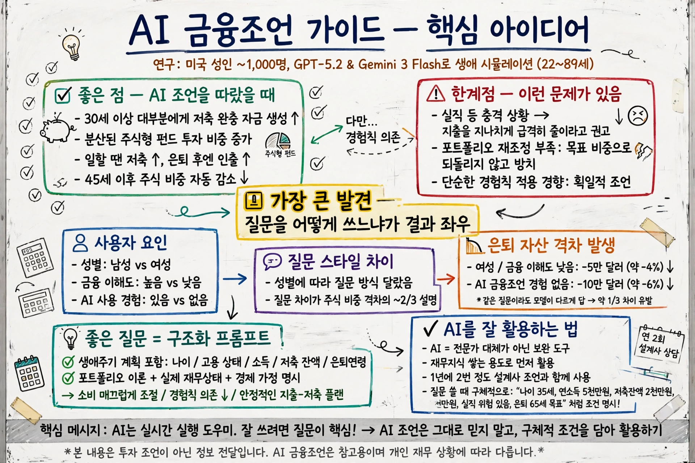
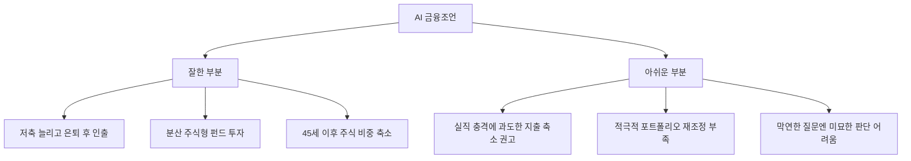
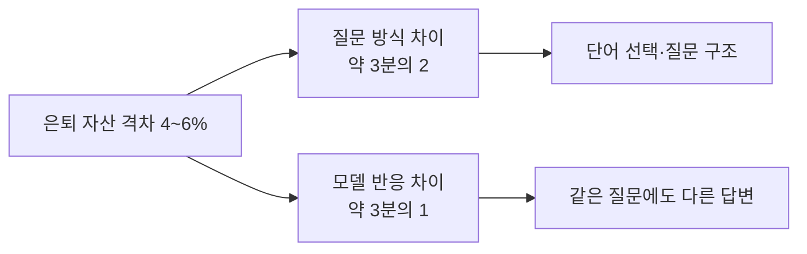

# AI Financial Advice: AI 금융조언은 뛰어나졌지만, 그대로 믿으면 안 됩니다

> **Summary**
> AI 금융조언을 그대로 따르면 30세 이상 대부분에게 저축 완충 자금이 생기고, 분산투자와 나이 맞는 위험 관리가 따라옵니다. 그런데 실직 같은 충격에는 소비를 지나치게 줄이라고 권하고, 포트폴리오 재조정도 충분히 챙기지 못합니다. 질문을 어떻게 쓰느냐가 결과를 갈라서, 성별·금융 이해도·AI 경험에 따라 은퇴 자산이 4~6% 벌어지니, AI는 전문가 대신이 아니라 보완 도구로 쓰고 내 조건을 구체적으로 적는 게 좋습니다.

---

- AI 금융조언을 그대로 따르면, 30세 이상 대부분에게 저축 완충 자금이 생기고 분산투자가 늘어납니다.
- 그런데 실직 같은 충격에는 소비를 지나치게 줄이라고 권하고, 포트폴리오 재조정도 충분히 챙기지 못합니다.
- 질문을 어떻게 쓰느냐가 결과를 갈라서, 성별·금융 이해도·AI 경험에 따라 은퇴 자산이 4~6% 벌어집니다.

월급날 통장 잔고를 보고 이런 생각 해본 적 있으시죠? "이번 달은 얼마를 저축해야 하지? 주식은 얼마나 담아야 하지?" 예전에는 은행 창구나 설계사에게 물어봤는데, 요즘은 AI에게 먼저 물어보는 사람이 절반을 넘었습니다. 그런데 AI의 답, 그대로 따라도 될까요?

🎥 [동영상 보기](https://www.youtube.com/watch?v=pT5rf274eU4)

## AI 조언, 어떻게 검증했을까요?

연구진은 미국 성인 약 1,000명에게 직접 질문을 쓰게 했습니다. 지출·저축·투자 조언을 AI에게 구하는 프롬프트를 각자 작성하게 한 겁니다. 그리고 그 질문에 대한 AI의 답변을 22세부터 89세까지의 생애 시뮬레이션에 넣었습니다. 소득이 오르고, 직장을 옮기고, 세금을 내는 현실적인 조건 속에서 AI 조언을 해마다 따랐을 때 어떻게 되는지를 계산한 겁니다.

비교 대상은 세 가지였습니다. 지금 사람들이 실제로 하는 재무 행동, 일반 사용자가 쓴 프롬프트에 대한 AI 조언, 그리고 생애주기 계획과 재무 상태, 경제 환경을 빠짐없이 적어 넣은 구조화된 프롬프트에 대한 AI 조언입니다. 모델은 GPT-5.2와 Gemini 3 Flash였습니다.

## 잘한 부분은 무엇일까요?

결과는 의외로 좋았습니다. AI 조언을 따르면 대부분이 교과서가 권하는 방향으로 움직였습니다. 일할 때는 더 많이 저축하고, 은퇴 후에는 저축을 인출했습니다. 분산된 주식형 펀드에 높은 비중으로 투자했고, 45세가 지나면 주식 비중을 낮췄습니다. 30세 이상 거의 모든 사람에게 상당한 저축 완충 자금이 생겼습니다.

"AI는 원래 재무 결정을 최적화하도록 만든 시스템이 아닌데, 조언이 교과서와 이토록 맞아떨어진다는 게 놀랍다"는 게 연구진의 평가였습니다. 비싼 설계사를 고용할 여력이 없는 사람에게도 저렴하고 접근성 높은 조언이 될 수 있다는 뜻입니다!

## 그런데 어디서 삐끗할까요?

잘한 부분만 있는 건 아닙니다. AI는 저축과 지출에 단순한 경험칙을 적용하는 경향이 있었습니다. 개인 상황이 달라져도 충분히 조정하지 못했습니다. 실직한 사람에게 쓸 수 있는 저축이 있는데도 지출을 지나치게 급격히 줄이라고 권한 사례가 있었습니다.

포트폴리오 관리도 아쉬웠습니다. 시간이 지나면서 포트폴리오 구성이 변하도록 내버려두고, 목표 비중으로 되돌리는 적극적인 재조정을 충분히 권하지 않았습니다. "50달러로 시작해 매달 25달러를 추가한다면 어디에 투자해야 하나요?" 같은 막연한 질문은 개인 조건과 경제 환경이 빠져 있어 미묘한 판단을 끌어내기 어려웠습니다.

## 같은 질문인데 왜 결과가 다를까요?

가장 흥미로운 대목입니다. 조언이 사람마다 다르게 나왔습니다. 성별, 금융 이해도, AI 사용 경험에 따라 조언이 달라졌고, 그 차이가 생애 전체에 누적돼 은퇴 자산 격차로 이어졌습니다. 여성과 금융 이해도가 낮은 사용자는 60세 자산이 약 5만 달러(4%) 적었고, AI 금융조언 경험이 없는 사용자는 약 10만 달러(6%) 적었습니다.

격차의 원인은 두 갈래였습니다. 성별에 따른 주식 비중 격차의 약 3분의 2는 남성과 여성이 서로 다른 방식으로 질문을 쓴 데서 나왔습니다. 나머지 약 3분의 1은 같은 질문이라도 모델이 다르게 답한 데서 비롯됐습니다. 기대수명이나 소득 위험처럼 실제 차이를 반영한 조정은 필요하지만, 학습 데이터에서 온 편향일 가능성도 남아 있습니다. 어떤 차이가 정당한 조정이고 어떤 차이가 편향인지, 합의된 평가 기준이 아직 없다는 게 연구진의 지적입니다.

## 질문을 잘 쓰면 조언이 달라질까요?

답은 그렇습니다. 생애주기 계획, 포트폴리오 이론, 실제 재무 상태와 경제 가정을 질문에 포함하면 지출·저축 조언이 좋아졌습니다. 구조화된 프롬프트가 일반 사용자 프롬프트보다 소비를 매끄럽게 조절하고 단순 경험칙에 의존하는 답변을 줄였습니다.

실용적인 팁도 있습니다. 프롬프트에서 모델에 편향을 경계하도록 직접 요구하는 방법입니다. 완벽한 질문을 쓰지 못하는 사람도 혜택을 받을 수 있게 만드는 게 남은 과제라고 연구진은 덧붙였습니다.

## 상품 추천도 AI가 바꿉니다?

뜻밖의 발견이 하나 더 있습니다. AI는 사용자가 거론하지 않은 계좌 유형이나 금융 상품을 답변에서 추천하는 경우가 많았습니다. 한 운용사의 투자 상품은 AI 답변의 6%에 등장했고, 다른 운용사 상품은 3.4%에 등장했지만, 두 회사를 언급한 사용자 질문은 각각 0.4%도 되지 않았습니다. 소비자가 금융 상품을 발견하고 비교하는 경로가 AI 조언으로 달라지고 있다는 뜻입니다. 금융사 입장에서는 자사 상품이 AI 답변에 어떻게 나타나는지도 살펴봐야 할 일이 됐습니다.

## 어떻게 활용하면 좋을까요?

AI를 전문가 대신이 아니라 보완 도구로 쓰는 게 핵심입니다. 조언을 그대로 따르기보다 먼저 재무 지식을 쌓는 도구로 활용하고, 1년에 두 번 정도 만나는 설계사의 조언을 일상에서 실시간으로 실행하도록 돕는 용도로 쓰는 겁니다. 질문을 쓸 때는 나이와 고용 상태, 소득과 저축 잔액, 은퇴 연령 같은 내 조건을 구체적으로 적는 게 좋습니다!

이 글은 투자 조언이 아니라 정보 전달입니다. 실제 투자 결정은 본인의 상황과 판단에 따라 내리는 게 맞습니다. AI 금융조언은 뛰어나졌지만, 그대로 믿는 것과 잘 활용하는 것은 다른 문제입니다!

