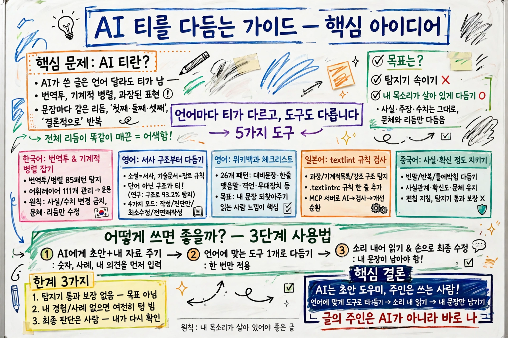
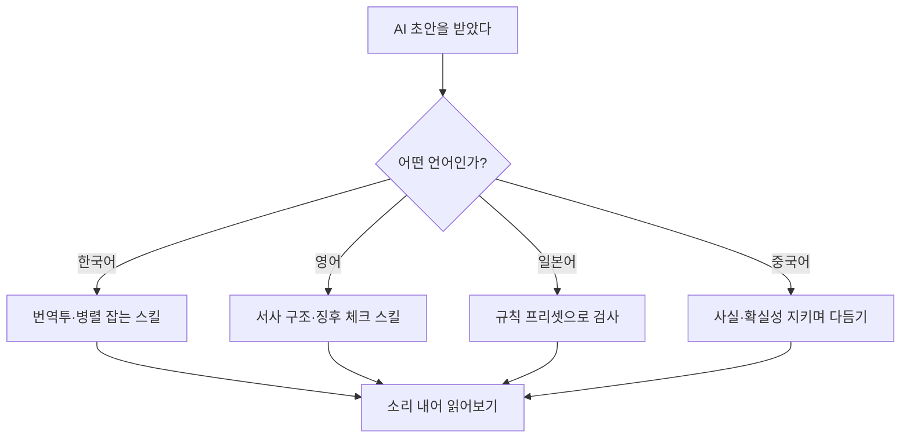
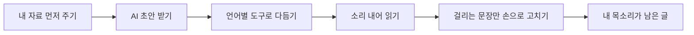

# AI 글쓰기 티, 언어마다 다릅니다. 한국어·영어·일본어·중국어 도구 5가지로 다듬습니다

> **Summary**
> AI 글쓰기의 번역투, 반복적인 문장 구조, 상투적 표현은 언어마다 다르게 나타나므로 한국어·영어·일본어·중국어에 맞는 오픈소스 도구로 문체와 구조를 다듬을 수 있습니다. 도구는 탐지기를 속이기 위한 것이 아니라 사실과 주장, 작성자의 목소리를 지키며 글을 자연스럽게 만드는 데 활용하고, 마지막에는 직접 읽고 수정해야 합니다.

---

- AI가 쓴 글은 언어가 달라도 티가 납니다. 번역투, 기계적인 병렬, 과장된 표현이 언어마다 다른 모양으로 드러납니다.
- 한국어·영어·일본어·중국어, 각 언어에 맞춘 오픈소스 도구 5가지가 AI 티를 다듬어 줍니다. 단어만 바꾸는 게 아니라 문장 구조와 장르별 문체까지 봅니다.
- 다만 도구는 탐지기를 속이는 장치가 아닙니다. 사실과 주장을 그대로 두고, 내 목소리가 살아 있게 다듬는 게 목표입니다.

AI에게 초안을 맡겼는데, 다 읽고 나니 어딘가 어색했던 적 있으시죠? 틀린 문장은 하나도 없는데, 문장마다 같은 리듬이 반복되고, 결론은 늘 "결론적으로"로 끝납니다. 그 어색함이 바로 AI 티입니다!

🎥 [동영상 보기](https://www.youtube.com/watch?v=orhmERS8Q_I)

## AI 티, 왜 자꾸 보일까요?

AI 글은 언어를 막론하고 비슷한 습관을 보입니다. 문장 길이가 고르게 맞춰지고, "첫째, 둘째, 셋째" 같은 기계적 병렬이 이어지고, "매우 중요합니다", "결론적으로" 같은 관용구가 반복됩니다. 문장 하나하나가 틀린 게 아니라, 전체 리듬이 매끈하게 똑같다는 게 문제입니다.

여기서 방향을 먼저 잡아야 합니다. 목표는 탐지기를 속이는 게 아닙니다. 탐지기는 어차피 완벽하지 않고, 탐지기를 속이는 데 성공한 글도 사람이 읽으면 어색합니다. 목표는 하나입니다. 내 글이 내 말처럼 읽히게 다듬는 것입니다.

## 언어마다 티가 다릅니다. 도구도 다릅니다

AI 티는 언어마다 모양이 다릅니다. 한국어의 티는 번역투와 기계적 병렬이고, 영어의 티는 과장된 대비 문장과 챗봇식 맺음말이고, 일본어의 티는 과장된 강조와 틀에 박힌 문장 구조입니다. 그래서 도구도 언어별로 갈렸습니다.

### 한국어: 번역투와 기계적 병렬을 잡습니다

한국어 도구는 AI가 쓴 한글의 번역투, 기계적인 병렬 구조, 상투적인 표현을 찾아 자연스러운 한국어 문체로 다듬어 주는 에이전트 스킬입니다. 10대 카테고리, 85개 패턴을 심각도별로 나눠 문장 단위로 탐지한 뒤 윤문합니다. 읽다가 걸리는 낱말 111개까지 따로 다루는 어휘 레이어도 있습니다. 원칙은 분명합니다. 사실과 주장, 수치는 한 글자도 바꾸지 않고 문체와 리듬, 표현만 다듬습니다!

### 영어: 겉이 아니라 서사 구조부터 봅니다

영어 도구 하나는 단어만 고치지 않습니다. 소설이면 서사 구조부터, 기술 문서나 릴리즈 노트면 장르별 규칙부터 봅니다. 글의 구조와 장르별 문체까지 분석하는 방식입니다. 배경에는 재밌는 연구 결과가 있습니다. AI가 쓴 소설을 서사 구조만으로 가려냈더니 정확도가 93.2%까지 나왔습니다. 표면 문체를 사람이 다시 손봐도 탐지율은 95.5%에서 93.9%로 거의 줄지 않았습니다. 티는 단어에 있는 게 아니라 구조에 있다는 뜻입니다. 이 도구는 작성, 진단만 하기, 최소 수정, 전면 재작성까지 네 가지 동작을 골라 쓸 수 있습니다.

### 영어: 위키백과 편집자의 체크리스트로 다듬습니다

또 다른 영어 도구는 위키백과 편집자들이 AI 글을 가려낼 때 쓰는 징후 가이드를 바탕으로 만들었습니다. 과장, 반복되는 문장 리듬, 형식적인 강조, 챗봇식 표현을 줄이면서 원래 의미와 작성자의 목소리는 유지합니다. 26개 패턴을 보는데, 대표적인 다섯 가지는 이렇습니다. "~가 아니라 ~이다" 식의 대비 문장, "두고 보세요" 같은 한 줄 맺음말, 깊어 보이는 격언, "여기서 핵심은" 같은 무대 장치, 반박할 상대도 없는데 벌이는 논쟁. 눈가림 테스트에서는 다듬은 글을 16번 중 16번 선호했습니다. 이 대목이 저는 가장 와닿았습니다. 도구가 문장을 고치는 게 아니라, 내 문장을 되찾아 주는 거라는 점이요!

단, 이 도구는 탐지기를 우회하려는 도구가 아니라고 스스로 밝힙니다. 탐지기는 다듬은 글도 대부분 잡아낸다고 합니다. 목표는 탐지기 점수가 아니라 사람이 읽었을 때의 느낌입니다.

### 일본어: 규칙으로 검사합니다

일본어 도구는 `textlint` 규칙 프리셋입니다. 일본어 글에서 자주 나타나는 과장, 기계적인 목록, 강조 표현과 문장 구조를 탐지합니다. `.textlintrc` 파일에 규칙 한 줄을 넣으면 됩니다. MCP 서버로도 쓸 수 있어서, AI 도구가 글을 만들고 이 규칙으로 검사한 뒤 다시 개선하는 순환을 만들 수 있습니다. 표현을 묶는 게 아니라 구조를 묶어서, 더 자연스러운 표현이 나오게 하는 게 원칙입니다.

### 중국어: 사실과 확신의 정도를 지킵니다

중국어 도구는 빈말과 반복, 틀에 박힌 표현을 다듬되 사실관계와 확실성의 정도, 작성자의 기존 문체는 최대한 유지합니다. 2026년 9월에는 규칙과 예시를 다시 써서, 보통의 병렬이나 대시, 접속사는 무조건 고치지 않도록 바꿨습니다. 검사가 아니라 편집 지침이라는 점도 분명히 합니다. 누가 썼는지 증명해 주지도 않고, 어떤 탐지기도 통과시켜 주지 않는다고 합니다.

## 어떻게 쓰면 좋을까요?

도구 다섯 개를 한꺼번에 쓸 필요는 없습니다. 쓰는 언어에 맞는 것 하나면 충분합니다. 순서는 이렇습니다.

먼저 AI에게 초안을 맡기되, 내 자료를 먼저 줍니다. 숫자, 사례, 내 의견이 들어가야 도구가 다듬을 재료가 생깁니다. 그다음 언어에 맞는 도구로 한 번 다듬습니다. 마지막으로 소리 내어 읽어봅니다. 입에 걸리는 문장은 손으로 고칩니다. 도구가 다듬은 뒤에도 내 문장이 남아 있어야 합니다. 도구가 고친 문장을 그대로 두면, 이번에는 도구 티가 남습니다!

## 어디까지 믿어야 할까요?

세 가지 한계는 알고 써야 합니다. 첫째, 이 도구들은 탐지기 통과를 보장하지 않습니다. 어떤 도구는 아예 그게 목표가 아니라고 밝힙니다. 둘째, 도구는 내 경험을 대신 쓸 수 없습니다. 구체적인 숫자나 사례가 없는 글은 다듬어도 여전히 텅 비어 있습니다. 셋째, 최종 판단은 사람이 합니다. 도구가 고친 문장도, 내가 다시 읽고 내 문장인지 확인해야 합니다.

AI에게 초안을 맡기는 건 이제 일상이 됐습니다. 달라지는 건 그다음입니다. 언어에 맞는 도구로 티를 다듬고, 소리 내어 읽고, 내 문장만 남기면 됩니다. 글의 주인은 AI가 아니라 쓰는 사람입니다!

