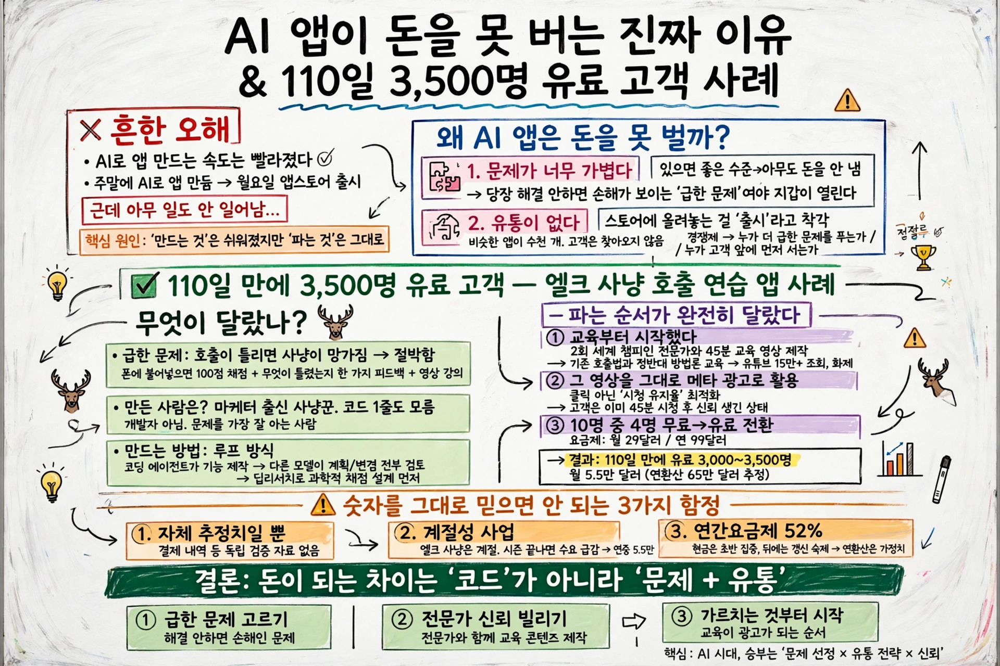
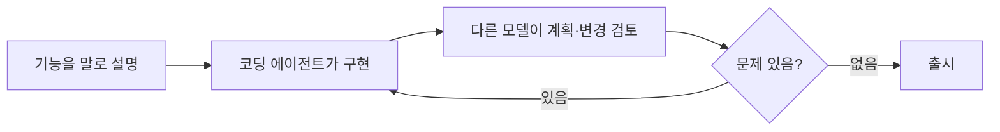
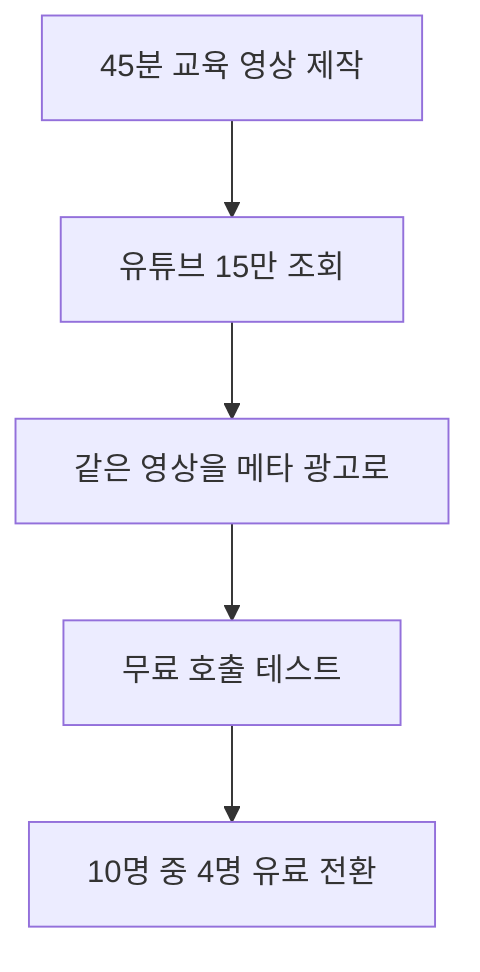

# AI 앱이 돈을 못 버는 이유, 코드를 못 짜서가 아닙니다. 파는 순서가 틀렸습니다

> **Summary**
> AI 앱의 수익은 코딩 속도보다 급한 문제를 고르고 고객에게 다가가는 순서에 달려 있다. 엘크 사냥 호출 연습 앱은 전문가의 신뢰를 활용한 교육 영상으로 관심을 모은 뒤 무료 테스트와 유료 상품으로 연결해 110일 만에 3,000~3,500명의 유료 고객을 얻었다고 한다. 다만 매출 수치는 자체 추정이며, 계절성과 연간 구독 갱신을 고려해 신중하게 해석해야 한다.

---

- AI로 만든 앱이 돈을 못 버는 건, 만드는 속도가 느려서가 아닙니다.
- 엘크 사냥 호출 연습 앱 하나는 출시 110일 만에 유료 고객 3,500명을 모았습니다. 비결은 코드가 아니라 문제와 파는 순서에 있었습니다.
- 다만 월 5만 5천 달러라는 숫자는 만든 사람의 자체 추정치라서, 그대로 믿기 전에 계절성부터 따져봐야 합니다.

주말에 AI한테 앱 하나 만들어달라고 했습니다. 월요일 아침, 앱스토어에 올렸습니다. 그리고 아무 일도 일어나지 않았습니다. 이런 적 있으시죠? 만드는 건 빨라졌는데, 파는 건 그대로입니다. "AI로 대충 만든 앱은 돈 못 번다"는 말이 도는 이유가 여기에 있습니다!

🎥 [동영상 보기](https://www.youtube.com/watch?v=YeoGehNsrLc)

## 왜 AI 앱은 돈을 못 벌까요?

예전에는 앱을 만드는 것 자체가 벽이었습니다. 코드를 짤 줄 아는 사람이 적었고, 만드는 데 몇 달이 걸렸습니다. 지금은 다릅니다. 주말이면 누구나 앱 하나를 내놓습니다. 만드는 벽이 무너지자, 경쟁은 다른 곳으로 옮겨갔습니다. 누가 더 급한 문제를 푸느냐, 누가 고객 앞에 먼저 서느냐로 말이죠.

대부분의 AI 앱은 이 두 가지를 놓칩니다. 첫째, 문제가 너무 가볍습니다. "있으면 좋은" 앱은 아무도 돈을 내지 않습니다. 당장 해결하지 않으면 손해가 보이는 문제라야 지갑이 열립니다. 둘째, 유통이 없습니다. 앱스토어에 올리는 걸 출시라고 착각합니다. 그런데 스토어에는 이미 비슷한 앱이 수천 개입니다. 고객은 찾아오지 않습니다.

바이브 코딩으로 돈이 안 된다는 이유를 다룬 글과 짝을 이루는 글입니다. 그 글은 왜 안 되는지, 이 글은 된 사례가 뭐가 달랐는지 봅니다. 결론부터 말하면, 된 사례는 앱을 잘 만든 게 아니라 문제를 잘 골랐고, 파는 순서를 바꿨습니다!

## 110일 만에 3,500명이 돈을 낸 앱은 뭐가 달랐을까요?

주인공은 엘크 사냥 호출 연습 앱입니다. 폰에 엘크 울음소리를 흉내 내서 불어넣으면, 100점 만점으로 점수를 매겨줍니다. 무엇이 틀렸는지 한 가지만 콕 집어 고쳐주고, 영상 강의도 붙어 있습니다. 기준이 되는 소리는 두 차례 세계 챔피언에 오른 엘크 호출 전문가의 녹음입니다. 사냥꾼에게는 절박한 문제입니다. 호출이 틀리면 사냥 자체가 망가집니다!

만든 사람은 개발자가 아닙니다. 마케터 출신의 사냥꾼으로, 코드를 한 줄도 읽은 적이 없다고 말합니다. 만드는 방법은 루프였습니다. 클로드 코드가 기능을 만들고, 코덱스가 계획과 변경을 전부 검토한 뒤에야 출시합니다. 채점 방식 같은 과학적인 부분은 딥 리서치로 먼저 조사해서 설계했습니다. 모델 하나에 맡기지 않고, 만드는 모델과 검토하는 모델을 나눈 것이 핵심입니다.

숫자도 구체적입니다. 2026년 6월 엘크 시즌을 앞두고 베타를 열었고, 출시 110일 만에 유료 고객 3,000~3,500명을 모았습니다. 요금제는 월 29달러 또는 연 99달러입니다. 무료로 호출을 테스트해본 사람 10명 중 4명이 유료로 전환했다고 합니다. 월 5만 5천 달러, 연 환산 65만 달러라는 숫자가 여기서 나왔습니다. 다만 이 숫자는 만든 사람의 자체 추정치이고, 독립적으로 검증된 수치는 아닙니다. 이 점은 뒤에서 다시 짚겠습니다.

## 마케팅은 앱을 팔지 않았습니다?

가장 놀라운 부분은 마케팅입니다. 광고는 앱을 직접 팔지 않았습니다. 두 차례 세계 챔피언에 오른 전문가와 함께 45분짜리 교육 영상을 만들었습니다. 기존 호출법과 정반대되는 방법론을 가르치는 영상입니다. 유튜브에 올렸더니 조회수 15만 회를 넘겼고, 사냥꾼들 사이에서 화제가 됐습니다. 그다음 그 영상을 그대로 메타 광고에 썼습니다. 클릭이 아니라 시청 유지율을 기준으로 최적화했습니다.

순서가 완전히 뒤집혔습니다. 보통은 앱을 만들고 광고를 돌립니다. 이 앱은 가르치는 것부터 시작했습니다. 전문가의 신뢰를 빌려왔고, 교육이 곧 광고가 됐습니다. 고객은 앱을 사기 전에 이미 45분을 보고 "이 방법이 맞다"고 믿은 상태였습니다. 그래서 무료 테스트 전환율이 10명 중 4명까지 나왔습니다. 파는 순서가 달랐던 겁니다!

## 숫자를 그대로 믿으면 안 되는 이유가 있을까요?

좋은 사례라고 해서 숫자를 그대로 받아들이면 안 됩니다. 세 가지 함정이 있습니다. 첫째, 모든 수치는 만든 사람의 말입니다. 결제 내역 같은 독립 검증 자료는 공개되지 않았습니다. 둘째, 엘크 사냥은 계절 사업입니다. 시즌이 끝나면 수요가 꺾입니다. 월 5만 5천 달러가 12개월 내내 이어진다는 뜻이 아닙니다. 셋째, 고객의 52%가 연간 요금제를 골랐습니다. 현금은 앞에 몰리고, 뒤에는 갱신이라는 숙제가 남습니다. 연 환산 65만 달러는 "이 속도가 이어진다면"이라는 가정에 가깝습니다.

그래도 배울 점은 분명합니다. AI가 코드를 짜주는 시대, 돈이 되는 차이는 코드가 아니라 문제와 유통에서 갈립니다! 급한 문제를 고르고, 전문가의 신뢰를 빌리고, 가르치는 것부터 시작하는 것. 이 세 가지가 110일의 차이를 만들었습니다!

