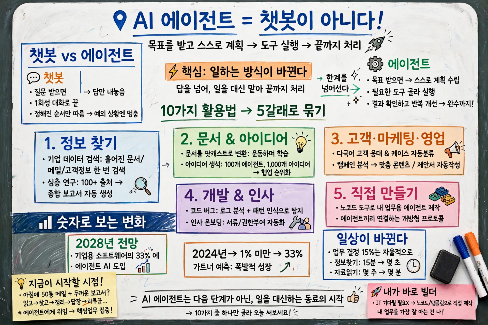
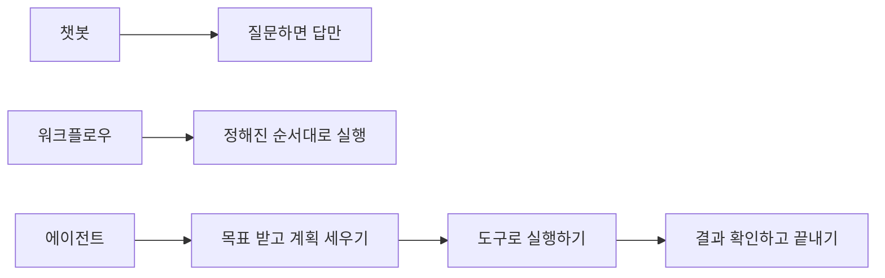
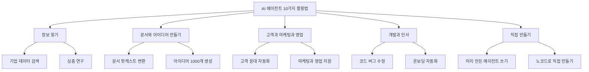

# AI 에이전트, 챗봇이 아니라 일을 대신하는 동료입니다

> **Summary**
> AI 에이전트는 챗봇처럼 답만 하는 것이 아니라 목표를 바탕으로 계획을 세우고 도구를 활용해 일을 끝까지 처리합니다. 기업 정보 검색, 문서 요약, 아이디어 생성, 고객 응대, 마케팅·영업, 코드 수정, 인사 업무 등 다양한 활용 사례가 있으며, 노코드 도구로 직접 만들 수도 있습니다. 2028년에는 기업용 소프트웨어의 33%에 에이전트 AI가 적용될 것으로 전망되는 만큼, 업무에 활용해볼 시점입니다.

---

- AI 에이전트는 챗봇이 아닙니다. 질문에 답하는 게 아니라 목표를 받고 스스로 계획하고 도구를 써서 일을 끝까지 처리합니다.
- 구글 핸드북이 정리한 활용법은 10가지입니다. 기업 데이터 검색, 문서 팟캐스트 변환, 아이디어 생성, 고객 응대, 마케팅, 영업, 코드 버그 수정, 인사 온보딩, 직접 에이전트 만들기까지, 일하는 방식 자체가 바뀝니다.
- 2028년이면 기업용 소프트웨어의 33%에 에이전트 AI가 들어간다고 합니다. 지금이 에이전트를 써보는 시점입니다!

아침에 출근해서 메일함을 열었는데, 답해야 할 메일이 수십 통 쌓여 있고, 오늘 안에 읽어야 할 보고서도 두꺼운 날이 있으시죠? 읽고, 찾고, 정리하고, 답장하고. 하루가 순식간에 지나갑니다. 그런데 구글 핸드북이 말하는 AI 에이전트는 여기서 한 걸음 더 나아갑니다. 질문에 답하는 걸 넘어, 일을 대신 맡아서 끝까지 처리한다는 겁니다!

🎥 [동영상 보기](https://www.youtube.com/watch?v=tQEq8ZS-4-8)

## 에이전트란 무엇인가요, 챗봇과 뭐가 다르죠?

챗봇은 질문을 받으면 답을 내놓습니다. 한 번의 주고받음이 전부입니다. 워크플로우는 정해진 순서를 따라 실행합니다. 정해진 길에서는 잘 돌아가지만, 예상 밖의 상황이 나오면 멈춥니다. 에이전트는 다릅니다. 목표를 받으면 스스로 계획을 세우고, 필요한 도구를 골라 실행하고, 결과를 확인합니다. 이 장면이 인상 깊었습니다. 모델이 똑똑한 게 아니라, 목표를 향해 스스로 움직인다는 점입니다!

## 10가지 활용법, 다섯 갈래로 묶으면?

핸드북은 활용법을 10가지로 정리했습니다. 다섯 갈래로 묶으면 한눈에 들어옵니다.

**정보 찾기**부터 시작합니다. 기업 데이터 검색은 여러 시스템에 흩어진 문서·메일·고객 정보를 한 번에 검색합니다. 심층 연구는 수백 개 출처를 훑어 종합 보고서를 만듭니다. 모르는 주제도 하루 종일 붙잡고 있지 않아도 됩니다.

**문서·아이디어 만들기**도 에이전트 몫입니다. 복잡한 문서는 팟캐스트 요약으로 바꿔 운동하면서 들을 수 있습니다. 아이디어 생성은 수백 개 에이전트가 1,000개 아이디어를 내고 협업으로 순위를 매깁니다. 몇 주 걸리던 브레인스토밍이 몇 분으로 줄어듭니다!

**고객·마케팅·영업**은 현장에서 바로 통합니다. 다국어 응대와 복잡한 케이스 분류를 자동화하고, 캠페인 성과를 분석해 맞춤형 콘텐츠를 만듭니다. 영업은 고객 정보를 한 번에 모아 제안서를 빠르게 만듭니다.

**개발·인사**도 빠지지 않습니다. 코드 버그는 로그 분석과 패턴 인식으로 찾고, 입사자 서류와 권한 부여 같은 온보딩 행정 업무를 자동화합니다.

**직접 만들기**가 마지막 활용법입니다. 미리 만든 에이전트를 골라 쓰거나, 노코드 도구로 내 업무에 맞는 에이전트를 직접 만들 수 있습니다.

## 숫자로 보는 변화, 얼마나 달라질까요?

숫자가 말해줍니다. 가트너는 2028년이면 기업용 소프트웨어의 33%에 에이전트 AI가 들어간다고 봤습니다. 2024년의 1% 미만에서 크게 뛰는 겁니다. 일상 업무 결정의 15%는 자율적으로 이뤄질 거라고 합니다. 현장 사례도 있습니다. 한 병원에서는 15분 걸리던 정보 찾기가 몇 초로 줄었습니다. 한 컨설팅 회사에서는 몇 주 걸리던 자료 읽기가 몇 분 만에 초기 인사이트로 바뀌었습니다. 근로자의 50%는 AI가 일상 업무를 자동화해 시간을 확보해준다고 답했습니다!

## 직접 만드는 길도 열려 있습니다, IT 부서에 줄 설 필요가 있을까요?

마지막 활용법이 가장 인상 깊었습니다. IT 부서에 줄을 서서 기다릴 필요가 없다는 겁니다. 미리 만든 에이전트 모음에서 골라 쓰거나, 노코드 도구로 내 업무에 맞는 에이전트를 직접 만들 수 있습니다. 개발자는 더 깊이 들어갈 수도 있습니다. 에이전트끼리 연결하는 개방형 프로토콜도 지원합니다. 내 업무를 가장 잘 아는 건 나 자신이라는 말이, 에이전트 시대에는 그대로 통합니다!

AI 에이전트는 챗봇의 다음 단계가 아닙니다. 일을 대신 맡는 동료의 시작입니다. 10가지 활용법 중 하나만 골라 오늘 써보는 건 어떨까요?

