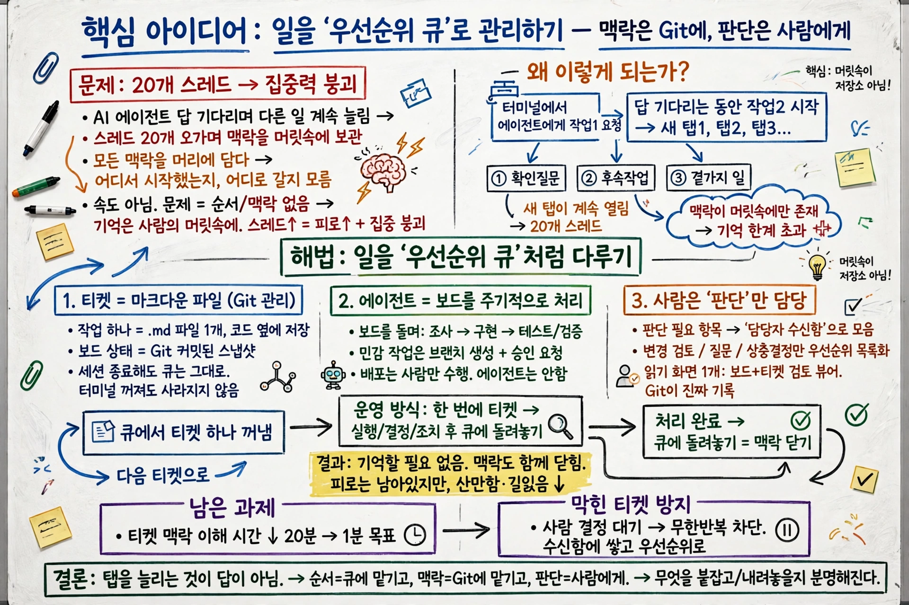
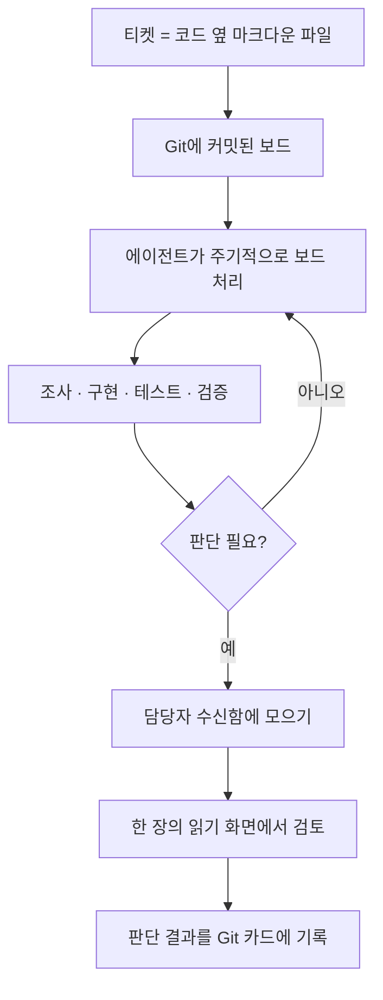

# AI 에이전트 20개가 머리를 터뜨린다면, 탭을 늘리지 말고 큐로 바꾸세요

> **Summary**
> AI 코딩 에이전트의 답을 기다리며 일을 늘리다 보면 어느새 스레드 20개를 오가며 맥락을 머릿속에 붙잡게 되고, 집중력이 무너집니다. 해법은 일을 우선순위 큐처럼 다루는 것입니다. 티켓을 코드 옆 마크다운 파일로 저장해 Git에 커밋하고, 에이전트는 보드를 돌며 조사·구현·검증을 맡기고, 사람의 판단이 필요한 항목만 수신함에 모읍니다. 한 번에 티켓 하나만 처리하고 큐에 돌려놓아 맥락까지 닫으면, 피로가 사라지지는 않지만 산만함과 길을 잃은 느낌은 줄어듭니다.

---

- AI 에이전트의 답을 기다리며 일을 늘리다 보면, 어느새 스레드 20개를 오가며 맥락을 머릿속에 붙잡게 됩니다. 집중력은 그 순간 무너집니다.
- 해법은 일을 우선순위 큐처럼 다루는 것입니다. 티켓을 코드 옆 마크다운 파일로 저장해 Git에 커밋하고, 에이전트는 보드를 돌며 조사·구현·검증을 맡기고, 사람의 판단이 필요한 항목만 수신함에 모읍니다.
- 한 번에 티켓 하나만 처리하고 큐에 돌려놓아 맥락까지 닫으면, 피로는 사라지지 않지만 산만함과 길을 잃은 느낌은 줄어듭니다.

터미널에서 에이전트에게 일을 하나 맡겼습니다. 답이 오기까지 시간이 걸리길래, 그 사이에 다른 일을 하나 더 시작했습니다. 그런데 첫 번째 답이 돌아왔는데, 확인 질문 하나, 후속 작업 하나, 곁가지 일 하나를 달고 왔습니다. 각각 새 탭이 필요했습니다. 이런 적 있으시죠?

두 번째 탭의 답도 도착했습니다. 오가다 보니 어느새 스레드 20개를 넘나들고 있었습니다. 모든 맥락을 머릿속에 붙잡고 있다가, 결국 머리가 지치고 집중력이 무너졌습니다. 어디서 시작했는지, 어디로 가야 하는지조차 흐릿해졌습니다.

🎥 [동영상 보기](https://www.youtube.com/watch?v=MPYUbQRxdjY)

## 문제는 속도가 아니라 순서와 맥락입니다

쉬어가라, 입력하기 전에 생각하라, 범위를 좁히라는 조언은 이미 많습니다. 그런데 한 개발자의 개인 실험은 다른 곳을 짚었습니다. 문제는 두 가지입니다. **순서**와 **맥락**입니다.

일을 시작하는 순서를 정해주는 장치가 없었고, 진행 중인 일의 맥락을 보관하는 장소도 없었습니다. 그래서 모든 맥락이 사람의 머릿속에 살았습니다. 머릿속은 저장소가 아닙니다. 스레드가 늘어날수록 기억해야 할 것이 늘어나고, 결국 머리가 먼저 지칩니다!

## 큐를 Git에 두면, 대화창이 죽어도 일은 남습니다

해법은 일을 **우선순위 큐**처럼 다루는 것입니다. 티켓 하나가 저장소 안의 마크다운 파일 하나입니다. 관련 코드 바로 옆에 두고, 보드 상태는 커밋된 스냅샷으로 남깁니다.

핵심 문장 하나만 기억하면 됩니다. **중요한 것은 대화창에도, 머릿속에도 두지 않는다!** 세션이 종료돼도 큐는 그대로 있습니다. 터미널이 꺼져도 작업 목록은 사라지지 않습니다.

## 에이전트는 보드를 돌고, 사람은 판단만 합니다

에이전트는 보드를 주기적으로 돌며 일합니다. 새 티켓을 조사하고, 사람이 안전하다고 표시한 작업을 구현하고, 테스트와 브라우저 확인을 수행합니다. 이미 배포된 항목도 검증합니다.

단, 선은 분명합니다. 민감한 코드에 손대는 작업은 브랜치에서 구현하고 먼저 승인을 요청합니다. 프로덕션 배포는 에이전트가 하지 않습니다. 배포는 사람이 직접 맡습니다!

에이전트가 할 수 없는 일이 하나 있습니다. 바로 **결정**입니다. 그래서 사람의 판단이 필요한 항목은 한곳에 모입니다. 이름하여 **담당자 수신함**입니다. 스크립트가 보드 전체를 읽고, 변경 검토·질문 응답·상충 관계에 대한 결정처럼 판단이 필요한 항목만 우선순위 목록으로 정리해 줍니다.

## 읽는 화면은 한 장, 기록의 기준은 Git입니다

판단할 때는 읽기 화면 하나만 봅니다. 보드 전체를 보여주는 페이지와 티켓별 검토 페이지가 한곳에 모인 화면입니다. 매 주기마다 Git에서 다시 생성되므로, 화면은 그저 뷰어일 뿐입니다.

터미널 기록을 거슬러 올라가 변경 맥락을 재구성할 필요가 없습니다. 링크 하나를 열어 무엇이 왜 구현됐는지 읽고, 판단을 내립니다. 판단 결과는 Git의 해당 카드에 기록합니다. **페이지는 뷰어일 뿐, 기록의 기준은 Git입니다!**

## 한 번에 하나, 닫는 것이 전부입니다

그리고 가장 중요한 부분이 옵니다. 한 번에 티켓 하나를 가져옵니다. 맥락을 파악하고, 결정을 내리거나 조치를 요청한 뒤, 큐에 돌려놓습니다.

큐에 돌려놓는 행위가 **작업을 닫는 장치**입니다. 티켓을 계속 기억해야 할 일로 남겨두지 않습니다. 맥락도 함께 닫힙니다. 다음 티켓을 고를 때 이전 맥락을 붙잡고 있을 필요가 없습니다. 한 번에 하나씩, 그것이 전부입니다!

이 방식을 쓰는 개발자의 말에 따르면, 일은 여전히 피로합니다. 하지만 산만하거나 길을 잃은 느낌은 없습니다. AI 도구를 활용한 생산성에서는 큰 진전이라고 느꼈다고 합니다.

## 남은 과제는 두 가지입니다

완성된 해법은 아닙니다. 남은 과제가 분명합니다.

첫째, 티켓의 맥락을 파악하는 시간입니다. 지금은 티켓 하나를 이해하는 데 20분이 걸릴 수 있습니다. 이것을 1분으로 줄이는 것이 목표입니다. 맥락을 이해하기 쉬운 형태로 제공하는 도구가 필요합니다.

둘째, 막힌 티켓의 무한 반복입니다. 사람만 내릴 수 있는 결정을 기다리며 막힌 티켓이 끝없는 반복에 빠지지 않도록 막아야 합니다.

## AI가 빨라질수록, 사람의 주의가 병목입니다

에이전트는 빨라졌습니다. 그런데 사람이 한 번에 붙잡을 수 있는 맥락은 늘어나지 않았습니다. 탭을 늘리는 것은 답이 아닙니다. 탭이 늘어날수록 머릿속에 쌓이는 맥락만 늘어납니다.

일의 순서를 큐에 맡기고, 맥락을 Git에 맡기고, 판단만 사람의 몫으로 남기는 방식은 어떨까요? 피로를 없애주지는 않습니다. 하지만 무엇을 붙잡고 있어야 하는지, 무엇을 내려놓아도 되는지 분명해집니다. 그리고 그 분명함이, AI와 함께 일할 때 가장 먼저 챙겨야 할 것이 아닐까요?

