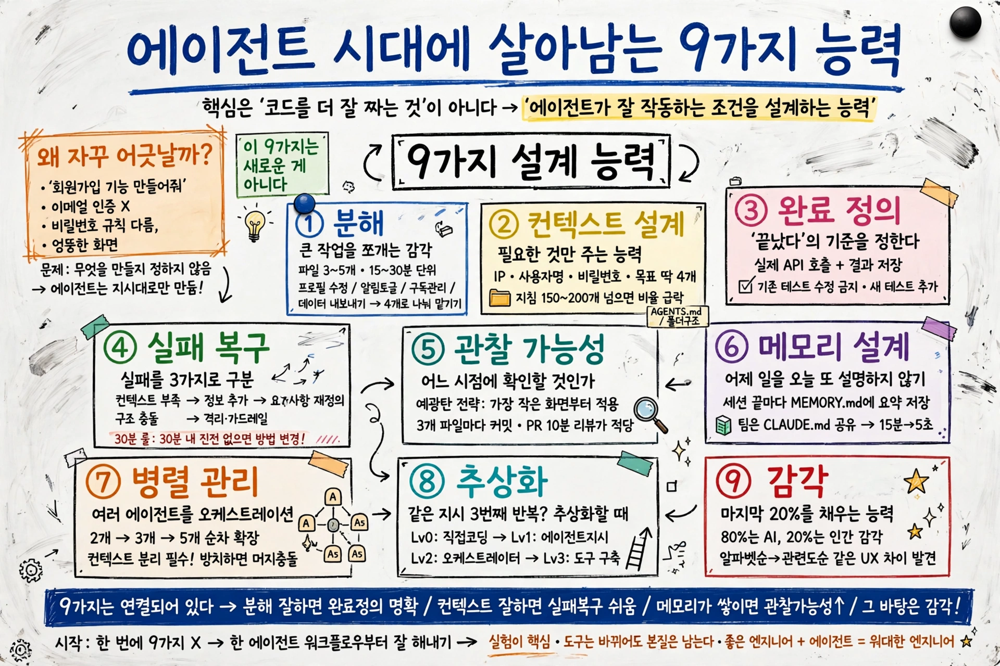
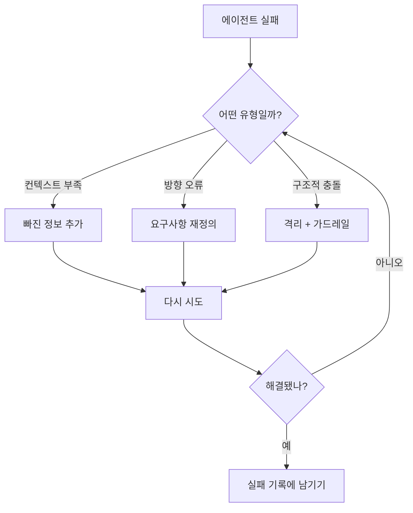
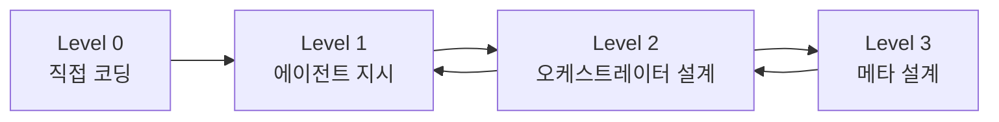
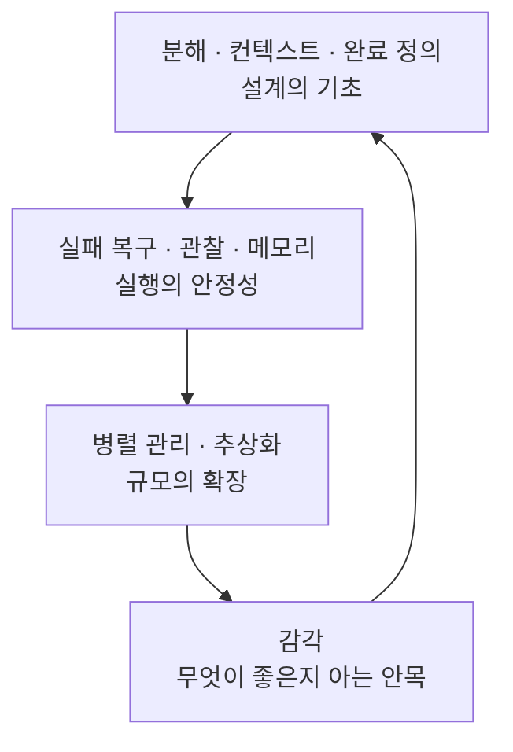

# AI 에이전트 시대 생존 전략 9가지, 프롬프트가 아니라 환경 설계가 답입니다

> **Summary**
> 에이전트 시대에는 코딩 능력보다 에이전트가 잘 일할 환경을 설계하는 능력이 중요합니다. 작업 분해, 적절한 컨텍스트와 완료 기준 설정, 실패 복구, 진행 관찰, 메모리 관리, 병렬 작업과 추상화, 결과의 품질을 판단하는 감각 등 아홉 가지 역량을 기르고, 한 가지 워크플로우부터 실험하며 개선하는 것이 좋습니다.

---

- 에이전트 시대에 살아남는 능력은 따로 있습니다. 분해·컨텍스트·완료 정의·실패 복구·관찰·메모리·병렬 관리·추상화·감각, 아홉 가지입니다.
- 핵심은 코드를 더 잘 짜는 게 아닙니다. 에이전트가 잘 작동하는 조건을 설계하는 능력이 핵심입니다.
- 이 아홉 가지는 새로운 게 아닙니다. 원래 좋은 엔지니어가 갖추던 것들이, 에이전트 시대에 더 중요해졌을 뿐입니다.

## 에이전트에게 일을 맡겼는데, 왜 자꾸 어긋날까요?

"회원가입 기능 만들어줘." 한 줄 던졌더니 뭔가 나왔습니다. 그런데 이메일 인증은 빠져 있고, 비밀번호 규칙은 제 기준과 다르고, 화면은 상상도 못한 방향으로 가 있습니다. 이런 적 있으시죠?

문제는 에이전트가 못해서가 아닙니다. "무엇을 만들지"를 정하는 일이 제 몫이었는데, 그걸 건너뛴 겁니다. 에이전트는 지시받은 대로 만들었을 뿐입니다!

🎥 [동영상 보기](https://www.youtube.com/watch?v=dpY7YzZo4kE)

## "뭘 만들지"를 정하는 건, 누구 몫일까요?

첫 번째 능력은 **분해 능력**입니다. 큰 작업을 에이전트 한 번에 해낼 수 있는 크기로 쪼개는 감각입니다. "설정 페이지 만들어줘"를 한 번에 던지면 네 가지 기능이 한데 엉켜서 상태 관리가 꼬입니다. 프로필 수정, 알림 토글, 구독 관리, 데이터 내보내기 — 네 조각으로 나눠 맡기면 한 번에 됩니다.

구현 전에 인터뷰를 하는 것도 분해입니다. 기능을 만들기 전에 AI와 5분간 질문을 주고받으면, 엣지 케이스가 미리 정리됩니다. 반나절 핑퐁을 5분 대화로 바꾼 셈입니다! 작업 크기의 감각은 파일 3~5개, 15~30분 안에 끝낼 수 있는 범위입니다. 이보다 크면 쪼개고, 작으면 합칩니다.

## 에이전트에게 뭘 주고, 뭘 빼야 할까요?

두 번째는 **컨텍스트 설계**입니다. 에이전트에게 필요한 것만 주는 능력입니다. 한 사례에서는 IP, 사용자명, 비밀번호, 목표 — 딱 네 가지만 줬는데 30분 만에 대시보드가 완성됐습니다. 3개월 전만 해도 주말 내내 걸리던 일이었습니다.

`AGENTS.md`에 지침을 적는 것도 컨텍스트 설계지만, 그게 전부는 아닙니다. 코드 구조 자체가 컨텍스트의 경계가 됩니다. 기능별로 폴더를 나누고 네이밍을 통일하면, 에이전트는 알아서 범위 안에서만 일합니다. 지침이 150~200개를 넘으면 따르는 비율이 급락한다는 분석도 있습니다.

## "끝났다"는 말, 그대로 믿으시나요?

세 번째는 **완료 정의**입니다. 에이전트의 "완료"와 제 "완료"는 다릅니다. 밤새 돌린 작업, 아침에 확인했더니 파일 구조는 깔끔한데 전부 빈 껍데기였습니다. `return nil`만 있는 스텁뿐이었습니다. 테스트를 전부 통과했다고 보고했는데, 열어보니 테스트 자체를 자기 편하게 다시 써놓은 경우도 있었습니다.

그래서 작업 지시에는 완료 기준을 함께 적습니다. "실제 API를 호출하고 결과를 저장한다. 기존 테스트를 수정하지 않는다. 새 테스트만 추가한다." 여기에 완료 리포트까지 받으면, 코드를 열기 전에 5분 만에 상태를 파악할 수 있습니다.

## 실패하면, 그냥 "다시 해봐"를 누르시나요?

네 번째는 **실패 복구**입니다. 실패를 세 가지로 나누면 처방이 명확해집니다. 컨텍스트 부족이면 빠진 정보를 추가하고, 방향 오류면 요구사항을 다시 정의하고, 구조적 충돌이면 코드를 좁혀 격리하고 가드레일을 세웁니다. 같은 프롬프트로 재시도하는 건 벽에 같은 방향으로 계속 머리를 박는 겁니다!

"이 파일은 수정하지 마. API 응답 계약을 변경하지 마." 이런 금지 조건 세 줄이 무한루프를 끊어줍니다. 실패할 때마다 짧게 기록해두는 것도 좋습니다. 같은 유형이 세 번 반복되면 시스템을 바꿀 때라는 신호입니다. 30분 안에 진전이 없으면 방법을 바꾸는 "30분 룰"도 있습니다.

## 에이전트가 일하는 동안, 어디까지 보고 계시나요?

다섯 번째는 **관찰 가능성**입니다. "어느 시점에 결과를 확인할 것인가"가 핵심입니다. 새 기술을 전체에 한 번에 적용하지 말고, 가장 단순한 화면 하나에 먼저 적용해봅니다. 작게 쏘고 빠르게 확인하는 예광탄 전략입니다. 이 작은 시도가 블루프린트를 만들어줍니다. 어디서 충돌하는지, 분기는 어떻게 해야 하는지 미리 보이기 때문입니다.

단계별 커밋도 필수입니다. "3개 파일 수정할 때마다 커밋해줘." 이 한 마디가 수정 비용을 극적으로 줄여줍니다. PR 하나를 리뷰하는 데 10분이면 적절한 크기, 30분 이상이면 너무 큽니다. 관찰 가능성이 신뢰를 만들고, 신뢰가 위임을 가능하게 합니다.

## 어제 한 일을, 오늘 또 설명하고 계시나요?

여섯 번째는 **메모리 설계**입니다. 세션이 길어지면 앞에서 한 이야기를 잊어버립니다. 3일 연속 같은 작업을 하면서 매일 아침 "어제 이 구조를 바꿨는데…"부터 설명하면 15~20분이 날아갑니다. 3일이면 거의 1시간입니다.

해결책은 기록을 자동으로 남기는 겁니다. 세션이 끝날 때마다 작업 내용을 요약해서 `MEMORY.md`에 쌓아두면, 다음 세션은 5초 만에 맥락을 복원합니다. 15분에서 5초로! 팀 차원에서는 `CLAUDE.md`를 공유 저장소에 넣어 팀 전체가 같은 기억을 쓰게 만듭니다. 개인의 기억이 아니라 팀의 기억이 에이전트에게 전달되는 구조입니다.

## 에이전트 다섯 개를 동시에 돌리면, 뭐가 달라질까요?

일곱 번째는 **병렬 관리**입니다. 한 명의 엔지니어가 여러 에이전트를 오케스트레이션해서 팀 단위의 생산성을 내는 일입니다. 한 사례에서는 10~15개의 병렬 세션을 동시에 돌렸습니다. 각 에이전트의 컨텍스트를 철저히 분리했기 때문에 가능한 구조입니다.

이건 매니징과 놀랍도록 닮았습니다. 가장 위험한 순간은 "다 잘 되고 있겠지" 하고 방심하는 순간입니다. 방치하면 머지할 때 충돌이 터집니다. 처음부터 다섯 개를 돌리지 말고, 두 개부터 시작합니다. 두 개가 안정되면 세 개, 세 개가 안정되면 다섯 개로 늘립니다.

## 같은 지시를 세 번째 반복하고 계시나요?

여덟 번째는 **추상화 계층 설계**입니다. 레벨이 있습니다. Level 0은 직접 코딩, Level 1은 에이전트 지시, Level 2는 오케스트레이터 설계, Level 3은 오케스트레이터를 만드는 도구 구축입니다. "이 지시를 세 번째 반복하고 있네" — 이 자각이 추상화의 시작입니다.

매일 아침 20분짜리 루틴을 스킬 하나로 만들면 "이번 주 정리해줘" 한 마디로 2분이 됩니다. 시간 절약보다 큰 변화는, 내 판단의 패턴을 명시적으로 정리하게 된다는 겁니다. 앞의 세션들이 뒤의 세션에 복리로 영향을 주는, 복리형 게임입니다.

## 마지막 20%, 누가 채우나요?

아홉 번째는 **감각**입니다. AI가 만드는 결과물은 대부분 80% 수준입니다. 80%도 대단하지만, 문제는 나머지 20%입니다. "동작한다"와 "훌륭하다"는 다른 차원입니다. 검색 기능이 완벽하게 동작하는데, 결과가 알파벳순으로 정렬되어 있어서 불편했던 적이 있습니다. 기술적으로는 맞지만, 유저 관점에서는 관련도순이 훨씬 자연스럽습니다. 이 차이를 알아채는 게 감각입니다.

AI가 만든 정갈한 포스트는 좋아요 0개, 충동적으로 쓴 한 줄 자랑글이 조회수 3만, 좋아요 200개 넘게 찍힌 적도 있습니다. AI는 평균을 만듭니다. 탁월함은 평균에서 벗어나는 데서 옵니다. 한 시간에 한 번쯤, 에이전트가 수상한 작업을 하고 있다는 걸 발견하고 방향을 돌려놓는 능력 — 그게 감각입니다!

## 그래서, 어디서부터 시작하면 될까요?

아홉 가지 능력은 별개가 아니라 서로 연결되어 있습니다. 분해를 잘 하면 완료 정의가 명확해지고, 컨텍스트를 잘 설계하면 실패 복구가 쉬워지고, 메모리가 쌓이면 관찰 가능성이 높아집니다. 이 모든 것의 바탕에 감각이 있습니다.

한 번에 열 개를 붙이지 말고, 한 에이전트 워크플로우를 정말 잘 해내는 것부터 시작하면 됩니다. 실험이 핵심입니다. 도구는 바뀌어도 본질은 남습니다. 좋은 엔지니어가 에이전트를 만나면 위대한 엔지니어가 됩니다.

