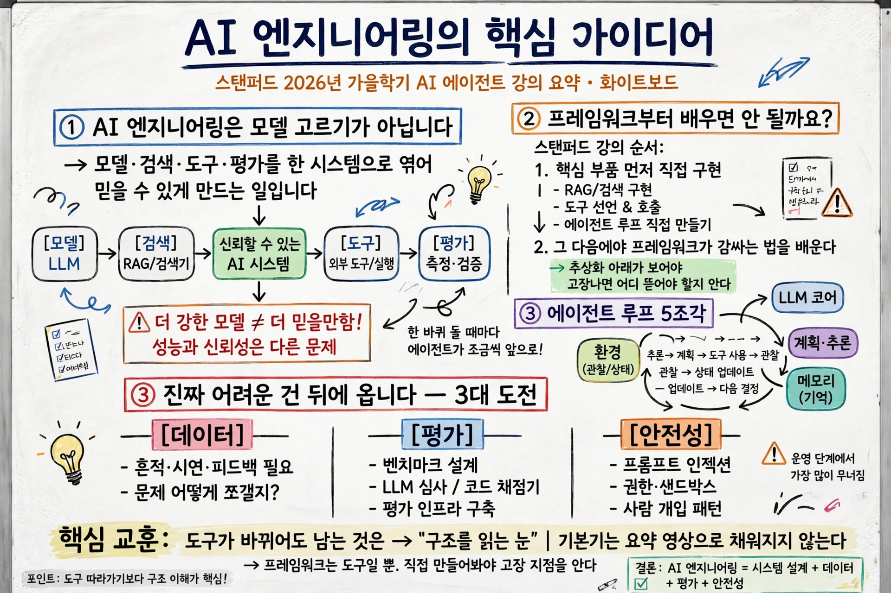
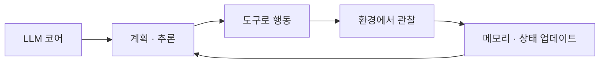
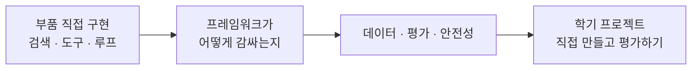

# AI 엔지니어링, 도구부터 배우면 안 됩니다. 부품을 직접 만들어 봐야 합니다

> **Summary**
> AI 엔지니어링은 모델을 잘 고르는 일이 아니라, 모델·검색·도구·평가를 한 시스템으로 엮어 믿을 수 있게 만드는 일입니다. 스탠퍼드 강의는 프레임워크부터 가르치지 않습니다. 검색·도구·에이전트 루프를 직접 만든 뒤에야 프레임워크가 그걸 어떻게 감싸는지 봅니다. 진짜 어려운 부분은 뒤에 옵니다. 데이터, 평가, 안전성입니다. 운영 단계에서 가장 많이 무너지는 세 가지입니다.

---

- AI 엔지니어링은 모델을 잘 고르는 일이 아닙니다. 모델·검색·도구·평가를 한 시스템으로 엮어 믿을 수 있게 만드는 일입니다.
- 스탠퍼드 강의는 프레임워크부터 가르치지 않습니다. 검색·도구·에이전트 루프를 직접 만든 뒤에야 프레임워크가 그걸 어떻게 감싸는지 봅니다.
- 진짜 어려운 부분은 뒤에 옵니다. 데이터, 평가, 안전성입니다. 운영 단계에서 가장 많이 무너지는 세 가지입니다.

에이전트 프레임워크가 새로 나올 때마다 갈아타 본 적 있으시죠? 이번 달엔 이게 대세라는데, 다음 달엔 또 다른 이름이 들립니다.

그런데 도구를 따라가다 보면 정작 중요한 걸 놓치기 쉽습니다. 이 구조가 왜 동작하는지, 어디서 실패하는지, 결과를 어떻게 평가해야 하는지 말이죠. 스탠퍼드에서 2026년 가을학기에 새로 연 AI 에이전트 강의가 던지는 질문도 바로 그겁니다. AI 엔지니어링, 도대체 뭘까요?

🎥 [동영상 보기](https://www.youtube.com/watch?v=DGI4vucR71w)

## AI 엔지니어링은 모델 고르기가 아닙니다

이 강의가 출발하는 지점은 모델이 아닙니다. 거대한 언어 모델 하나에서, 여러 부품이 맞물려 돌아가는 **복합 AI 시스템**으로 시선이 옮겨갔습니다. 모델, 검색기, 도구, 최적화가 한 시스템 안에서 함께 일하는 구조 말이죠.

에이전트는 그 시스템이 스스로 다음 단계를 고르는 형태입니다. 해부도를 그리면 다섯 조각이 나옵니다. 중심에 있는 `LLM` 코어, 일을 단계로 쪼개는 계획·추론, 지난 일을 기억하는 메모리, 바깥과 연결되는 도구, 그리고 에이전트가 보고 만지는 환경입니다.

돌아가는 순서는 단순합니다. 추론하고 계획합니다. 도구를 써서 행동합니다. 결과를 관찰합니다. 상태를 업데이트하고 다음을 정합니다. 이 루프가 한 바퀴 돌 때마다 에이전트는 조금씩 앞으로 갑니다!

여기서 놓치면 안 되는 대목이 있습니다. 더 강한 모델이 에이전트를 더 믿을 만하게 만들지는 않습니다! 성능과 신뢰성은 다른 문제입니다. 1강에서 가장 먼저 짚는 경고가 바로 이겁니다.

## 왜 프레임워크부터 배우면 안 될까요?

강의의 순서가 이 글의 핵심입니다. `RAG`, 도구 사용, 에이전트 루프 같은 핵심 부품을 먼저 직접 구현해 봅니다. 그다음에야 프레임워크가 이 패턴들을 어떻게 감싸는지 배웁니다.

첫 번째 과제가 그 순서를 그대로 보여줍니다. 프레임워크 없이 에이전트 하네스를 직접 만드는 겁니다. 도구를 선언하고, 모델의 답을 파싱하고, 명령을 실행하고, 맥락을 관리하는 층을 손으로 짜 봅니다. 두 번째 과제는 평가입니다. 코드 채점기와 `LLM` 심사, 벤치마크 과제를 직접 만들어 에이전트를 재 봅니다.

프레임워크부터 배우면 추상화 아래가 안 보입니다. 뭔가 안 될 때 어디를 뜯어야 할지 모른 채 설정만 만지게 됩니다. 직접 만들어 본 사람은 다릅니다. 어디가 부서졌는지, 왜 부서졌는지, 손대야 할 곳이 어디인지 압니다!

## 진짜 어려운 건 뒤에 옵니다

강의는 세 가지 기둥으로 짜여 있습니다. 데이터, 시스템, 평가입니다. 그리고 세 가지 도전을 정면으로 꼽습니다. 문제를 어떻게 쪼갤 것인지, 어떤 데이터가 필요한지, 어떻게 평가할 것인지 말이죠.

후반부는 그래서 더 무겁습니다. 에이전트에 필요한 데이터는 흔적·시연·피드백입니다. 평가는 벤치마크 설계와 `LLM` 심사, 평가 인프라까지 들어갑니다. 안전성은 도구 접근의 프라이버시, 프롬프트 인젝션, 샌드박스와 권한 모형, 사람 개입 패턴을 다룹니다.

게스트 강의도 같은 방향을 가리킵니다. 벤치마크를 만든 팀들이 직접 나와서 평가가 왜 어려운지 이야기합니다. 만드는 법보다 재는 법이 먼저라는 뜻 아닐까요?

## 기본기는 요약 영상으로 안 채워집니다

새 도구를 빨리 익히는 건 분명 중요합니다. AI 관련 서비스와 프레임워크는 지금도 매일 새로 나옵니다. 그런데 속도를 따라가다 보면 기본기가 빠지기 쉽습니다. 이 구조가 왜 동작하는지 모른 채 도구만 바꿔 가는 방식은 오래가지 못합니다!

요약 영상이나 짧은 글로는 채워지지 않는 부분이 있습니다. 좋은 강의를 처음부터 끝까지 직접 듣는 것, 그게 기본기를 쌓는 가장 확실한 방법입니다. 혼자 듣는 것보다 함께 듣고 각자의 프로젝트 경험에 비춰 이야기 나누면 더 좋습니다.

이 글과 앞선 글들의 차이도 짚어둘 만합니다. 하네스 6계층 가이드는 만드는 방법을, 루프 설계 글은 출시 방식을 다뤘습니다. 이 글은 그 앞단입니다. AI 엔지니어링이라는 분야 자체가 무엇이고, 어떤 순서로 배워야 하는지 말이죠.

강의 홈페이지와 1강 영상은 공개되어 있어 직접 읽어봤습니다. 1강 영상은 공개된 지 얼마 안 돼 9만 회를 넘겼다고 전해집니다. 관심 있는 분들은 1강부터 차근차근 따라가 보시면 좋겠습니다.

도구가 바뀌어도 남는 건 구조를 읽는 눈입니다. 그 눈은 직접 만들어 봐야 생깁니다.

