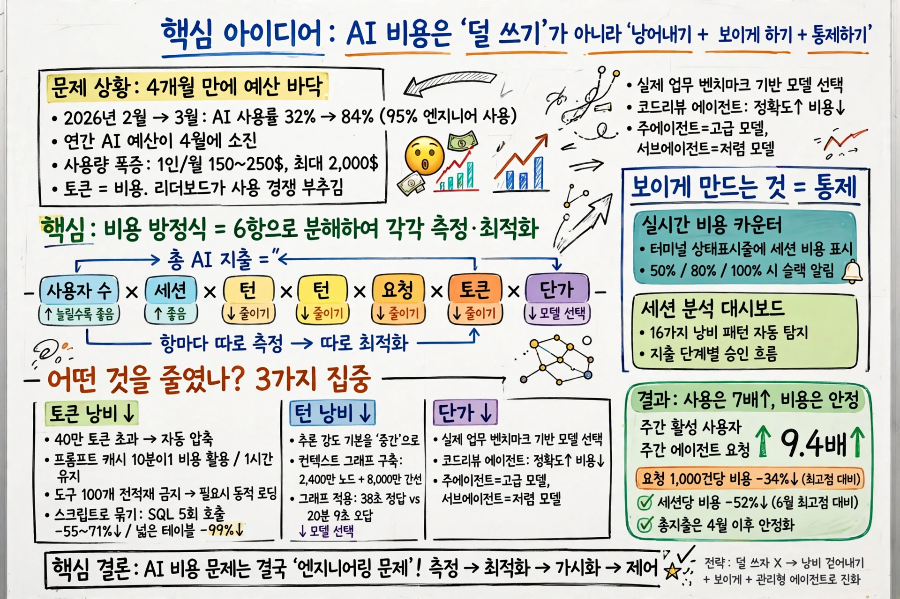
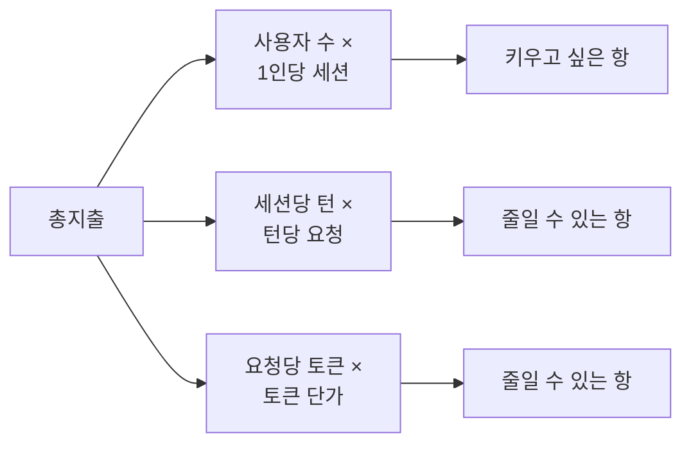
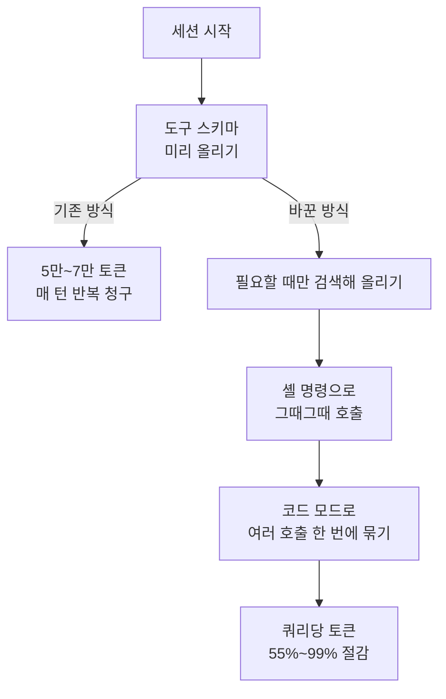

# AI 예산 넉 달 만에 소진, 우버는 덜 쓰는 대신 낭비를 걷어냈습니다

> **Summary**
> 우버는 AI 사용량을 줄이는 대신 비용을 사용자 수, 세션, 턴, 요청, 토큰, 단가로 나눠 측정하고, 모델 선택·컨텍스트 압축·프롬프트 캐시·도구 호출 최적화와 실시간 비용 가시화로 낭비를 줄였습니다. 그 결과 AI 사용량이 7배 늘어나는 동안 요청 1,000건당 비용은 34%, 세션당 비용은 52% 감소해 지출을 안정시켰습니다.

---

- 연간 AI 예산을 넉 달 만에 소진했던 우버는, 사용량을 줄이지 않고 낭비되는 토큰을 걷어내 지출을 안정시켰습니다.
- 핵심은 비용 방정식입니다. 사용자 수 × 세션 × 턴 × 요청 × 토큰 × 단가를 여섯 항으로 나눠, 곱해지는 항마다 따로 측정하고 따로 줄였습니다.
- 사용량이 7배로 늘어나는 동안 요청 1,000건당 비용은 34%, 세션당 비용은 52% 줄었습니다. AI 비용 문제는 결국 엔지니어링 문제였습니다!

새 AI 코딩 도구를 팀에 깔았는데, 한 달 뒤 청구서를 보고 깜짝 놀란 적 있으시죠? 도구는 잘 돌아가는데, 예산은 생각보다 훨씬 빨리 줄어듭니다. 우버가 2026년에 딱 그 상황을 겪었습니다. 연간 AI 예산이 4월에 바닥났습니다.

🎥 [동영상 보기](https://www.youtube.com/watch?v=17-YSUHo6Lk)

## 예산은 왜 넉 달 만에 바닥났을까요?

2025년 12월, 우버는 약 5,000명의 엔지니어에게 AI 코딩 도구를 보급했습니다. 도입 속도가 무서웠습니다. 2026년 2월 32%였던 에이전트 코딩 사용률은 3월에 84%까지 치솟았습니다. 봄이 되자 엔지니어의 95%가 매달 AI 도구를 썼고, 커밋되는 코드의 약 70%가 AI 시스템에서 나왔습니다.

비용은 사람 수가 아니라 사용량으로 불어났습니다. 월평균 인당 150~250달러, 많이 쓰는 사람은 2,000달러까지 나왔습니다. 토큰은 쓸 때마다 돈이 됩니다. 게다가 내부에는 사용량 순위를 매기는 리더보드까지 있었다고 합니다. 경쟁이 사용을 부추긴 셈입니다. 보도에 따르면 이후 도구별로 월 1,500달러 상한이 생겼습니다.

> 예산은 사람 수 기준으로 세웠는데, 비용은 행동량 기준으로 불어났습니다. 이 간극이 바로 문제의 본질이었습니다.

## 비용을 여섯 조각으로 나누면 무엇이 보일까요?

우버는 총지출을 여섯 항이 곱해지는 방정식으로 나눴습니다. 사용자 수, 1인당 세션, 세션당 턴, 턴당 요청, 요청당 토큰, 토큰 단가입니다. 앞의 두 항은 키우고 싶은 것입니다. 사용자가 늘고 세션이 느는 건 좋은 신호니까요. 가운데 세 항이 최적화의 대상이었습니다. 단가는 벤더가 정하니, 어떤 모델을 고르느냐로 대응했습니다.

항을 나누면 "왜 숫자가 움직였는지"를 정확히 말할 수 있습니다. 도입이 늘어서인지, 턴이 늘어서인지, 토큰이 불어서인지. 설명되지 않는 나머지가 없어야 대책을 세울 수 있습니다.

## 모델 선택은 벤치마크가 정합니다

모델 선택은 실제 업무로 만든 벤치마크에서 출발했습니다. 비용, 품질, 안정성을 함께 보고 가장 효율적인 지점을 찾았습니다. 코드 리뷰를 맡은 에이전트 사례가 대표적입니다. 실제 풀 리퀘스트로 만든 벤치마크에서 모델을 바꾸자 결함 탐지 정확도는 오르고 리뷰당 비용은 크게 줄었습니다.

기본값도 손댔습니다. 주 모델이 작업을 나누고 평가하면, 서브에이전트는 정해진 일을 실행합니다. 서브에이전트에는 약하지만 저렴한 모델을 기본값으로 뒀습니다. 세션에서 서브에이전트를 쓰는 비율이 계속 늘고 있었기 때문에, 이 기본값 하나가 전체 비용을 크게 움직였습니다.

## 토큰은 어디서 새고 있었을까요?

에이전트는 매 턴마다 전체 대화 기록을 다시 모델에 보냅니다. 컨텍스트가 커질수록 매 단계가 비싸집니다. 우버는 40만 토큰에서 자동 압축이 걸리도록 했습니다. 100만 토큰 창을 가진 모델도 마찬가지입니다. 압축은 앞의 대화를 요약해서 세션을 이어가게 합니다. 추론 강도도 기본값을 중간으로 낮췄습니다. 출력 토큰은 입력보다 몇 배 비싸기 때문입니다.

프롬프트 캐시도 손봤습니다. 캐시에 남은 앞부분은 표준 요금의 10분의 1로 읽을 수 있습니다. 엔지니어는 세션을 자주 비워두기 때문에, 메인 에이전트의 캐시 유효기간을 1시간으로 늘렸습니다. 짧은 일을 하는 서브에이전트는 5분으로 뒀습니다.

도구 연결 방식도 바꿨습니다. 100개가 넘는 도구를 미리 올리면 세션 시작부터 5만~7만 토큰이 들어갑니다. 그래서 도구는 필요할 때만 검색해서 올리고, 나머지는 셸 명령으로 그때그때 부릅니다. 외부 서비스 도구도 같은 게이트웨이 뒤에 뒀습니다. 도구를 하나씩 부르는 대신 스크립트로 묶는 코드 모드도 도입했습니다. 같은 SQL 쿼리 5개를 재보니 토큰이 55%에서 71% 줄었고, 넓은 테이블 조회는 99% 이상 줄었습니다!

## 에이전트가 헤매는 시간도 비용일까요?

네, 그렇습니다. 에이전트는 코드 작성보다 정보를 찾는 데 턴을 더 많이 씁니다. 우버는 2,400만 개 노드와 8,000만 개 간선을 가진 컨텍스트 그래프를 만들었습니다. 30개가 넘는 내부 시스템의 서비스, 팀, 사고 기록, 풀 리퀘스트, 설계 문서를 하나로 엮은 지도입니다.

같은 질문을 던져봤습니다. 그래프를 쓴 에이전트는 38초 만에 정답을 냈습니다. 안 쓴 에이전트는 20분 9초를 헤매다 오답을 냈습니다. 헤매는 턴마다 토큰이 나가는데, 정답도 못 냈으니 이중 손해였습니다. 정보를 앞에 풍부하게 주는 게 턴을 줄이는 가장 강력한 방법입니다.

이 대목이 저는 가장 와닿았습니다. 비용을 줄이는 기술보다, 에이전트가 헤매지 않게 만드는 지도가 먼저였다는 점이요!

## 보이게 만드는 게 먼저입니다

그렇습니다. 우버는 터미널 상태 표시줄에 실시간 비용 카운터를 달았습니다. 세션 비용이 항상 눈에 보입니다. 예상 지출의 50%, 80%, 100% 지점에서는 슬랙 알림이 옵니다. 무작정 상한을 두는 대신, 지출 단계와 승인 흐름을 뒀습니다. 매니저 승인을 받으면 단계를 올릴 수 있습니다.

세션 분석 대시보드도 있습니다. 세션 기록을 직접 뜯어 16가지 낭비 패턴을 짚어줍니다. 간단한 일을 비싼 모델로 돌리는 경우, 4만 바이트짜리 도구 응답이 컨텍스트에 남아 매 턴 청구되는 경우, 캐시가 만료된 채 세션을 재개하는 경우처럼요. 패턴마다 금액과 고치는 방법까지 붙어 있습니다. 보이니까 고칠 수 있는 겁니다!

## 결과는 어땠을까요?

2026년 2월부터 8월까지 주간 활성 사용자는 7배, 주간 에이전트 요청은 9.4배 늘었습니다. 그런데 총지출은 4월 이후 비교적 안정됐습니다. 같은 모델로 고정해 재보니, 요청 1,000건당 비용은 최고점 대비 약 34%, 세션당 비용은 6월 최고점 대비 52% 줄었습니다. 풀 리퀘스트의 70% 이상이 에이전트에서 나오고, 3,600개가 넘는 에이전트 스킬이 하루 3만 번 넘게 실행됩니다.

우버의 다음 방향은 대화형 세션에서 관리형 에이전트로 옮기는 것입니다. 관리형 에이전트에서는 모델 선택, 실행 방식, 지출을 전부 통제할 수 있기 때문입니다. AI 비용을 잡는 답은 "덜 쓰자"가 아니었습니다. 낭비를 걷어내고, 보이게 만들고, 통제 가능한 곳으로 옮기는 것이었습니다!

