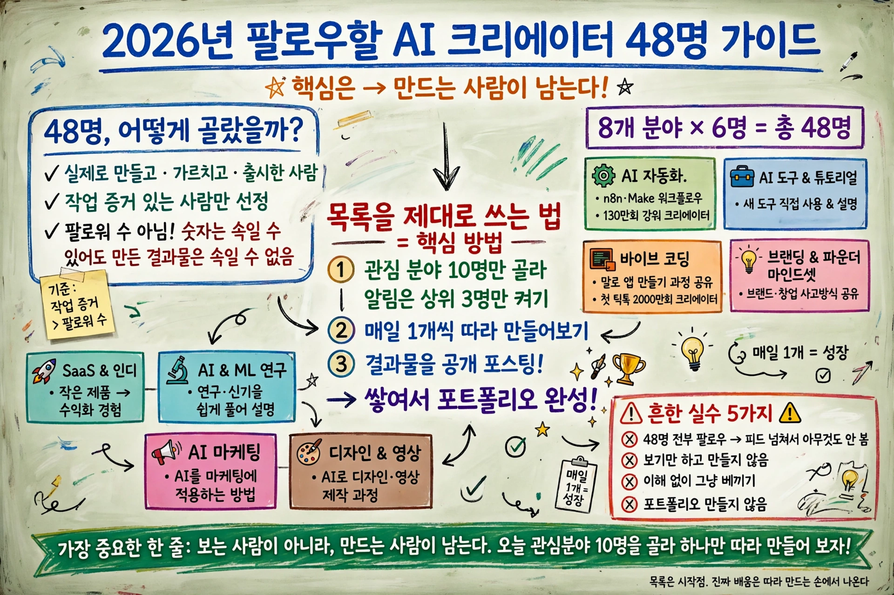
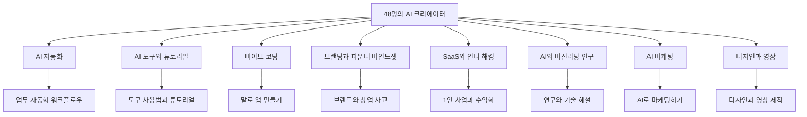
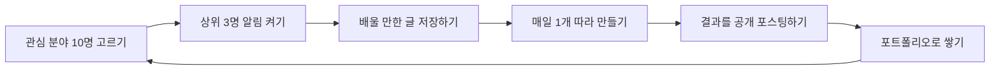
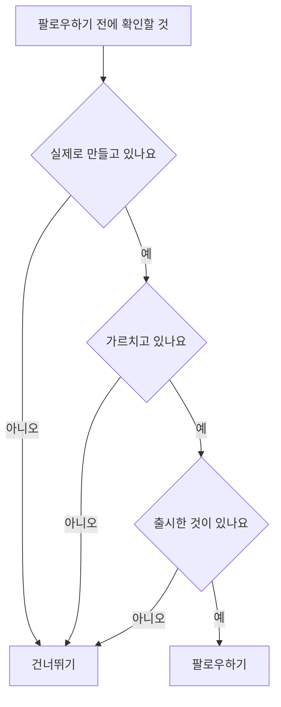

# AI 크리에이터 48명, 팔로우가 아니라 따라 만드는 게 먼저입니다

> **Summary**
> 2026년에 주목할 AI 크리에이터 48명을 자동화, 도구·튜토리얼, 바이브 코딩 등 8개 분야로 소개합니다. 팔로워 수보다 실제 제작·교육·출시 경험을 기준으로 골랐으며, 모두 팔로우하기보다 관심 분야에서 10명을 선택해 매일 하나씩 따라 만들고 결과를 공개해 포트폴리오로 쌓는 것이 핵심입니다.

---

- 2026년에 팔로우할 AI 크리에이터 48명은 실제로 만들고, 가르치고, 출시하는 사람들로 골랐습니다. 자동화·도구·바이브 코딩 등 8개 분야로 나뉩니다.
- 고르는 기준은 팔로워 수가 아니라 작업 증거입니다. 프로젝트를 보여주고, 도구를 공유하고, 과정을 기록하는 사람이어야 합니다.
- 48명을 전부 팔로우하는 건 실수입니다. 관심 분야 10명만 골라 알림을 켜고, 매일 하나씩 따라 만들어 공개하는 게 이 목록을 제대로 쓰는 방법입니다.

AI를 공부하려고 인스타그램을 켰는데, 30분이 지나도 남은 건 스크롤한 기억뿐인 적 있으시죠? 매일 새로운 도구가 쏟아지는데, 정작 뭘 봐야 할지 모르겠다는 분이 많습니다. 이 글은 그런 분을 위해 2026년에 팔로우할 만한 AI 크리에이터 48명을 분야별로 정리한 목록을 소개합니다!

🎥 [동영상 보기](https://www.youtube.com/watch?v=TeowUOtmEwA)

## 48명, 어떻게 골랐을까요?

이 목록의 기준은 딱 세 가지입니다. 실제로 만들고 있는지, 가르치고 있는지, 출시한 것이 있는지입니다. 말만 하는 사람이 아니라 작업 증거가 있는 사람을 골랐다는 뜻입니다. 팔로워 수는 기준이 아니었습니다. 숫자는 속일 수 있지만, 만든 결과물은 속이지 못합니다!

목록은 8개 분야로 나뉘고, 분야마다 6명씩 모두 48명입니다. AI 자동화, AI 도구와 튜토리얼, 바이브 코딩, 브랜딩과 파운더 마인드셋, SaaS와 인디 해킹, AI와 머신러닝 연구, AI 마케팅, 디자인과 영상이 그 8개 분야입니다.

## 분야별로 누구를 봐야 할까요?

관심 분야부터 정하는 게 순서입니다. 분야별로 6명씩, 이름만 모아봤습니다.

**AI 자동화**: 닉 사라예프, 케이본 자파르자데, 사브리나 라모노프, 체이스 H, 네이트 허크, 닉 퍼칙키. `n8n`과 `Make`로 업무 워크플로우를 짜는 법을 보여주는 사람들입니다. 6시간짜리 `n8n` 강의가 130만 회 넘게 본 자동화 크리에이터도 이 분야에 있습니다.

**AI 도구와 튜토리얼**: 바룬 마야, 비슈누 비자얀, 네이선 호지슨, 질 니킬 자인, 애덤 스튜어트, 쿠샨크 아가르왈. 새 도구가 나오면 직접 써 보고 사용법을 알려주는 사람들입니다.

**바이브 코딩**: 라일리 브라운, 매버릭 몰틴, 가야트리 아그라왈, 크리스 쉬어, 잭 프라이스, 산조그 보라. 말로 앱을 만드는 과정을 그대로 보여주는 사람들입니다. 이 분야의 대표 주자는 `ChatGPT` 출시 당일 올린 첫 틱톡 영상이 2,000만 회 넘게 본 크리에이터입니다!

**브랜딩과 파운더 마인드셋**: 베디카 바이아, 요니 스몰리아, 로이 리, 캣 괴체, 존 후, 찰리 힐스. 브랜드를 만들고 창업자의 사고방식을 나누는 사람들입니다.

**SaaS와 인디 해킹**: 스타터 스토리, 시리오 베라티, 유리 시시킨, 마르코 필리포비치, 리암 존스턴, 스티븐 빌즈. 작은 제품을 만들어 수익까지 연결한 경험을 공유하는 사람들입니다.

**AI와 머신러닝 연구**: 티파니 얀젠, 마리아나 안타야, 아이슈와리아 스리니바산, 클레어 조우, 하퍼 캐롤, 파스. 연구와 신기술을 쉽게 풀어 설명하는 사람들입니다.

**AI 마케팅**: 그렉 아이젠버그, 수프라바 사밧, 제이슨 쿠퍼슨, 디뱐시 샤르마, 아푸르브 싱, 리시 자인. AI를 마케팅에 적용하는 방법을 나누는 사람들입니다.

**디자인과 영상**: 로크, 세바스티앙, 아드리안 쿨레조, 시모네 페레티, 조 멘데스, 아드리앵 니네. AI로 디자인하고 영상을 만드는 과정을 보여주는 사람들입니다.

## 목록을 제대로 쓰는 법은요?

목록을 받는 것과 목록으로 배우는 건 다릅니다. 목록을 제대로 쓰는 방법은 단순합니다. 처음부터 48명을 다 팔로우하지 않습니다. 관심 분야 10명까지만 고르고, 그중 상위 3명에게만 알림을 켭니다. 배울 만한 글은 저장해 두고, 매일 1개씩 따라 만들어 봅니다. 그리고 결과를 공개 포스팅으로 남깁니다. 이렇게 쌓인 작업물이 포트폴리오가 됩니다!

## 흔한 실수는 무엇일까요?

가장 흔한 실수는 48명을 전부 팔로우하는 것입니다. 피드가 넘쳐서 아무것도 안 보게 됩니다. 두 번째는 보기만 하고 만들지 않는 것입니다. 세 번째는 이해 없이 베끼는 것이고, 네 번째는 유행을 좇는 것입니다. 다섯 번째는 포트폴리오를 안 만드는 것입니다. 보다 보면 알겠지만, 이 목록의 결론은 하나입니다. 보는 사람이 아니라 만드는 사람이 남는다는 것입니다!

목록은 시작점일 뿐입니다. 진짜 배움은 따라 만드는 손에서 나옵니다. 관심 분야 10명을 골라 오늘 하나만 따라 만들어 보시면 어떨까요?

