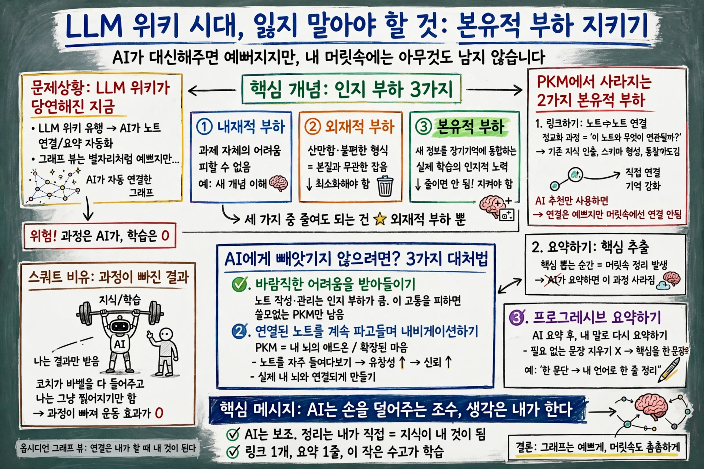
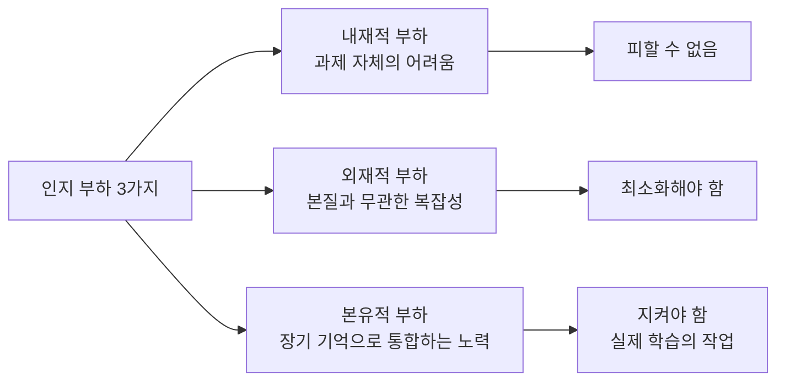
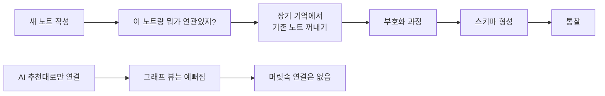
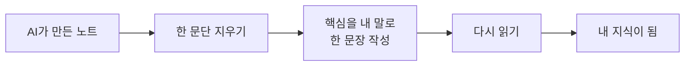

# AI가 노트 연결까지 대신해주면, 내 노트는 내 것이 아닙니다

> **Summary**
> LLM 위키가 유행하면서 AI가 노트 연결과 요약을 대신해주는 일이 당연해졌지만, 노트를 연결하고 핵심을 뽑아내는 과정 자체가 학습입니다. 인지 부하 이론에서 이를 본유적 부하라 부르는데, AI가 이 과정을 대신하면 그래프 뷰는 예뻐져도 머릿속에는 개념이 실제로 연결되지 않습니다. 대신 바람직한 어려움을 받아들이고 연결된 노트를 계속 들여다보며, AI가 만든 노트는 내 말로 다시 요약하는 프로그레시브 요약을 쓰는 게 답에 가깝습니다.

---

- LLM 위키가 유행하면서, AI가 노트 연결과 요약까지 대신해주는 일이 당연해졌습니다.
- 그런데 노트를 연결하고 핵심을 뽑아내는 과정 자체가 학습입니다. 이 과정을 AI에게 넘기면, 그래프 뷰는 예뻐져도 머릿속에는 아무것도 남지 않습니다.
- 바람직한 어려움을 받아들이고, 연결된 노트를 계속 들여다보고, AI가 만든 노트는 내 말로 다시 요약하면 됩니다.

옵시디언 볼트를 열어본 적 있으시죠? 그래프 뷰를 켜면 노트들이 별자리처럼 촘촘하게 연결돼 있습니다. 그런데 그 그래프, 누가 만들었을까요? 직접 손으로 이은 게 아니라 AI가 알아서 연결해준 거라면, 한 번쯤 물어봐야 합니다. 내 머릿속에도 저렇게 연결돼 있을까요?

🎥 [동영상 보기](https://www.youtube.com/watch?v=yke4fLQUsh4)

## 본유적 부하, 그게 뭘까요?

2026년 4월, 짧은 메모 한 장에서 시작된 LLM 위키 패턴이 순식간에 퍼졌습니다. 원문 자료를 AI가 미리 읽고, 핵심만 뽑아, 서로 연결된 위키 페이지로 정리해두는 방식입니다. 물어볼 때마다 원문을 다시 뒤지는 게 아니라, 이미 정리된 지식을 물어보는 구조입니다. 편합니다. 그런데 이 편함이 어디까지 괜찮을까요?

인지 부하 이론에서는 머릿속 노력을 세 가지로 나눕니다. **내재적 부하**는 과제 자체의 어려움이라 피할 수 없습니다. **외재적 부하**는 산만함이나 불편한 형식처럼 본질과 무관한 복잡성이라 최소화해야 합니다. 그리고 **본유적 부하**는 새 정보를 장기 기억으로 통합하는 인지적 노력, 그러니까 실제 학습의 작업입니다. 이 셋 중에서 줄여도 되는 건 외재적 부하뿐입니다. 본유적 부하는 줄이는 게 아니라 지켜야 하는 쪽입니다.

## PKM에서 사라지는 두 가지 본유적 부하

PKM에서 본유적 부하는 크게 두 가지 형태로 나타납니다. 첫 번째는 **링크**입니다. 노트와 노트를 연결하는 과정은 인지 심리학에서 말하는 정교화와 정확히 일치합니다. "이 노트랑 어떤 게 연관있을까?"라는 질문 하나가 장기 기억에서 기존 노트를 끄집어내고, 부호화 과정을 일으키고, 지금 쓰는 노트를 더 탄탄하게 기억하게 합니다. 다른 맥락의 노트가 연결되면서 스키마가 형성되고, 그게 통찰이 됩니다. 추상화된 아이디어는 멘탈 모델에 연결하기 쉽고, 거시적인 관점에서 질문을 던지기도 쉬워집니다.

그런데 AI 추천대로만 노트를 연결하면 어떻게 될까요? 그래프 뷰는 자랑할 만하게 예뻐집니다. 하지만 머릿속에선 개념들이 실제로 연결되지 않았습니다. 내 노트지만, 정말 내 노트는 아닌 셈입니다!

두 번째는 **핵심 개념 추출**, 그러니까 요약입니다. 요약도 마찬가지입니다. 핵심을 뽑아내는 순간에 머릿속에서 정리가 일어나는데, AI가 요약해주면 그 정리는 일어나지 않습니다. 오탈자만 고치는 작업도 비슷합니다. 기계적으로 고치고 나면 커밋만 쌓이고, 실력은 그대로입니다.

## 스쿼트 비유, 과정이 빠진 결과

원문에서는 스쿼트에 비유했습니다. 내가 바벨을 들고 있는데 코치가 아래에서 위까지 바벨을 다 올려주고, 나는 다시 바벨을 짊어지기만 하는 꼴입니다. 운동 대신 체중 감량 주사를 맞는 느낌과 비슷하다고도 했습니다. 과정 자체가 중요한데 과정만 빼고 결과만 얻으려는 형태입니다.

이 대목이 저는 가장 와닿았습니다. 편해지는 것과 배우는 것은 같은 방향이 아니라는 게, 운동 비유 하나로 정리되니까요!

## AI한테 빼앗기지 않으려면?

그럼 어떻게 해야 할까요? 원문이 제시한 대처법은 세 가지입니다.

첫 번째는 **바람직한 어려움을 받아들이기**입니다. 노트를 작성하고 관리하는 과정은 분명히 인지 부하가 큰 과정입니다. 그런데 이 고통을 피하고자 AI에 의존하면 사실상 쓸모없는 PKM을 만들게 됩니다. 어렵고 짜증나게 느껴지는 부분을 피하지 말고 받아들이자는 얘기입니다. 물론 그렇다고 외재적 부하까지 받아들이자는 건 아닙니다.

두 번째는 **연결 노트를 계속 파고들며 내비게이션하기**입니다. PKM이 세컨드 브레인처럼 쓰이려면 실제 나의 뇌, 퍼스트 브레인의 애드온 형태가 되어야 합니다. PKM이 내 뇌랑 괴리가 커질수록 쓸모없는 세컨드 브레인이 되어버립니다. 확장된 마음 가설에서는 외부 도구가 마음의 확장처럼 되려면 두 가지 조건이 필요합니다. 언제든 접근 가능하고, 신뢰되어야 합니다. 여기서 "언제든 접근 가능"은 스마트폰에 옵시디언이 깔려 있다는 뜻이 아닙니다. 원하는 노트에 언제든 빠르게 닿을 수 있다는 뜻입니다. 노트를 자주 보면 유창성이 늘고, 유창성이 신뢰를 키웁니다.

세 번째는 **프로그레시브 요약**입니다. 편의상 AI로 노트를 만드는 과정을 앞으로 아예 안 쓰기는 어렵습니다. 다만 만든 뒤에는 프로그레시브 요약을 통해 본유적 부하를 다시 만들어낼 수 있습니다. 요약할 때 단순히 필요 없는 문장을 지우는 형태가 되어서는 안 됩니다. 내 말로 다시 써야 합니다. 한 문단을 지워버리고, 그 문단의 핵심을 한 문장으로 직접 작성하는 식입니다.

AI를 아예 안 쓰는 게 답은 아닙니다. 예를 들어 `marksman`이 잡지 못하는 중간 레벨 헤딩 누락을 찾아주는 스크립트처럼, 생각을 대신하는 게 아니라 손을 덜어주는 용도로 쓰면 됩니다. 정리를 맡기는 것과 생각을 맡기는 것은 다릅니다.

정리해주는 AI가 나쁜 게 아닙니다. 문제는 정리를 맡긴 뒤에 내 머릿속에서 아무 일도 일어나지 않는다는 점입니다. 링크 하나, 요약 한 줄, 그 작은 수고를 직접 하는 게 지식을 내 것으로 만드는 유일한 방법입니다!

