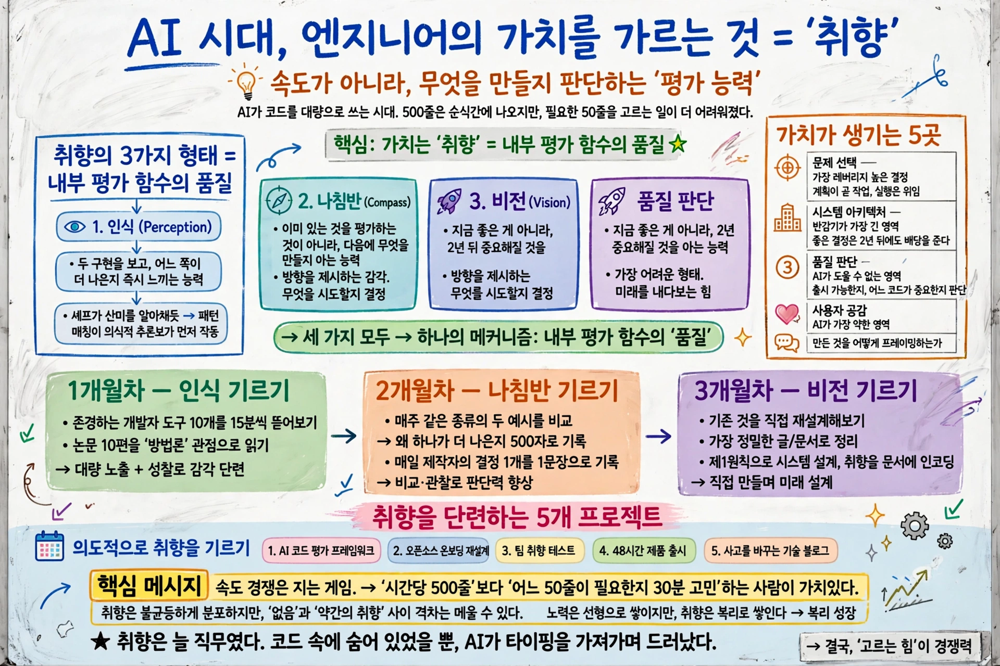
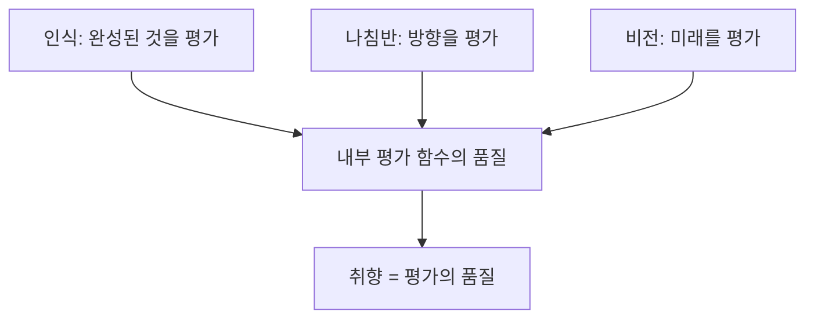
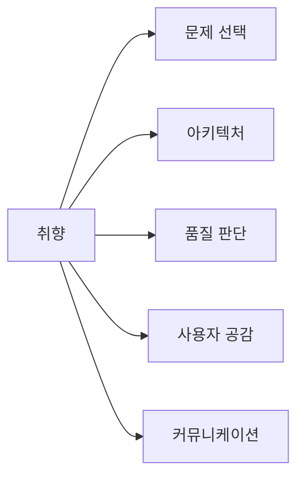
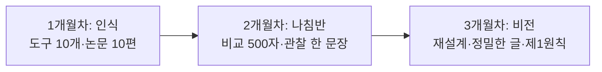

# AI가 코드를 다 쓰는 시대, 30배 엔지니어의 차이는 취향입니다

> **Summary**
> AI가 코드를 대량으로 쓰는 시대, 엔지니어의 가치를 가르는 건 속도가 아니라 취향입니다. 취향은 무엇을 만들지 판단하는 평가 능력입니다. 취향은 인식·나침반·비전 세 형태이고, 모두 내부 평가 함수의 품질이라는 하나의 메커니즘으로 모입니다. 가치는 문제 선택·아키텍처·품질 판단·사용자 공감·커뮤니케이션 다섯 곳에서 나고, 90일 계획으로 의도적으로 기를 수 있습니다.

---

- AI가 코드를 대량으로 쓰는 시대, 엔지니어의 가치를 가르는 건 속도가 아니라 취향입니다. 취향은 무엇을 만들지 판단하는 평가 능력입니다.
- 취향은 인식·나침반·비전 세 형태이고, 모두 내부 평가 함수의 품질이라는 하나의 메커니즘으로 모입니다.
- 가치는 문제 선택·아키텍처·품질 판단·사용자 공감·커뮤니케이션 다섯 곳에서 나고, 90일 계획으로 의도적으로 기를 수 있습니다.

AI한테 코드 500줄을 뽑아달라고 했는데, 정작 필요한 50줄이 뭔지 몰라서 한참을 헤맨 적 있으시죠? 코드는 순식간에 나오는데, 뭘 만들어야 할지 고르는 일은 오히려 더 어려워졌습니다. 이 글은 그 고르는 힘, 취향에 대한 이야기입니다.

🎥 [동영상 보기](https://www.youtube.com/watch?v=pTNZQ4RsfHI)

## 취향, 세 가지 얼굴일까요?

**인식**은 두 구현을 보고 설명하기 전에 어느 쪽이 더 나은지 느끼는 능력입니다. 소스를 맛본 셰프가 산미가 빠졌음을 알아채듯, 패턴 매칭이 의식적 추론보다 먼저 작동합니다. 코덱스 팀이 CLI를 러스트로 고른 것도 이런 판단이었습니다. 기술적 우월성보다 "팀이 원하는 행동을 만드는 언어"를 택한 거죠. 반대로 유행이라서, 블로그가 빠르다고 해서 고르면 취향 없는 선택입니다!

**나침반**은 이미 있는 걸 평가하는 게 아니라 다음에 무엇을 만들지 아는 능력입니다. 코드 한 줄 쓰기 전에 "이건 옳은 기능이 아니다"라고 말하는 엔지니어, 그게 나침반입니다. 클로드 코드 제작자는 할 일 목록 기능을 이틀 동안 20개 프로토타입으로 만들었습니다. 중간안에 대한 불만족 자체가 방향을 잡아준 거죠.

**비전**은 지금 좋은 게 아니라 2년 뒤 중요해질 것을 아는, 가장 어려운 형태입니다. 오픈소스 프로젝트 제작자는 에이전트 5~10개를 동시에 돌리면서 대부분의 시간을 아키텍처에 씁니다. "대부분의 코드는 지루한 데이터 변환"이라는 말이 저는 가장 와닿았습니다. 코덱스 팀의 다음 목표도 더 나은 코드 생성기가 아니라, 맥락을 바탕으로 한 계획 수립입니다.

## 가치는 어디서 날까요?

취향이 불균형한 가치를 만드는 다섯 영역이 있습니다. 대부분 엔지니어는 한두 영역에서만 경쟁합니다.

**문제 선택**은 가장 레버리지 높은 결정입니다. "이걸 잘 풀면 다른 다섯 문제가 사라지는가?"라고 묻는 것부터 시작합니다. 계획이 곧 작업이고, 실행은 위임합니다. 권한 시스템을 복잡한 접근 제어 대신 가장 단순한 방식으로 만든 선택이, 빠른 출시를 만든 이유입니다.

**시스템 아키텍처**는 취향의 반감기가 가장 긴 영역입니다. 좋은 결정은 2년 뒤에도 배당을 줍니다. 모델이 새로 나올 때마다 코드를 삭제하는 팀의 철학, "모델이 곧 제품"이라는 판단이 여기에 있습니다!

**품질 판단**은 AI가 도울 수 없는 영역입니다. 출시하기에 충분한지, 어느 코드가 중요한지 아는 것입니다. 핵심 코드는 사람 리뷰 필수, 그 외는 AI 리뷰로 충분합니다. 손으로 쓰는 30%는 품질 판단이 가장 중요한 부분입니다.

**사용자 공감**은 AI가 가장 약한 영역입니다. 아무도 요청하지 않은 로딩 메시지, 채택률을 손해 보더라도 안전한 기본값을 택하는 판단. 편의보다 안전을 택하는 것이 여기에 있습니다.

**커뮤니케이션**은 만든 걸 어떻게 프레이밍하는가입니다. 바이럴 주간에 검색량이 폭발한 오픈소스 프로젝트, AI용 README인 `AGENTS.md`가 그 예시입니다. 독자가 바뀌면 형식도 바뀝니다.

## 취향 있음 vs 없음, 같은 상황 다른 결말

기술 스택을 고를 때, "다들 아니까"로 고르면 취향 없는 선택입니다. 모델이 이미 잘 다루는 언어라서, 팀이 원하는 행동을 만드는 언어라서 고르면 취향 있는 선택입니다.

AI가 만든 코드를 읽지 않고 출시하는 것도 두 갈래입니다. 테스트 통과만 보고 내보내면 도박입니다. 구조를 알고 테스트·린팅·CI라는 검증 계층을 갖추면, 다른 종류의 정확성입니다.

PR이 쏟아질 때는 리뷰 단위도 바뀌어야 합니다. 코드만 보던 리뷰에서, 생성 프롬프트까지 함께 보는 리뷰로 말이죠. 만드는 단위가 바뀌었으니 리뷰 단위도 바뀌는 게 당연하지 않을까요?

## 90일이면 취향을 기를 수 있을까요?

"경험을 더 쌓아라"는 조언은 "운동을 더 해라"만큼 무용합니다. 원문은 세 형태별로 90일 계획을 제시합니다.

**1개월차, 인식**은 대량 노출과 성찰로 기릅니다. 존경하는 개발자 도구 10개를 15분씩 뜯어보고, 논문 10편을 방법론으로 읽습니다. 좋은 도구는 첫 30초에 결과를 보여주고, 나쁜 도구는 아키텍처부터 설명합니다!

**2개월차, 나침반**은 비교와 관찰로 기릅니다. 매주 같은 종류의 두 예시를 골라 왜 하나가 더 나은지 500자로 쓰고, 매일 제작자의 결정 하나를 골라 "왜 이것이고 명백한 대안이 아닌가" 한 문장을 기록합니다. "좋아한다"는 금지, "이것이 더 나은 이유는…"으로 씁니다.

**3개월차, 비전**은 직접 만드는 것으로 기릅니다. 가진 것을 재설계하고, 가장 정밀한 글을 쓰고, 제1원칙으로 시스템을 설계하고, 취향을 문서에 인코딩합니다. 가르치는 순간 취향은 개인 기술에서 조직 역량이 됩니다.

## 취향을 단련하는 다섯 프로젝트

읽는 것만으로는 나침반과 비전은 안 생깁니다. 원문이 제안한 다섯 프로젝트입니다.

- AI 코드 평가 프레임워크를 만듭니다. 정확성·유지보수성·효율성·보안·스타일 루브릭으로 실제 AI 생성 PR 50개를 채점합니다.
- 답답한 오픈소스 도구를 포크해 첫 5분 온보딩을 재설계합니다.
- 팀 취향 테스트를 만듭니다. 구현 접근 10쌍을 두고 엔지니어 5명에게 물어봅니다. 흥미로운 산출은 정답이 아니라 의견 불일치입니다!
- 48시간 제약으로 제품을 출시합니다. 잘못된 기능에 6시간을 쓰면 4분의 1을 태우니, 나쁜 결정의 결과가 즉각적입니다.
- 사고를 바꾸는 기술 블로그를 씁니다. 익숙한 개념을 재구성해 독자가 이후 다르게 보게 하는 글입니다.
## 경력, 어디에 걸까요?

속도 경쟁은 지는 게임입니다. 시간당 500줄을 뽑는 사람보다 어느 50줄이 필요한지 30분 고민하는 사람이 가치 있습니다. 취향엔 원재료가 필요합니다. 제품 사고·디자인 감각·비즈니스 이해·소통 능력이 그 재료입니다.

취향을 직접 보상하는 역할도 따로 있습니다. 초기 스타트업 창업 엔지니어, 제품 회사 테크 리드, 플랫폼·인프라 엔지니어, 개발자 경험 엔지니어, 교차 팀 아키텍처를 다루는 스태프급 엔지니어입니다. 이력서보다 포트폴리오가 말합니다.

## 불편한 진실

취향은 불균등하게 분포합니다. 15년 경력의 출발선 차이를 90일 계획으로 다 메울 수는 없습니다. 그래도 "취향 없음"과 "약간의 취향" 사이 격차는 메울 수 있습니다. 티켓을 받아 구현하던 사람이 무엇을 만들지 제안하는 사람으로 바뀌는 것, 그 도약이 곧 취향입니다.

한 가지 짚고 넘어갈 점이 있습니다. "30배"라는 제목의 숫자는 원문의 표현이고, 글이 제시한 구체적인 수치는 스타트업 내 실력 격차가 3배에서 10배로 벌어졌다는 대목입니다. 숫자의 크기보다 중요한 건 방향입니다. 노력은 선형으로 쌓이지만, 취향은 복리로 쌓입니다!

취향은 늘 직무였습니다. 코드 속에 숨어 있었을 뿐, AI가 타이핑을 가져가며 그것을 드러냈습니다. 이제 남은 일은 평가하는 힘을 기르는 것입니다.

