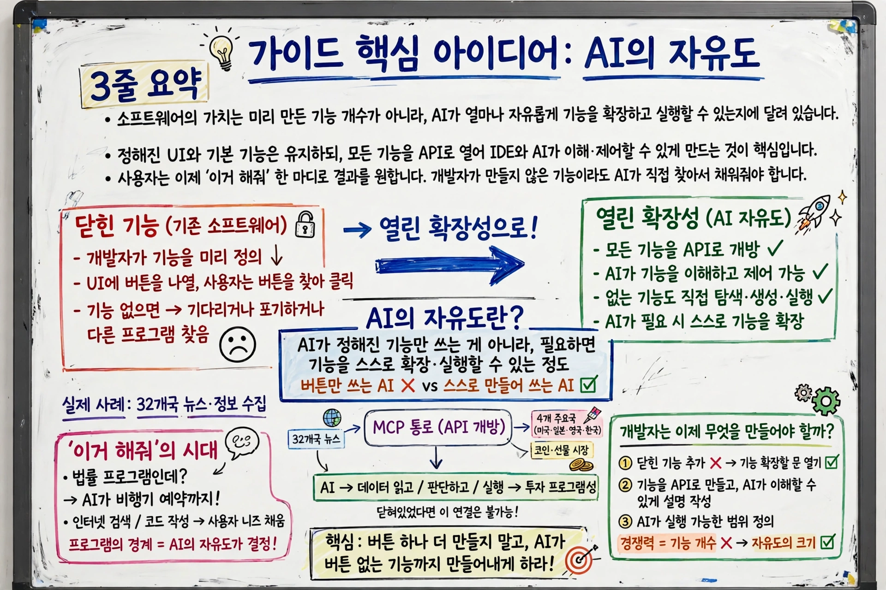
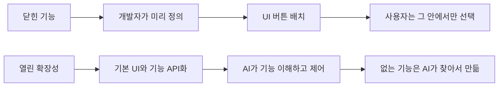
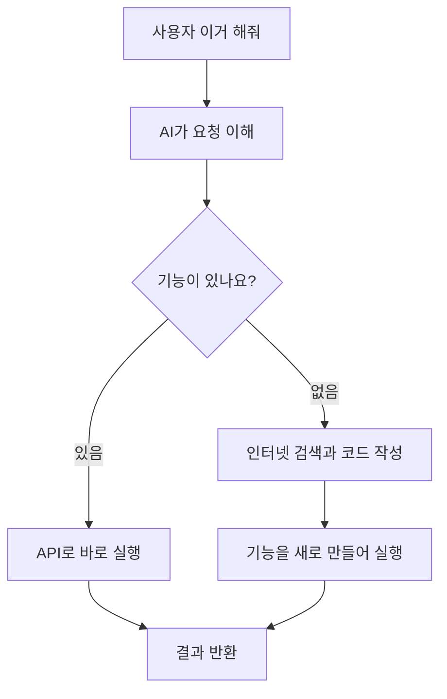

# AI에게 자유도를 주면, 기능은 알아서 생깁니다

> **Summary**
> 소프트웨어의 가치는 미리 만든 기능이 아니라 AI의 '자유도'에 달려 있습니다. UI와 기본 기능은 두되 모든 기능을 API로 열어 AI가 이해하고 제어하게 만들고, 사용자가 '이거 해줘' 한 마디로 원하는 결과를 얻을 수 있게 해야 합니다. 개발자는 닫힌 기능이 아니라 열린 확장성을 설계해야 합니다.

---

- 소프트웨어의 가치는 미리 만든 기능 개수가 아니라, AI가 얼마나 자유롭게 기능을 확장하고 실행할 수 있는지에 달려 있습니다.
- 정해진 UI와 기능을 기본으로 두되, 모든 기능을 API로 열어 IDE와 AI가 이해하고 제어할 수 있게 만드는 것이 핵심입니다.
- 사용자는 이제 "이거 해줘" 한 마디로 결과를 원합니다. 개발자가 미리 만들지 않은 기능이라도 AI가 직접 찾아서 채워줘야 합니다.

앱을 켰는데 버튼이 수십 개 늘어서 있는 화면, 본 적 있으시죠? 개발자는 기능을 하나하나 만들었고, 사용자는 그중에서 원하는 걸 찾아 눌러야 했습니다. 그런데 이제 사용자는 버튼을 찾지 않습니다. 그냥 말합니다. "이거 해줘"라고요.

🎥 [동영상 보기](https://www.youtube.com/watch?v=YuvfFHl6w6I)

## AI의 자유도란 무엇일까요?

AI의 자유도란, AI가 정해진 기능 안에서만 움직이는 게 아니라 필요하면 기능을 스스로 확장하고 실행할 수 있는 정도를 말합니다. 버튼이 있는 기능만 쓸 수 있는 AI와, 없는 기능도 직접 찾아서 만들어 쓰는 AI는 완전히 다릅니다!

이 고민은 두 갈래로 나뉩니다. 하나는 프론트엔드 UI와 자유도의 공존입니다. 다른 하나는 사용자 경험의 변화, 바로 "이거 해줘"의 시대입니다.

## 닫힌 기능과 열린 확장성, 무엇이 다를까요?

기존 소프트웨어는 닫힌 기능으로 움직였습니다. 개발자가 기능을 미리 정의하고, UI에 버튼을 배치하고, 사용자는 그 안에서만 골라서 썼습니다. 원하는 기능이 없으면 답이 없었습니다. 기다리거나, 포기하거나, 다른 프로그램을 찾아야 했습니다.

열린 확장성은 정반대입니다. UI와 기본 기능은 그대로 두되, 모든 기능을 API로 열어둡니다. IDE와 AI가 각 기능을 완벽히 이해하고 제어할 수 있게 만드는 겁니다. 그러면 AI는 정해진 버튼 안에서만 움직이지 않습니다. 없는 기능이 필요하면 직접 찾아서, 없으면 만들어서 채워줍니다!

## 32개국 뉴스를 묶은 사례가 보여주는 것

이 방향이 실제로 어떻게 굴러가는지 보여주는 사례가 있습니다. 32개국 뉴스와 정보 수집 서비스, 미국·일본·영국·한국 주요국과 코인·선물 시장의 일일 스냅샷을 MCP로 제공하는 서비스가 있습니다. 데이터와 기능을 MCP라는 통로로 열어둔 겁니다. 그 위에서는 오픈클로처럼 자유롭게 동작하는 투자 프로그램이 개발되고 있습니다.

이 장면이 저는 가장 와닿았습니다. 기능을 만드는 일이 개발자의 일이었는데, 이제는 AI가 기능을 만들 수 있게 해주는 일이 개발자의 일이 되는 거니까요!

숫자로 보면 그림이 더 또렷해집니다. 32개국, 4개 주요국, 코인과 선물 시장까지. 이 모든 스냅샷이 하나의 통로로 묶여 있습니다. AI는 이 통로를 통해 데이터를 읽고, 판단하고, 실행합니다. 기능이 닫혀 있었다면 이 연결은 불가능했습니다.

## 법률 프로그램이 비행기 예약을 해준다고요?

"이거 해줘"의 시대가 되면, 개발자가 미리 정의하지 않은 기능이라도 AI가 직접 채워줘야 합니다. 인터넷을 검색하거나 코드를 짜서 사용자의 니즈를 채우는 겁니다. 법률 프로그램인데 사용자가 원한다면 비행기 예약을 도와주는 수준까지 말입니다.

처음 들으면 황당하게 들릴 수 있습니다. 하지만 사용자는 이미 그렇게 기대하고 있습니다. "이거 해줘" 한 마디면 결과가 나오길 바라니까요. 프로그램의 경계는 사용자가 정하는 게 아니라, AI의 자유도가 정하게 됩니다!

## 개발자는 이제 무엇을 만들어야 할까요?

닫힌 기능을 하나 더 만드는 게 아니라, AI가 스스로 기능을 늘릴 수 있는 문을 여는 일입니다. 기능을 API로 만들고, AI가 이해할 수 있게 설명하고, 실행할 수 있는 범위를 정하는 일입니다.

소프트웨어의 경쟁력은 이제 기능 개수가 아니라 자유도의 크기로 갈립니다. 버튼을 하나 더 다는 것보다, AI가 버튼 없는 기능까지 만들어낼 수 있게 해주는 게 먼저입니다!

