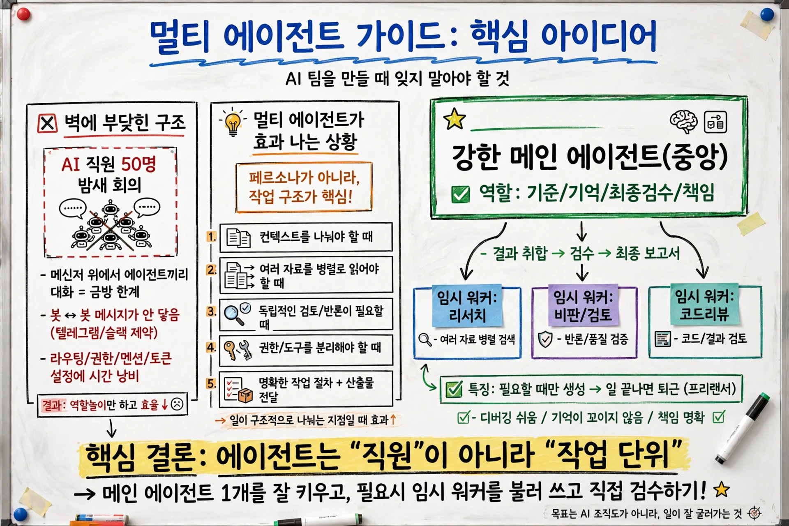
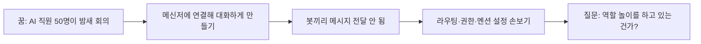
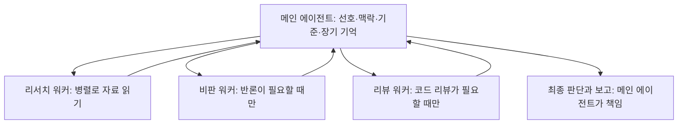
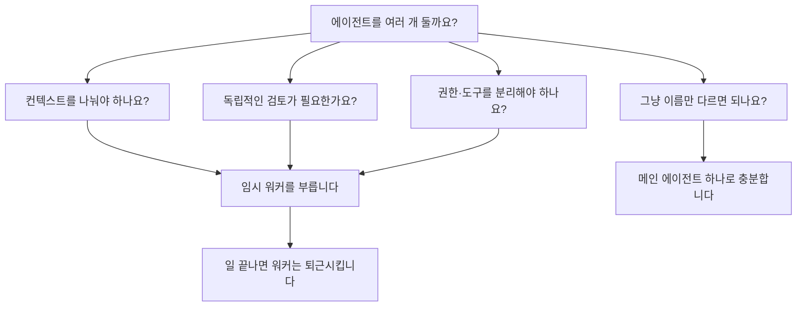

# AI팀은 허상입니다. 메인 에이전트 하나가 프로세스를 돌려야 합니다

> **Summary**
> 멀티 에이전트의 가치는 역할극이 아니라 컨텍스트 분리, 병렬 조사, 독립 검토, 권한 분리처럼 작업 구조가 나뉠 때 생깁니다. 기본적으로는 기준과 장기 기억을 가진 메인 에이전트 하나가 필요할 때만 임시 워커를 불러 쓰고 결과를 검수하는 방식이 더 단순하고 효율적입니다.

---

- "AI 직원 50명"이 밤새 회의하는 그림은 멋있지만, 메신저 위에서 에이전트끼리 대화시키는 구조는 금방 벽에 부딪힙니다.
- 멀티 에이전트가 효과를 내는 지점은 페르소나가 아니라, 컨텍스트를 나누고·병렬로 읽고·독립적으로 검토해야 할 때입니다.
- 강한 메인 에이전트 하나가 기준과 기억을 들고, 필요할 때만 임시 워커를 불러 쓰고 직접 검수하는 구조가 정답에 가깝습니다.

"AI 직원 50명을 밤새 일시켰다", "에이전트들이 서로 회의하면서 발전한다" — 이런 영상이나 글, 본 적 있으시죠? AI 직원들이 알아서 회의하고, 서로 피드백하고, 아침에 결과물을 가져다준다? 생각만 해도 멋지고 편합니다!

🎥 [동영상 보기](https://www.youtube.com/watch?v=ow1we5PzK-o)

## AI 팀, 직접 만들어 봤습니다

이 멋진 그림에 끌려서, 직접 실험해 본 사례가 있습니다. 에이전트 도구로 각 에이전트에게 페르소나를 주고, 역할을 나누고, 메신저에 연결하고, 서로 대화하게 만들고, 정기 리포트까지 맡겼습니다. 처음에는 꽤 재밌었습니다. 진짜 작은 AI 조직을 만든 느낌이 들었고요. "이제 나는 AI 팀을 관리하는 CEO인가?" 싶은 순간도 있었다고 합니다.

이 장면이 가장 인상 깊었습니다. 권한 위임을 잘해야겠다는 경영관까지 생겼다는 대목에서는, 웃음이 나면서도 고개가 끄덕여졌습니다!

## 그런데 메신저 위에서 벽에 부딪혔습니다

몇 시간을 세팅하며 굴려보니 이상한 지점이 드러났습니다. 특히 메신저 위에서 돌려보면 제약이 많았습니다. 단순하게 기대하기 쉽습니다. "A 봇이 B 봇을 멘션했으니 B가 보겠지"라고요. 그런데 실제로는 구조적으로 그렇지 못합니다.

텔레그램에서는 봇이 다른 봇의 메시지를 제대로 받지 못하는 경우가 있습니다. 슬랙도 채널, 스레드, 멘션, 이벤트 구독 설정에 따라 반응 범위가 달라집니다. 그러다 보니 AI 직원들이 자연스럽게 회의하는 그림을 만들려다가, 정작 라우팅, 게이트웨이, 토큰, 권한, 채널 설정, 멘션 조건 같은 것들을 계속 손보고 있게 됩니다.

어느 순간 이런 질문이 떠오릅니다. "내가 지금 뭐하고 있는 거지? 이게 정말 효율적인가? 그냥 역할 놀이를 하고 있는 건가?"

원했던 건 메신저에서 AI 직원들이 핑퐁하며 회의하는 모습을 지켜보는 게 아니었습니다. 일이 더 빨리 끝나고, 결과물이 더 좋아지고, 실수가 줄어드는 것. 그게 목표였습니다.

## 멀티 에이전트, 어디서 효과가 날까요?

그래서 다시 찾아봤습니다. 실제 써본 사람들의 반응, 그리고 논문과 프레임워크 문서들을요. `AutoGen`, `MetaGPT`, `CAMEL`, `Mixture-of-Agents`, `Self-Refine`, `Reflexion` 같은 논문들과 여러 회사의 에이전트 설계 문서를 같이 봤습니다.

결론부터 말하면, 멀티 에이전트가 효과를 내는 지점은 "페르소나"가 아니었습니다. 효과가 나는 건 보통 이런 경우였습니다.

- 컨텍스트를 나눠야 할 때
- 여러 자료를 병렬로 읽어야 할 때
- 독립적인 검토나 반론이 필요할 때
- 권한이나 도구를 분리해야 할 때
- 명확한 작업 절차와 넘겨줄 산출물이 있을 때
이 다섯 가지에는 공통점이 있습니다. 일의 구조가 나뉘는 지점이 분명하다는 점입니다. 반대로 같은 모델에 이름만 여러 개 붙이고 "너는 리서처야", "너는 PM이야"라고 해두면 비용만 늘어납니다. 토큰도 더 쓰고, 응답도 느려지고, 메모리도 분산되고, 운영할 것도 많아집니다. 무엇보다 보기에는 그럴듯한데, 실제 효율이 꼭 올라가지는 않습니다!

이 지점은 공식 설계 문서와도 같은 방향입니다. 중앙 LLM이 일을 나누고 워커 LLM에 위임한 뒤 결과를 합치는 오케스트레이터-워커 패턴이 대표적입니다. 복잡한 일인데 하위 작업을 미리 예측하기 어려울 때 잘 맞는 구조라고 설명합니다. 핵심 원칙도 단순합니다. 설계를 단순하게 유지하고, 계획 단계를 투명하게 보여주는 것입니다.

## 그래서 내린 결론: 에이전트는 직원이 아니라 작업 단위입니다

정리는 이렇습니다. 굳이 "AI 직원"을 여러 명 키울 필요는 없습니다. 오히려 기본은 하나가 맞는 것 같습니다. 중앙에 강한 메인 에이전트 하나. 그 에이전트가 내 선호, 맥락, 기준, 장기 기억을 들고 있고, 필요할 때만 임시 워커를 여러 개 만들어 쓰는 방식입니다.

리서치가 필요하면 리서치 워커를 몇 개 병렬로 돌리고, 반론이 필요하면 비판 워커를 잠깐 붙이고, 코드 리뷰가 필요하면 리뷰 워커를 부릅니다. 최종 판단과 보고는 다시 메인 에이전트가 책임지는 구조입니다. 이쪽이 훨씬 단순했습니다. 디버깅하기도 쉽고, 기억도 덜 꼬이고, 누가 최종 책임자인지도 명확했습니다!

AI 에이전트는 "가상의 직원"이라기보다 필요할 때 생성되는 작업 단위에 가까워야 합니다. 상시 직원처럼 이름과 캐릭터를 부여하는 건 채널, 권한, 장기 기억, 반복 업무 경계가 명확할 때만 의미가 있습니다. 그 외에는 그냥 메인 에이전트를 잘 키우는 게 낫습니다. 메인 에이전트가 내 기준을 알고, 필요한 도구를 쓰고, 필요하면 분신을 여러 개 돌리고, 다시 본인이 검수해서 결과를 주는 것. 그게 전부입니다.

그래서 오늘부로 AI 팀원들은 대부분 해고했습니다. 아니, 프리랜서로 전환이 맞겠네요. 필요할 때만 부르고, 일 끝나면 퇴근시키는 방식으로요. AI 조직을 만드는 게 목표가 아니라, 일이 잘 굴러가게 만드는 게 목표니까요!

AI 조직도를 그리는 데 시간을 쓰기 전에, 메인 에이전트 하나가 내 기준을 얼마나 알고 있는지부터 물어봐야겠습니다.

