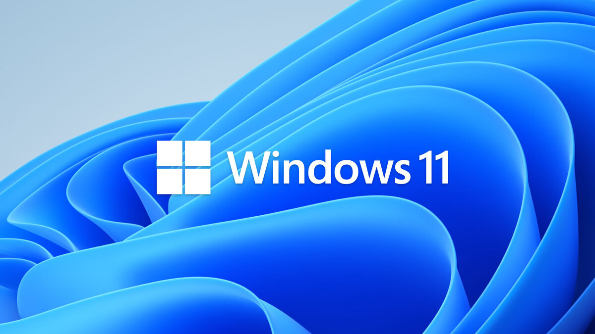

# ARM windows를 Azure 에 VM으로 설치해보자

> **Summary**
> ARM Windows를 Azure에 VM으로 설치하는 방법에 대한 안내로, 동아시아 지역을 설정하여 적절한 저장 크기를 지정하고 RDP로 연결하여 사용할 수 있다는 점을 강조합니다.

---

> 💡 **[https://learn.microsoft.com/en-us/windows/arm/create-arm-vm](https://learn.microsoft.com/en-us/windows/arm/create-arm-vm)**

> 💡 **[https://m.blog.naver.com/alaldi2006/221589597186](https://m.blog.naver.com/alaldi2006/221589597186)**

> 💡 **이제 RDP로 연결해서 쓰면 되는데, 생각보다 RDP 이거 매우 우수하다!**

