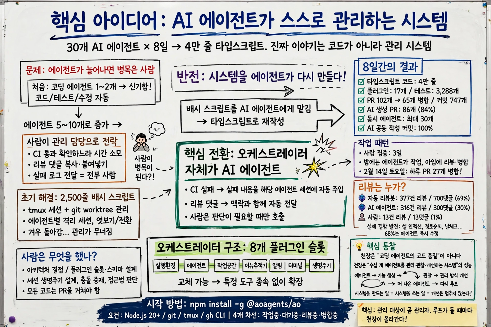
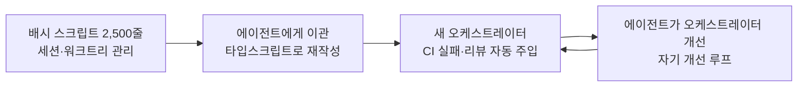
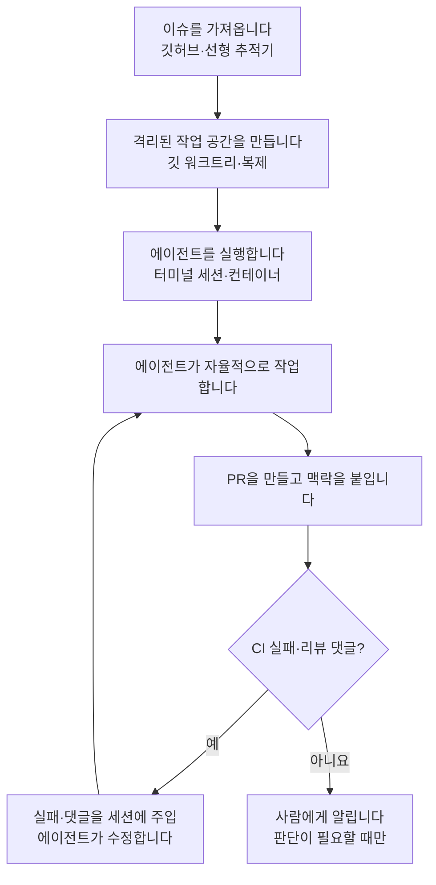
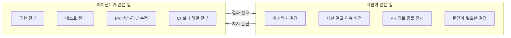

# Agent Orchestrator: 30개 에이전트를 돌리면, 병목은 코드가 아니라 사람입니다

> **Summary**
> 30개의 AI 에이전트를 병렬 운영해 8일 만에 약 4만 줄의 코드와 플러그인 17개를 만든 실험에서, 핵심 성과는 코딩 속도보다 사람의 관리 부담을 줄인 오케스트레이터였다. 오케스트레이터는 CI 실패와 리뷰 댓글을 에이전트에게 전달해 수정과 반복 작업을 자동화하고, 사람은 아키텍처 결정과 최종 판단에 집중하도록 했다.

---

- 30개 AI 에이전트를 동시에 돌려 8일 만에 4만 줄의 타입스크립트 코드를 만들었습니다. 그런데 진짜 이야기는 코드가 아닙니다.
- 에이전트들을 관리하던 시스템을 에이전트들이 직접 다시 만들었습니다. 오케스트레이터 자체가 AI 에이전트입니다.
- 병목은 코드 속도가 아니라 사람이었습니다. CI 확인과 리뷰 전달을 시스템이 대신하면서, 사람에게는 판단만 남았습니다.

코딩 에이전트 하나를 터미널에 띄워두고 일을 시켜본 적 있으시죠? 처음에는 신기합니다. 코드를 짜고, 테스트를 돌리고, 알아서 고치니까요. 그런데 에이전트를 다섯 개, 열 개로 늘리면 풍경이 바뀝니다. 코드는 빠른데, 사람이 못 따라갑니다. CI가 통과했는지 확인하고, 리뷰 댓글을 복사해서 다시 붙여넣고, 실패 로그를 전달하는 일이 전부 사람이 됩니다. 자동화한 줄 알았는데, 프로젝트 관리자로 전직한 셈입니다.

🎥 [동영상 보기](https://www.youtube.com/watch?v=QdwaeEXOmDs)

### 에이전트가 빨라지자, 병목이 사람이 된다고요?

이 문제의 출발점은 두세 개 에이전트를 병렬로 돌리던 실험이었습니다. 다섯 개, 열 개로 늘어나자 관리가 먼저 무너졌습니다. 그래서 만든 것이 약 2,500줄짜리 배시 스크립트였습니다. `tmux` 세션과 깃 워크트리를 관리하고, 세션 사이를 오가는 스크립트였습니다. 에이전트마다 격리된 세션을 주고, 무엇을 하는지 엿보고, 세션을 넘나들 수 있게 했습니다. 돌아는 갔습니다. 간신히요!

### 관리 시스템을 에이전트에게 맡기면 어떻게 될까요?

여기서 반전이 나옵니다. 그 배시 스크립트를 에이전트들에게 맡긴 것입니다. 에이전트들이 스크립트 전체를 타입스크립트로 다시 썼습니다. 그것도 옛날 방식으로 관리하면서 말이죠. 낡은 오케스트레이터로 새 오케스트레이터를 만드는 동안, 관리 대상이 곧 관리자가 되었습니다. 새 시스템은 CI 실패와 리뷰 댓글을 에이전트 세션으로 자동 주입합니다. 그 뒤로 시스템은 스스로 개선되고 있습니다.

### 8일 동안 무슨 일이 있었을까요?

숫자부터 보겠습니다. 타입스크립트 코드 약 4만 줄, 플러그인 17개, 테스트 3,288개가 8일 만에 나왔습니다. PR은 102개가 만들어져 65개가 병합됐고, 커밋은 747개였습니다. AI 세션이 만든 PR이 86개로 84%였고, 동시 에이전트는 최대 30개였습니다. AI가 공동 작성한 커밋은 100%였습니다. 모든 커밋에는 어떤 모델이 썼는지 보여주는 깃 트레일러가 붙습니다.

사람이 꼬박 8일을 쓴 것도 아닙니다. 집중한 시간은 3일 정도였고, 나머지 빈틈은 에이전트가 메웠습니다. 잠들기 전에 세션을 열어두면 에이전트가 밤새 일하고, 아침에 리뷰하고 병합하는 패턴이었습니다. 가장 눈에 띄는 날은 2월 14일 토요일이었습니다. 하루에 PR 27개가 병합됐습니다. 핵심 서비스, CLI, 웹 대시보드, 17개 플러그인, 패키지 발행까지 그날 다 나왔습니다. 읽는 속도보다 병합이 빨랐습니다. 다만 모든 PR이 CI와 자동 코드 리뷰를 먼저 통과했다는 단서가 붙습니다.

모델별 분업도 있었습니다. 어려운 아키텍처와 패키지 간 통합은 상위 모델이 512개 커밋을 맡았고, 플러그인 구현과 테스트, 문서는 경량 모델들이 양으로 맡았습니다. 사람이 한 일과 에이전트가 한 일이 헷갈릴 여지가 없습니다.

### 리뷰는 누가 했을까요?

코드 리뷰도 사람 손을 떠났습니다. 자동 리뷰 봇이 377건 리뷰에 700개 인라인 댓글(69%)을 달았고, AI 에이전트들이 316건 리뷰에 303개 댓글(30%)을 달았습니다. 사람이 단 리뷰는 13건, 댓글 13개. 단 1%입니다! 봇이 잡은 것은 가짜 문제가 아니었습니다. `exec()`을 통한 셸 인젝션, 경로 순회, 닫지 않은 인터벌, 빠진 널 체크 같은 실제 결함이었습니다. 에이전트는 지적의 약 68%를 바로 고쳤고, 약 7%는 의도된 동작이라 설명했으며, 약 4%는 다음 PR로 미뤘습니다.

가장 극적인 사례는 대시보드 재설계 PR이었습니다. CI 실패와 수정을 12번 반복했습니다. 사람이 한 번도 끼지 않았습니다. 12번 모두 에이전트가 실패 로그를 읽고 원인을 찾고 수정해서 다시 올렸습니다. 9개 브랜치에서 발생한 CI 실패 41건은 결국 전부 에이전트 손으로 고쳐졌습니다. 전체 CI 성공률은 84.6%였습니다.

### 오케스트레이터는 어떻게 돌아갈까요?

핵심은 오케스트레이터 자체가 AI 에이전트라는 점입니다. 대시보드가 아닙니다. 정해진 주기로 깃허브를 확인하는 스크립트도 아닙니다. 코드베이스를 읽고, 백로그를 이해하고, 기능을 나눌 수 있는 단위로 쪼개고, 각 작업을 코딩 에이전트에게 맡기고, 진행 상황을 지켜봅니다. CI가 실패하면 실패 내용을 에이전트 세션에 넣어주고, 리뷰 댓글이 달리면 맥락과 함께 해당 세션으로 전달합니다. 사람은 진짜 판단이 필요할 때만 호출됩니다. 이 장면이 저는 가장 인상 깊었습니다. 대시보드는 상태를 보여주는 게 끝이 아니라, "이 PR이 세 가지 작업을 막고 있습니다. 이 CI 실패는 불안정한 테스트입니다"처럼 결정을 건네주니까요!

구조는 8개 플러그인 슬롯으로 되어 있습니다. 실행 환경, 에이전트, 작업 공간, 이슈 추적기, 소스 관리, 알림, 터미널, 생명주기입니다. `tmux`가 싫으면 프로세스 실행 환경을 쓰고, 깃허브 대신 다른 추적기를 쓰고, 클로드 코드 대신 다른 코딩 에이전트를 꽂으면 됩니다. 어느 한 조각도 고정되어 있지 않습니다. 이 교체 가능성이, 특정 도구에 종속되지 않고 시스템을 오래 쓸 수 있게 합니다.

### 사람은 그럼 뭘 했을까요?

사람이 한 일은 따로 있습니다. 아키텍처 결정, 플러그인 슬롯과 설정 스키마, 세션 생명주기 설계. 세션을 열고 이슈를 배정하고, PR을 검토했습니다. 다만 줄 단위가 아니라 아키텍처 관점에서 봤습니다. 에이전트끼리 같은 파일을 건드려 충돌이 나면 중재했고, 접근법을 버릴지 말지 판단했습니다. 에이전트가 한 일은 구현 전부, 테스트 전부, PR 생성 전부, 리뷰 댓글 수정 전부, CI 실패 해결 전부입니다. 기능 브랜치에 직접 커밋한 적은 한 번도 없습니다. 모든 코드는 PR을 거쳤습니다!

### 지금 쓰려면 어떻게 시작할까요?

설치는 패키지 하나로 시작합니다. `npm install -g @aoagents/ao` 명령으로 설치하고, 대시보드를 열어 프로젝트를 가리키면 됩니다. 필요한 것은 Node.js 20 이상, 깃, `tmux`, 깃허브 CLI입니다. 대시보드는 작업 중·대기 중·리뷰 중·병합 중 네 개 차선으로 세션을 보여줍니다. 한 가지 짚을 점이 있습니다. 공개 당시 저장소는 회사 조직 계정에 있었지만, 이후 만든 이의 개인 계정으로 옮겨졌습니다. 회사 후원 없이 이어지는 프로젝트라는 뜻이라, 도입 전에 저장소 상태를 한 번 확인하는 편이 안전합니다.

이 실험이 남긴 문장 하나가 있습니다. 천장은 "코딩 에이전트가 타입스크립트를 얼마나 잘 짜느냐"가 아닙니다. 천장은 "수십 개 에이전트를 배치하고, 관찰하고, 개선하는 시스템이 얼마나 좋아질 수 있느냐"입니다. 그 천장은 루프가 한 번 돌 때마다 올라갑니다. 에이전트가 기능을 만들고, 오케스트레이터가 무엇이 통했는지 관찰하고, 다음 세션의 관리 방식을 조정합니다. 그리고 에이전트는 더 나은 기능을 만듭니다. 시스템을 만드는 일과 시스템을 쓰는 일이 같은 루프 안에 들어간 순간, 개선은 멈추지 않습니다!

