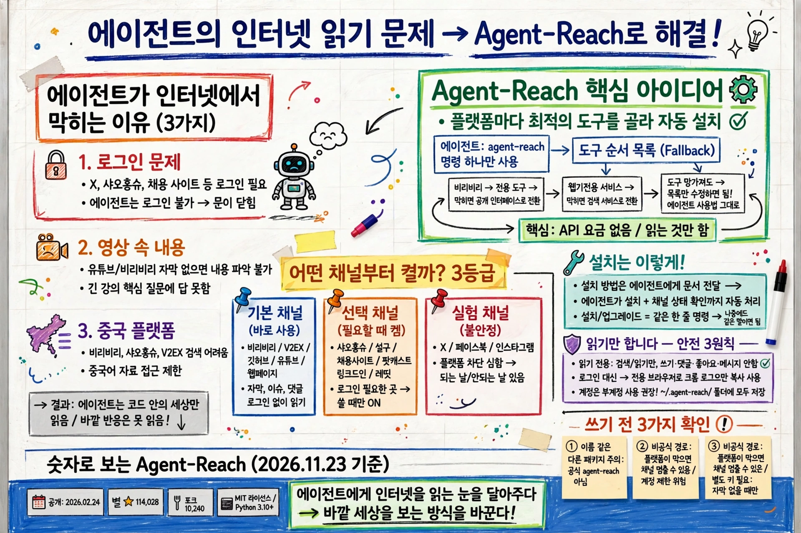
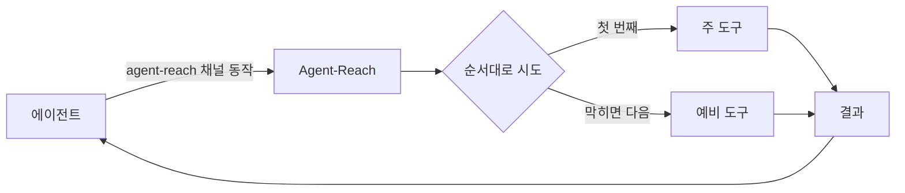
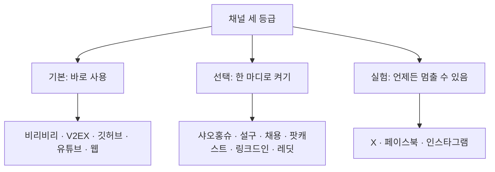

# Agent-Reach: 에이전트에게 눈을 달아주면, 인터넷이 통째로 읽힙니다

> **Summary**
> Agent-Reach는 에이전트가 유튜브, 깃허브, 중국 플랫폼 등 여러 사이트의 정보를 읽도록 플랫폼별 도구를 설치하고, 막히면 대체 도구로 전환하는 명령줄 도구입니다. 읽기 전용이며 유료 API를 사용하지 않지만, 비공식 접근으로 채널이 중단되거나 계정이 제한될 수 있어 부계정 사용이 권장됩니다.

---

- 에이전트는 코드를 잘 짜는데, 인터넷에서 정보를 찾는 건 서툽니다. 로그인 벽, 영상 속 내용, 중국 플랫폼이 막혀 있기 때문입니다.
- Agent-Reach는 플랫폼마다 최적의 도구를 골라 설치하고, 막히면 다음 도구로 자동 전환하는 명령줄 도구입니다. API 요금은 없습니다.
- 읽는 것만 합니다. 글을 쓰거나 좋아요를 누르지 않고, 로그인도 대신하지 않습니다. 계정은 부계정으로 쓰는 것이 안전합니다.

에이전트에게 유튜브 튜토리얼 하나 요약해 달라고 했는데, 자막을 못 가져와서 멈춘 적 있으시죠? X에서 사람들이 제품을 어떻게 평가하는지 물었더니, API가 유료라서 안 된다는 답만 돌아온 적도 있을 겁니다. 코드는 잘 짜는 에이전트가 인터넷 앞에서는 유독 작아집니다. 왜 그럴까요?

🎥 [동영상 보기](https://www.youtube.com/watch?v=FpC4SVVjlsw)

## 에이전트가 인터넷에서 막히는 이유, 세 가지입니다

첫째, 로그인입니다. X에서 계정 소식을 보거나, 샤오홍슈에서 노트를 검색하거나, 채용 사이트에서 상세 정보를 읽으려면 로그인이 필요합니다. 에이전트에게는 이 문이 닫혀 있습니다.

둘째, 영상 속 내용입니다. 유튜브나 비리비리 영상은 자막이 없으면 에이전트가 안을 들여다볼 수 없습니다. 긴 강의 영상의 핵심을 묻는 질문에 답을 못 하는 이유가 여기에 있습니다.

셋째, 중국 플랫폼입니다. 비리비리, 샤오홍슈, V2EX 같은 곳은 일반 검색이 잘 닿지 않습니다. 중국어 자료도 에이전트 손에 잘 안 잡힙니다.

이 세 가지가 합쳐지면, 에이전트는 코드 안의 세상만 보는 도구가 됩니다. 바깥 세상의 반응은 읽지 못합니다!

## 플랫폼마다 도구를 골라주는 방식입니다

Agent-Reach는 스스로 읽지 않습니다. 플랫폼마다 쓸 도구를 골라 설치하고, 상태를 점검하는 층입니다. 에이전트는 `agent-reach` 명령 하나만 배우면 됩니다.

핵심은 순서 목록입니다. 비리비리 영상은 먼저 전용 도구로 읽고, 막히면 공개 인터페이스로 바꿉니다. 웹페이지는 먼저 읽기 전용 서비스로 가져오고, 안 되면 검색 서비스로 넘깁니다. 플랫폼이 바뀌어 도구가 망가져도, 목록만 고치면 에이전트 사용법은 그대로입니다.

이 장면이 저는 가장 인상 깊었습니다. 도구를 바꾸는 일이 에이전트 사용법을 바꾸는 일이 아니라는 점이, 이 도구의 설계 전부니까요!

## 어떤 채널부터 켜면 좋을까요?

채널은 세 등급입니다. 기본 채널은 설치 직후 바로 씁니다. 비리비리, V2EX, 깃허브, 유튜브, 웹 페이지가 여기 들어갑니다. 유튜브 자막, 깃허브 저장소와 이슈, V2EX 글과 댓글을 로그인 없이 읽습니다.

선택 채널은 한 마디로 엽니다. 샤오홍슈, 설구, 채용 사이트, 팟캐스트, 링크드인, 레딧이 여기에 있습니다. 로그인이 필요한 곳이 많아, 쓸 때만 켜는 구조입니다.

실험 채널은 쓸 수 있지만 언제든 멈출 수 있습니다. X, 페이스북, 인스타그램이 여기에 있습니다. 플랫폼의 차단이 가장 심한 곳이라, 되는 날도 있고 안 되는 날도 있습니다.

채널 목록은 `agent-reach channels` 명령으로 확인합니다. 어떤 채널이 무엇을 하는지, 무엇이 필요한지 에이전트가 직접 읽고 고릅니다. 링크를 주면 채널을 알아서 고르는 `agent-reach read` 명령도 있습니다. URL 하나만 주면 됩니다!

## 설치는 에이전트에게 맡기면 됩니다

설치 방법이 특이합니다. 명령을 직접 치는 대신, 설치 안내 문서를 에이전트에게 건넵니다. 에이전트가 안내를 읽고 설치부터 채널 상태 확인까지 알아서 합니다. 설치와 업그레이드가 같은 한 줄이라, 나중에 업데이트할 때도 같은 말을 하면 됩니다.

설치 중에 에이전트가 물어보는 것은 세 가지입니다. 명령 실행을 허용할지, 설치 도구가 없으면 깔아도 되는지, 선택 채널을 지금 추가할지입니다. 답만 해주면 됩니다.

한국어 안내 문서도 따로 마련되어 있습니다. 주 문서는 중국어로 돼 있지만, 한국어로 정리된 안내가 있어 처음 읽는 부담이 적습니다.

## 읽기만 합니다, 그 이상은 안 합니다

Agent-Reach는 읽기 전용입니다. 검색하고 읽을 뿐, 글을 쓰거나 댓글을 달거나 좋아요를 누르지 않습니다. 메시지를 보내지도 않습니다.

로그인은 대신하지 않습니다. 로그인이 필요한 플랫폼은 전용 브라우저를 백그라운드에서 띄워, 크롬에 저장된 해당 사이트 로그인만 복사해 씁니다. 원래 브라우저는 그대로 두고, 비밀번호 저장소는 읽지 않습니다. 다시 로그인이 필요하면 전용 창을 열어 본인이 직접 로그인합니다.

그래서 계정은 부계정을 쓰는 것이 안전합니다. 플랫폼이 자동 접근을 막거나 계정을 제한할 수 있기 때문입니다. 도구와 로그인, 설정은 모두 `~/.agent-reach/` 폴더 하나에 모여 있습니다. 지울 때도 에이전트에게 한 마디만 하면, 지울 목록을 먼저 보여주고 확인받고 지웁니다.

## 쓰기 전에 확인할 것, 세 가지입니다

첫째, 이름이 같은 다른 패키지를 조심합니다. 공개 패키지 저장소에 `agent-reach`라는 이름의 패키지가 따로 있는데, 이 프로젝트가 아닙니다. 설치 안내에 나온 경로로만 설치합니다.

둘째, 비공식 경로라는 점을 기억합니다. 유료 API를 쓰지 않는 대신, 플랫폼의 비공식 접근 방식을 씁니다. 플랫폼이 막으면 채널이 멈출 수 있고, 계정이 제한될 수 있습니다. 그래서 주계정이 아니라 부계정을 씁니다.

셋째, 음성 변환에는 키가 필요합니다. 자막이 있는 영상은 키 없이 읽지만, 자막이 없는 영상의 음성을 글로 바꾸려면 별도 키가 필요합니다. 팟캐스트 음성을 글로 바꾸는 채널도 마찬가지입니다.

## 숫자로 보면 이렇습니다

2026년 2월 24일에 공개된 프로젝트이고, 2026년 11월 23일 기준으로 별 114,028개, 포크 10,240개를 받았습니다. MIT 라이선스이고, 파이썬 3.10 이상에서 돌아갑니다. 공개 첫날 트렌딩 1위에 오른 적도 있습니다.

에이전트에게 인터넷을 읽는 눈을 달아주는 일, 결국 도구를 하나 더 설치하는 일이 아니라 에이전트가 바깥 세상을 보는 방식을 바꾸는 일입니다!

