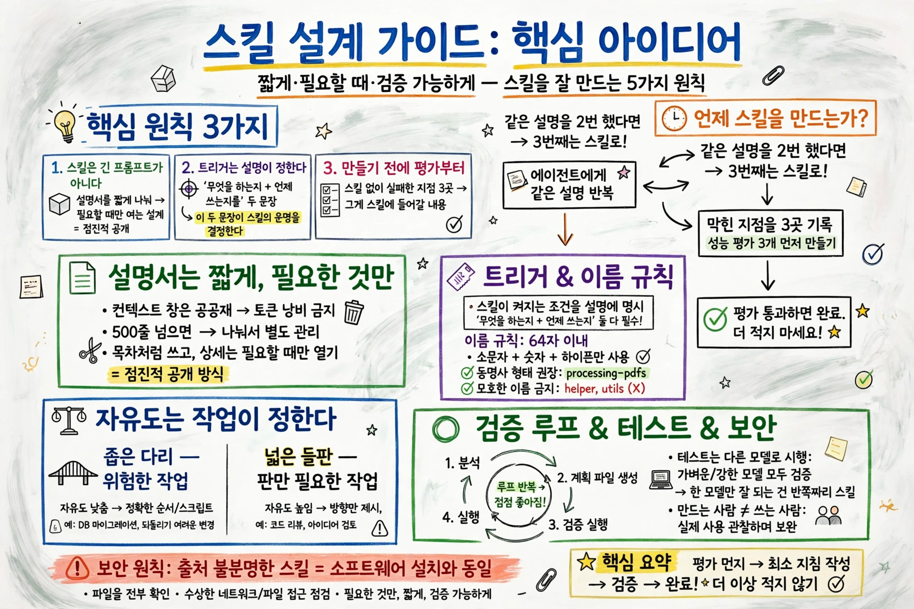
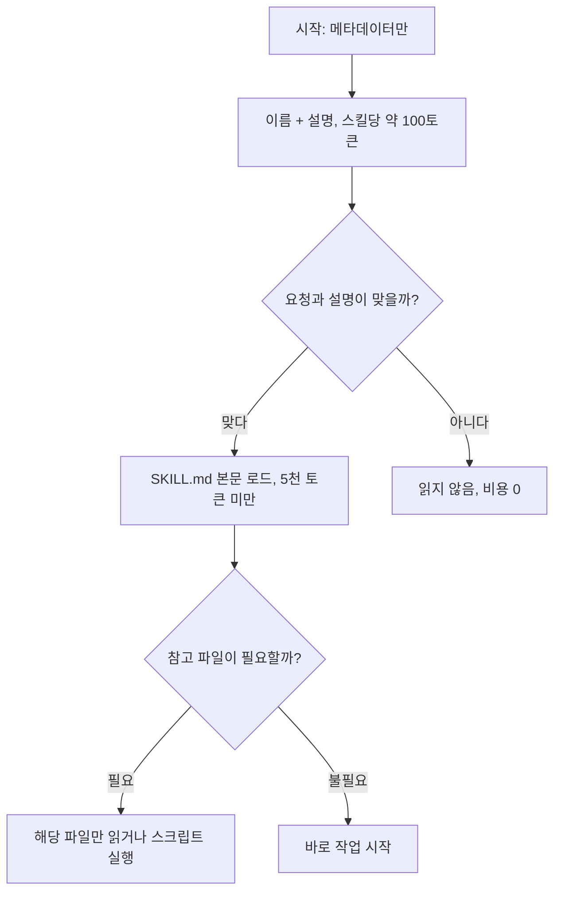
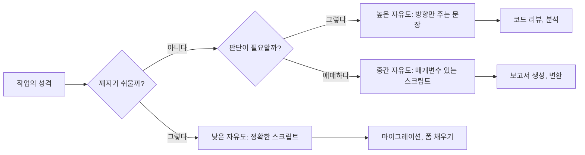
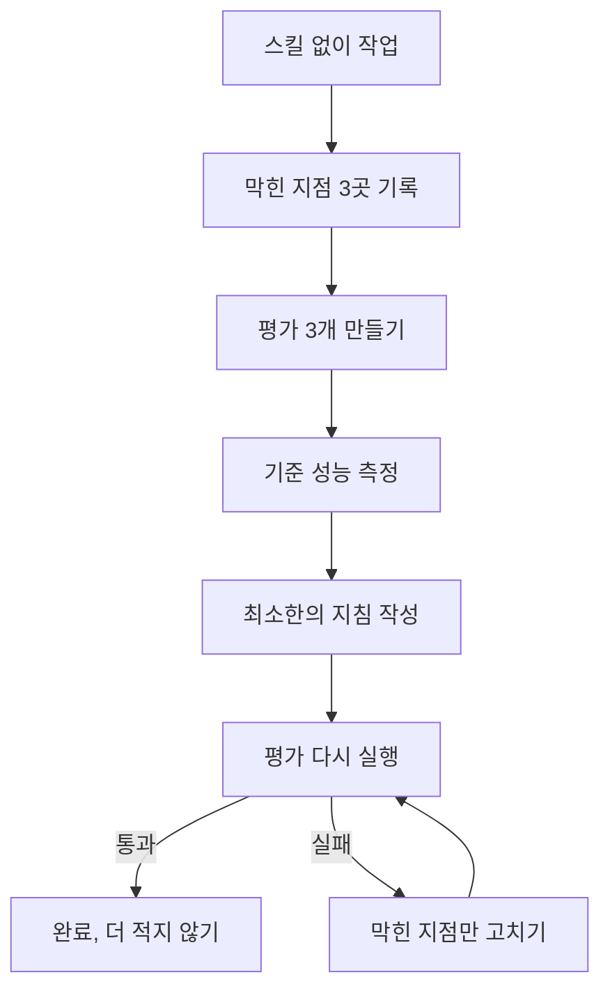

# Agent Skills 설계, 길게 쓰는 게 아닙니다. 짧게 나눠서 필요할 때만 여는 겁니다

> **Summary**
> 에이전트 스킬은 긴 프롬프트가 아니라, 반복되는 실패를 평가로 확인한 뒤 필요한 지침만 짧게 나눠 담아야 합니다. 명확한 이름과 사용 조건으로 적절한 스킬을 선택하게 하고, 작업의 위험도에 맞춰 자유도를 조절하며, 검증 루프와 여러 모델 테스트로 완성도를 높이세요.

---

- 스킬은 프롬프트를 길게 쓰는 게 아닙니다. 설명서를 짧게 나눠, 필요할 때만 여는 게 설계입니다.
- 트리거는 설명이 정합니다. 무엇을 하고 언제 쓰는지를 적은 두 문장이, 스킬의 운명을 가릅니다.
- 만들기 전에 평가부터 만드세요. 스킬 없이 실패한 지점 세 곳이, 스킬에 들어갈 내용의 전부입니다.

에이전트에게 같은 설명을 세 번째 반복하고 계시죠? 이번에는 파일 이름 규칙을, 다음에는 표 형식을, 그다음에는 검증 순서를 다시 알려주는 일 말입니다. 그 반복이 스킬의 씨앗입니다. 그런데 막상 스킬을 만들려고 앉으면, 프롬프트를 길게 붙여넣는 것부터 시작하게 됩니다. 그게 가장 흔한 실패입니다!

🎥 [동영상 보기](https://www.youtube.com/watch?v=VxGIopUQVKo)

### 스킬, 언제 만드는 게 맞을까요?

기준은 하나입니다. 같은 설명을 두 번 했다면, 세 번째는 스킬로 만드세요. 공식 안내도 같은 순서를 권합니다. 먼저 스킬 없이 일을 해보고, 어디서 막히는지 적어두는 겁니다. 그다음 그 막힌 지점을 재는 평가 세 개를 만드세요. 평가가 먼저입니다. 문서를 길게 쓰기 전에 말이죠.

평가가 없으면 스킬은 상상 속 문제를 푸는 문서가 됩니다. 평가가 있으면 스킬은 딱 필요한 만큼만 자랍니다. 기준 성능을 재고, 최소한의 지침을 적고, 평가를 다시 돌려보세요. 통과하면 끝입니다. 더 적지 마세요!

### 설명서는 짧게, 필요한 것만

컨텍스트 창은 공공재입니다. 스킬 한 장이 차지하는 토큰은 대화 기록과 다른 스킬의 자리까지 밀어냅니다. 그래서 공식 안내의 첫 원칙은 간결함입니다. 이미 아는 내용은 빼고, 모르는 것만 적으세요. 문단마다 이렇게 물어보세요. "이 설명이 정말 필요할까요?"

본문은 500줄을 넘기지 않는 게 좋습니다. 넘기면 나눠서 따로 두세요. 설명서는 목차처럼 쓰고, 자세한 내용은 필요할 때만 여는 구조가 정답입니다. 이걸 점진적 공개라고 부릅니다.

### 트리거는 설명이 정합니다

스킬이 켜지는 순간은 설명이 정합니다. 에이전트는 수십, 수백 개의 스킬 중에서 설명만 보고 하나를 고릅니다. 그래서 설명에는 무엇을 하는지와 언제 쓰는지를 둘 다 적어야 합니다. "언제 쓰는지"가 빠진 설명은, 아무리 정확해도 켜지지 않습니다!

이름 규칙도 있습니다. 64자 이내, 소문자와 숫자와 하이픈만, 동명사 형태가 좋습니다. `processing-pdfs`처럼 말이죠. `helper`나 `utils`처럼 모호한 이름은 피하세요. 예약어는 이름에 쓸 수 없습니다. 이름만 봐도 하는 일이 보여야 합니다.

### 자유도는 작업이 정합니다

같은 지침이라도, 작업에 따라 조이는 정도가 다릅니다. 공식 안내의 비유가 좋습니다. 좁은 다리와 넓은 들판입니다. 한 발만 헛디뎌도 떨어지는 다리 위에서는 정확한 순서와 스크립트를 줍니다. 데이터베이스 마이그레이션처럼 말이죠. 반대로 들판에서는 방향만 주고 에이전트에게 맡깁니다. 코드 리뷰처럼 맥락이 답을 정하는 일입니다.

기준은 이렇습니다. 깨지기 쉬운 작업일수록 자유도를 낮추고, 판단이 필요한 작업일수록 자유도를 높입니다. 스크립트는 확정된 순서를, 문장은 판단의 여지를 맡는 겁니다.

### 검증 루프를 넣어두세요

좋은 스킬에는 검증이 들어 있습니다. "검사기를 돌리고, 고치고, 다시 돌리는" 루프 말입니다. 양식 스킬이라면 채움 결과를 검사하는 스크립트를, 스타일 가이드 스킬이라면 대조 문서를 검증기로 삼습니다. 한 번에 통과하지 않아도 됩니다. 루프가 돌수록 결과는 좋아집니다!

특히 배치 작업이나 되돌리기 어려운 변경 앞에서는, 계획부터 검증하는 순서를 쓰세요. 분석하고, 계획 파일을 만들고, 검증하고, 실행하는 겁니다. 계획이 틀렸다는 걸 실행 전에 아는 게, 스킬이 주는 가장 큰 안전입니다.

### 테스트는 다른 모델로

스킬은 모델에 따라 다르게 동작합니다. 가벼운 모델에는 설명이 더 필요하고, 강한 모델에는 설명이 과할 수 있습니다. 그래서 세 가지 모델로 모두 테스트하는 게 좋습니다. 한 모델에서만 잘 되는 스킬은, 반쪽짜리 스킬입니다.

만드는 과정도 둘로 나누면 좋습니다. 한쪽이 스킬을 만들고, 다른 한쪽이 실제 일에 써보는 겁니다. 쓰는 쪽이 어디서 헤매는지 보고, 만드는 쪽이 그 지점만 고칩니다. 관찰이 쌓일수록 스킬은 짧아지고, 정확해집니다.

한 가지 밝혀둘 점이 있습니다. 원문 포스트는 직접 읽지 못했습니다. 이 글은 공식 문서를 1차 원본으로 삼아 쓴 겁니다. 마지막으로 보안입니다. 스킬은 지침과 코드를 함께 담습니다. 그래서 출처를 모르는 스킬은 소프트웨어를 설치하는 것과 같은 마음으로 다뤄야 합니다. 파일을 전부 읽어보고, 수상한 네트워크 호출이나 파일 접근이 없는지 확인하세요. 좋은 설계는 여기서도 통합니다. 필요한 것만, 짧게, 검증 가능하게 말이죠!

