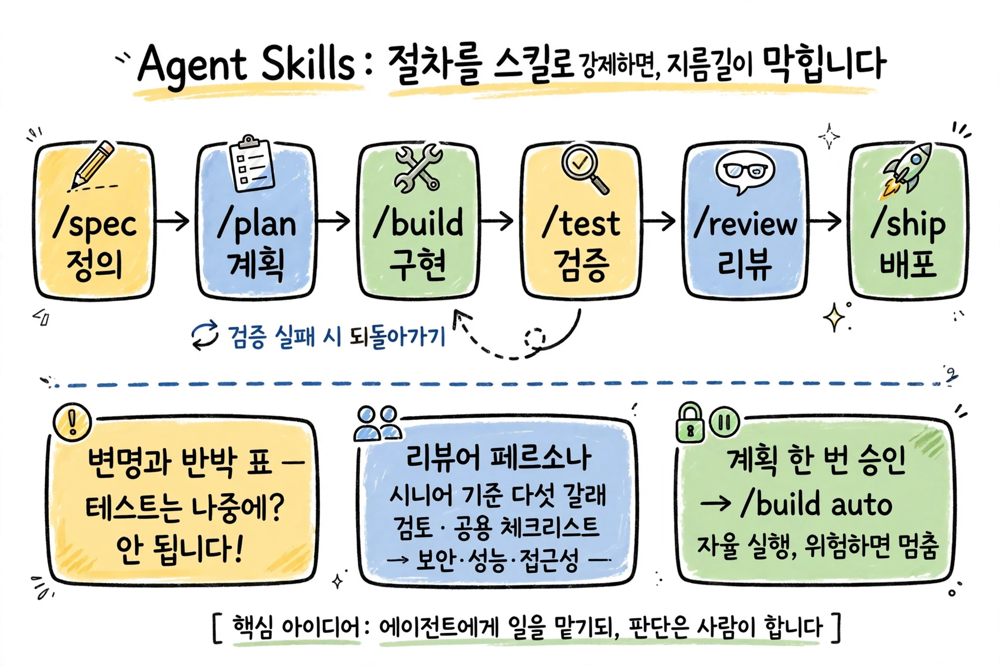
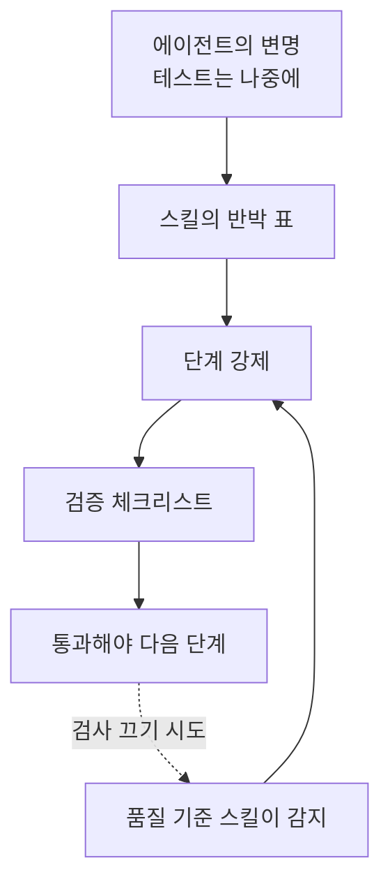
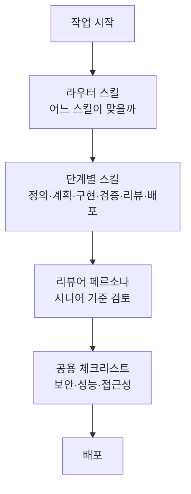

# Agent Skills: AI가 테스트를 건너뛰지 못하게 하려면, 절차를 스킬로 강제하면 됩니다

> **Summary**
> AI 코딩 에이전트가 테스트와 보안 검토를 건너뛰지 않도록, 요구사항 정의부터 배포까지의 절차를 스킬로 구조화해 강제합니다. 변명 반박 표, 검증 체크리스트, 별도 리뷰어 페르소나를 활용해 품질을 높이고, 자동화 중에도 위험한 단계와 최종 판단은 사람이 맡도록 합니다.

---

- AI 코딩 에이전트는 빠른 지름길을 좋아합니다. 테스트와 보안 검토를 건너뛰고 "돌아가기만 하는 코드"를 내놓는 게 기본값입니다.
- Agent Skills는 시니어 엔지니어의 작업 절차를 스킬로 묶어, 설계부터 배포까지 여섯 단계를 에이전트가 건너뛰지 못하게 강제합니다.
- 핵심은 프롬프트가 아니라 구조입니다. 변명에 대한 반박 표, 검증 체크리스트, 리뷰어 페르소나가 절차를 지키게 만듭니다.


AI에게 기능 하나를 맡겼는데, 코드는 금방 나왔지만 테스트가 하나도 없던 적 있으시죠? 돌아가기는 합니다. 그런데 그 코드를 그대로 배포할 수 있을까요?

🎥 [동영상 보기](https://www.youtube.com/watch?v=Q6LR0mXArIQ)

## 에이전트는 왜 지름길을 탈까요?

AI 코딩 에이전트는 기본적으로 가장 짧은 길을 찾습니다. 스펙 없이 바로 코드를 쓰고, 테스트는 나중에 하겠다며 미루고, 보안 검토는 아예 건너뜁니다. 빨리 만드는 것과 잘 만드는 것은 다른 문제입니다!

사람이 옆에서 하나하나 지적하면 고쳐지기는 합니다. 하지만 그 지적을 매번 사람이 해야 한다면, 에이전트를 쓰는 의미가 반쯤 사라집니다. 그래서 이 스킬팩은 지적을 사람의 입이 아니라 스킬의 구조로 옮겼습니다.

## 여섯 단계는 어떻게 돕니까?

작업은 여섯 단계로 나뉩니다. 정의하고, 계획하고, 만들고, 검증하고, 리뷰하고, 배포합니다. 각 단계마다 슬래시 명령어가 붙어 있습니다. `/spec`이 요구사항을 문서로 굳히고, `/plan`이 원자 단위 작업으로 쪼개고, `/build`가 얇은 조각 하나씩 구현하고, `/test`가 테스트로 증명하고, `/review`가 머지 전에 검토하고, `/ship`이 배포합니다.

처음 소개됐을 때는 6개의 명령어라고 알려졌지만, 지금 저장소에는 명령어가 10개입니다. 품질 기준을 정하는 `/constraints`, 웹 성능을 재는 `/webperf`, 접근성을 점검하는 `/a11y`, 코드를 단순하게 다듬는 `/code-simplify`가 더해졌습니다. 6은 단계 수이고, 10은 명령어 수입니다.

스킬은 26개입니다. 명령어를 치지 않아도 작업에 맞는 스킬이 저절로 켜집니다. API를 설계하면 API 설계 스킬이, UI를 만들면 프론트엔드 스킬이 로드됩니다. 무엇을 해야 할지 에이전트가 스스로 판단하는 게 아니라, 스킬이 정해진 절차를 불러오는 구조입니다.

```mermaid
flowchart LR
    A[아이디어] --> B[/spec 정의]
    B --> C[/plan 계획]
    C --> D[/build 구현]
    D --> E[/test 검증]
    E --> F[/review 리뷰]
    F --> G[/ship 배포]
    E -.->|실패하면| D
    F -.->|수정이 필요하면| D
```

## 변명이 통하지 않는 이유는 뭘까요?

이 스킬팩에서 가장 인상적인 장치는 따로 있습니다. 모든 스킬에 "변명과 반박" 표가 들어 있습니다. 에이전트가 단계를 건너뛰려고 흔히 내놓는 변명을 미리 적어두고, 그 변명이 왜 안 되는지 반박까지 함께 적어둔 겁니다. "테스트는 나중에 추가하겠습니다" 같은 말이 나오면, 스킬이 그 자리에서 반박합니다. 변명은 통하지 않습니다!

품질 기준을 정하는 스킬은 한술 더 뜹니다. 품질 기준을 `CONSTRAINTS.md`라는 파일로 따로 적어두고, 에이전트가 검사를 조용히 끄거나 테스트를 빼먹고 통과 표시를 하는지 감시합니다. 검사를 끄는 행위 자체가 규칙 위반으로 잡히는 구조입니다.

## 누가 에이전트를 의심할까요?

결정이 중요한 순간에는 스킬이 에이전트에게 "의심"을 시킵니다. 새로운 맥락에서 결정을 다시 검토하는 스킬은 주장, 근거 추출, 반박, 조정, 중단이라는 다섯 단계를 거칩니다. 확신이 싸다고 검증이 더 비쌀 때, 지금 확인하는 편이 낫다는 판단입니다.

요구사항이 모호하면 한 번에 하나씩 질문하는 스킬이 끼어듭니다. 대충 짐작하고 넘어가지 않고, 확신이 95%쯤 될 때까지 물어봅니다. 질문이 귀찮게 느껴질 수도 있습니다. 하지만 모호한 요구사항으로 만든 코드는 나중에 더 귀찮아집니다.

리뷰는 다른 페르소나가 맡습니다. 코드를 쓴 에이전트가 자기 코드를 리뷰하면 의미가 없으니까요. 리뷰어 페르소나는 "시니어 엔지니어가 이 변경을 승인할까?"라는 기준으로 다섯 갈래로 코드를 봅니다. 변경 크기는 100줄 안팎으로 작게 유지하는 게 원칙입니다.



## 계획은 한 번만 승인하면 될까요?

`/build auto`는 계획 승인을 한 번만 받습니다. 이후에는 각 작업을 알아서 구현하고, 작업마다 테스트를 돌리고, 개별 커밋으로 남깁니다. 실패하거나 위험한 단계에서는 멈춰서 사람에게 넘깁니다. 자율과 방치가 다르다는 걸 구조로 보여주는 셈입니다.

그래도 마지막 판단은 사람의 몫입니다. 세션에서는 "인지적 항복"을 경계하라고 말합니다. 에이전트가 다 했다는 말을 곧이곧대로 믿고 코드를 읽지 않으면, 검토를 에이전트에게 통째로 넘긴 꼴이 됩니다. 절차를 스킬로 고정해두는 이유도 결국 여기에 있습니다. 사람이 코드를 읽고 결정을 내리는 일에 집중하게 하려는 겁니다!

## 설치할 때 뭘 조심해야 할까요?

설치는 스킬 CLI로 한 줄이면 됩니다. 70개가 넘는 에이전트에 같은 스킬팩을 넣을 수 있습니다. 다만 스킬 하나만 골라서 설치하면 공용 체크리스트 폴더가 함께 복사되지 않습니다. 보안·성능·접근성 체크리스트가 빠진 채로 스킬만 들어오는 겁니다. 통째로 설치하는 편이 안전합니다.

이름이 겹치는 명령어도 있습니다. `/review`는 코딩 에이전트에 이미 있는 명령어라서, 이 스킬팩의 리뷰 명령어는 이름 앞에 접두어를 붙인 형태로 써야 합니다. 작은 디테일이지만, 처음 쓰면 헷갈리기 쉬운 지점입니다.

숫자도 확인했습니다. 2026년 2월에 공개된 이 스킬팩은 2026년 11월 22일 기준으로 별 119,700개, 포크 12,442개를 받았습니다. 스킬 26개, MIT 라이선스입니다. 숫자가 품질을 보증하지는 않습니다. 다만 이렇게 많은 사람이 절차를 스킬로 고정하는 방식에 공감했다는 뜻으로는 읽을 수 있습니다.



에이전트에게 일을 맡기는 것과 판단을 맡기는 것은 다릅니다. 절차를 스킬로 고정해두면, 사람은 코드를 읽고 결정을 내리는 일에 집중할 수 있습니다. 그게 이 스킬팩이 던지는 가장 실용적인 메시지입니다!

