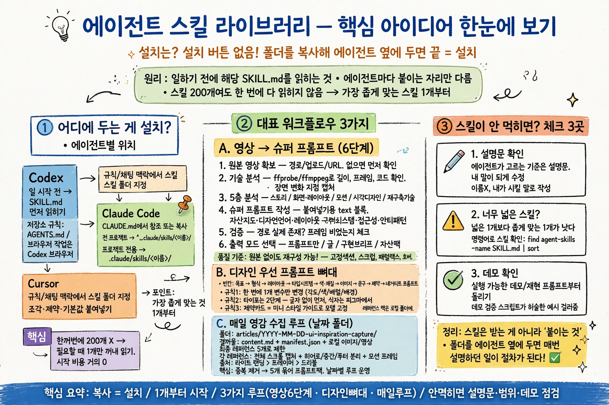
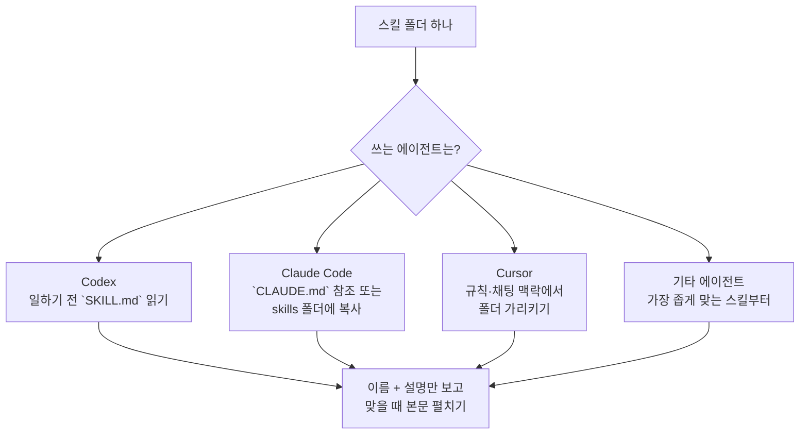
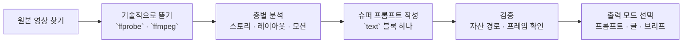
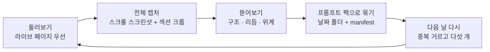

# Agent Skills: 설치 버튼은 없습니다. 스킬 폴더를 에이전트 옆에 두는 게 설치입니다

> **Summary**
> Agent Skills는 별도 설치 프로그램 없이 스킬 폴더를 에이전트가 작업 전에 읽을 수 있도록 배치하는 방식으로 사용합니다. 가장 적합한 스킬 하나부터 적용하고, 영상 분석·디자인 프롬프트·영감 수집 같은 반복 작업은 정해진 단계와 산출물로 체계화할 수 있습니다. 스킬이 작동하지 않으면 설명문이 실제 요청 표현과 맞는지, 범위가 너무 넓지 않은지, 데모로 검증했는지 확인합니다.

---

- 에이전트 스킬 라이브러리에는 설치 프로그램이 없습니다. 폴더를 복사해 에이전트 옆에 두는 게 설치이고, 에이전트마다 붙이는 자리만 다릅니다.
- 대표 워크플로우는 영상을 슈퍼 프롬프트로 바꾸는 여섯 단계, 디자인 우선 프롬프트 뼈대, 매일 도는 영감 수집 루프 세 가지로 나뉩니다.
- 가장 좁게 맞는 스킬 하나부터 읽히는 게 요령입니다. 스킬이 안 먹히면 설명문을 내가 쓸 말로 고치는 것부터 봅니다.


스킬 200개짜리 모음을 받았는데, 설치 버튼이 안 보인 적 있으시죠? 압축을 풀었는데 실행 파일도 없고 설정 화면도 없습니다. 다음에 뭘 해야 할지 막막합니다. 이게 정상입니다. 설치 버튼이 없는 게 이 라이브러리의 설계입니다.

🎥 [동영상 보기](https://www.youtube.com/watch?v=K2MwtjcHA6U)

## 어디에 두는 게 설치인가요?

에이전트마다 붙이는 자리가 다릅니다. 원리는 하나입니다. 일하기 전에 해당 `SKILL.md`를 읽히는 겁니다.

- **Codex**: 일하기 전에 관련 `SKILL.md`를 먼저 읽힙니다. 저장소 행동 규칙은 `AGENTS.md`에 두고, 브라우저 작업은 Codex 브라우저로 합니다.
- **Claude Code**: `CLAUDE.md`에서 스킬을 참조하거나, 스킬 설정에 복사하거나, `SKILL.md`를 직접 작업 맥락으로 엽니다. 모든 프로젝트에 쓸 스킬은 `~/.claude/skills/<이름>/`에, 한 프로젝트에만 쓸 스킬은 `.claude/skills/<이름>/`에 둡니다.
- **Cursor**: 규칙이나 채팅 맥락에서 스킬 폴더를 가리킵니다. 재사용할 조각·제약·기본값은 붙여넣기 쉽게 둡니다.
- **그 외 에이전트**: 계약은 같습니다. 가장 좁게 맞는 스킬부터 읽고, 그 안의 단계와 연결 문서를 따릅니다.
- **채팅형 클로드**: 스킬 폴더를 통째로 압축해 올리는 방식이 있습니다. 폴더 안 이름이 스킬 이름과 같아야 합니다.
여기서 헷갈리기 쉬운 지점이 있습니다. 스킬 200개를 한꺼번에 읽히면 될까요? 안 됩니다. 에이전트는 시작할 때 이름과 설명만 보고, 지금 할 일과 맞을 때 본문을 펼칩니다. 필요한 것만 꺼내 읽는 구조라, 스킬이 많아도 시작 비용이 거의 안 듭니다. 설치의 요령은 전부 붙이는 게 아니라, 가장 좁게 맞는 것 하나부터 붙이는 겁니다.



## 영상 하나를 슈퍼 프롬프트로 바꾸면 어떻게 되나요?

대표 워크플로우부터 돌려보는 게 가장 빠릅니다. 영상에서 슈퍼 프롬프트를 뽑는 스킬은 여섯 단계로 돌아갑니다.

**1단계, 원본 영상을 찾습니다.** 로컬 경로, 업로드한 파일, URL, 브라우저에 보이는 영상까지 받습니다. 영상이 안 보이면 정확한 파일이나 URL을 먼저 묻습니다. 없는 걸 지어내지 않습니다.

**2단계, 기술적으로 뜯어봅니다.** `ffprobe`로 길이·크기·프레임·코덱을 확인하고, `ffmpeg`으로 대표 프레임을 뽑습니다. 균일한 썸네일보다 타임라인의 박자가 바뀌는 장면을 고릅니다.

```bash
ffprobe -v error -show_entries format=duration,size:stream=width,height,r_frame_rate -of json "$VIDEO"
ffmpeg -y -i "$VIDEO" -vf fps=1 /tmp/video-frames/frame-%03d.jpg
```

**3단계, 층별로 분석합니다.** 스토리, 화면·레이아웃, 모션, 시각 디자인, 재구축 기술 다섯 층으로 나눠 봅니다. 모션은 나타나는 타이밍과 이징, 고정 섹션과 스크롤 연동, 호버 상태까지 봅니다. 재구축 기술은 어떤 라이브러리와 API로 다시 만들지를 적습니다.

**4단계, 슈퍼 프롬프트를 씁니다.** 붙여넣기용 프롬프트 하나를 `text` 블록으로 씁니다. 자산 지도, 전체 디자인 언어, 레이아웃 규칙, 섹션별 해부, 모션 시스템, 반응형 요구사항, 접근성·성능, 안티 패턴까지 들어갑니다. "예쁘게 해줘" 같은 말은 쓰지 않습니다. 취향을 구체적인 제작 지시로 바꿉니다.

**5단계, 마무리 전에 검증합니다.** 프롬프트 안 자산 경로가 실제로 있는지, 뽑은 프레임 파일이 비어 있지 않은지 확인합니다.

**6단계, 출력 모드를 고릅니다.** 프롬프트만 줄 수도 있고, 글로 만들 수도 있고, 제작 계획과 검수 목록을 붙인 구현 브리프나 자산 생성 팩으로 나눌 수도 있습니다.

품질 기준은 하나입니다. 원본 영상을 보지 않고도 다시 만들 수 있을 만큼 자세할 것! 정확한 모션 메커니즘은 이름으로 적습니다. 고정 섹션, 스크럽 타임라인, `video.currentTime`, 패럴랙스 층, 마스크, 호버 상태처럼 말입니다. 모바일 동작과 모션 감소 대응은 매번 포함합니다.



## 디자인 프롬프트, 어떻게 쓰면 매번 같아지나요?

디자인 우선 프롬프트 스킬은 뼈대부터 줍니다. 목표·형식·레이아웃·타입 시스템·색과 재질·이미지·문구·제약·네거티브 프롬프트 순으로 빈칸을 채우는 겁니다. 소망이 아니라 설계도처럼 적는 게 핵심입니다.

규칙은 세 가지입니다. 첫째, 하나의 시스템을 고정하고 변형은 한 번에 한 변수만 바꿉니다. 각도·강조색·카드 배열·배경 톤 중 하나만 움직입니다. 둘째, 타이포는 2단계로 갑니다. 글자 없이 먼저 만들고, 식자는 피그마에서 합니다. 모델이 자꾸 오타를 내면 이 방법이 답입니다. 셋째, 제약 카드를 씁니다. 폰트·스타일·모드 값을 작은 패널로 적어두면, 그게 미니 스타일 가이드처럼 모델을 붙잡아 둡니다.

하나를 더합니다. 레퍼런스 팩을 로컬에 모아두는 겁니다. 취향을 모델이 기억하게 두지 않습니다. 참고 이미지를 버전 관리에서 뺀 폴더에 두고, 프롬프트가 그 스타일을 가리키게 합니다. 맛은 문장이 아니라 파일로 남기는 겁니다!

## 매일 도는 루프는 어떻게 만드나요?

매일 영감을 모으는 스킬은 날짜 폴더 하나가 결과물입니다. `articles/YYYY-MM-DD-ui-inspiration-capture/` 안에 `content.md`와 `manifest.json`, 로컬 이미지와 영상을 담습니다. 최종 레퍼런스는 정확히 다섯 개입니다.

한 레퍼런스마다 라이브 페이지 전체를 스크롤 캡처한 스크린샷 한 장을 남기고, 히어로·중간 섹션·푸터는 따로 잘라냅니다. 동영상 캡처가 되면 모션 프레임도 붙입니다. 출처는 둘러볼 수 있는 라이브 랜딩 페이지가 우선이고, 프레이머 마켓플레이스가 강한 출처입니다. 드리블은 되는 만큼만 씁니다. 막히면 더 강한 후보로 바꿉니다.

고르는 기준도 있습니다. 이전 `manifest.json`부터 읽어 중복을 거르고, 다섯 개가 모이면 프롬프트 팩으로 묶습니다. 이 장면이 저는 가장 인상 깊었습니다. 영감을 스크린샷 더미로 쌓지 않고 날짜별 묶음으로 굴리는 루프라는 점입니다!



## 스킬이 안 먹히면 어디를 보나요?

스킬을 붙였는데 에이전트가 안 쓰면, 세 곳을 봅니다.

첫째, **설명문**입니다. 에이전트가 스킬을 고르는 기준은 설명문 한 장입니다. 설명을 내가 그 일을 시킬 때 쓸 말로 적어야 합니다. 이름이 아니라 설명이 트리거를 정합니다.

둘째, **너무 넓은 스킬**을 골랐는지 봅니다. 넓은 스킬 하나보다 좁게 맞는 스킬 하나가 낫습니다. 스킬 목록은 `find agent-skills -name SKILL.md | sort` 명령으로 직접 세는 게 정확합니다. 소개 글의 스냅샷 숫자는 파일 증가 속도를 못 따라갑니다.

셋째, **데모**입니다. 실행 가능한 데모와 재현 프롬프트가 있는 스킬은 먼저 돌려봅니다. 데모 검증 스크립트가 얇은 재현이나 규격 미달 미리보기를 걸러줍니다. 예시가 증명 없이 쌓이는 걸 막아주는 장치입니다.

스킬은 받는 게 아니라 붙이는 겁니다. 폴더 하나를 에이전트 옆에 두는 순간, 매번 새로 설명하던 일이 절차가 됩니다!

