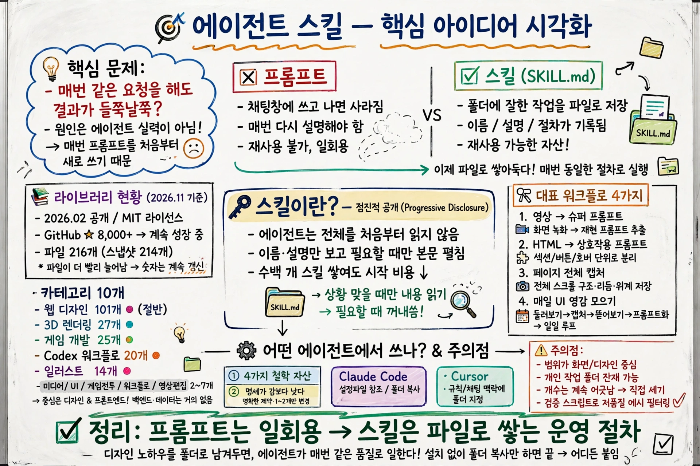
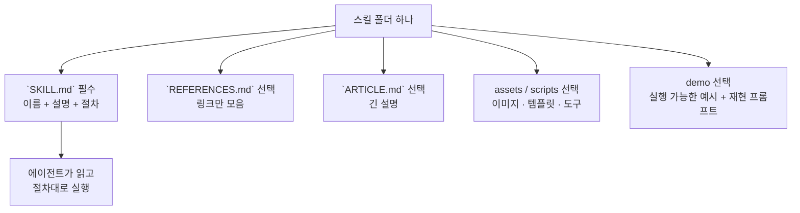
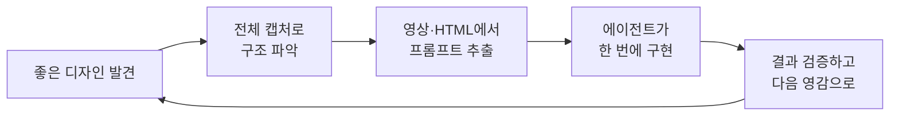

# Agent Skills: 프롬프트를 파일로 쌓아두면, 에이전트가 매번 같은 품질로 만듭니다

> **Summary**
> 에이전트 스킬은 잘한 작업의 절차와 주의사항을 SKILL.md 파일로 저장해 필요할 때 불러 쓰는 방식으로, 반복 작업의 일관성과 재사용성을 높입니다. 200개가 넘는 스킬을 담은 라이브러리는 웹 디자인과 프론트엔드 중심이며, 다양한 에이전트에서 활용할 수 있습니다. 다만 백엔드·데이터·테스트 분야는 부족하고 일부 스킬은 다듬어지지 않았으므로, 실제 파일과 예시를 확인해 사용하는 것이 좋습니다.

---

- 에이전트 스킬은 잘한 작업을 폴더 하나에 담아두는 방식입니다. `SKILL.md` 한 장에 언제 쓰고, 뭘 먼저 하고, 뭘 조심할지가 적혀 있습니다.
- 디자인 교육 플랫폼 창업자가 공개한 이 라이브러리에는 웹 디자인·3D·게임·일러스트까지 200개가 넘는 스킬이 들어 있습니다.
- 프롬프트를 채팅창에 매번 새로 쓰는 대신, 파일로 쌓아두면 에이전트가 매번 같은 절차로 일합니다!

에이전트에게 랜딩 페이지 하나 만들어달라고 했는데, 어제는 근사하게 나왔고 오늘은 어딘가 어색하게 나온 적 있으시죠? 같은 요청을 했는데 결과가 들쭉날쭉합니다. 문제는 에이전트 실력이 아닙니다. 매번 처음부터 설명하기 때문입니다!

🎥 [동영상 보기](https://www.youtube.com/watch?v=oVthf0fUcFY)

## 스킬은 프롬프트와 뭐가 다른가요?

프롬프트는 채팅창에 쓰고 나면 사라집니다. 다음에 같은 일을 시키려면 다시 써야 합니다. 스킬은 다릅니다. 잘한 작업을 파일로 남기는 겁니다. 폴더 하나에 `SKILL.md` 한 장이 들어가고, 그 안에 이름·설명·절차가 적혀 있습니다.

에이전트는 처음부터 파일 전체를 읽지 않습니다. 이름과 설명만 보고, 지금 할 일과 맞을 때 본문을 펼칩니다. 그래서 스킬이 수백 개 쌓여도 시작 비용이 거의 안 듭니다. 필요할 때만 꺼내 읽는 구조입니다. 이 방식을 점진적 공개라고 부릅니다.

이 장면이 저는 가장 인상 깊었습니다. 지식을 외우는 게 아니라, 필요할 때 찾아 읽는 절차로 바꾸는 발상입니다!

## 라이브러리 안에는 뭐가 들었나요?

이 라이브러리는 2026년 2월에 공개됐고, MIT 라이선스로 열려 있습니다. 2026년 11월 기준으로 별 8,000개가 넘었고, 지금도 계속 커지고 있습니다. README에 적힌 스냅샷은 214개, 열 개 카테고리입니다. 직접 파일 목록을 세어 보니 216개가 나왔습니다. 숫자가 어긋나는 이유는 간단합니다. 스냅샷이 갱신되는 속도보다 파일이 늘어나는 속도가 빠르기 때문입니다.

카테고리별로 보면 중심이 분명합니다. 웹 디자인이 101개로 절반 가까이 차지합니다. 3D 렌더링이 27개, 게임 개발이 25개, Codex 워크플로우가 20개, 일러스트가 14개입니다. 미디어 7개, UI 7개, 게임 전투 6개, 워크플로우 5개, 영상 편집 2개가 뒤를 잇습니다. 백엔드·데이터·테스트는 거의 없습니다. 이 라이브러리의 무대는 화면입니다. 디자인과 프론트엔드가 본체입니다.

## 대표 워크플로우는 어떻게 돕나요?

입구에는 네 가지 대표 워크플로우가 서 있습니다. 영상에서 프롬프트를 뽑는 것부터, 하루치 영감을 모으는 루프까지 이어집니다.

- **영상을 슈퍼 프롬프트로**: 화면 녹화본을 보고, 디자인을 한 번에 재현할 만큼 자세한 프롬프트를 뽑아냅니다.
- **HTML을 상호작용 프롬프트로**: 이미 있는 페이지를 섹션·애니메이션·버튼·호버 상태 단위로 쪼개 재사용 가능한 프롬프트로 바꿉니다.
- **페이지 전체를 캡처**: 첫 화면만 말고 페이지 끝까지 통째로 캡처해 구조·리듬·위계를 통째로 참고합니다.
- **매일 UI 영감 모으기**: 둘러보고, 캡처하고, 뜯어보고, 프롬프트를 만드는 일을 매일 도는 루프로 묶었습니다.

## 왜 파일로 쌓는 걸까요?

이 라이브러리 뒤에는 네 가지 철학이 있습니다. 하나씩 보면, 스킬이라는 형식이 왜 하필 폴더인지 감이 옵니다.

첫째, 프롬프트는 자산입니다. 한 번 잘 썼으면 재사용해야 합니다. 파일로 저장하고, 버전을 매기고, 모아서 관리합니다. 둘째, 명세가 감보다 낫습니다. 명확한 제약과 위계, 한 번에 1~2가지만 바꾸는 반복이 일관된 결과를 만듭니다. 셋째, 레퍼런스가 문단보다 낫습니다. 스크린샷과 예시가 폰트·간격·색·리듬을 말보다 정확히 전합니다. 넷째, 스킬은 운영 절차입니다. 언제 쓰는지, 뭘 먼저 하는지, 기본값은 뭔지, 어떤 실수를 피해야 하는지를 적어둡니다. 이 네 가지가 모이면, 스킬은 지식이 아니라 일하는 순서가 됩니다!

## 어떤 에이전트에서 쓰나요?

형식이 평범한 마크다운 폴더라, 에이전트를 가리지 않습니다. Codex는 일하기 전에 해당 `SKILL.md`를 읽습니다. Claude Code는 설정 파일에서 스킬을 참조하거나, 폴더를 통째로 복사해 씁니다. Cursor는 규칙이나 채팅 맥락에 폴더를 가리킵니다. 다른 에이전트도 같은 계약을 따릅니다. 가장 좁게 맞는 스킬부터 읽고, 그 안의 단계를 따르는 겁니다.

설치 프로그램은 없습니다. 폴더를 복사해 넣는 게 기본입니다. 스킬 관리 도구를 쓰면 명령 한 줄로 받을 수도 있지만, 라이브러리 자체는 파일 묶음 그 자체입니다. 단순한 만큼, 어디에든 붙습니다.

## 어디까지 믿으면 될까요?

좋은 점만 있는 건 아닙니다. 몇 가지는 알고 쓰는 게 맞습니다.

첫째, 범위가 화면에 쏠려 있습니다. 백엔드·데이터·테스트 작업은 거의 다루지 않습니다. 둘째, 일부 스킬은 아직 개인 작업 폴더 같은 티가 납니다. 내부 초안이라는 문구가 남아 있거나, 작성자의 로컬 경로가 설정 파일에 박혀 있는 곳도 있습니다. 셋째, 개수는 금방 어긋납니다. 스냅샷 숫자를 그대로 믿기보다, 파일 목록을 직접 세는 게 정확합니다. 넷째, 데모에는 검증 스크립트가 있습니다. 얇은 재현 프롬프트나 규격 미달 미리보기는 걸러냅니다. 이건 장점입니다. 예시가 증명 없이 쌓이는 걸 막아주니까요.

정리하면, 이 라이브러리는 디자인 노하우를 파일로 쌓아두는 창고입니다. 프롬프트를 매번 새로 쓰는 대신, 잘한 절차를 폴더로 남겨두는 겁니다. 에이전트가 매번 같은 품질로 일하게 만드는 가장 단순한 방법이, 어쩌면 파일 하나일지도 모릅니다!

