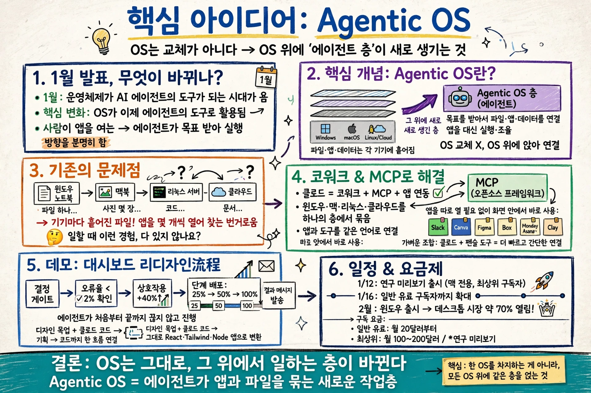
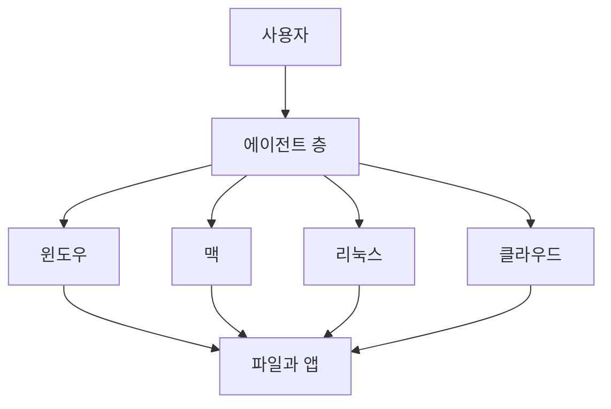
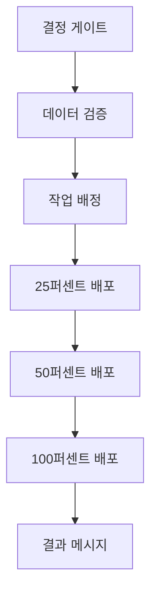
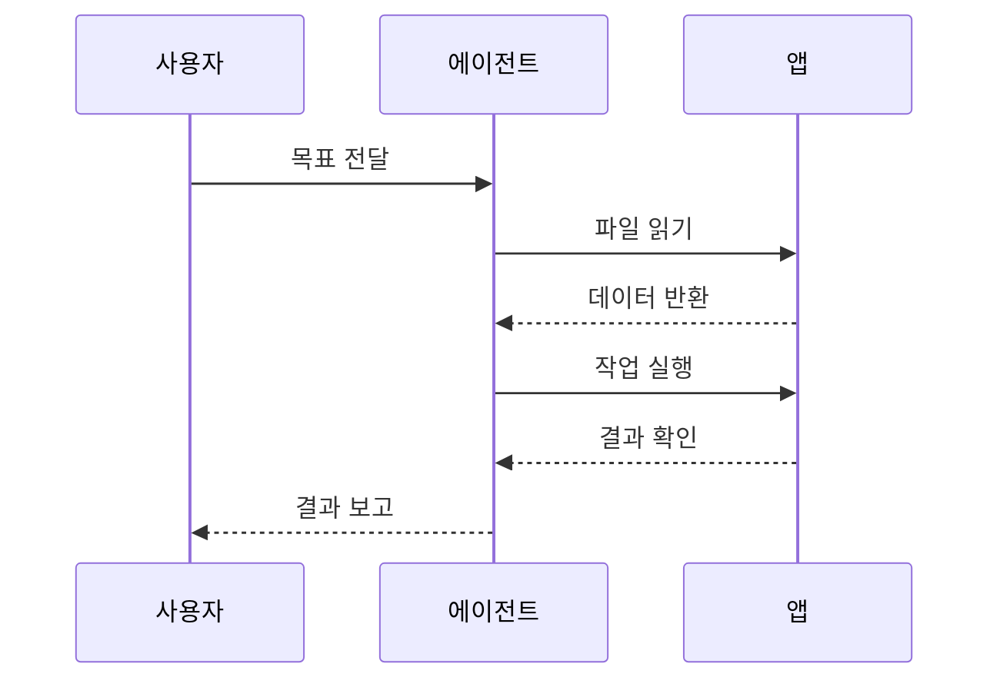

# Agentic OS, OS가 바뀌는 게 아니라 에이전트 층이 새로 생기는 겁니다

> **Summary**
> 에이전트가 OS를 대체하는 것이 아니라 윈도우·맥·리눅스·클라우드 위에 새로운 작업 층으로 자리 잡아 파일과 앱을 연결하고 목표를 실행합니다. 코워크와 MCP를 통해 앱 연동과 다단계 작업을 하나의 흐름으로 처리하며, OS는 그대로 유지됩니다.

---

- 1월 발표는 방향을 분명히 했습니다. 운영체제가 AI 에이전트의 도구가 되는 시대가 오고 있습니다.
- 클로드는 코워크와 MCP, 앱 연동으로 윈도우·맥·리눅스·클라우드를 하나의 층에서 묶기 시작했습니다.
- 핵심은 OS 교체가 아닙니다. OS 위에 앉아 파일·앱·데이터를 이어주는 에이전트 층이 새로 생기는 겁니다.

윈도우 노트북에 파일 하나, 맥북에 사진 몇 장, 리눅스 서버에 코드, 클라우드에 문서까지. 일하다 보면 기기마다 흩어진 파일을 찾느라 앱을 몇 개씩 열어본 적 있으시죠?

🎥 [동영상 보기](https://www.youtube.com/watch?v=UAmKyyZ-b9E)

## Agentic OS, 무슨 뜻일까요?

OS가 에이전트의 도구가 된다는 말, 무슨 뜻일까요? 앱을 켜고 파일을 여는 주체가 사람에서 에이전트로 바뀐다는 뜻입니다. 사람이 앱을 하나씩 여는 대신, 에이전트가 목표를 받아서 움직입니다.

1월 12일, 코워크가 연구 미리보기로 나왔습니다. 처음엔 맥 전용, 최상위 구독자 대상이었습니다. 1월 16일 일반 유료 구독자로 넓어졌고, 2월에는 윈도우에도 왔습니다. 데스크톱 시장의 약 70%가 열리는 순간이었습니다!

코워크는 클로드 코드의 에이전트 방식을 개발자 바깥으로 가져온 겁니다. 터미널 없이, 대화로 파일을 읽고 다단계 작업을 실행합니다. 제안하고, 실행하고, 결과를 확인하는 순환이 그대로 돌아갑니다!

## 데모가 보여준 그림은?

캐러셀 데모는 대시보드 리디자인 롤아웃을 처음부터 끝까지 이어서 보여줍니다. 결정 게이트부터 배포까지, 에이전트가 끊지 않고 이어갑니다.

오류율 2% 미만이면 다음 단계로 넘어갑니다. 스테이징 그룹의 상호작용이 기존 대비 40% 올랐습니다. 숫자 확인이 끝나면 작업이 배정되고, 25%에서 50%, 100%로 단계적으로 배포됩니다. 마지막엔 결과 메시지가 나갑니다.

마지막 장면이 인상 깊었습니다. 디자인 목업 옆에 클로드 코드가 떠 있고, 목업이 그대로 리액트·테일윈드·노드 앱으로 바뀌는 과정이 이어집니다. 기획부터 코드까지, 한 흐름으로 연결되는 겁니다!

## 앱이 에이전트 안에 들어옵니다

클로드는 이제 외부 서비스를 화면 안에서 바로 보여줍니다. 슬랙, 캔바, 피그마, 박스, 앱플리튜드, 먼데이닷컴, 아사나, 클레이, 헥스까지. 앱을 따로 열 필요가 없습니다!

연결의 기반은 MCP입니다. 오픈소스 프레임워크가 앱과 도구를 같은 언어로 묶어줍니다. 이게 있으니 에이전트가 앱을 도구처럼 부를 수 있습니다.

가벼운 조합도 눈에 띕니다. 클로드와 펜슬 도구를 함께 쓰면 피그마 연결보다 빠르고 설정도 간단합니다. 무거운 다리보다 가벼운 연결이 먼저 통했습니다.

## 그럼 OS는 사라질까요?

아닙니다. 윈도우·맥·리눅스는 그대로 있습니다. 바뀌는 건 그 위에서 일하는 층입니다. OS는 파일과 앱을 품고, 에이전트는 그 위에서 목표를 받아 움직입니다.

코워크가 맥에서 시작해 윈도우로 간 순서도 이 방향을 보여줍니다. 한 OS를 차지하는 게 아니라, 모든 OS 위에 같은 층을 얹는 겁니다.

구독 요금도 현실적인 선에 있습니다. 일반 유료 요금제는 월 20달러부터 쓸 수 있고, 최상위 요금제는 월 100달러에서 200달러 사이입니다. 연구 미리보기라는 단서도 함께 붙어 있습니다.

OS는 그대로 두고, 그 위에서 일하는 층이 바뀌고 있습니다. 에이전트가 앱과 파일을 묶는 시대, 그 층의 이름이 바로 Agentic OS입니다.

