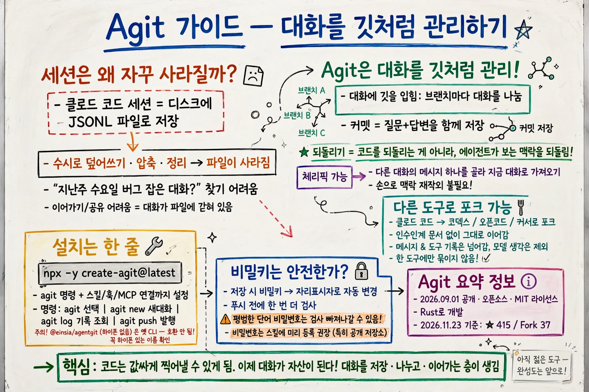
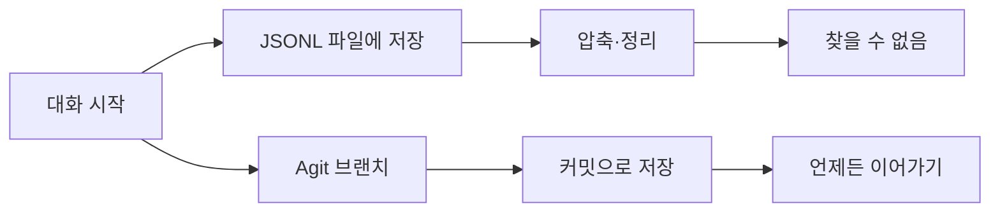
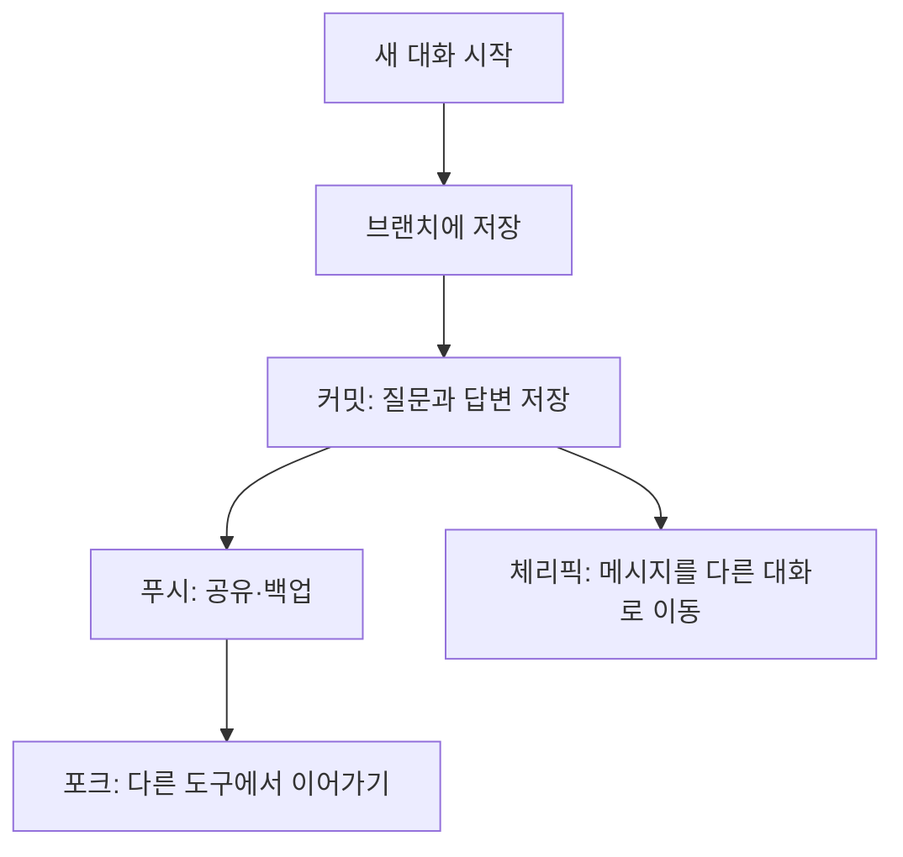

# Agit: 대화는 깃처럼 관리합니다. 세션도 커밋하고, 브랜치하고, 포크합니다

> **Summary**
> Agit은 클로드 코드 등의 AI 대화를 브랜치·커밋·체리픽으로 저장하고 관리하며, 다른 코딩 도구로 포크하거나 공유할 수 있게 해 줍니다. 비밀키를 감지해 자리표시자로 바꾸지만 평범한 비밀번호는 놓칠 수 있어 주의가 필요합니다. 오픈소스 도구로, 세션을 지속 가능한 자산으로 다루는 새로운 방식을 제안합니다.

---

- 클로드 코드 세션은 그냥 파일이라, 덮어쓰이고 압축되고 정리되면서 사라집니다.
- Agit은 그 대화에 깃을 입힙니다. 브랜치마다 대화를 나누고, 커밋으로 저장하고, 필요하면 다른 대화로 메시지를 가져옵니다.
- 클로드 코드에서 하던 대화를 다른 코딩 도구로 포크할 수도 있고, 비밀키는 저장 전에 자리표시자로 바꿉니다.

지난주 수요일에 겨우 잡은 버그, 그 대화 다시 찾으려던 적 있으시죠? 세션 목록을 뒤졌는데 이름은 비슷비슷하고, 이어가려니 맥락이 잘렸습니다. 대화가 파일 한 장에 갇혀 있으면 이런 일이 반복됩니다!

🎥 [동영상 보기](https://www.youtube.com/watch?v=CHHEjuNBxoQ)

### 세션은 왜 자꾸 사라질까요?

클로드 코드 세션은 디스크에 `JSONL` 파일로 남습니다. 그런데 그 파일은 수시로 덮어쓰이고, 압축되고, 정리됩니다. "지난주 수요일에 버그를 잡은 그 대화"는 찾을 방법이 따로 없습니다. 이어가기도, 동료에게 건네기도 어렵습니다. 대화가 코드가 아니라 파일에 갇혀 있기 때문입니다.

### 대화를 깃처럼 관리하면 뭐가 달라질까요?

Agit은 대화에 깃 모델을 그대로 가져옵니다. 프로젝트마다 여러 대화를 각자 브랜치에 나눠 두고, 커밋은 질문과 답변을 함께 저장합니다. 되돌리기가 코드를 되돌리는 게 아닙니다. 에이전트가 보는 맥락을 되돌리는 겁니다!

이 장면이 저는 가장 인상 깊었습니다. 되돌리기가 코드를 되돌리는 게 아니라, 에이전트가 보는 맥락을 되돌린다는 점이요!

체리픽도 됩니다. 다른 대화의 메시지 하나를 골라, 그 답변과 함께 지금 대화로 가져옵니다. 맥락을 다시 설명하며 손으로 옮길 필요가 없습니다. 공유도 깃 방식입니다. 프로필, 협업자, 풀 리퀘스트, 읽기 전용 링크까지 그대로 씁니다. 비공개 저장소는 1GB까지, 공개 저장소는 제한이 없습니다.

### 다른 도구로 대화를 넘길 수도 있을까요?

됩니다. 클로드 코드에서 하던 세션을 코덱스로 포크하면, 인수인계 문서 없이 그대로 이어갑니다. 메시지와 도구 기록은 넘어가고, 모델의 생각만 넘어가지 않습니다. 클로드 코드, 코덱스, 오픈코드, 커서까지 네 가지 도구에서 돌아갑니다. 한 도구에만 묶이지 않는다는 뜻입니다!

### 설치는 어떻게 할까요?

설치는 한 줄입니다. `npx -y create-agit@latest`를 실행하면 `agit` 명령과 스킬·훅·MCP 연결까지 함께 갖춰집니다. 전역 설치는 `npm install -g @einsia/agent-git`입니다. 세션 데이터는 홈 폴더 안 `.agit` 폴더에 모입니다. 명령도 깃을 닮았습니다. `agit`은 이어갈 세션을 고르고, `agit new`는 새 대화를 만들고, `agit log`는 대화 기록을 훑고, `agit push`는 세션을 발행합니다.

주의할 이름이 하나 있습니다. 하이픈 없는 `@einsia/agentgit`은 다시 쓰기 전 옛날 CLI라, 지금 버전과는 프로토콜이 맞지 않습니다. 설치할 때 꼭 하이픈 있는 이름을 확인해야 합니다.

### 비밀키는 괜찮을까요?

Agit은 저장할 때 알아본 비밀키를 자리표시자로 바꾸고, 푸시하기 전에 한 번 더 검사합니다. 그런데 구멍이 하나 있습니다. 평범한 단어로만 된 비밀번호는 패턴이 없어서 검사를 빠져나갈 수 있습니다. 그래서 비밀번호는 스킬에 미리 등록해 두는 편이 안전합니다. 공개 저장소에 세션을 올릴 때는 이 점이 더 중요합니다.

Agit은 2026년 9월 1일에 공개된 오픈소스 프로젝트로, MIT 라이선스입니다. 러스트로 만들어졌고, 2026년 11월 23일 기준 별 415개, 포크 37개를 기록했습니다. 아직 젊은 도구입니다. 그래서 세션을 깃처럼 다룬다는 발상 자체가 먼저이고, 완성도는 앞으로 지켜볼 일입니다.

코드는 값싸게 찍어낼 수 있게 됐습니다. 이제 대화가 자산이 됩니다. 대화를 저장하고, 나누고, 이어가는 층이 비로소 생겼습니다!

