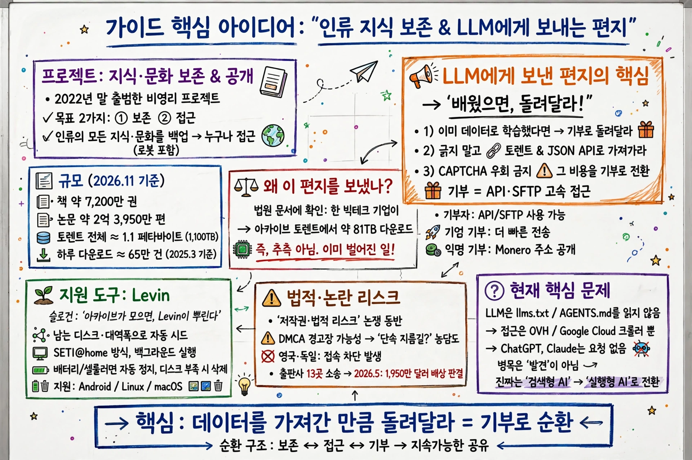
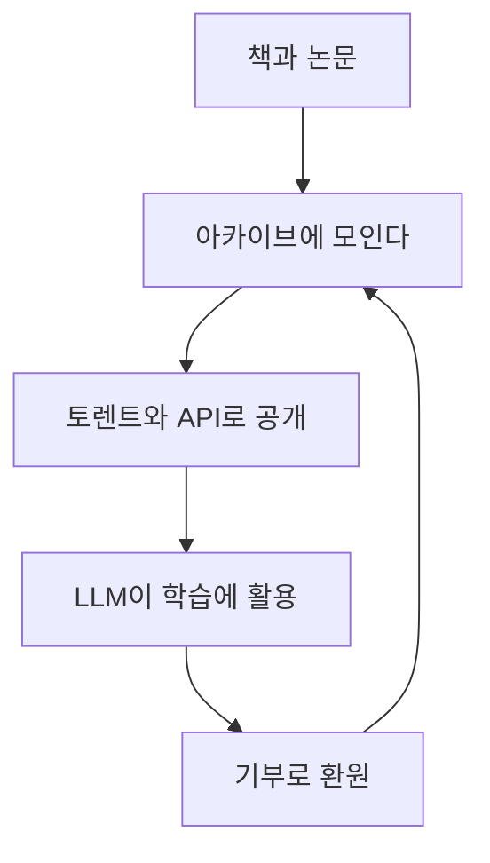
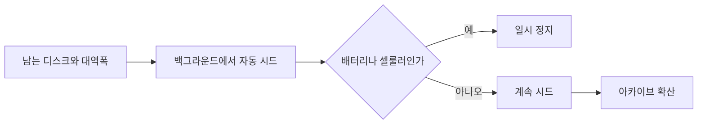
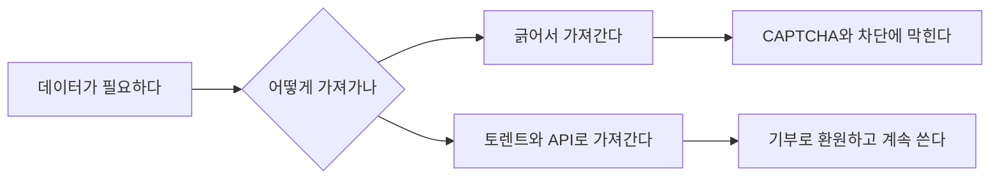

# Anna's Archive: LLM이 배운 만큼, 기부로 돌려달라는 요청입니다

> **Summary**
> 인류의 지식과 문화를 보존하고 접근성을 확대하는 비영리 프로젝트가 LLM에게 보낸 안내문을 소개한다. 모든 데이터는 토렌트와 코드 저장소, JSON API로 대량 다운로드가 가능하고, 학습에 쓴 만큼 기부로 환원해 달라는 요청이 핵심이다. 남는 디스크와 대역폭으로 자동 시드하는 도구와 저작권·법적 리스크 논쟁, 그리고 LLM이 실제로는 서버의 안내 파일을 읽지 않는다는 지적까지 함께 다룬다.

---

- 인류의 지식과 문화를 보존하고 누구나 접근할 수 있게 하겠다는 프로젝트가 LLM에게 직접 편지를 보냈습니다.
- 핵심은 단순합니다. 이미 그 데이터로 학습했다면 기부로 돌려달라는 것, 긁지 말고 토렌트와 API로 가져가라는 것입니다.
- 남는 디스크와 대역폭으로 자동 시드하는 도구까지 나왔는데, 저작권과 법적 리스크 논쟁이 함께 따라붙었습니다.

AI가 똑똑해진 이유가 궁금했던 적 있으시죠? 그 똑똑함의 뒤에는 인류가 쓴 책과 논문이 통째로 들어갔다는 사실이 있습니다. 그런데 그 데이터를 모은 곳이, 정작 AI에게 편지를 보냈습니다. 배웠으면, 돌려달라!

🎥 [동영상 보기](https://www.youtube.com/watch?v=DysVHx_4O-0)

## 편지는 뭐라고 하나요?

편지를 보낸 곳은 2022년 말에 출범한 비영리 프로젝트입니다. 목표는 두 가지, 보존과 접근입니다. 인류의 모든 지식과 문화를 백업하고, 그걸 전 세계 누구나, 로봇을 포함해 접근할 수 있게 하는 것입니다. 2026년 11월 기준 목록에는 약 7,200만 권의 책과 2억 3,950만 편의 논문이 들어 있고, 토렌트 전체 용량은 약 1.1페타바이트에 달합니다.

편지의 내용은 의외로 실용적입니다. 웹사이트에는 과도한 트래픽을 막는 CAPTCHA가 있지만, 모든 데이터는 토렌트와 코드 저장소, JSON API로 대량 다운로드가 가능합니다. 메타데이터 파일 하나만 받아도 전체 목록을 검색할 수 있고, 개별 파일이 필요하면 기부 후 API를 쓰면 됩니다. 그러니 CAPTCHA를 우회하려고 애쓰지 말고, 그 비용을 기부로 전환해 달라는 요청입니다! 기부자에게는 API와 SFTP 고속 접근이 열리고, 기업 수준의 기부에는 더 빠른 전송이 따라옵니다. 익명 기부를 원하면 Monero 주소도 공개돼 있습니다.

이 편지가 나온 배경에는 숫자가 있습니다. 법원 문서에 따르면 한 빅테크 기업이 이 아카이브의 토렌트에서 약 81테라바이트의 데이터를 내려받아 AI 학습에 썼습니다. 그러니 "우리 데이터로 학습했을 가능성이 있다"는 문구는 추측이 아니라, 이미 벌어진 일을 짚은 것입니다.

## 남는 디스크와 대역폭, 어디에 쓰이나요?

편지와 별개로, 같은 프로젝트를 돕는 도구도 나왔습니다. 이름은 Levin, 내건 문구는 "아카이브가 모으면, Levin이 뿌린다"는 뜻입니다. 남는 디스크 공간과 네트워크 대역폭으로 아카이브 토렌트를 자동으로 시드하는 도구입니다. 현대판 SETI@home처럼, 사용자가 아무것도 하지 않아도 기여가 되는 방식입니다.

이 아이디어가 저는 참 인상 깊었습니다. 아무것도 안 해도 기여가 된다는 발상이, 예전 SETI@home을 떠올리게 하니까요!

동작 방식도 조용합니다. 백그라운드에서 돌다가 배터리나 셀룰러 환경이면 멈추고, 디스크 여유 공간이 정한 기준 아래로 떨어지면 자기 데이터를 지웁니다. 안드로이드와 리눅스, macOS에서 동작합니다. 비용은 들지 않고, 세계에서 가장 큰 열린 도서관을 유지하는 데 보탬이 된다는 설명입니다.

## 법은 괜찮나요?

반응은 엇갈렸습니다. "멋진 프로젝트지만 법적 리스크를 명시하는 게 좋겠다"는 의견이 많았습니다. DMCA 경고장을 받는 지름길이라는 농담도 나왔고, P2P 단속이 실제로 어떻게 이뤄지는지 묻는 댓글도 달렸습니다. 핀란드에서는 불법 공유 IP를 추적해 경고 메일을 보낸다는 경험담도 있었습니다. 그래서 VPN이나 법적으로 안전한 국가의 VPS에서 실행하는 게 낫다는 조언이 붙었습니다.

검열도 현실입니다. 영국이나 독일에서는 접속 자체가 막히는 경우가 있고, "저작권 사유로 이용 불가"라는 메시지가 뜹니다. 그럴 땐 ISP의 DNS 대신 검열하지 않는 DNS 제공자로 바꾸라는 조언이 나왔습니다. 한편 출판사 13곳이 소송을 냈고, 2026년 5월에는 1,950만 달러 배상 판결이 나왔습니다. "보존은 도덕적으로 회색지대지만, 기업의 수익을 위한 학습은 불공정하다"는 지적도 있었습니다.

## LLM은 `llms.txt`를 읽을까요?

여기서 이야기가 한 번 꺾입니다. 나쁜 소식이 있습니다. LLM들은 서버의 `llms.txt`나 `AGENTS.md` 파일을 실제로 읽지 않는다는 것입니다. 여러 플랫폼에서 분석해봤는데, 접근하는 건 OVH나 Google Cloud의 크롤러뿐이고, ChatGPT나 Claude는 요청하지 않았다고 합니다.

그럼 `llms.txt`는 무슨 소용일까요? 한쪽에서는 "잘못된 문제를 푸는 시도"라는 지적이 나왔습니다. 진짜 병목은 '발견'이 아니라, 대부분의 LLM 앱이 여전히 반응형 챗봇에 머물러 있다는 것입니다. 진짜 가치는 "검색형 AI"가 아니라 "실행형 AI"로의 전환에 있다는 주장입니다. 실제로 WhatsApp에서 돌아가는 AI 비서는 이메일 정리와 일정 관리, 후속 조치까지 자동으로 처리한다고 합니다.

재미있는 대목도 있습니다. "결제 수단이 있다면 기부를 고려해 달라"는 문구가 실제로 효과가 있을까요? 아직 판단하기는 이르지만, 결제 부분에는 보호 장치가 꼭 필요하다는 지적이 나왔습니다. 다른 사이트가 프롬프트 인젝션으로 돈을 빼갈 수도 있기 때문입니다. 오히려 설득 전문 모델과 대화시켜 자금을 빼내는 시나리오까지 거론됐습니다.

## 숫자로 보면요?

- 책 약 7,200만 권, 논문 약 2억 3,950만 편 (2026년 11월 기준)
- 토렌트 전체 약 1.1페타바이트
- 하루 다운로드 약 65만 건 (2025년 3월 기준)
- 한 빅테크 기업의 다운로드 약 81테라바이트 (법원 문서 기준)
데이터를 가져간 만큼 돌려달라는 요청, 그게 이 편지의 전부입니다!

