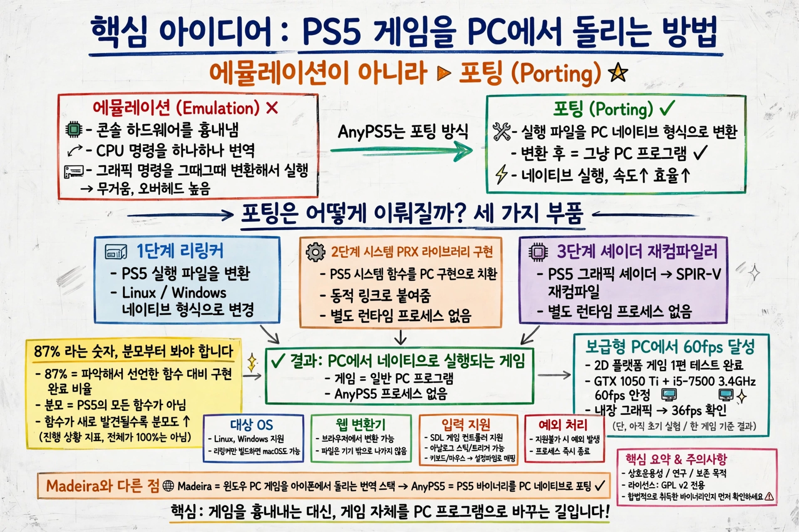
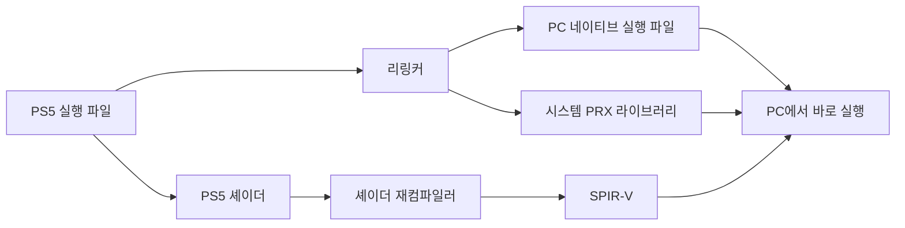
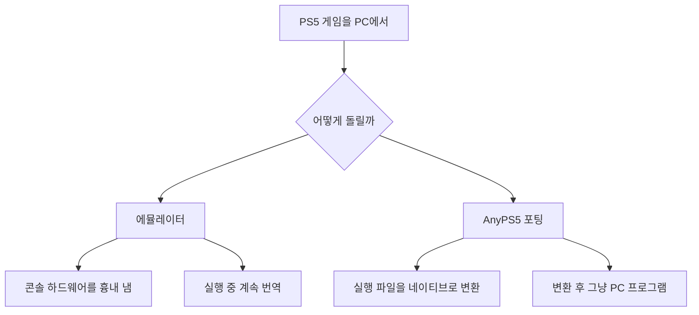

# AnyPS5: PS5 게임을 에뮬레이션 없이 PC 네이티브 실행 파일로 바꿉니다

> **Summary**
> PS5 게임을 PC에서 돌리는 길이 에뮬레이션만 있는 건 아닙니다. 실행 파일 자체를 PC 네이티브 형식으로 바꾸는 포팅이라는 방법이 있습니다. AnyPS5는 리링커가 PS5 실행 파일을 Linux와 Windows 네이티브 실행 파일로 변환하고, 시스템 PRX 라이브러리 구현을 동적 링크로 붙여줍니다. 별도 런타임 프로세스도 없습니다. 2D 게임 한 편이 보급형 PC에서 60fps로 돌아가는 단계까지 왔지만, 아직 초기 실험입니다. 시스템 라이브러리 매핑 87%라는 숫자부터 분모를 정확히 봐야 합니다.

---

- PS5 게임을 PC에서 돌리는 길이 에뮬레이션만 있는 건 아닙니다. 실행 파일 자체를 PC 네이티브 형식으로 바꾸는 포팅이라는 방법이 있습니다.
- AnyPS5는 리링커가 PS5 실행 파일을 Linux와 Windows 네이티브 실행 파일로 변환하고, 시스템 PRX 라이브러리 구현을 동적 링크로 붙여줍니다. 별도 런타임 프로세스도 없습니다.
- 2D 게임 한 편이 보급형 PC에서 60fps로 돌아가는 단계까지 왔지만, 아직 초기 실험입니다. 시스템 라이브러리 매핑 87%라는 숫자부터 분모를 정확히 봐야 합니다.

PS5로 산 게임이 있습니다. 그런데 그 게임을 PC에서 하고 싶으면 어떻게 해야 할까요? 보통은 에뮬레이터를 떠올립니다. 콘솔을 흉내 내는 프로그램 안에서 게임을 돌리는 방법입니다. 그런데 흉내 내지 않고, 게임 자체를 PC용 프로그램으로 바꿔버리는 방법은 어떨까요? 그게 바로 이 글의 주인공이 하는 일입니다!

🎥 [동영상 보기](https://www.youtube.com/watch?v=8TrhkqTsrQM)

## 에뮬레이션이 아니라 포팅입니다?

"에뮬레이터와 뭐가 다를까요?"

에뮬레이터는 콘솔 하드웨어를 흉내 냅니다. CPU 명령을 하나하나 번역하고, 그래픽 명령도 그때그때 바꿔서 실행합니다. 그래서 콘솔이 없어도 게임이 돌아가지만, 흉내 내는 비용이 계속 붙습니다.

포팅은 방향이 다릅니다. 실행 파일 자체를 PC가 바로 실행할 수 있는 네이티브 형식으로 변환합니다. 변환이 끝나면 게임은 그냥 PC 프로그램입니다. 실행 중에 콘솔을 흉내 내는 층이 끼어들지 않습니다. 이 차이가 AnyPS5의 핵심입니다!

흉내 내는 것과 바꿔버리는 것, 한 글자 차이 같지만 실행 방식이 완전히 달라진다는 점이 저는 가장 인상 깊었습니다.

## 포팅은 어떻게 이뤄질까요?

세 가지 부품이 함께 움직입니다.

- **리링커**: PS5 실행 파일을 대상 시스템의 네이티브 형식으로 변환합니다.
- **시스템 PRX 라이브러리 구현**: 게임이 부르는 PS5 시스템 함수를 PC에서 동작하는 구현으로 바꿔 동적 링크로 붙여줍니다.
- **셰이더 재컴파일러**: PS5 그래픽 셰이더를 SPIR-V로 다시 컴파일합니다. 검증 도구와 함께 빌드하면 변환 결과를 검사할 수도 있습니다.

## 87%라는 숫자, 분모부터 봐야 합니다

"시스템 라이브러리 87% 매핑, 그럼 거의 다 된 거 아닐까요?"

숫자부터 정확히 봐야 합니다. 87%의 분모는 PS5의 모든 시스템 함수가 아닙니다. 프로젝트가 지금까지 파악해서 선언한 함수가 분모입니다. 함수가 새로 선언될수록 분모도 함께 늘어납니다. 그래서 87%는 "PS5 전체의 87%를 끝냈다"는 뜻이 아닙니다. 지금까지 확인한 범위 안에서의 진척도입니다!

이 솔직한 표기가 저는 오히려 믿음이 갔습니다. 진척도를 부풀리지 않고 기준을 함께 밝히니까요.

## 보급형 PC에서 60fps, 정말일까요?

숫자가 있습니다. 2D 플랫폼 게임 한 편이 GTX 1050 Ti와 i5-7500 3.4GHz 환경에서 안정적인 60fps로 실행됐습니다. 내장 그래픽 환경에서는 36fps까지 확인됐습니다. 최신 고사양 PC가 아니라, 몇 년 된 보급형 PC에서 나온 숫자라는 점이 눈에 띕니다!

다만 이건 한 게임의 결과입니다. 모든 게임이 이렇게 돌아간다는 뜻이 아닙니다. 게임별 호환 상태는 따로 정리된 목록에서 확인해야 합니다.

## 어디까지 쓸 수 있을까요?

실행 환경은 생각보다 넓습니다. Linux와 Windows가 대상이고, 리링커만 빌드하면 macOS에서도 동작합니다. 브라우저에서 바로 변환하는 웹 변환기도 있습니다. 변환할 파일은 기기 밖으로 나가지 않습니다.

조작도 챙겼습니다. SDL 매핑 게임 컨트롤러를 지원하고, 아날로그 스틱과 트리거도 쓸 수 있습니다. 키보드와 마우스 조작은 `anyps5-input.ini` 파일로 설정합니다.

제약도 분명합니다. 지원하지 않거나 예상하지 못한 상태가 나오면 `std::runtime_error` 예외를 던지고 프로세스가 종료됩니다. 에러 메시지를 표준 오류 출력에 남기고 끝나는 방식입니다. 아직은 다듬어지는 중인 도구라는 뜻입니다.

## 그래서, 지금 써볼 만할까요?

P315에서 다룬 Madeira와 헷갈리면 안 됩니다. Madeira는 윈도우 PC 게임을 아이폰에서 돌리는 번역 스택입니다. 이 도구는 반대로, PS5 바이너리를 PC 네이티브 실행 파일로 포팅합니다. 방향도, 방법도 다릅니다.

관심이 가신다면, 먼저 확인할 것은 두 가지입니다. 내 게임이 호환 목록에 있는지, 그리고 바이너리를 합법적으로 취득한 것인지입니다. 이 프로젝트는 상호운용성과 연구, 보존을 목적으로 하고, 저작권 소프트웨어나 펌웨어, 암호화 키를 포함하지도 배포하지도 않습니다. 라이선스는 GPL 버전 2 전용입니다.

에뮬레이션이 전부가 아니었습니다. 게임을 흉내 내는 대신, 게임 자체를 PC 프로그램으로 바꾸는 길이 열리고 있습니다!

