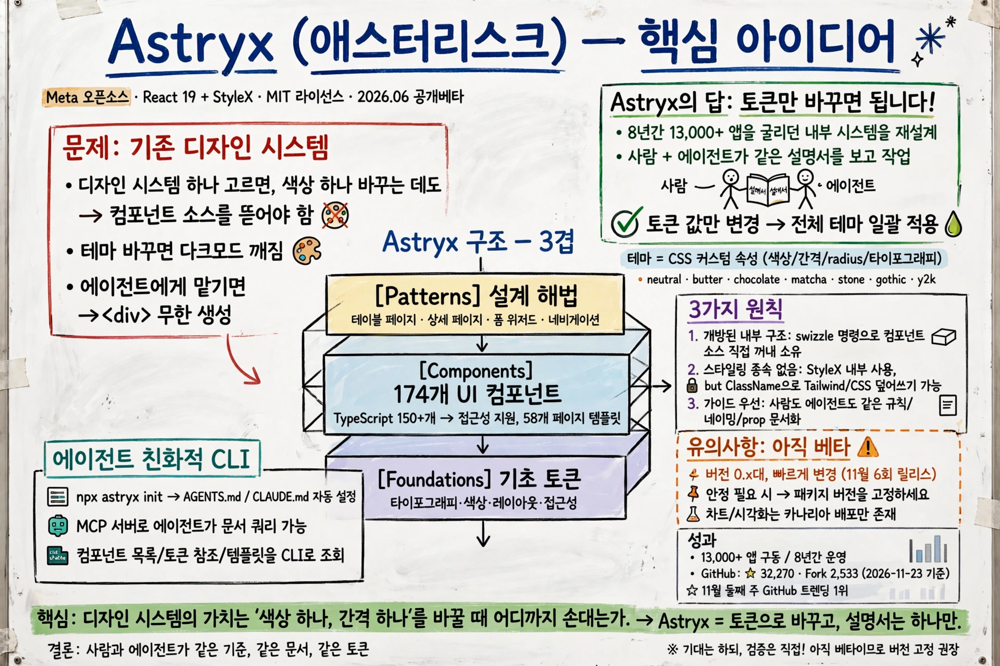
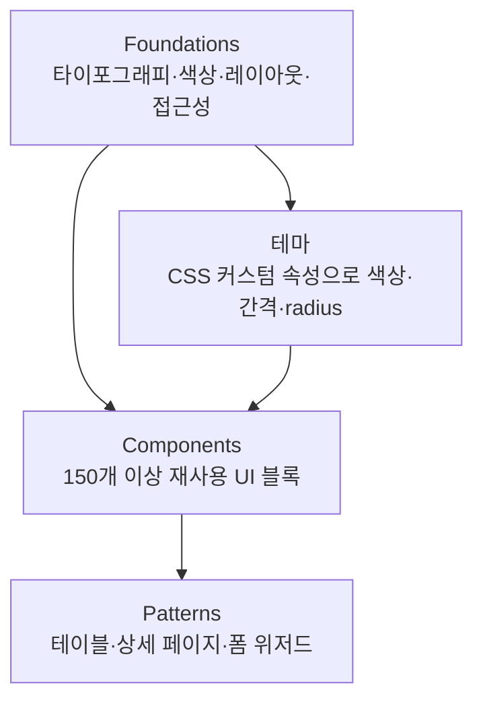
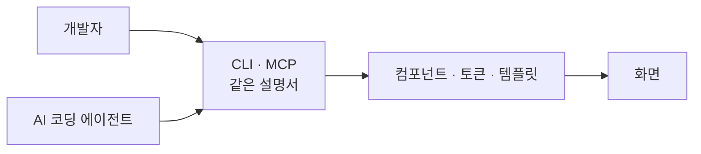

# Astryx: 13,000개 앱을 굴리던 디자인 시스템, 이제 에이전트와 함께 씁니다

> **Summary**
> Astryx는 Meta가 8년간 다듬어 13,000개가 넘는 앱에 쓴 내부 디자인 시스템을 오픈소스로 공개한 것으로, 150개가 넘는 접근성 지원 컴포넌트와 테마, 템플릿, CLI를 하나의 시스템으로 묶었습니다. 토큰만 바꾸면 화면 전체가 다시 칠해지고, 컴포넌트 소스를 꺼내 직접 소유할 수도 있으며, 사람과 AI 코딩 에이전트가 CLI와 MCP로 같은 설명서를 보고 화면을 만듭니다. 다만 아직 공개 베타라 API가 빠르게 바뀌고 일부 패키지는 카나리아 배포만 있으니, 버전을 고정하고 시험 단계로 쓰는 것이 맞습니다.

---

- 디자인 시스템 하나 고르면, 색상 하나 바꾸는 데도 컴포넌트 소스를 뜯어야 했습니다. Astryx는 토큰만 바꾸면 됩니다.
- 8년간 13,000개가 넘는 앱을 굴리던 내부 시스템을, 에이전트와 사람이 같은 설명서를 보고 쓰도록 다시 만들었습니다.
- 다만 아직 베타입니다. 안정된 API가 필요하면 버전을 고정하고, 바뀔 수 있다는 전제로 써야 합니다.


디자인 시스템 하나 골라서 버튼 색상 하나만 바꾸려고 했는데, 컴포넌트 소스를 통째로 뜯어본 적 있으시죠? 테마를 바꾸면 다크모드가 깨지고, 에이전트에게 화면을 맡기면 `div`를 마구 찍어내는 장면도 낯설지 않습니다. 그런데 13,000개가 넘는 앱을 굴리던 내부 시스템을 통째로 공개한 곳이 있습니다. 이름은 Astryx입니다. 발음은 "애스터리스크"입니다.

🎥 [동영상 보기](https://www.youtube.com/watch?v=4GaR7k9VMp4)

## Astryx, 도대체 뭘까요?

Astryx는 Meta가 공개한 오픈소스 React 디자인 시스템입니다. 2026년 6월에 공개 베타로 나왔고, MIT 라이선스입니다. 150개가 넘는 접근성 지원 컴포넌트, 브랜드 단위 테마, 다크모드, 바로 쓸 수 있는 템플릿, CLI를 하나의 시스템으로 묶었습니다. 기반은 React 19 이상과 StyleX입니다.

숫자부터 짚어보겠습니다. Meta 내부에서 8년간 자라 가장 많이 쓰이고 규모가 가장 큰 디자인 시스템이 되었고, 13,000개가 넘는 앱을 구동했습니다. 업데이트의 절반 가까이는 내부 개발자 커뮤니티가 직접 기여했습니다. 공개 저장소는 2026년 11월 23일 기준 별 32,270개, 포크 2,533개를 기록했고, 11월 둘째 주에는 주간 트렌딩 1위에 올랐습니다. 이 글의 원본 클립이 저장된 11월 14일이 바로 그 화제가 한창이던 시기입니다!



구조는 세 겹입니다. **Foundations**는 타이포그래피·색상·레이아웃·접근성 같은 시각적 일관성의 재료입니다. **Components**는 TypeScript 타입을 갖춘 150개 이상의 재사용 UI 블록입니다. 최신 버전 기준으로는 174개 컴포넌트, 58개 페이지 템플릿, 7개 테마까지 늘었습니다. **Patterns**는 테이블 페이지, 상세 페이지 레이아웃, 폼 위저드, 네비게이션 같은 검증된 설계 해법입니다. 여기에 콘텐츠만 넣으면 되는 프로덕션용 템플릿과, 라우팅·테마·컴포넌트가 연결된 예제 앱까지 딸려 옵니다.

## 왜 다른 디자인 시스템과 다를까요?

차이는 세 가지 원칙에서 나옵니다. 첫째, **개방된 내부 구조**입니다. 컴포넌트가 닫힌 최상위 API 뒤에 갇히지 않고, 어느 수준에서든 조합할 수 있습니다. 필요한 빌딩 블록은 직접 export해서 쓰면 됩니다. 더 깊이 들어가야 하면 `swizzle` 명령으로 컴포넌트 전체 소스를 프로젝트로 꺼내 직접 소유할 수 있습니다!

둘째, **스타일링 종속이 없습니다.** 내부적으로는 StyleX로 스타일을 쓰지만, 사용자에게는 드러나지 않습니다. 미리 빌드된 CSS를 가져와서 쓰면 되고, `className`으로 Tailwind나 CSS 모듈, 일반 CSS로 덮어쓸 수 있습니다. 스타일링 도구를 새로 배울 필요가 없다는 뜻입니다.

셋째, **가이드 우선**입니다. 값을 전달하면 컴포넌트가 그대로 렌더링하고, 디자인 의견은 문서와 예제에 담았습니다. 모든 컴포넌트가 같은 네이밍·prop·조합 규칙을 따르고 문서화되어 있어, 사람도 에이전트도 낯선 컴포넌트의 동작을 예측할 수 있습니다. 규칙이 같으니까요!

## 에이전트와 사람이 같은 설명서를 봅니다

Astryx가 가장 힘을 준 부분은 바로 여기입니다. 기존 디자인 시스템을 에이전트에 맞게 고친 게 아니라, 처음부터 사람과 에이전트가 함께 쓰도록 설계했습니다. CLI가 그 중심입니다. 컴포넌트 목록, 토큰 참조, 템플릿, 문서를 CLI 하나로 조회할 수 있고, MCP 서버를 통해 에이전트가 같은 문서를 직접 묻고 답합니다.



시작은 간단합니다. 설치 지시문을 에이전트에게 붙여넣으면 `npx astryx init` 실행으로 에이전트 문서가 자동으로 설정됩니다. `init` 단계에서는 `AGENTS.md`나 `CLAUDE.md`에 컴포넌트 목록을 적어 넣어, 에이전트가 템플릿에서 출발하고 날것의 `div`를 찍지 않으며 디자인 토큰을 쓰도록 안내합니다. 테마는 색상·간격·radius·타이포그래피 같은 모든 토큰을 CSS 커스텀 속성으로 제공해서, 테마만 갈아끼우면 화면 전체가 다시 칠해집니다. 기본 테마 7가지는 neutral, butter, chocolate, matcha, stone, gothic, y2k입니다.

설치 명령도 짧습니다. 코어 패키지와 테마, StyleX를 받고 CLI를 개발 의존성으로 더하면 끝입니다.

```bash
npm install @astryxdesign/core @astryxdesign/theme-neutral @stylexjs/stylex
npm install -D @astryxdesign/cli
```

## 베타라는 사실, 잊으면 안 됩니다

좋은 소식만 있는 건 아닙니다. Astryx는 아직 공개 베타이고, 버전은 0.x대입니다. 안정된 API가 필요하다면 조심해야 합니다. 차트나 시각화 패키지는 아직 카나리아 배포만 있고, 일부 패키지는 아예 공개되지 않았습니다. 11월 한 달에만 여섯 번 릴리스가 나왔을 정도로 빠르게 바뀌고 있습니다. 그래서 패키지 버전을 맞추는 게 중요합니다. 모든 `@astryxdesign/*` 패키지를 같은 버전으로 고정해 두는 편이 안전합니다.

한 가지 더 짚고 넘어가겠습니다. "에이전트에 최적화됐다"는 평가는 아직 측정된 결과가 아닙니다. 공식 자료가 밝힌 평가 방식도 있고, 밤마다 다른 시스템과 비교한 점수가 언급되기도 했지만, 공개된 정식 결과는 없습니다. 기대는 하되, 검증은 직접 해보는 게 맞습니다.

이 글은 P336에서 다룬 모션 그래픽 기능과는 결이 다릅니다. 그 글은 디자인 작업 공간 안에서 움직임을 만드는 기능이 주제였다면, 이 글은 화면의 뼈대와 토큰, 그리고 사람과 에이전트가 공유하는 설명서라는 디자인 시스템 자체가 주제입니다. 움직임을 더하는 일과, 화면이 서는 방식을 정하는 일은 다른 층위입니다.

디자인 시스템의 진짜 가치는 컴포넌트 개수가 아닙니다. 색상 하나, 간격 하나를 바꿀 때 어디까지 손대야 하는지, 그리고 그 결정을 사람과 에이전트가 같은 기준으로 내릴 수 있는지가 본질입니다. Astryx는 그 질문에 "토큰으로 바꾸고, 설명서는 하나만 둔다"는 답을 내놓았습니다. 베타라는 단서만 잊지 않는다면, 지금 시험해볼 만한 답입니다!

