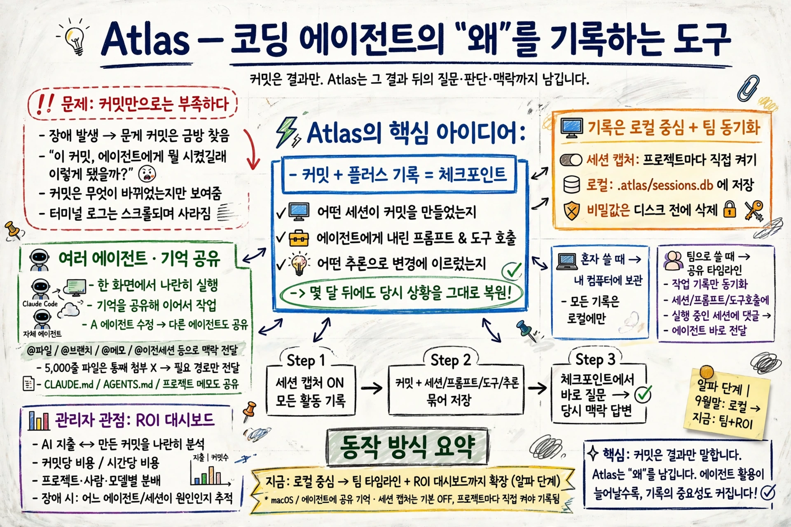
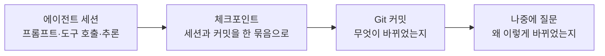
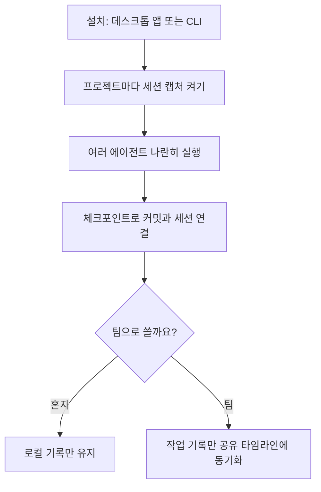

# Atlas: 커밋만 보고는 알 수 없습니다. 어떤 프롬프트가 그 줄을 만들었는지, 그게 기록됩니다

> **Summary**
> Atlas는 코딩 에이전트가 남긴 커밋에, 그 커밋을 만든 세션·프롬프트·도구 호출·추론까지 묶어 기록하는 데스크톱 도구입니다. 여러 에이전트를 한 화면에서 나란히 돌리고, 기억을 공유해 에이전트를 바꿔도 처음부터 다시 설명하지 않으며, @로 지정한 파일·메모·이전 세션은 내 컴퓨터 안에서 미리 풀어 건넵니다. 기록은 기본적으로 로컬에만 두고 세션 캡처도 프로젝트마다 직접 켜야 하며, 팀으로 쓸 때만 작업 기록만 공유 타임라인에 동기화하고 소스 트리는 동기화하지 않습니다.

---

- Atlas는 코딩 에이전트가 남긴 커밋에, 그 커밋을 만든 세션·프롬프트·도구 호출·추론까지 묶어 기록하는 도구입니다.
- 여러 에이전트를 한 화면에서 나란히 돌리고, 기억을 공유해 에이전트를 바꿔도 처음부터 다시 설명하지 않습니다.
- 기록은 기본적으로 내 컴퓨터에 두고, 팀으로 쓸 때만 작업 기록만 동기화합니다.

운영 중인 서비스에서 장애가 터졌습니다. 로그를 뒤져 보니, 문제를 만든 커밋은 금방 찾았습니다. 그런데 그 다음 질문에서 막히지 않으셨나요? "이 커밋, 에이전트에게 뭘 시켰길래 이렇게 됐을까요?" 커밋은 무엇이 바뀌었는지 보여주지만, 왜 그렇게 바뀌었는지는 보여주지 않습니다. 그 이유는 터미널이 스크롤되면서 사라집니다. Atlas는 바로 그 사라지는 부분을 붙잡는 도구입니다.

🎥 [동영상 보기](https://www.youtube.com/watch?v=PAi6QVCHmD8)

## 체크포인트가 뭐길래, 커밋에 질문을 던질 수 있을까요?

Atlas의 핵심은 체크포인트입니다. 커밋에 플러스가 붙은 기록이라고 생각하시면 됩니다. 어떤 세션이 그 커밋을 만들었는지, 에이전트에게 무엇을 시켰는지, 어떤 도구를 불렀는지, 어떤 추론으로 그 변경에 이르렀는지까지 한 묶음으로 남깁니다. 몇 달 뒤에 그 커밋을 다시 열어도, 당시 상황이 그대로 복원됩니다!

기록 방식도 눈여겨볼 만합니다. 세션 캡처는 프로젝트마다 직접 켜야 돌아갑니다. 켜면 모든 세션이 프로젝트 안의 `.atlas/sessions.db`에 로컬로 쌓이고, 비밀값은 디스크에 닿기 전에 지워집니다. 터미널이나 다른 편집기에서 만든 커밋도 추적하고, `amend`나 `rebase`를 해도 세션 연결이 유지됩니다. 긴 대화 기록을 뒤질 필요도 없습니다. 체크포인트를 골라 직접 질문하면, 당시 작업 내용을 바탕으로 답을 돌려줍니다.

## 에이전트를 바꿔도, 맥락이 이어질까요?

코딩 에이전트를 쓰다 보면 이런 순간이 있습니다. 한 에이전트로 시작한 일을 다른 에이전트로 이어가려는데, 처음부터 다시 설명해야 합니다. Atlas는 여러 에이전트를 한 화면에서 나란히 돌립니다. Claude Code, Codex, 자체 에이전트, ACP 등록부의 에이전트까지 함께 쓸 수 있습니다. 그리고 기억을 공유합니다. 한 에이전트에게 준 수정 사항이 다른 에이전트에게도 전해집니다. 이 부분이 저는 가장 와닿았습니다. 에이전트를 바꾸는 일이, 도구를 바꾸는 일이 아니라 같은 팀원에게 이어서 말하는 일이 되니까요!

맥락을 건네는 방식도 과하지 않습니다. 파일, 브랜치, 커밋, 메모, 논문, 이전 세션을 `@`로 지정하면, 내 컴퓨터 안에서 미리 풀어서 프롬프트에 붙입니다. 5,000줄짜리 파일은 통째로 붙여 넣지 않고, 에이전트가 필요할 때 읽는 경로만 건넵니다. `CLAUDE.md`와 `AGENTS.md`, 프로젝트 메모도 모든 에이전트에게 닿습니다. 검색에 쓰는 임베딩도 내 컴퓨터에서 돌아가서, 검색 단계에서는 파일 내용이 밖으로 나가지 않습니다.

## 팀으로 쓰면, 타임라인이 됩니다

혼자 쓸 때는 로컬 기록이 전부입니다. 그런데 팀으로 넓히면 Atlas는 공유 타임라인이 됩니다. 조직의 모든 멤버가 같은 저장소를 열면, 각자의 세션이 하나의 타임라인에 모입니다. 세션 전체나 프롬프트 하나, 도구 호출 하나, 체크포인트 하나에 댓글을 달 수 있습니다. 실행 중인 세션에 단 댓글은, 에이전트가 일하는 도중에 바로 전달됩니다. 팀 채팅과 함께 쓰는 프롬프트 초안, 원격으로 세션을 조종하는 기능까지 들어 있습니다!

관리자에게는 다른 숫자가 보입니다. ROI 대시보드가 AI 지출과 그 지출이 만든 커밋을 나란히 보여줍니다. 커밋 하나당 비용, 활성 시간당 비용을 프로젝트·사람·모델별로 나눠서 말입니다. 장애가 터졌을 때는 어느 에이전트가 무엇을 바꿨는지, 어떤 세션이 원인이었는지 바로 추적할 수 있습니다. 동기화되는 것은 작업 기록뿐이고, 소스 트리는 절대 동기화되지 않습니다. 비밀값도 내 컴퓨터에서 먼저 지워집니다.

## 쓰기 전에 확인할 것은 뭐가 있을까요?

소개 글이 정리된 9월 말에는 로컬 중심 설명이 앞섰는데, 지금은 팀 타임라인과 ROI 대시보드까지 커졌습니다. 그만큼 빠르게 바뀌는 알파 단계라는 뜻이기도 합니다. 설치 파일은 macOS·Windows·Linux용으로 나오고, 터미널이 편하면 CLI로 같은 기록을 쌓을 수 있습니다. CLI는 이미 쓰는 에이전트에 붙어 세션을 기록하고, 모든 에이전트에게 하나의 공유 기억을 줍니다. 세션 캡처가 기본으로 꺼져 있다는 점만 기억하시면 됩니다. 프로젝트마다 직접 켜야 기록이 쌓입니다!

커밋은 결과만 말합니다. Atlas는 그 결과 뒤에 있던 질문과 판단까지 남깁니다. 에이전트가 코드를 많이 쓸수록, "왜"라는 기록이 더 중요해집니다!

