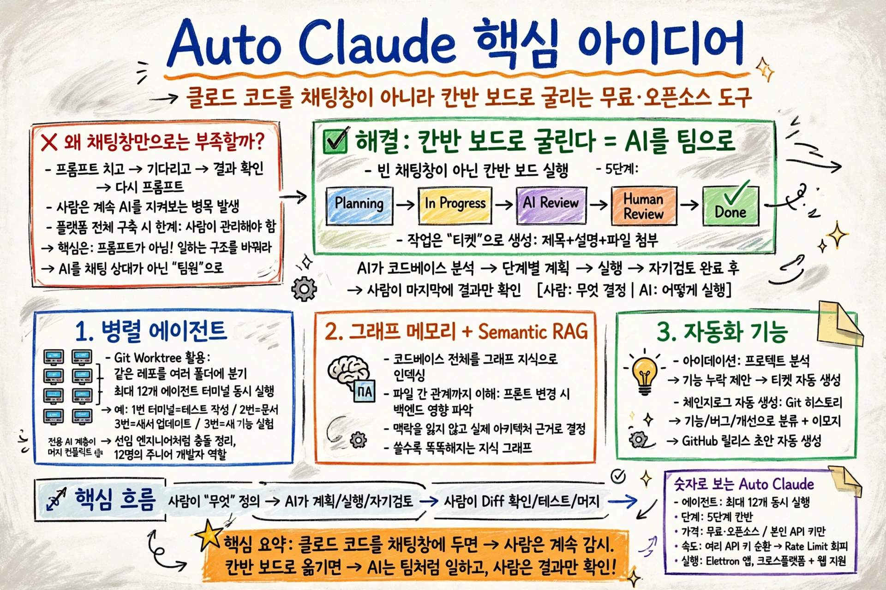
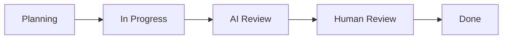
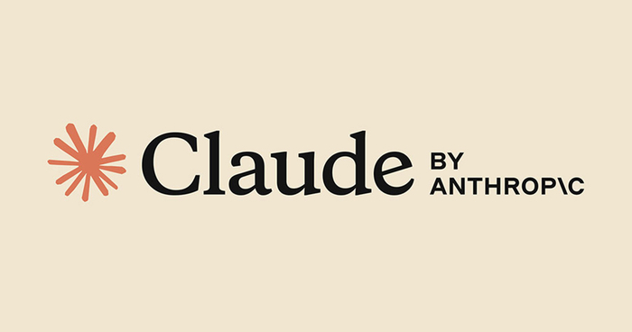
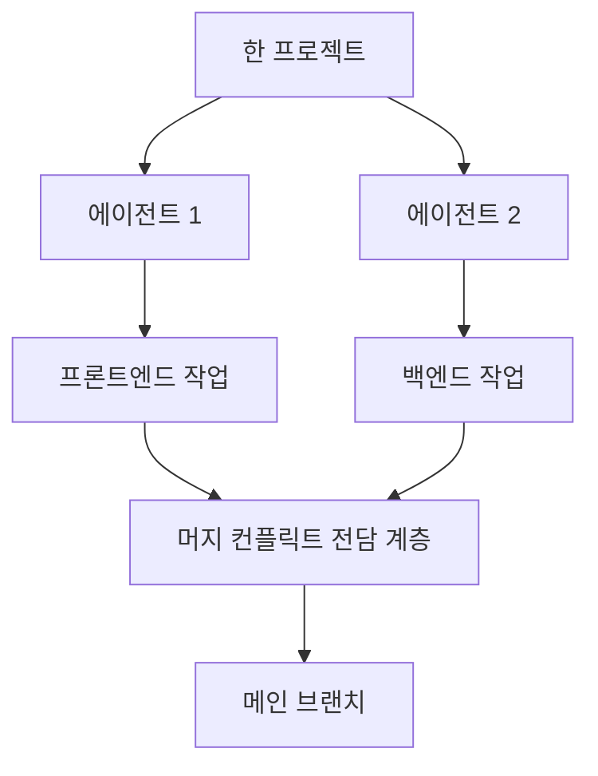

# Auto Claude: 클로드 코드를 칸반 보드로 굴리면 AI 팀이 됩니다

> **Summary**
> Auto Claude는 Claude Code를 칸반 보드 기반의 AI 팀으로 운영하는 무료 오픈소스 도구입니다. 작업을 티켓으로 만들면 AI가 계획·실행·검토하고, Git 워크트리에서 최대 12개 에이전트가 병렬 작업하며 충돌도 자동으로 해결합니다. 코드베이스를 기억해 기능 제안과 체인지로그 생성까지 지원하고, 사람은 최종 결과를 검토하고 승인합니다.

---

- Auto Claude는 클로드 코드를 채팅창이 아니라 칸반 보드로 굴리는 무료·오픈소스 도구입니다. 작업을 티켓으로 만들면 AI가 계획·실행·자기 검토까지 하고, 사람은 마지막에 결과만 확인합니다.
- Git 워크트리로 여러 에이전트가 같은 프로젝트에서 병렬로 일하고, 최대 12개의 에이전트 터미널을 주니어 개발자처럼 굴릴 수 있습니다. 전용 AI 계층이 머지 컨플릭트를 자동으로 해결합니다.
- 그래프 메모리와 Semantic RAG로 코드베이스 전체를 이해하고, 누락된 기능을 제안해 티켓으로 만들고, 체인지로그까지 자동 생성합니다. 자신의 API 키만 넣으면 됩니다.

클로드 코드한테 일을 맡겼는데, 프롬프트를 치고 기다리고, 결과를 보고 다시 시키는 일을 반복한 적 있으시죠? 한 번에 하나씩, 사람이 옆에서 계속 지켜봐야 하는 겁니다. 그런데 AI를 채팅창이 아니라 칸반 보드로 굴리면 이야기가 달라집니다. 클로드 코드가 혼자 일하는 게 아니라, 팀처럼 일하게 만드는 겁니다!

🎥 [동영상 보기](https://www.youtube.com/watch?v=8suXIOy9vMk)

## 왜 채팅창만으로는 부족할까요?

프롬프트를 반복하는 방법은 버그 하나를 고치는 데는 좋습니다. AI를 루프에 넣어 테스트를 통과할 때까지 돌리는 겁니다. 그런데 플랫폼 전체를 만든다면 이야기가 다릅니다. 프롬프트를 치고, 기다리고, 결과를 관리하는 사람이 여전히 병목입니다. AI를 지켜보는 사람이 따로 필요한 겁니다.
핵심은 프롬프트를 더 잘 쓰는 게 아닙니다. 일하는 구조를 바꾸는 겁니다. AI를 채팅 상대가 아니라 팀원으로 대하는 겁니다!

## 칸반 보드로 굴린다는 건 뭘까요?

Auto Claude를 열면 빈 터미널이나 채팅창이 아니라 칸반 보드가 나옵니다. Planning → In Progress → AI Review → Human Review → Done, 다섯 단계입니다. 작업은 티켓으로 만듭니다. 제목과 설명을 적고, 스크린샷이나 참고 파일을 드래그해서 카드에 붙일 수 있습니다.
작업을 시작하면 AI가 코드베이스를 분석해 단계별 계획을 세웁니다. 그리고 실행하고, 자기 검토까지 마친 뒤에야 사람에게 결과를 보여줍니다. 사람이 정하는 건 "무엇"이고, AI가 맡는 건 "어떻게"입니다. 사람은 마지막에 결과만 확인하면 됩니다.

## 여러 에이전트가 동시에 일하면, 충돌은 어떻게 해결할까요?

Git 워크트리를 씁니다. 같은 레포의 여러 브랜치를 서로 다른 폴더에 동시에 체크아웃하는 방식입니다. 그래서 한 에이전트가 프론트엔드 CSS 버그를 고치는 동안, 다른 에이전트가 백엔드 데이터베이스 스키마를 리팩터링할 수 있습니다. 같은 프로젝트에서 동시에 말입니다.
보통 이렇게 하면 머지 컨플릭트 지옥에 빠집니다. 그런데 Auto Claude에는 머지 컨플릭트만 전담하는 AI 계층이 있습니다. 메인 브랜치에 닿기 전에, 선임 엔지니어처럼 정리해주는 겁니다.
여기에 에이전트 터미널이 있습니다. 최대 12개까지 띄울 수 있습니다. 터미널마다 이름을 붙이고, 1번 터미널에는 테스트 작성을, 2번 터미널에는 문서 업데이트를, 3번 터미널에는 새 기능 실험을 맡기는 식입니다. 12명의 주니어 개발자가 한 방에 앉아 있는 셈입니다. 시간을 떼어놓고, 실행은 AI에게 맡기는 겁니다!

## AI가 코드베이스를 기억한다는 건 뭘까요?

채팅 인터페이스의 문제는 맥락을 잃는다는 겁니다. 파일 구조를 잊고, 없는 import를 지어내기도 합니다. Auto Claude는 그래프 메모리와 Semantic RAG로 코드베이스 전체를 인덱싱합니다. 파일 사이의 관계까지 이해합니다. 프론트엔드 컴포넌트 하나를 바꾸면 백엔드 라우트에 영향을 줄 수 있다는 걸 아는 겁니다.
쓸수록 똑똑해집니다. 코드베이스의 지식 그래프가 쌓이기 때문입니다. 결정을 내릴 때 마지막 세 메시지가 아니라, 앱의 실제 아키텍처를 근거로 삼습니다.

## 숫자로 보면 어떨까요?

- 에이전트 터미널: 최대 12개까지 동시에 굴립니다.
- 칸반 단계: Planning → In Progress → AI Review → Human Review → Done, 5단계입니다.
- 가격: 무료·오픈소스입니다. 자신의 API 키만 넣으면 됩니다.
- 속도: 여러 API 키를 순환 사용해, Opus 4.5 같은 고급 모델의 rate limit에 걸리지 않게 설계했습니다.
- 실행: Electron 앱이라 크로스플랫폼이고, 웹에서도 실행할 수 있습니다.
## 그래서, 뭘로 쓰면 좋을까요?

아이데이션 기능이 있습니다. 프로젝트를 분석해달라고 하면, "여기에 에러 핸들링이 빠져 있습니다"나 "다크 모드를 넣는 게 좋겠습니다" 같은 제안을 티켓으로 만들어줍니다. 버튼 하나만 누르면 칸반 보드에 올라가 바로 실행됩니다.
체인지로그 생성도 있습니다. Git 히스토리를 훑어 에이전트와 사람이 한 일을 기능·버그 수정·개선으로 묶어, 이모지까지 넣은 체인지로그를 써줍니다. GitHub 릴리스 초안까지 만들어줍니다.
정리하면, 흐름은 이렇습니다. 사람이 "무엇"을 정합니다. AI가 계획하고, 샌드박스에서 실행하고, 자기 검토를 합니다. 그리고 나서야 사람이 diff를 보고, 테스트를 돌리고, 마음에 들면 머지합니다. 클로드 코드가 프로젝트 매니저가 되는 겁니다!

클로드 코드를 채팅창에만 두면, 사람은 계속 옆에서 지켜봐야 합니다. 칸반 보드로 옮기는 순간, AI는 팀처럼 일하고 사람은 결과만 확인하면 됩니다. 그게 이 도구의 본질입니다!

