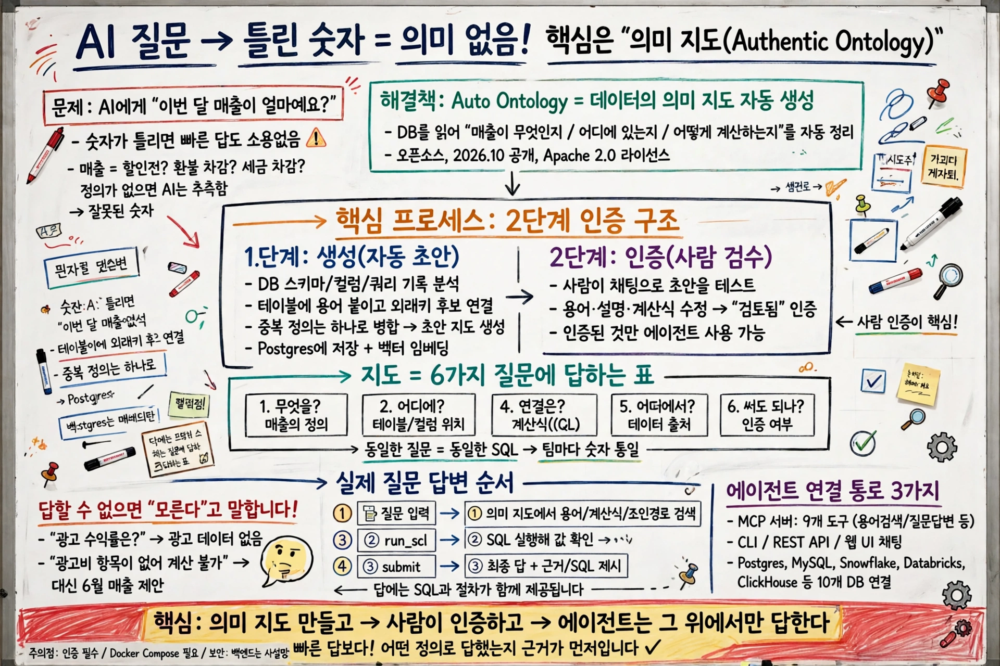
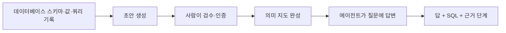
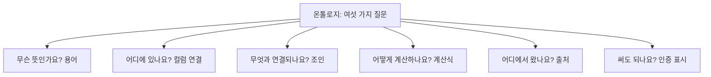

# Auto Ontology: 매출 숫자가 틀리면 빠른 답은 소용없습니다. 의미 지도를 먼저 만듭니다

> **Summary**
> Auto Ontology는 데이터베이스의 스키마·값·쿼리 기록을 바탕으로 비즈니스 용어, 컬럼, 조인, 계산식, 출처를 연결한 의미 지도를 자동 생성합니다. 사람이 검수·인증한 정의를 바탕으로 에이전트가 SQL과 근거를 제시하며 답하고, 데이터가 부족하면 모른다고 응답합니다. MCP·CLI·REST API와 여러 데이터베이스를 지원하지만, 초안을 반드시 검수하고 설치 및 보안 요구사항을 고려해야 합니다.

---

- AI에게 "이번 달 매출이 얼마예요?"라고 물었는데, 숫자가 틀리면 빠른 답은 소용이 없습니다.
- Auto Ontology는 데이터베이스를 읽어 "매출이 무엇인지, 어디에 있는지, 어떻게 계산하는지"를 정리한 의미 지도를 자동으로 만듭니다.
- 지도는 사람이 검수하고 인증한 뒤에야 쓰이고, 에이전트는 그 지도 위에서만 SQL을 짜서 답과 함께 근거를 내놓습니다.

"이번 달 매출이 얼마예요?" 이런 질문, AI에게 던져본 적 있으시죠? 답은 금방 나옵니다. 그런데 그 숫자가 맞을까요? 매출을 뜻하는 항목이 회사 안에 여러 개라면, AI는 어느 것을 골라야 할지 모릅니다. 할인 전 금액인지, 환불을 뺀 금액인지, 세금을 뺀 금액인지 알 수 없습니다. 틀린 정의에서 나온 숫자는 빨라도 소용이 없습니다!

그래서 필요한 것이 **온톨로지**입니다. 쉽게 말하면, 데이터의 의미와 관계를 정리한 지도입니다. "매출은 이 테이블의 이 컬럼이고, 이렇게 계산하고, 이 출처에서 왔다"는 약속을 한곳에 모아두는 것이죠. 문제는 이 지도를 사람이 손으로 만드는 데 몇 주가 걸린다는 점입니다. Auto Ontology는 이 지도를 데이터베이스 메타데이터에서 자동으로 만들어주는 오픈소스 도구입니다. 2026년 10월에 공개됐고, 아파치 2.0 라이선스라 누구나 쓸 수 있습니다.

🎥 [동영상 보기](https://www.youtube.com/watch?v=Zksf5xKOo-s)

## 지도는 어떻게 만들어질까요?

Auto Ontology는 두 단계로 움직입니다. 먼저 지도의 초안을 만들고, 사람이 검수하고 인증합니다. 그다음 에이전트가 그 지도 위에서 질문에 답합니다. 초안을 그대로 믿지 않고 사람이 인증하는 구조가 핵심입니다!

**1단계: 생성.** 도구는 연결된 데이터베이스의 스키마를 읽고, 컬럼 값을 살펴보고, 쿼리 기록까지 훑어봅니다. 테이블마다 용어를 붙이고, 외래 키 후보와 연결 테이블을 찾고, 중복된 정의는 하나로 묶습니다. 추측한 연결은 데이터가 확인해줄 때만 남깁니다. 이렇게 만든 초안은 `Postgres`에 저장되고, 벡터 검색용 임베딩도 함께 들어갑니다.

**2단계: 인증.** 사람은 채팅으로 실제 질문을 던져 초안을 시험해보고, 용어·설명·계산식을 고친 뒤 인증합니다. 인증된 항목은 "검토됨" 표시가 붙습니다. 수정하면 바로 다시 임베딩돼 다음 컴파일에도 반영됩니다.

샘플 데이터베이스(Wide World Importers)로 한 번 돌리면 용어가 31개 만들어졌습니다. "주문"이라는 용어를 고르면 설명, 관련 용어, 연결된 컬럼, 계산식이 한 화면에 보입니다.

## 지도 하나에 담긴 여섯 가지 질문

온톨로지는 결국 여섯 가지 질문에 답하는 표입니다. 무엇을 뜻하는지, 어디에 있는지, 무엇과 연결되는지, 어떻게 계산하는지, 어디에서 왔는지, 써도 되는지가 한 세트로 묶입니다.

예를 들어 "매출"이라는 용어 아래에는 계산식이 검토된 SQL로 붙어 있습니다. 마진을 구하는 식이든, 합계를 구하는 식이든, 한 번 인증된 식을 모든 답이 똑같이 씁니다. 그래서 같은 질문에는 같은 계산이 나옵니다. 팀마다, 에이전트마다 매출 계산이 다르면 회의 때마다 숫자가 싸웁니다.

## 실제 질문에 답하는 순서

질문이 들어오면 에이전트는 세 가지 도구를 번갈아 씁니다. 먼저 `retrieve`로 의미 지도에서 용어·컬럼·계산식·조인 경로를 찾습니다. 없으면 다시 찾습니다. 다음 `run_sql`로 값을 확인하거나 초안을 시험합니다. 마지막 `submit`으로 최종 쿼리와 설명을 내놓습니다. 답에는 SQL과 어떤 단계를 거쳤는지가 함께 붙어 나옵니다.

샘플 질문이 있습니다. "2015년 6월, 펜실베이니아에서 초밥 롤 모양 USB 플래시 드라이브의 매출은?" 답은 588.80달러, 송장 라인 3건에서 나왔다고 SQL과 함께 돌아왔습니다. 용어를 해석하고, 송장 라인에서 송장·고객·도시·주까지 조인을 따라간 결과입니다.

더 인상적인 장면은 따로 있습니다. 답할 수 없는 질문에는 "모른다"고 말합니다! 샘플 데이터베이스에는 광고 데이터가 없습니다. "광고 수익률은?"이라고 물으면, 에이전트는 답할 수 있는지부터 확인합니다. 적용 범위가 0.5 수준이라 "광고비 용어를 다루는 항목이 없어서 계산할 수 없습니다. 대신 6월 매출을 알려드릴까요?"라고 되묻습니다. 틀린 숫자를 내놓는 것보다, 못한다고 말하는 편이 훨씬 낫습니다.

## 붙여서 쓰는 세 가지 통로

Auto Ontology는 에이전트에게 맥락을 건네는 통로를 세 가지로 열어두었습니다. **MCP 서버**는 읽기 전용 도구 아홉 개를 제공합니다. 용어 검색, 용어 조회, 답 가능 여부 확인, 질문 답변 같은 도구입니다. 데스크톱 채팅 도구나 코드 편집기에 연결하면, 에이전트가 그 도구로 지도에 물어봅니다. **CLI**와 **REST API**도 있고, 웹 UI에서 직접 채팅으로 물어볼 수도 있습니다.

연결되는 데이터베이스는 열 가지입니다. `Postgres`, `MySQL`, `Snowflake`, `Databricks`, `ClickHouse`, `Trino`, `DuckDB`, `SQLite` 등이 있습니다. 추론에는 기본적으로 `Nemotron` 계열 모델을 쓰지만, `OpenAI` 호환 엔드포인트로 바꿔 쓸 수도 있습니다. 코딩 에이전트용 스킬 세 개(설치·관리·질의)도 함께 들어 있습니다.

기존 의미 모델이 이미 있다면 버리지 않아도 됩니다. 아파치 `Ossie`라는 공개 표준 형식으로 가져오고 내보낼 수 있습니다. 참고로 이 도구는 고전적인 온톨로지 언어(`OWL`, `RDF`, `SPARQL`)를 쓰지 않습니다. 비즈니스 용어와 SQL 사이의 지도라는 역할에 집중한 설계입니다.

## 쓰기 전에 알아둘 점

좋은 점만 있는 것은 아닙니다. 첫째, **인증이 핵심**입니다. 초안은 어디까지나 초안이라, 사람이 검수하지 않으면 틀린 정의가 그대로 답에 스며듭니다. 둘째, **설치가 가볍지 않습니다**. `Docker Compose`로 데이터베이스·백엔드·웹 앱을 함께 띄우고, 모델 호출용 API 키도 필요합니다. 셋째, **외부 기여를 지금은 받지 않는다**고 저장소에 적혀 있습니다. 직접 고쳐서 쓰고 싶다면 이 점을 알고 써야 합니다.

또 하나, 보안 경계가 있습니다. 웹 앱과 MCP 서버는 공개 영역에 두되, 백엔드와 수집 서비스는 사설망 안에 두라고 안내합니다. 연결 정보는 볼트에 넣어두는 선택지도 있습니다. 예측 질문 기능은 외부 예측 서비스를 쓰는데, 연결된 테이블을 업로드하므로 조직의 데이터 검토를 먼저 거치라고 적혀 있습니다.

숫자 하나가 틀리면 회의가 흔들립니다. AI가 빨리 답하는 것보다, 어떤 정의로 답했는지 보여주는 것이 먼저입니다! 의미 지도를 만들고, 사람이 인증하고, 에이전트는 그 위에서만 답하는 순서. 데이터 질문을 AI에게 맡기기 전에, 이 순서를 한 번 점검해보면 어떨까요?

