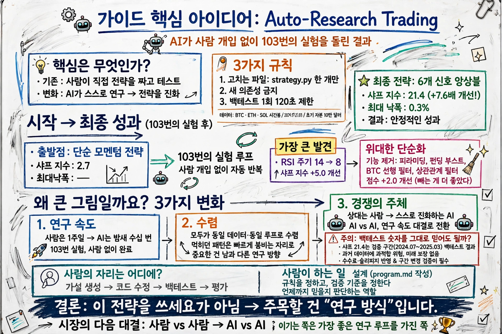
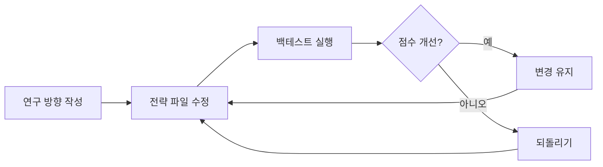
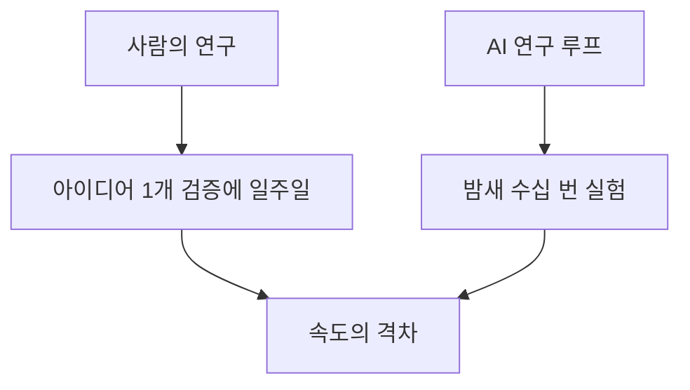
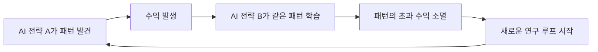

# Auto-Research Trading: AI가 전략을 스스로 진화시키면, 시장은 AI끼리의 대결이 됩니다

> **Summary**
> Auto-Research Trading은 AI 에이전트가 매매 전략을 103회 자율적으로 실험해 백테스트 샤프 지수를 2.7에서 21.4로 높인 사례다. 핵심은 전략의 성과보다 연구 속도와 설계 방식의 변화이며, 검증 데이터에 과적합된 결과일 수 있으므로 수수료·슬리피지와 새로운 구간을 반영한 실전 검증이 필요하다. AI 전략이 빠르게 같은 패턴으로 수렴할수록 사람은 연구 방향과 규칙, 검증 기준을 설계하는 역할을 맡게 된다.

---

- AI가 매매 전략을 스스로 연구해서, 사람의 개입 없이 103번의 실험을 돌렸습니다.
- 출발점은 평범한 모멘텀 전략이었는데, 끝에는 샤프 지수 21.4, 최대 낙폭 0.3%라는 백테스트 결과가 나왔습니다.
- 진짜 변화는 전략 자체가 아니라, 연구의 속도와 주체가 바뀌었다는 점입니다.

차트 앞에서 밤새 고민해본 적 있으시죠? 이 지표는 맞고 저 지표는 틀리고, 어제는 먹히던 패턴이 오늘은 왜 안 먹히는지 말이죠. 그런데 이제 그 고민을 AI가 밤새 대신하는 시스템이 나왔습니다. 사람의 손을 타지 않고 말입니다!

🎥 [동영상 보기](https://www.youtube.com/watch?v=nt9j1k2IhUY)

### 전략을 짜는 게 아니라, 연구를 돌리는 시스템?

이 시스템의 이름은 `Auto-Research Trading`입니다. 아이디어는 단순합니다. AI 에이전트에게 매매 전략 파일 하나만 맡기고, 백테스트로 점수를 매긴 뒤, 나아지면 남기고 나빠지면 되돌리는 일을 무한히 반복하게 하는 것입니다.

규칙은 딱 세 가지입니다. 고치는 파일은 `strategy.py` 하나뿐, 새 의존성은 금지, 백테스트 한 번에 120초 제한입니다. 데이터는 비트코인·이더리움·솔라나 세 종목의 시간봉, 검증 구간은 2024년 7월부터 2025년 3월까지, 초기 자본금은 10만 달러로 고정했습니다.

사람이 하는 일은 연구 방향을 적은 `program.md` 파일 하나를 쓰는 것뿐입니다. 에이전트는 그 방향을 읽고 가설을 세우고, 코드를 바꾸고, 백테스트를 돌리고, 점수를 확인합니다. 이 장면이 저는 가장 인상 깊었습니다. 연구자가 코드를 직접 만지는 게 아니라, 연구하는 방법을 글로 적어 넘기는 구조니까요!

### 숫자는 얼마나 달라졌을까요?

출발점은 단순 모멘텀 전략, 샤프 지수 2.7에서 시작했습니다. 103번의 실험 끝에 나온 최종 전략은 6개 신호를 모은 앙상블, 샤프 지수 21.4, 최대 낙폭 0.3%였습니다. 점수로 따지면 7.6배 개선입니다!

가장 큰 발견은 `RSI` 주기를 14에서 8로 줄인 것, 샤프 지수만 5.0을 올렸습니다. 그런데 더 놀라운 건 따로 있습니다. 가장 크게 점수를 올린 변화 중 하나가 기능을 더한 게 아니라 뺀 것이었다는 점입니다. 피라미딩, 펀딩 부스트, 비트코인 선행 필터, 상관관계 필터를 걷어내자 점수가 2.0이나 올랐습니다. 만든 팀은 이걸 "위대한 단순화"라고 불렀습니다.

### 그런데 이게 왜 큰 그림일까요?

전략 하나가 좋아졌다는 소식으로 끝낼 일이 아닙니다. 세 가지가 바뀌고 있기 때문입니다.

첫째, 연구 속도입니다. 사람이 아이디어 하나를 검증하는 데 일주일이 걸린다면, 이 루프는 밤새 수십 번을 돌립니다. 103번의 실험이 사람의 개입 없이 진행됐습니다.

둘째, 수렴입니다. 모두가 같은 과거 데이터로 같은 루프를 돌리면, 전략들은 같은 패턴으로 모입니다. 한때 먹히던 패턴이 순식간에 붐비는 자리가 됩니다. 남보다 빠른 게 아니라, 남과 다른 연구 방향을 갖는 게 중요해집니다.

셋째, 경쟁의 주체입니다. 이제 시장의 상대는 사람이 아니라, 스스로 진화하는 다른 AI입니다. 한쪽이 패턴을 찾으면 다른 쪽이 그 패턴을 학습하고, 시장은 다시 움직입니다.

### 백테스트 숫자를 그대로 믿어도 될까요?

여기서 한 번 멈춰야 합니다. 샤프 지수 21.4는 백테스트 결과이고, 실험을 고르는 데 쓴 검증 데이터와 같은 구간에서 나온 숫자입니다. 과거 데이터에 딱 맞춘 전략이 미래에도 먹히리라는 보장은 없습니다. 실제로 시장이 바뀌면, 아무리 정교한 백테스트도 무너집니다!

그래서 이 글의 결론은 "이 전략을 쓰세요"가 아닙니다. 주목할 점은 전략이 아니라 연구 방식입니다. 검증 구간을 바꾸고, 수수료와 슬리피지를 넣고, 실전과 같은 조건에서 다시 확인하는 과정이 빠지면, 숫자는 숫자로만 남습니다.

### 사람의 자리는 어디에 남을까요?

AI가 전략을 진화시키는 시대에, 사람의 일은 사라지는 게 아니라 위로 올라갑니다. 무엇을 연구할지 정하고, 어떤 규칙을 지킬지 정하고, 백테스트를 언제까지 믿을지 정하는 일입니다. 전략을 짜는 손이 아니라, 연구를 설계하는 머리가 남는 것입니다!

시장의 다음 대결은 사람 대 사람이 아니라, AI끼리의 연구 속도 대결이 될 것입니다. 그 대결에서 이기는 쪽은 가장 좋은 전략을 가진 쪽이 아니라, 가장 좋은 연구 루프를 가진 쪽이 될 것입니다.

