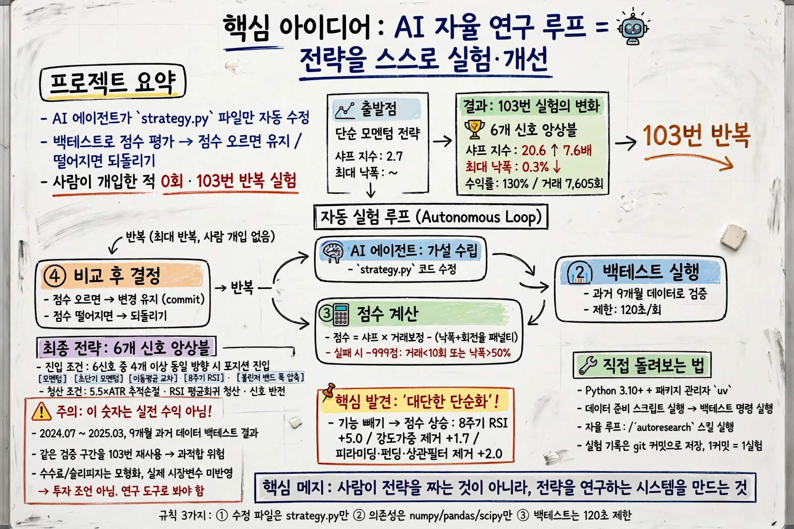
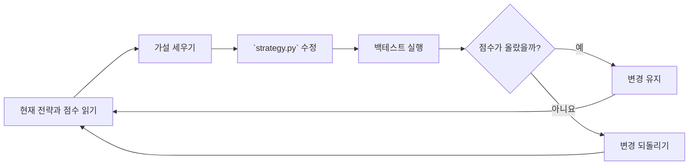
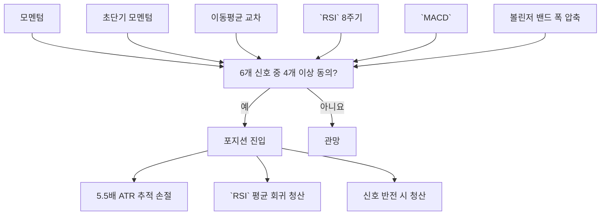
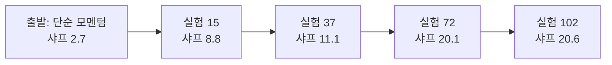

# Auto-Research Trading: 전략은 사람이 짜지 않습니다. AI가 백테스트 103번으로 찾아냅니다

> **Summary**
> AI 에이전트가 전략 코드를 수정하고 백테스트를 반복해 103회 실험 끝에 샤프 지수 2.7에서 20.6으로 개선된 6개 신호 앙상블을 만들었습니다. 그러나 모든 실험이 같은 9개월 검증 구간을 사용해 과적합 가능성이 크므로, 결과는 실전 수익의 증거가 아니라 자율 연구 시스템의 작동 사례로 봐야 합니다.

---

- AI 에이전트가 매매 전략 파일을 직접 고치고 백테스트로 검증하는 과정을 103번 반복했습니다. 사람이 개입한 적은 한 번도 없습니다.
- 출발점은 샤프 지수 2.7의 단순 모멘텀 전략이었고, 마지막에는 샤프 20.6에 최대 낙폭 0.3%인 6개 신호 앙상블 전략이 남았습니다.
- 다만 이 숫자는 과거 데이터 백테스트 결과입니다. 같은 검증 구간을 103번 재사용했으니, 실전 수익으로 읽으면 안 됩니다.

차트를 보면서 "이번엔 오를까, 내릴까" 고민해 본 적 있으시죠? 보통은 사람이 전략을 짜고, 백테스트를 돌리고, 안 되면 다시 짜는 일을 반복합니다. 그런데 이 프로젝트는 그 반복 자체를 AI에게 맡겼습니다!

🎥 [동영상 보기](https://www.youtube.com/watch?v=XXR0zZ0_16M)

### 전략을 짜는 건 이제 AI 일일까요?

핵심 아이디어는 단순합니다. AI 에이전트가 매매 전략이 담긴 파일 하나(`strategy.py`)만 고칩니다. 고칠 때마다 과거 데이터로 백테스트를 돌리고, 점수가 올랐으면 변경을 남기고, 떨어졌으면 되돌립니다. 이 과정을 사람이 멈출 때까지 끝없이 반복합니다.

사람이 하는 일은 목표와 규칙을 적는 것뿐입니다. 전략을 직접 짜지 않습니다. 실험을 하나하나 실행하지도 않습니다. 에이전트는 스스로 가설을 세우고, 코드를 바꾸고, 결과를 확인하고, 배운 것을 다음 실험에 반영합니다. 103번의 실험이 그렇게 쌓였습니다.

이 패턴의 출발점은 따로 있습니다. 단일 GPU에서 작은 언어 모델 학습을 스스로 개선하던 오토-리서치 패턴을, 트레이딩 전략 연구에 가져온 것입니다. 학습 코드를 고치던 자리에 전략 코드가 들어갔고, 검증 손실 자리에 백테스트 점수가 들어갔습니다. 구조는 똑같습니다. 바꾸는 파일 하나, 고정된 평가 기준, 그리고 끝없는 반복입니다.

### 규칙은 무엇일까요?

루프가 제대로 돌려면 규칙이 단단해야 합니다. 이 프로젝트의 규칙은 세 가지입니다.

첫째, 에이전트가 건드릴 수 있는 파일은 `strategy.py` 하나뿐입니다. 데이터 준비와 백테스트 엔진은 고정돼 있습니다. 둘째, 새 의존성을 추가할 수 없습니다. 쓸 수 있는 건 `numpy`, `pandas`, `scipy` 같은 기본 라이브러리뿐입니다. 셋째, 백테스트 한 번에 120초까지만 씁니다. 느린 실험은 루프를 갉아먹으니까요.

점수 계산도 미리 정해져 있습니다. 샤프 지수에 거래 횟수 보정을 곱하고, 낙폭과 회전율에 벌점을 뺍니다. 거래가 10번 미만이거나 낙폭이 50%를 넘기면 점수는 바로 -999점입니다. 에이전트는 이 점수 하나만 보고 판단합니다. 사람이 중간에 끼어들 여지가 없습니다!

### 103번 실험 끝에 무엇이 남았을까요?

출발점은 샤프 2.7의 단순 모멘텀 전략이었습니다. 103번의 실험 끝에 남은 전략은 샤프 20.6, 최대 낙폭 0.3%, 수익률 130%, 거래 7,605회였습니다. 점수로 따지면 7.6배 개선입니다. 기준이 되는 5개 참조 전략 중 가장 높았던 단순 모멘텀의 점수가 2.724였으니, 그 선을 한참 넘겼습니다.

최종 전략은 6개 신호를 묶은 앙상블입니다. 모멘텀, 초단기 모멘텀, 이동평균 교차, 8주기 `RSI`, `MACD`, 볼린저 밴드 폭 압축까지 여섯 신호 중 네 개 이상이 같은 방향을 가리켜야 포지션을 잡습니다. 빠져나올 때는 5.5배 `ATR` 추적 손절, `RSI` 평균 회귀 청산, 신호 반전 순서로 판단합니다.

이 장면이 저는 가장 인상 깊었습니다. 점수를 가장 많이 올린 건 기능을 더한 실험이 아니라 뺀 실험이었다는 대목이요! 8주기 `RSI`가 샤프를 5.0이나 올렸고, 강도 가중을 빼는 것만으로 1.7이 올랐습니다. 피라미딩, 펀딩 부스트, 상관관계 필터를 걷어내는 "대단한 단순화"만으로 2.0이 올랐습니다. 똑똑해 보이는 기능을 하나씩 떼어낼 때마다 전략은 더 좋아졌습니다.

### 그런데 이 숫자, 그대로 믿어도 될까요?

여기서 한 번 멈춰야 합니다. 이 숫자는 실전 수익이 아닙니다. 2024년 7월부터 2025년 3월까지, 9개월치 과거 데이터에 대한 백테스트 결과입니다. 수수료와 슬리피지는 모형에 넣었지만, 실제 시장에는 호가창, 체결 실패, 급변하는 변동성까지 백테스트가 담지 못하는 변수가 훨씬 많습니다.

더 중요한 함정이 하나 있습니다. 103번의 실험이 모두 같은 검증 구간을 재사용했다는 점입니다. 점수를 올리는 방향으로만 103번을 고르다 보면, 그 구간에 과하게 맞는 전략이 나올 수 있습니다. 샤프 20.6이라는 숫자 자체가 그 신호일 수 있습니다. "루프가 돈다"는 사실은 믿을 만하지만, "이 전략이 돈을 번다"는 말은 아닙니다!

그래서 이 프로젝트는 투자 조언이 아니라 연구 도구로 읽는 게 맞습니다. 백테스트 점수가 말해주는 건 전략의 우열이 아니라, 스스로 실험하고 배우는 시스템이 실제로 돌아간다는 사실입니다.

### 직접 돌려보려면 어떻게 할까요?

직접 돌려보는 길은 열려 있습니다. `Python 3.10` 이상과 패키지 관리자 `uv`만 있으면 됩니다. 저장소를 받아 데이터 준비 스크립트를 한 번 돌리고, 백테스트 명령을 실행하면 현재 전략의 점수가 나옵니다. API 키는 필요 없습니다. 데이터는 공개 `API`에서 가져옵니다.

자율 루프를 돌리려면 코딩 에이전트에서 `/autoresearch` 스킬을 실행하면 됩니다. 에이전트가 전략을 읽고, 바꾸고, 백테스트하고, 유지하거나 되돌리는 과정을 멈출 때까지 반복합니다. 실험 기록은 `git` 커밋으로 남습니다. 커밋 하나가 실험 하나입니다!

매매 실력을 키우는 게 아니라, 매매를 연구하는 시스템을 만드는 쪽으로 시선이 옮겨가고 있습니다.

