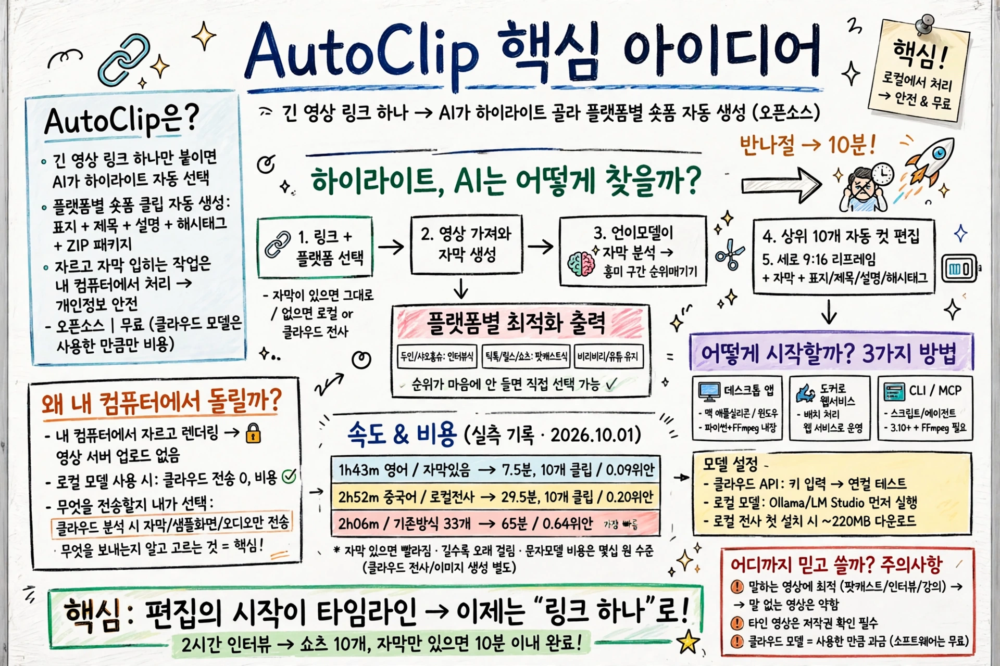
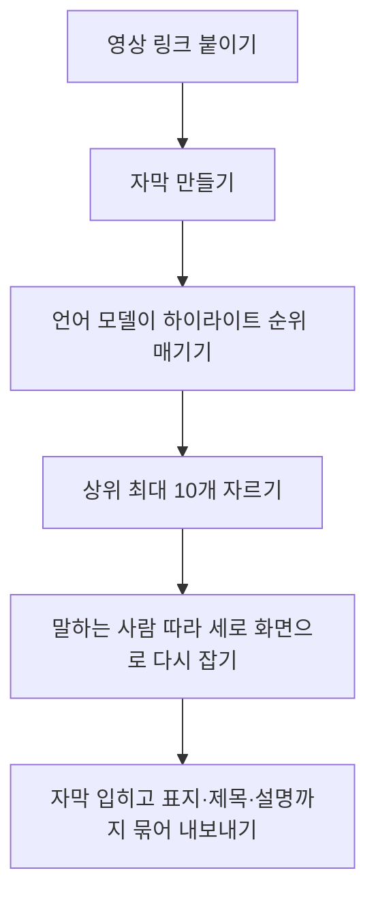
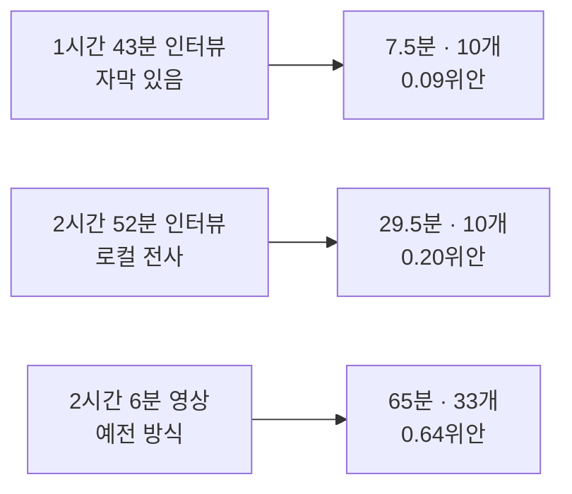
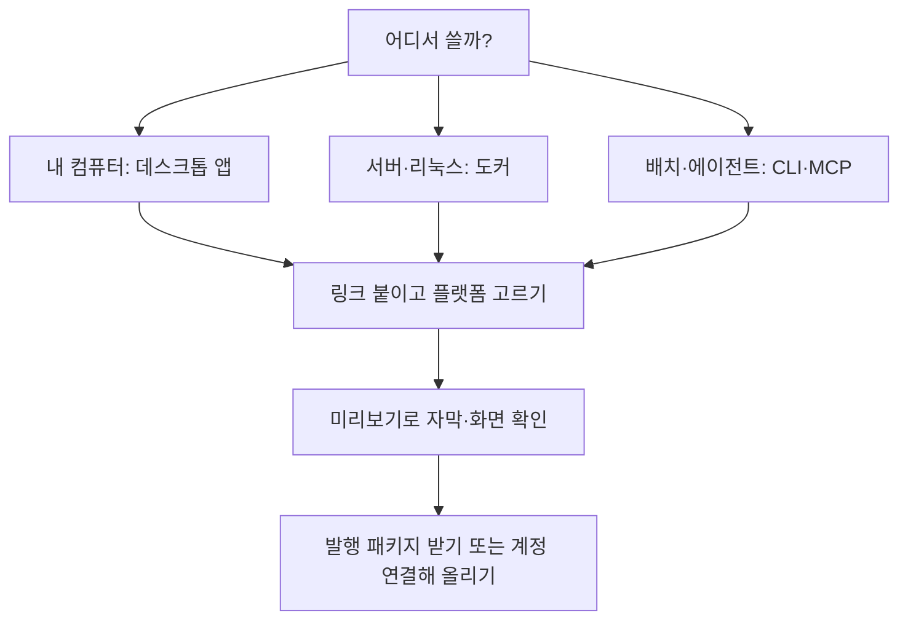

# AutoClip: 긴 영상은 링크 하나면, 하이라이트 클립 10개로 나옵니다

> **Summary**
> AutoClip은 긴 영상 링크를 입력하면 AI가 하이라이트를 찾아 최대 10개의 세로 숏폼 클립과 자막·표지·제목·설명·해시태그가 포함된 발행 패키지를 만들어주는 무료 오픈소스 도구입니다. 편집과 렌더링은 컴퓨터에서 처리하며, 클라우드 모델은 사용량에 따라 요금이 들고 로컬 모델을 쓰면 비용 없이 실행할 수 있습니다. 말이 중심인 영상에 적합하고, 클라우드 기능을 사용하면 자막·오디오·화면 샘플 등이 전송될 수 있으므로 설정을 확인해야 합니다.

---

- AutoClip은 긴 영상 링크 하나만 붙이면 AI가 하이라이트를 골라 플랫폼별 숏폼 클립을 만들어주는 오픈소스 도구입니다.
- 클립마다 표지, 제목, 설명, 해시태그, ZIP 발행 패키지까지 붙고, 자르고 자막을 입히는 일은 내 컴퓨터에서 처리합니다.
- 소프트웨어는 무료이고, 클라우드 모델을 쓸 때만 사용한 만큼 내며, 로컬 모델을 쓰면 비용 없이 돌릴 수 있습니다.

2시간짜리 인터뷰 영상을 보고 쇼츠 10개를 손으로 자른 적 있으시죠? 타임라인을 왔다 갔다 하며 하이라이트를 찾고, 세로 화면에 맞게 다시 잡고, 자막을 한 줄씩 입히다 보면 반나절이 금방 갑니다. 이 지루한 반복을 링크 하나로 끝내는 도구가 있습니다!

🎥 [동영상 보기](https://www.youtube.com/watch?v=p_hGm5aCkg0)

## 하이라이트, AI가 어떻게 찾을까요?

과정은 단순합니다. 링크를 붙이고 플랫폼을 고르면, 도구가 영상을 가져와 자막을 만들고, 언어 모델이 자막을 읽어 클립으로 만들 만한 순간에 순위를 매깁니다. 순위가 높은 순간부터 최대 10개까지 잘라내고, 화면은 말하는 사람을 따라 세로 9:16으로 다시 잡고, 자막을 입혀 플랫폼에 맞는 파일로 내보냅니다.

플랫폼마다 결이 다릅니다. 두인·샤오홍슈는 인터뷰식, 틱톡·릴스·쇼츠는 꽉 찬 팟캐스트식 화면이 기본이고, 비리비리와 유튜브는 가로 화면을 그대로 씁니다. 클립마다 표지, 제목, 설명, 해시태그가 붙고, ZIP 발행 패키지로 한 번에 받을 수 있습니다. 어떤 순간이 왜 뽑혔는지 궁금하면, 순위를 보고 직접 고를 수도 있습니다.

## 왜 내 컴퓨터에서 돌리는 게 중요할까요?

이 도구의 핵심은 "내 컴퓨터에서 자르고 렌더링한다"는 점입니다. 영상이 어딘가 서버로 올라가지 않으니, 아직 공개하지 않은 인터뷰 원본을 다룰 때도 마음이 편합니다. 분석에 쓸 모델은 직접 고릅니다. 클라우드 API를 쓸 수도 있고, 로컬 모델을 띄워 쓸 수도 있습니다.

자막도 선택지가 있습니다. 영상에 딸린 자막이 있으면 그대로 쓰고, 없으면 로컬 전사나 클라우드 전사를 씁니다. 클라우드 분석을 쓰면 자막과 문안이 전송되고, 화면 이해나 참고 이미지 생성을 쓰면 샘플 화면이 전송되고, 클라우드 전사를 쓰면 오디오가 전송됩니다. 로컬 분석과 로컬 전사만 쓰면 클라우드로 나가는 게 없습니다. 무엇을 보내는지 알고 고르는 것, 이게 이 도구의 태도입니다!

## 얼마나 빠르고, 비용은 얼마나 들까요?

개발 과정에서 실제 소재로 잰 기록이 있습니다. 2026년 10월 1일, 같은 애플 실리콘 맥에서 세 번 돌린 결과입니다. 1시간 43분짜리 영어 인터뷰는 자막이 있는 상태라 7.5분 만에 10개를 뽑았고, 문자 모델 비용은 0.09위안이었습니다. 2시간 52분짜리 중국어 인터뷰는 로컬 전사를 써서 29.5분이 걸렸고 0.20위안이었습니다. 2시간 6분짜리 영상은 예전 방식으로 33개를 뽑느라 65분이 걸렸고 0.64위안이었습니다!

숫자를 그대로 믿으면 안 됩니다. 세 번의 조건이 다르고, 자막 유무와 방식이 시간을 좌우합니다. 그래도 방향은 분명합니다. 자막이 있으면 빠르고, 길수록 느리고, 문자 모델 비용은 한 번 돌리는 데 몇십 원 수준입니다. 참고로 이 비용은 문자 모델만 잰 것이고, 클라우드 전사나 이미지 생성을 쓰면 별도로 듭니다.

## 어떻게 시작하면 될까요?

세 가지 길이 있습니다. 컴퓨터에서 바로 쓸 거면 데스크톱 앱을 받습니다. 맥 애플 실리콘용과 윈도우용이 있고, 파이썬과 `FFmpeg`이 함께 들어 있습니다. 웹 서비스로 띄울 거면 도커로 올립니다. 배치로 돌리거나 에이전트에 연결할 거면 CLI와 MCP를 씁니다. 파이썬 3.10 이상과 `FFmpeg`이 필요합니다.

모델 설정은 따로 챙겨야 합니다. 클라우드 API는 서비스사를 고르고 키를 넣어 연결을 테스트합니다. 로컬 모델은 `Ollama`나 `LM Studio`를 먼저 띄우고 모델을 올린 뒤 고릅니다. 자막이 없고 로컬 전사가 느리면 클라우드 전사로 바꿀 수 있고, 처음 로컬 전사를 설치할 때는 약 220MB를 내려받습니다. 예시 프로젝트가 설치 패키지 안에 들어 있어, 키 없이 먼저 맛볼 수도 있습니다.

## 어디까지 믿고 쓰면 될까요?

세 가지는 짚고 넘어가야 합니다. 첫째, 이 도구는 말하는 영상에 맞춰져 있습니다. 팟캐스트, 인터뷰, 강의처럼 말이 중심인 영상이 제격이고, 말 없는 영상에서는 하이라이트를 찾기 어렵습니다. 둘째, 남의 영상을 가져다 쓸 때는 권리를 먼저 확인해야 합니다. 데모 클립도 원본의 권리는 원작자에게 있다고 분명히 밝히고 있습니다. 셋째, 클라우드 모델을 쓰면 사용한 만큼 요금이 나갑니다. 소프트웨어는 무료이지만 모델 호출은 공짜가 아닙니다!

이 장면이 저는 가장 와닿았습니다. 긴 영상을 보고 "이 부분, 쇼츠로 만들면 되겠다" 싶었던 순간이, 이제는 링크 하나로 시작된다는 점입니다. 편집의 시작이 타임라인이 아니라 링크가 되는 겁니다.

긴 영상을 정리하는 일, 손으로 자르는 데서 끝내지 않아도 됩니다. 링크를 붙이고, 순위를 보고, 미리보기로 확인한 뒤, 발행 패키지를 받으면 됩니다. 2시간짜리 인터뷰가 쇼츠 10개로 바뀌는 데, 자막만 있으면 10분이 채 안 걸립니다!

