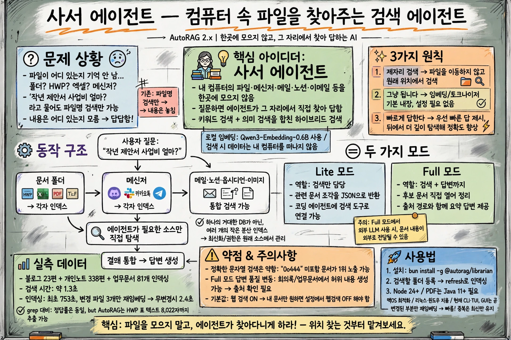
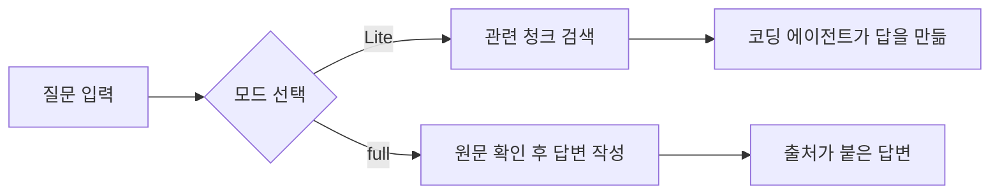
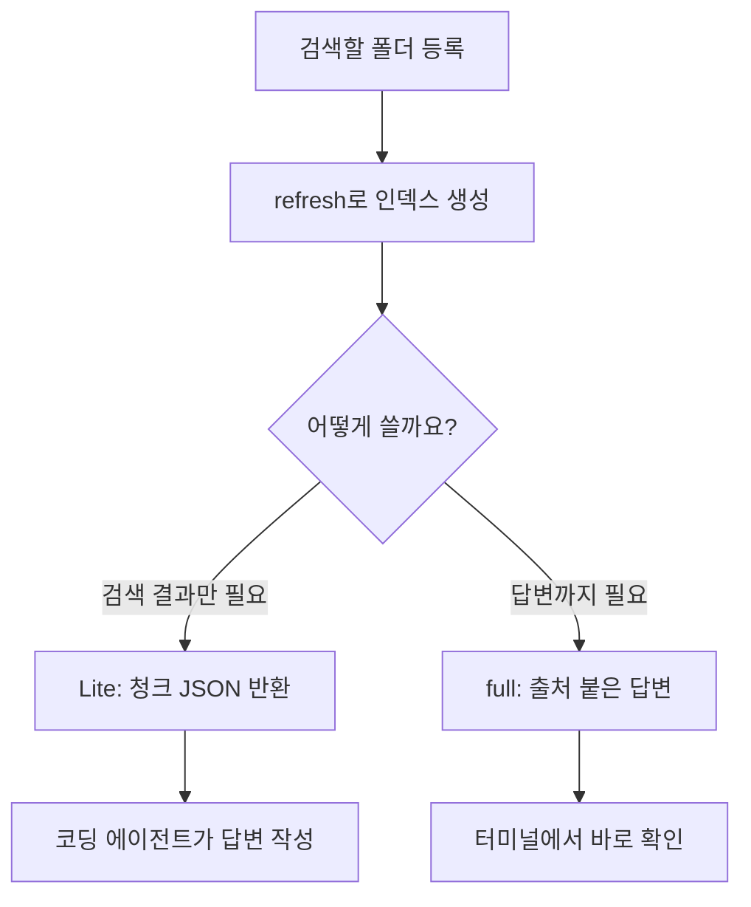

# AutoRAG Agent: 파일을 한곳에 모으지 않고, 그 자리에서 찾아 답합니다

> **Summary**
> 내 컴퓨터에 흩어진 파일·메신저·메일을 한곳에 모으지 않고, 그 자리에서 찾아 답해주는 검색 에이전트입니다. 키워드 검색과 의미 검색을 합치고, 로컬 임베딩 모델로 인덱싱하니 검색 단계에서는 파일 내용이 내 컴퓨터를 떠나지 않습니다. 검색만 맡기는 Lite와 답변까지 받는 full 두 가지 모드가 있고, 코딩 에이전트에 검색 도구로 붙일 수도 있습니다.

---

- 내 컴퓨터에 흩어진 파일·메신저·메일을 한곳에 모으지 않고, 그 자리에서 찾아 답해주는 검색 에이전트입니다.
- 키워드 검색과 의미 검색을 합치고, 로컬 임베딩 모델로 인덱싱하니 검색 단계에서는 파일 내용이 내 컴퓨터를 떠나지 않습니다.
- 검색만 맡기는 Lite와 답변까지 받는 full 두 가지 모드가 있고, 코딩 에이전트에 검색 도구로 붙일 수도 있습니다.

작년 제안서 사업비가 얼마였지? 파일은 분명 어딘가에 있는데, 어느 폴더에 있는지, HWP인지 엑셀인지, 메신저에서 논의한 건지 도통 기억이 나지 않습니다. 이런 적 있으시죠? 파일명으로 검색하면 파일명만 나옵니다. 내용으로 묻고 싶은데, 내용은 어디에 있는지 모릅니다. 이 답답함을 풀어주는 도구가 있습니다. 컴퓨터 전체를 뒤져서 답을 찾아주는 사서 에이전트입니다!

🎥 [동영상 보기](https://www.youtube.com/watch?v=_ygHIlWFkgM)

## RAG 파이프라인 도구에서 사서 에이전트로 바뀌었습니다?

원래 AutoRAG는 데이터에 맞는 RAG 파이프라인을 자동으로 찾아주는 도구였습니다. 그런데 에이전트 시대가 오면서 방향이 바뀌었습니다. 고정된 파이프라인 하나를 찾는 대신, 문서를 직접 찾아 읽고 답을 만드는 에이전트로 다시 태어났습니다. 지금의 2.x 버전이 바로 그 모습입니다. 예전 파이프라인 최적화 도구는 별도 위치에서 유지보수만 이어갑니다.

이 에이전트가 내세우는 원칙은 세 가지입니다. 첫째, 제자리 검색입니다. 파일을 한곳에 모으지 않고 원래 자리에서 찾습니다. 둘째, 그냥 됩니다. 임베딩 모델이나 토크나이저 같은 기본 설정을 내장해서 사용자가 일일이 고를 필요가 없습니다. 셋째, 빠르게 답합니다. 정보가 충분하지 않아도 일단 빠른 답을 내놓고, 뒤에서 더 깊이 탐색해 정확도를 높입니다!

## 파일을 옮기지 않고 어떻게 찾을까요?

검색 대상은 로컬 문서 파일만이 아닙니다. 디스코드, 슬랙, 텔레그램, 카카오톡 같은 메신저 대화 기록과 이메일, 노션, 옵시디언, 이미지까지 함께 찾습니다. 회의록은 문서 폴더에 있고 후속 논의는 메신저에 흩어져 있어도, 한 번의 질문으로 함께 찾을 수 있습니다. 어디에 저장했는지 몰라도 내용으로 찾는다는 게 핵심입니다.

구조는 생각보다 단순합니다. 데이터가 한곳에 모이는 대신, 소스마다 인덱스를 따로 만듭니다. 그리고 에이전트가 질문을 받으면 필요한 소스를 직접 찾아가 검색합니다. 하나의 거대한 벡터 DB가 아니라, 여러 개의 작은 인덱스가 분산돼 있는 셈입니다. 그래서 데이터 최신화나 권한 문제도 원래 소스에 맡길 수 있습니다.

임베딩은 로컬에서 실행하는 `Qwen3-Embedding-0.6B` 모델이 맡습니다. 검색 단계에서는 파일 내용이 외부로 나가지 않습니다. 다만 한 가지는 알고 써야 합니다. full 모드에서 외부 LLM으로 답변을 만들면, 문서 내용이 그 서비스로 전달됩니다. 검색은 로컬, 답변은 외부일 수 있다는 뜻입니다.

## Lite와 full, 뭐가 다를까요?

두 모드는 역할이 다릅니다. Lite는 검색만 맡습니다. `autorag lite retrieve "질문"`을 실행하면 관련 문서의 조각을 JSON으로 받습니다. 이 결과를 코딩 에이전트에 넘기면, 기존 에이전트가 그 내용을 읽고 답을 만듭니다. full은 답변까지 맡습니다. `autorag search "질문"`을 실행하면 에이전트가 후보 문서를 직접 열어보고, 항목별로 정리한 답을 출처 경로와 함께 내놓습니다.

인덱싱도 손이 덜 갑니다. 폴더에 문서를 추가하거나 내용을 고친 뒤 `refresh`를 돌리면, 바뀐 조각만 다시 임베딩합니다. 전체를 처음부터 다시 처리하지 않습니다. 본문이 완전히 같은 중복 문서는 최신 파일 하나만 남기고 제외합니다. 원본 파일을 지우는 동작이 아니라, 인덱스에서 빼는 방식입니다.

## 숫자로 보면 어떨까요?

실측 기록이 있습니다. v2.5.2 기준으로 블로그 23편, 개인 노트 338편, 업무 문서 81개를 인덱싱하고 검색했습니다. 검색 시간은 약 1.3초였습니다! 첫 인덱싱은 컴파일 시간까지 합쳐 753초가 걸렸지만, 파일 하나를 고친 뒤 다시 돌리니 바뀐 조각 3개만 다시 임베딩했습니다. 무변경 상태에서는 2.4초면 끝났습니다.

코딩 에이전트에 Lite를 붙인 경우와 grep만 쓴 경우를 비교한 결과도 있습니다. 정답률은 세 번 모두 같았습니다! 그런데 시간과 토큰은 grep 쪽이 더 적게 들었습니다. 이 장면이 저는 가장 인상 깊었습니다. 검색 도구의 승부는 속도가 아니라, 어떤 파일까지 읽어내느냐에 달렸다는 걸 보여주니까요! 실제로 HWP 표 안의 텍스트는 AutoRAG 파서가 8,022자로 뽑아냈습니다. grep 쪽은 표 내용을 버리는 바람에 같은 파일을 다시 변환해야 했습니다.

## 약점도 있습니다. 어디까지 믿을까요?

좋은 점만 있는 도구는 없습니다. 정확한 문자열을 찾는 질문에는 약합니다. `0o444`라는 식별자를 물었더니, 그 문자열이 없는 글이 1위로 나왔습니다. 그리고 1위 점수는 방식별로 정규화돼서 항상 1.000이 됩니다. 점수만 보고 관련 문서가 없다고 판단할 수는 없습니다.

full 모드의 답변 품질도 문서 종류에 따라 갈립니다. 업무 문서 75개에 같은 질문을 던졌더니, grep 에이전트와 Lite 에이전트는 전부 정답을 냈는데 full 모드는 절반 이하였습니다. 회의록에 적힌 상태 흐름을 찾지 못하고, 원문에 없는 표현을 만들어낸 사례도 있었습니다. 출처가 붙은 답변도 확인은 필요합니다.

기본 설정에서 웹 검색이 켜져 있다는 점도 주의해야 합니다. 폴더에 없는 내용을 웹에서 가져와 인용한 사례가 있었습니다. 내 문서만으로 답하고 싶다면 웹 검색을 끄는 설정부터 확인하는 게 순서입니다.

## 쓰기 전에 확인할 것

설치는 한 줄로 시작합니다. `bun install -g @autorag/librarian`을 실행하고, 검색할 폴더를 등록한 뒤 `refresh`로 인덱스를 만듭니다. Node 24 이상이 필요하고, PDF 파싱에는 Java 11 이상이 필요합니다. 맥 OS에 최적화돼 있고, 리눅스와 윈도우도 지원합니다. 지금은 CLI와 간단한 TUI로 쓰고, GUI 버전은 곧 추가될 예정입니다.

외부 데이터소스를 연결할 때는 소스마다 준비물이 다릅니다. 메신저나 메일은 각 소스 전용 도구를 준비해야 하고, 슬랙과 노션은 어휘 검색만 지원합니다. 모든 연결이 복사 없이 동작하는 건 아니니, 연결하기 전에 소스별 방식을 한 번씩 확인하는 게 좋습니다.

파일을 한곳에 모으는 대신, 에이전트가 직접 찾아다니게 만드는 선택입니다. 완벽한 답을 기대하기보다, 위치를 찾는 일부터 맡겨보시면 어떨까요?

