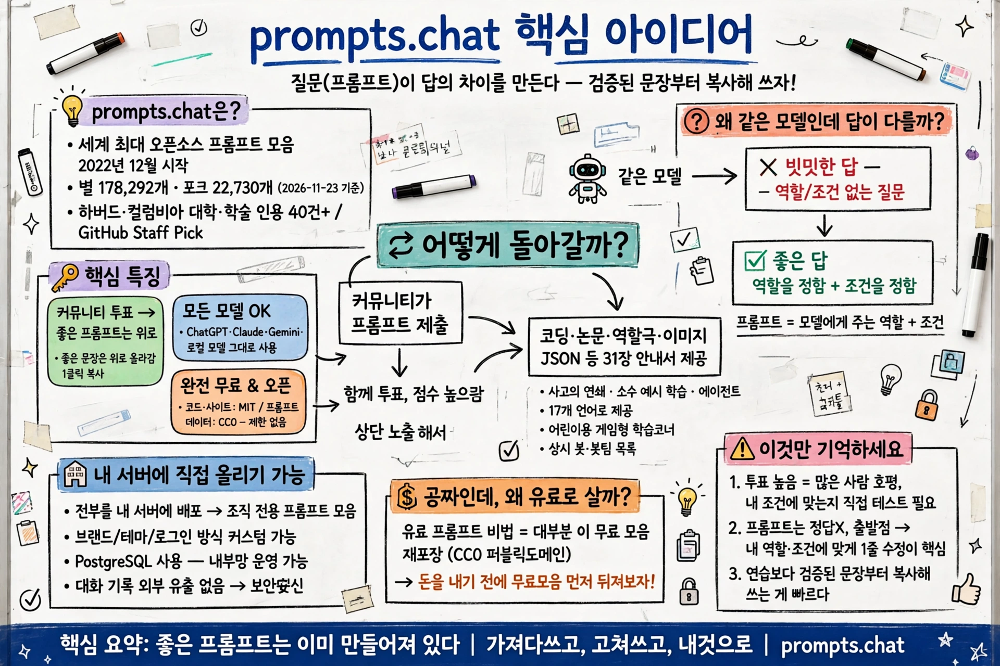
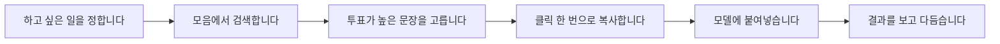
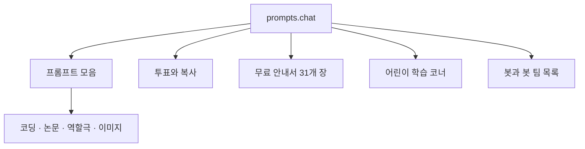

# Awesome ChatGPT Prompts: 좋은 질문은 만들지 말고 복사하세요. 별 17만 개가 이유입니다

> **Summary**
> prompts.chat은 커뮤니티가 검증한 프롬프트를 검색하고 한 번에 복사해 다양한 AI 모델에 활용할 수 있는 대규모 오픈소스 모음입니다. 무료 안내서와 봇 목록도 제공하며, MIT 및 CC0 라이선스와 자가 호스팅을 지원해 조직 전용 모음으로 만들 수 있습니다. 투표 순위는 참고만 하고, 각 프롬프트를 자신의 목적과 조건에 맞게 다듬어야 합니다.

---

- `prompts.chat`은 세계에서 가장 큰 오픈소스 프롬프트 모음입니다. 2022년 12월에 시작된 첫 프롬프트 라이브러리로, 별이 17만 8천 개 넘게 찍혔습니다.
- 커뮤니티 투표로 좋은 프롬프트가 위로 올라오고, 마음에 드는 문장은 클릭 한 번이면 복사됩니다. 코딩부터 논문, 역할극, 이미지 생성까지, 모델도 가리지 않습니다.
- 코드와 사이트는 MIT, 프롬프트 데이터는 CC0라서 가져다 쓰는 데 제한이 없고, 내 서버에 직접 올려 쓸 수도 있습니다.


AI에게 일을 시켰는데, 답이 어딘가 밋밋했던 적 있으시죠?

같은 모델인데, 누구는 척척 뽑아내고 누구는 헤맵니다. 차이는 모델이 아니라 질문에 있습니다. 그런데 질문을 잘 만드는 건 또 하나의 기술입니다. 그걸 처음부터 만들 필요는 없습니다. 이미 수많은 사람이 검증한 문장이 모여 있으니까요!

🎥 [동영상 보기](https://www.youtube.com/watch?v=MnCUGeJfIGY)

## 왜 같은 모델인데 답이 다를까요?

프롬프트는 모델에게 주는 역할과 조건입니다. "글을 써 줘"와 "당신은 10년 차 편집자입니다. 독자는 초보 개발자입니다. 500자로 써 줘"는 같은 요청이 아닙니다. 역할이 정해지면 답의 깊이가 달라지고, 조건이 정해지면 답의 형태가 달라집니다.

그런데 매번 이런 문장을 처음부터 짓는 건 피곤한 일입니다. 그래서 누군가 2022년 12월에 프롬프트를 모아두는 저장소를 만들었습니다. 그게 지금의 `prompts.chat`입니다. 이름은 바뀌었지만, 처음 시작된 프롬프트 라이브러리라는 자리는 그대로입니다.

숫자가 말해 줍니다. 별 178,292개, 포크 22,730개(2026-11-23 확인). 하버드와 컬럼비아 대학의 안내가 이 모음을 인용했고, 학술 인용도 40건이 넘습니다. 깃허브 스태프 픽에도 올랐습니다. 원문 글에 적힌 "17만 8천 개"라는 숫자, 확인해 보니 사실이었습니다!

## 이 모음은 어떻게 돌아갈까요?

구조는 단순합니다. 커뮤니티가 프롬프트를 올리고, 함께 투표합니다. 점수가 높은 문장이 위로 올라옵니다. 마음에 드는 문장은 클릭 한 번이면 복사됩니다. 검색창에 원하는 기능을 적으면 됩니다. 코딩, 논문 다듬기, 역할극, 이미지 생성용 `JSON`까지 한곳에 모여 있습니다.



모델도 가리지 않습니다. `ChatGPT`는 물론 `Claude`, `Gemini`, 로컬 오픈 모델에도 그대로 붙여넣으면 됩니다. 프롬프트는 특정 모델 전용이 아니라, 역할과 조건을 적는 문장이기 때문입니다.

## 무엇이 들어 있을까요?

프롬프트 모음만 있는 게 아닙니다. 31개 장이 넘는 무료 프롬프트 안내서가 딸려 있습니다. 기초부터 사고의 연쇄, 소수 예시 학습, 에이전트까지 다루고, 17개 언어로 읽을 수 있습니다. 어린이용 게임형 학습 코너도 있습니다. 8세부터 14세까지, 퍼즐과 이야기로 AI와 대화하는 법을 배웁니다.

상시 작동하는 봇과 봇 팀 목록도 있습니다. 봇마다 설치 방법과 필요한 컴퓨터(클라우드, 내 컴퓨터, 둘 다)가 적혀 있고, 투표와 댓글도 달립니다. 봇 팀은 일을 서로 넘겨주는 봇들의 묶음으로, 한 번에 설치할 수도 있습니다.



## 내 서버에 올려 쓸 수도 있습니다

이 모음의 진짜 매력은 공개 여부보다 자가 호스팅에 있습니다. 전부를 내 서버에 올려서 우리 조직 전용 프롬프트 모음을 만들 수 있습니다. 브랜드와 테마, 로그인 방식까지 바꿀 수 있습니다.

```bash
npx prompts.chat new my-prompt-library
cd my-prompt-library
```

설치 마법사가 브랜드와 테마, 인증 방식을 물어보고, 데이터베이스는 `PostgreSQL`을 씁니다. 회사 내부망에 두고 팀만 쓰는 것도 가능합니다. 대화 기록이 밖으로 나가지 않으니, 내부 자료를 다루는 팀에는 이 점이 크게 와닿습니다!

## 공짜인데, 왜 돈을 내고 살까요?

원문 글에 재미있는 대목이 있습니다. 인터넷에서 수만 원을 받고 파는 "최고의 AI 프롬프트 비법" 중 상당수가 이 무료 모음에서 가져와 다시 포장한 것이라는 지적입니다. 확인할 길은 없지만, 구조상 가능한 이야기입니다. 프롬프트 데이터는 CC0, 즉 퍼블릭 도메인이라서 가져다 쓰는 데 제한이 없기 때문입니다.

그래서 순서가 바뀝니다! 돈을 내기 전에 무료 모음부터 뒤져보는 게 먼저입니다. 원하는 문장이 이미 있을 가능성이 큽니다. 없었다면, 그때 돈을 쓸지 말지 고민해도 늦지 않습니다.

## 어디까지 믿어야 할까요?

투표가 높다고 해서 내 일에 맞는 문장이라는 뜻은 아닙니다. 투표는 "많은 사람이 좋았다"는 신호일 뿐, 내 조건과 맞는지는 직접 써 봐야 압니다. 프롬프트는 정답이 아니라 출발점입니다. 복사한 문장을 내 역할과 조건에 맞게 고치는 한 줄이, 사실은 가장 중요한 한 줄입니다.

한 가지 더 짚고 넘어가겠습니다. 원문 글은 로그인 벽 뒤에 있어 직접 열지 못했습니다. 공개 미러로 전문을 확인한 뒤, 저장소와 사이트를 직접 읽어 정리했습니다. 같은 날 올라온 다른 글 세 편은 주제가 다릅니다. 하나는 영상 다운로드 도구 모음, 하나는 클라우드 명령줄 도구 업데이트, 하나는 로컬 AI 실행기입니다. 이 글은 그중에서도 "모델에게 무슨 말을 할지"를 다루는 프롬프트 모음이 주제입니다.

질문을 잘 만드는 연습도 좋지만, 검증된 문장부터 복사해 쓰는 게 더 빠릅니다. 오늘 쓸 질문 하나, 모음에서 골라보시는 건 어떨까요?

