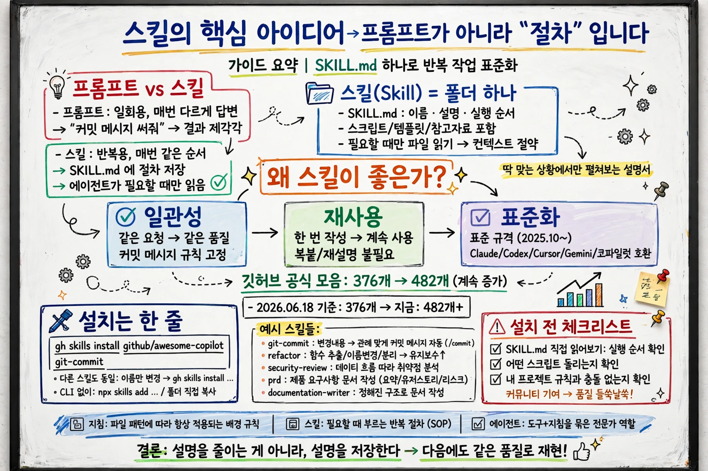
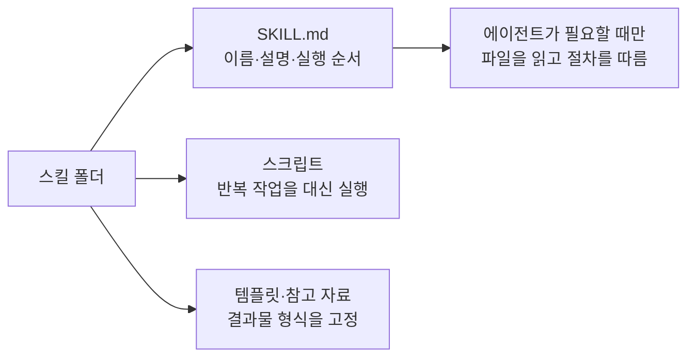
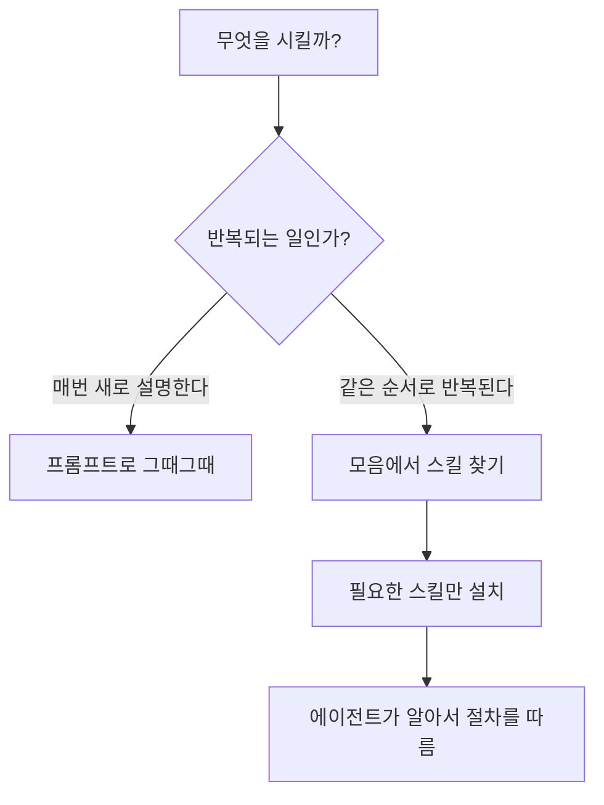
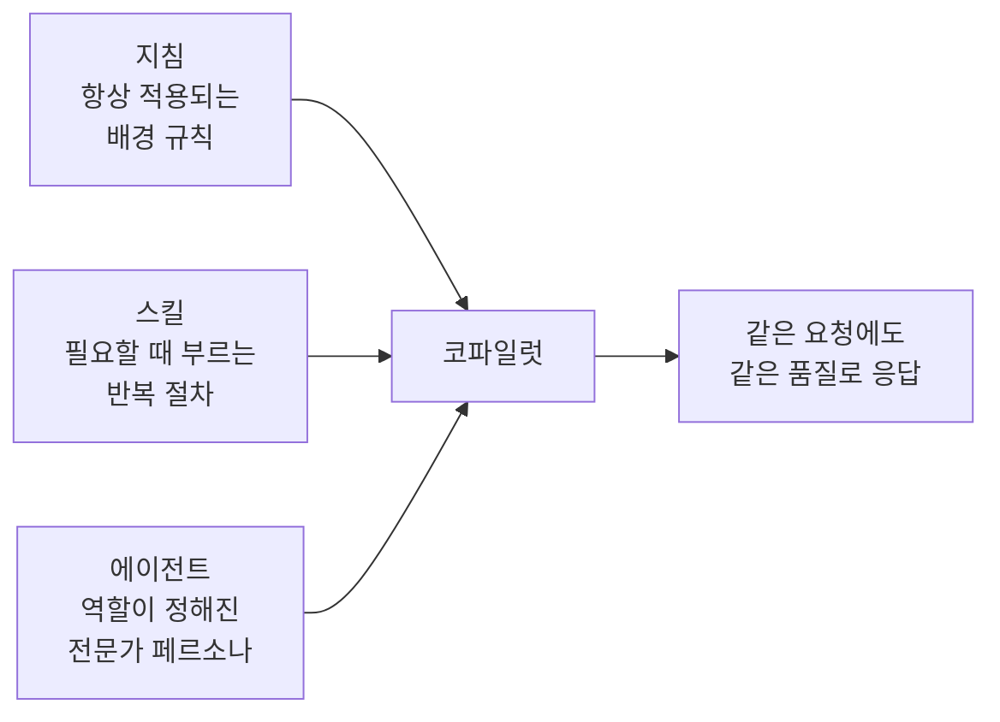

# Awesome Copilot: 코딩 스킬 376개를 모아두면, 코파일럿이 매번 같은 순서로 일합니다

> **Summary**
> 코파일럿 스킬은 SKILL.md에 반복 작업의 절차와 규칙을 저장해 필요할 때 일관되게 실행하도록 돕습니다. 공식 모음에는 커밋, 리팩터링, 보안 검토 등 다양한 스킬이 있으며, 필요한 것만 설치해 사용할 수 있지만 커뮤니티 제작 스킬은 내용을 확인한 뒤 적용하는 것이 안전합니다.

---

- 스킬은 프롬프트가 아니라 절차입니다. `SKILL.md` 한 장에 이름·설명·실행 순서가 들어 있고, 에이전트는 필요할 때만 그 파일을 읽습니다.
- 깃허브 공식 모음에는 코딩 스킬이 376개(6월 18일 기준) 들어 있었고, 지금은 482개까지 늘었습니다. 커밋·리팩터링·보안 검토·문서 작성까지, 반복되는 일을 스킬로 골라 깔면 됩니다.
- 설치는 한 줄입니다. 필요한 스킬만 골라 넣으면, 에이전트는 매번 같은 순서로 일합니다.


코파일럿한테 "커밋 메시지 써줘"라고 할 때마다 결과가 다르지 않으셨나요? 어떤 날은 깔끔한 메시지가 나오고, 어떤 날은 변경 내용을 두 줄로 퉁치고 끝냅니다. 같은 부탁인데 결과가 매번 달라지는 게, 사실은 당연합니다. 프롬프트는 그때그때 던지는 말이라, 지난번에 어떻게 했는지 기억하지 못하니까요!

🎥 [동영상 보기](https://www.youtube.com/watch?v=JRDN_-4E9ts)

## 스킬이 뭐길래, 프롬프트랑 다를까요?

스킬은 폴더 하나입니다. 안에 `SKILL.md`라는 파일이 들어 있고, 그 파일에 이름·설명·실행 순서가 적혀 있습니다. 에이전트는 이 파일을 필요할 때만 읽습니다. 평소에는 컨텍스트를 차지하지 않고, 딱 맞는 상황에서만 펼쳐 보는 설명서인 셈이죠.

프롬프트랑 뭐가 다를까요? 프롬프트는 일회용입니다. 스킬은 반복용입니다. 커밋 메시지 규칙을 매번 새로 설명하지 않아도 됩니다. 스킬 폴더에 한 번 적어두면, 에이전트는 그 규칙을 매번 같은 순서로 따릅니다. 게다가 `SKILL.md`만 있는 게 아닙니다. 스크립트·템플릿·참고 자료까지 한 폴더에 묶여 있어서, 에이전트가 절차에 필요한 도구까지 함께 씁니다.



이 형식은 한 회사의 전유물이 아닙니다. 앤트로픽이 2025년 10월에 내놓고 12월에 공개 표준으로 푼 에이전트 스킬 규격이라, 클로드 코드·코덱스·커서·제미나이 CLI·코파일럿까지 같은 파일을 읽습니다. 한 번 만들어두면 도구 갈아탈 때도 그대로 가져갈 수 있다는 뜻입니다!

## 376개, 뭐가 들어 있을까요?

깃허브 공식 모음은 코파일럿을 위한 커뮤니티 모음집입니다. 에이전트·지침·스킬·플러그인·레시피가 한 저장소에 모여 있고, 스킬만 2026년 6월 18일 기준으로 376개였습니다. 지금은 482개까지 늘었습니다. 숫자는 계속 바뀌니, 오늘 열어본 목록이 내일도 똑같지는 않습니다.

뭐가 들어 있을까요? 대표적인 것 몇 개만 골라봤습니다.

- `git-commit`: 변경 내용을 보고 관례에 맞는 커밋 메시지를 짓습니다. `/commit`이라고만 쳐도 됩니다.
- `refactor`: 동작은 그대로 두고, 함수 추출·이름 바꾸기·거대 함수 나누기로 유지보수성을 높입니다.
- `security-review`: 보안 연구자처럼 데이터 흐름을 따라가며 취약점을 찾습니다.
- `create-implementation-plan`: 새 기능·리팩터링·패키지 업그레이드 전에 실행 계획 파일을 만듭니다.
- `prd`: 제품 요구사항 문서를 만듭니다. 요약·유저 스토리·기술 명세·리스크까지 한 번에 나옵니다.
- `documentation-writer`: 문서 작성 전문가처럼, 정해진 구조에 맞춰 문서를 씁니다.
웹사이트에서는 검색과 필터로 스킬을 찾을 수 있고, 러닝 허브에는 409개 안내 글이 있습니다. 기계가 읽는 `llms.txt`까지 제공돼서, 에이전트도 목록을 구조화해서 볼 수 있습니다. 이 장면이 저는 가장 인상 깊었습니다. 사람이 고르는 목록과 에이전트가 읽는 목록이 같은 저장소에서 나온다는 게, 스킬 시대의 풍경이니까요!



## 설치는 어떻게 할까요?

설치는 한 줄입니다. 깃허브 CLI가 있으면 이렇게 넣습니다.

```bash
gh skills install github/awesome-copilot git-commit
```

스킬 이름만 바꾸면 다른 스킬도 같은 방식으로 들어갑니다. 깃허브 CLI가 없어도 됩니다. `npx skills add github/awesome-copilot`으로 전체를 받거나, 스킬 폴더를 직접 복사해서 넣는 방법도 있습니다. 플러그인 형태로 묶인 것은 코파일럿 마켓플레이스에서 설치합니다.

여기서 한 가지, 헷갈리기 쉬운 구분이 있습니다. 지침·스킬·에이전트는 역할이 다릅니다!



지침은 파일 패턴에 따라 항상 적용되는 배경 규칙입니다. 스킬은 필요할 때 부르는 반복 절차입니다. 에이전트는 도구와 지침을 묶은 전문가 역할입니다. 세 겹이 함께 돌 때, 코파일럿은 "뭘 시킬지"가 아니라 "어떻게 일할지"까지 알게 됩니다.

## 깔기 전에, 이것만은 확인하세요?

다만, 모음에 들어 있다고 해서 다 믿고 쓸 수는 없습니다. 커뮤니티 기여 모음이라 품질이 들쑥날쑥합니다. 스킬은 에이전트가 그대로 실행하는 지시문이니, 설치하기 전에 `SKILL.md`를 한 번 직접 읽어보는 게 안전합니다. 무슨 순서로 일하는지, 어떤 스크립트를 돌리는지, 내 프로젝트 규칙과 충돌하지 않는지 확인하고 나서 넣으면 됩니다.

그리고 정직하게 밝혀둘 점이 하나 있습니다. 원문 게시글은 로그인 벽 뒤에 있어 전문을 직접 읽지 못했습니다. 그래서 주제와 날짜에 맞는 깃허브 공식 스킬 모음을 1차 원본으로 삼아, 저장소 API와 문서를 직접 확인해 글을 썼습니다. 스킬 개수와 별 개수는 확인한 시점의 수치이고, 모음은 지금도 매일 커지고 있습니다.

코파일럿을 쓸 때, 매번 같은 설명을 반복하고 계시다면 스킬 한 번 깔아보시면 어떨까요? 설명을 줄이는 게 아니라, 설명을 저장하는 겁니다. 저장된 절차는 다음번에도 같은 품질로 돌아옵니다!

