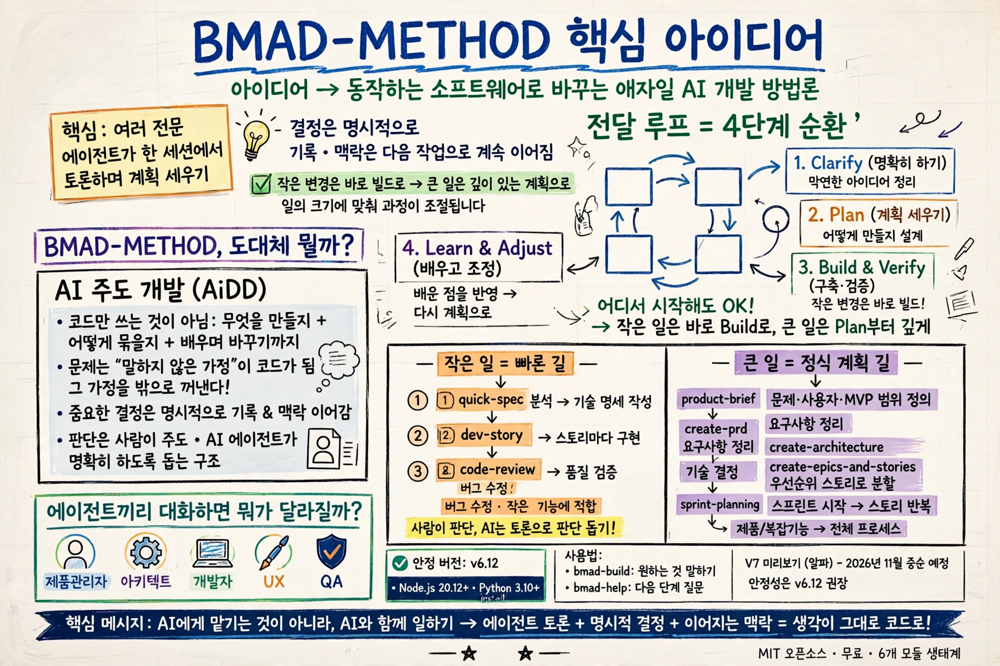
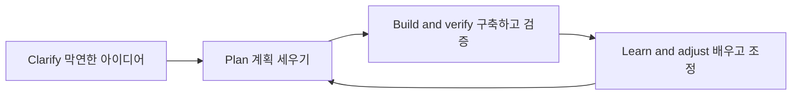
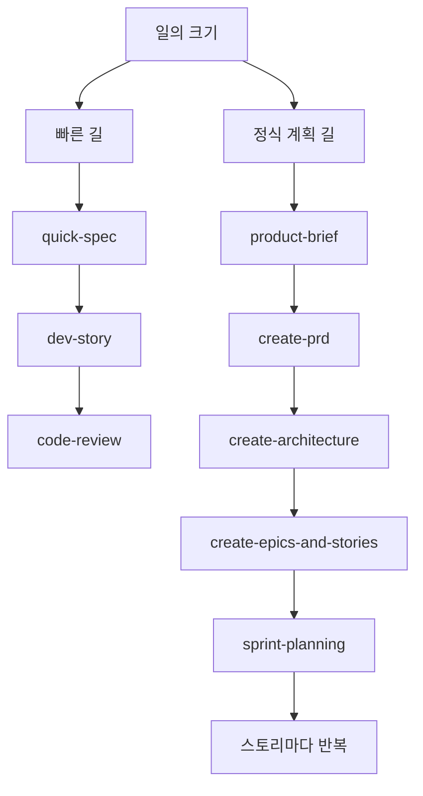

# BMAD-METHOD: 에이전트끼리 대화하게 하면, 생각이 그대로 코드가 됩니다

> **Summary**
> BMAD-METHOD는 여러 전문 AI 에이전트가 함께 계획하고 토론하며, 사람이 판단을 주도하도록 돕는 애자일 AI 개발 방법론입니다. 작은 변경은 빠르게 구현하고 복잡한 작업은 단계적으로 계획하며, 결정과 맥락을 이어 가며 소프트웨어를 만들고 검증합니다.

---

- BMAD-METHOD는 아이디어를 동작하는 소프트웨어로 바꾸는 애자일 AI 개발 방법론입니다.
- 핵심은 여러 전문 에이전트가 한 세션에서 토론하며 계획을 세우는 것입니다. 결정은 명시적으로 남고, 맥락은 다음 작업으로 이어집니다.
- 작은 변경은 바로 빌드로, 큰 일은 깊이 있는 계획으로 — 일의 크기에 맞게 과정이 조절됩니다.

AI 코딩 도구에게 "이 기능 만들어줘"라고 했는데, 돌아온 코드가 내 생각과 달라서 다시 설명한 적 있으시죠? 코드는 빨리 나오는데, 정작 내가 원한 게 아니었던 경험 말입니다.

🎥 [동영상 보기](https://www.youtube.com/watch?v=4VPoGSeI2sw)

## BMAD-METHOD, 도대체 뭘까요?

BMAD-METHOD는 애자일 AI 주도 개발 방법론입니다. 이름 그대로, AI가 이끄는 개발을 애자일 방식으로 하는 방법입니다. 그런데 여기서 말하는 개발은 코드만 짜는 게 아닙니다. 무엇을 만들지, 어떻게 묶을지, 배우면서 어떻게 바꿀지까지 전부 포함합니다. 그래서 이름도 AiDD, AI 주도 개발입니다.

코딩 어시스턴트는 구현은 잘합니다. 문제는 말하지 않은 가정이 코드가 된다는 점입니다. BMAD-METHOD는 그 가정을 밖으로 꺼냅니다. 중요한 결정은 명시적으로 남기고, 그 맥락을 다음 작업까지 이어갑니다. 판단은 사람이 쥐고, 에이전트와 워크플로우가 결정을 명확하게 만드는 구조입니다.

## 전달 루프는 어떻게 돌까요?

핵심 그림은 네 단계 루프입니다. Clarify(명확히 하기) → Plan(계획) → Build and verify(구축·검증) → Learn and adjust(배우고 조정), 그리고 다시 Plan으로 돌아갑니다. 어디서 시작해야 할지 모르겠다고요? 아무 데서나 시작해도 됩니다. 막연한 아이디어는 Clarify에서, 큰 그림이 잡힌 아이디어는 Plan에서, 작은 변경은 Build에서 바로 시작합니다!

이 루프가 좋은 이유는, 일의 크기에 과정이 맞춰지기 때문입니다. 주말 프로토타입도, 수년 된 시스템도 같은 방법으로 다룹니다. 작은 변경은 계획 단계를 건너뛰고 바로 빌드로 갑니다. 복잡한 일은 깊이 있는 계획을 거칩니다. 과정이 일에 맞춰 조절되는 겁니다.

## 작은 일과 큰 일, 같은 방법으로 하나요?

아닙니다. 두 갈래 길이 있습니다. 작은 일은 빠른 길로, 큰 일은 정식 계획 길로 갑니다.

빠른 길은 버그 수정이나 작은 기능에 씁니다. 세 명령이면 됩니다. `quick-spec`으로 코드베이스를 분석해 기술 명세를 만들고, `dev-story`로 스토리마다 구현하고, `code-review`로 품질을 검증합니다.

큰 일은 정식 계획 길을 갑니다. 제품이나 복잡한 기능처럼요. `product-brief`로 문제·사용자·MVP 범위를 정하고, `create-prd`로 요구사항을 정리하고, `create-architecture`로 기술 결정을 내리고, `create-epics-and-stories`로 우선순위가 있는 스토리로 쪼개고, `sprint-planning`으로 스프린트를 시작합니다. 그 뒤로는 스토리마다 `create-story` → `dev-story` → `code-review`를 반복합니다. 매 단계가 다음 단계를 알려주니, 길을 잃을 일이 없습니다!

## 에이전트끼리 대화하면 뭐가 달라질까요?

여기가 이 방법론의 가장 재미있는 부분입니다. 여러 에이전트 페르소나를 한 세션에 불러서 함께 계획하고, 문제를 풀고, 토론하게 할 수 있습니다. 제품 관리자, 아키텍트, 개발자, UX, QA 같은 전문 관점이 한 자리에서 부딪힙니다. 혼자 AI와 대화할 때는 나오지 않는 관점이, 여럿이 모이면 나옵니다!

이 장면이 저는 가장 인상 깊었습니다. AI가 대신 생각해주는 게 아니라, AI들이 토론하는 동안 사람이 판단을 내리는 구조라는 점이요. 판단권을 넘기지 않습니다. 워크플로우와 토론이 판단을 돕는 것이지, 대신 내리는 게 아닙니다!

## 설치는 어떻게 하나요?

안정 버전은 v6.12입니다. 어느 버전을 골라야 할까요? 안정성이 필요하면 v6.12가 답입니다. Node.js 20.12 이상과 Python 3.10 이상이 필요하고, 프로젝트에서 `npx bmad-method install` 한 줄이면 됩니다. 설치 뒤에는 AI 코딩 도구에서 `bmad-build`로 바꾸고 싶은 것을 말하고, 막히면 `bmad-help`로 다음 단계를 물어봅니다. 뭘 해야 할지 모를 때 `bmad-help`가 정확히 알려줍니다.

V7은 미리보기 알파 단계입니다. 스킬 방식으로 설치하고, 2026년 11월 중순 출시 예정입니다. 아직 바뀌는 부분이 많으니, 안정성이 필요하면 v6.12가 답입니다.

생태계도 넓습니다. 핵심 방법론 외에 에이전트·워크플로우를 만드는 빌더, 창의적 사고 모듈, 엔터프라이즈 테스트 모듈, 에픽 전체를 무인으로 빌드·검증·회고하는 루프, 게임 개발 스튜디오까지 여섯 개 모듈이 있습니다. 전부 무료이고 오픈소스이며, MIT 라이선스입니다. 유료로 막힌 워크플로우는 없습니다.

## 맺음말

AI에게 일을 맡기는 것과, AI와 함께 일하는 것은 다릅니다. BMAD-METHOD는 후자를 위한 방법입니다. 에이전트끼리 대화하게 하고, 결정은 명시적으로 남기고, 맥락은 이어가면, 생각은 그대로 코드가 됩니다!

