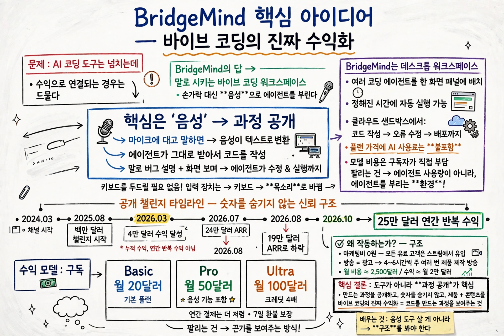
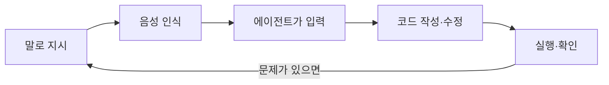
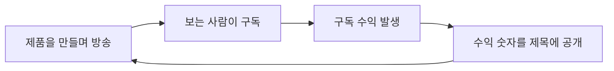
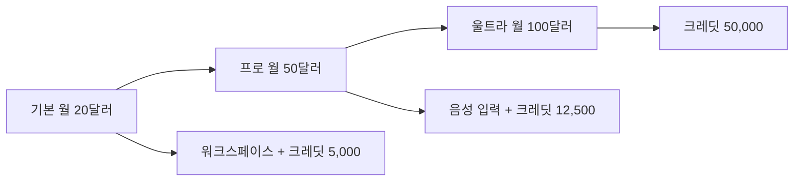

# BridgeMind: 바이브 코딩으로 백만 달러를 노리는 법, 제품이 곧 방송입니다

> **Summary**
> BridgeMind는 음성으로 코딩 에이전트를 조작하는 데스크톱 워크스페이스로, 구독자가 AI 모델 사용료를 별도로 부담합니다. 제품을 만드는 과정을 실시간 방송하고 수익을 투명하게 공개해 콘텐츠를 마케팅과 고객 유입에 연결하며, 구독 수익을 창출합니다. 핵심은 도구 자체보다 제작 과정과 성과를 공개해 신뢰를 쌓고 제품과 콘텐츠를 하나로 묶는 전략입니다.

---

- AI 코딩 도구는 넘치는데, 수익으로 연결되는 경우는 드뭅니다.
- BridgeMind는 말로 시키는 바이브 코딩 워크스페이스입니다. 손가락 대신 음성으로 에이전트를 부립니다.
- 비결은 도구가 아니라 과정 공개입니다. 백만 달러 챌린지를 방송으로 만들고, 수익 숫자를 제목에 그대로 띄웁니다.

밤 11시, 키보드를 두드리다 문득 이런 생각이 듭니다. "이 기능, 누가 사줄까?" AI가 코드를 짜주는 시대인데, 정작 돈이 되는 제품을 만드는 일은 여전히 어렵습니다. 도구는 넘치는데 수익화는 따로 노는 느낌, 있지 않으시죠?

🎥 [동영상 보기](https://www.youtube.com/watch?v=bsCqeZoAYng)

## 손가락을 안 쓴다고요? 말로 코딩하는 방식이 있습니다

핵심은 음성입니다. 마이크에 대고 말하면 음성이 텍스트로 바뀌고, 에이전트가 그대로 받아서 코드를 짭니다. 키보드를 두드릴 필요가 없습니다. 말로 버그를 설명하면서 화면을 보고 있으면, 에이전트가 수정하고 실행까지 해줍니다. 코딩의 입력 장치가 키보드에서 목소리로 바뀐 셈입니다!

이 방식이 가능한 이유는 에이전트가 개발 환경 안에서 직접 움직이기 때문입니다. 코드를 읽고, 고치고, 명령을 실행합니다. 사람은 지시하고 확인하는 역할에 가깝습니다.

## 이 워크스페이스는 뭐가 다릅니까?

BridgeMind는 데스크톱 워크스페이스입니다. 여러 코딩 에이전트를 한 화면의 패널에 띄워 놓고, 정해진 시간에 실행되도록 둘 수도 있습니다. 에이전트는 클라우드 샌드박스에서 코드를 짜고, 오류를 고치고, 배포까지 합니다.

한 가지 짚고 넘어갈 점이 있습니다. 플랜 가격에 AI 사용료는 포함되지 않습니다. 에이전트가 쓰는 모델 비용은 구독자가 직접 부담합니다. 도구가 파는 건 에이전트 사용량이 아니라, 에이전트를 부리는 환경입니다!

## 백만 달러 챌린지, 숫자는 왜 제목에 있을까요?

이 채널의 또 다른 얼굴은 공개 챌린지입니다. 채널은 2024년 3월에 시작됐고, 2025년 8월부터 "백만 달러까지 바이브 코딩으로 만든다"는 도전이 이어지고 있습니다. 날짜별로 스트림을 열고, 그날의 연간 반복 수익을 제목에 그대로 적습니다. 2026년 3월 기준으로는 4만 달러를 벌었다고 밝혔습니다. 그 뒤에도 챌린지는 계속됐고, 같은 해 10월에는 연간 반복 수익이 약 25만 달러까지 올라갔습니다.

숫자를 제목에 다는 건 단순한 자랑이 아닙니다. 오르내림이 그대로 보이니까, 보는 사람은 과정을 믿게 됩니다. 7월에 24만 달러를 찍었다가 8월에 19만 달러대로 떨어진 적도 있습니다. 숫자를 숨기지 않는 게 이 채널의 신뢰 구조입니다!

## 수익은 어떻게 납니까? 구독과 방송의 구조

수익 모델은 구독입니다. 기본 플랜은 월 20달러, 음성 기능이 들어간 프로 플랜은 월 50달러, 크레딧이 네 배인 울트라 플랜은 월 100달러입니다. 연간 결제는 더 저렴합니다. 구독자에게는 바이브 코딩 세팅과 인프라, 에이전트 개발 환경까지 공유합니다. 7일 환불 보장도 있습니다.

그런데 마케팅비가 따로 들지 않습니다. 모든 유료 고객이 스트림에서 왔다고 합니다. 한 번에 4~6시간씩, 주 여러 번 제품을 만들며 방송하는 게 곧 광고입니다. 월 비용은 약 2,500달러 수준인데, 수익은 월 2만 달러 안팎입니다. 제품이 곧 콘텐츠이고, 콘텐츠가 곧 영업인 구조입니다!

## 그래서, 따라 하면 됩니까?

따라 할 만한 이유는 분명합니다. 음성 코딩 도구부터 살 게 아니라, 구조부터 봐야 합니다. 만드는 과정을 공개하고, 숫자를 숨기지 않고, 제품과 콘텐츠를 하나로 묶는 구조 말입니다.

도구는 따라 살 수 있습니다. 하지만 매일 몇 시간씩 제품을 만들며 방송하는 끈기는 사서 쓸 수 없습니다. 이 채널이 파는 건 사실 도구가 아니라, 그 끈기를 보여주는 방식입니다!

바이브 코딩의 진짜 수익화는 코드가 아니라, 코드를 만드는 과정을 보여주는 데서 시작됩니다.

