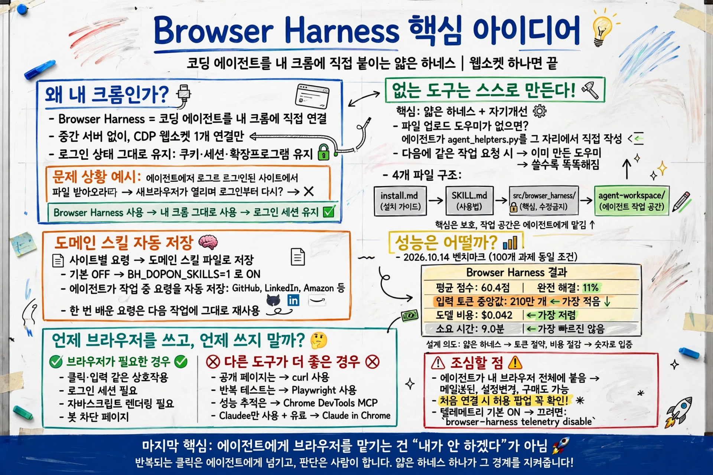
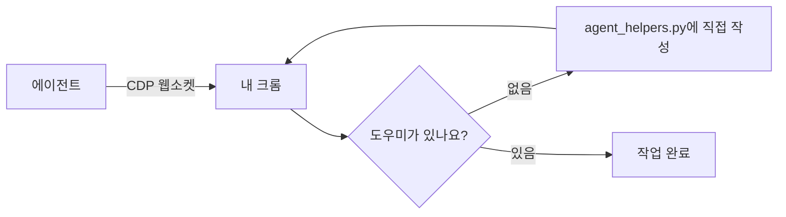
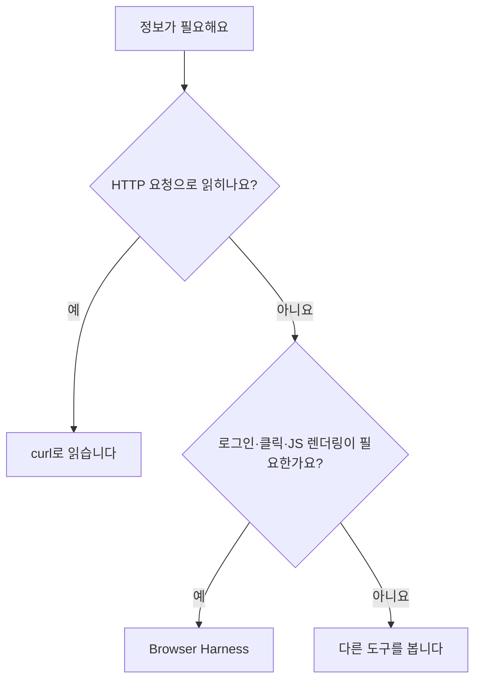
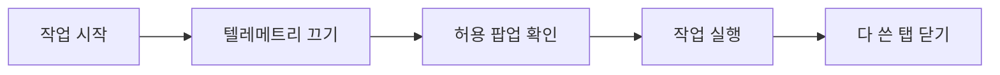

# Browser Harness: 내 크롬을 에이전트에게 통째로 맡기면, 없는 도구는 그 자리에서 만듭니다

> **Summary**
> Browser Harness는 코딩 에이전트를 지금 쓰고 있는 크롬에 직접 붙이는 얇은 하네스로, 중간 서버 없이 개발자 도구 프로토콜 웹소켓 하나면 로그인 상태 그대로 클릭하고 입력하고 다운로드합니다. 없는 도구는 에이전트가 작업 중에 직접 만들어 작업 공간에 남기므로, 할수록 하네스가 똑똑해지고 사이트별 요령도 도메인 스킬로 쌓입니다. 100개 과제 벤치마크에서 점수는 다른 도구와 차이가 없었지만 토큰과 비용이 가장 적었고, 브라우저 전체를 맡기는 만큼 허용 팝업과 텔레메트리 설정은 미리 확인해야 합니다.

---

- Browser Harness는 코딩 에이전트를 내 크롬에 직접 붙이는 얇은 하네스입니다. 웹소켓 하나면 끝입니다.
- 없는 도구는 에이전트가 작업 중에 직접 만들어서, 할수록 하네스가 똑똑해집니다.
- 로그인 상태 그대로 쓰니 편하지만, 브라우저 전체를 맡기는 만큼 권한과 텔레메트리는 미리 확인해야 합니다.

에이전트한테 로그인된 사이트에서 파일 하나 받아오라고 시켰는데, 새 브라우저가 떠서 로그인부터 다시 하라고 하던 적 있으시죠? 그 순간이 바로 이 도구가 노리는 지점입니다!

🎥 [동영상 보기](https://www.youtube.com/watch?v=Sn5dEDSIRZw)

## 왜 내 크롬이어야 할까요?

Browser Harness는 클로드 코드나 코덱스 같은 코딩 에이전트를 지금 쓰고 있는 크롬에 직접 연결합니다. 중간 서버 없이, 크롬 개발자 도구 프로토콜(CDP) 웹소켓 하나가 전부입니다.

그래서 로그인 상태가 그대로 이어집니다. 쿠키도, 세션도, 확장 프로그램도 그대로입니다. 에이전트는 내가 쓰는 브라우저에서 페이지를 열고, 클릭하고, 입력하고, 다운로드합니다. 2026년 4월에 공개돼 11월 기준 별 1만 9천 개를 넘겼습니다.

설치는 프롬프트 한 줄이면 됩니다. 에이전트에게 설치를 맡기면 `uv tool install browser-use`로 설치하고 스킬을 등록한 뒤, `chrome://inspect/#remote-debugging` 페이지에서 원격 디버깅을 켜도록 안내합니다. 크롬 144 이상에서는 연결할 때마다 허용 팝업이 뜹니다. 이 팝업이 바로 권한의 경계입니다.

## 없는 도구는 그 자리에서 만듭니다?

이 하네스의 핵심은 얇다는 점이 아닙니다. 스스로 고친다는 점입니다!

파일 업로드를 시켰는데 업로드 도우미가 없다고요? 에이전트는 그 자리에서 `agent_helpers.py`에 도우미를 직접 씁니다. 다음에 같은 작업을 시키면 이미 만든 도우미가 기다리고 있습니다. 그래서 작업을 거듭할수록 하네스는 똑똑해집니다.

구조는 네 파일이 전부입니다. 처음 설치를 돕는 `install.md`, 매일 쓰는 방법을 적은 `SKILL.md`, 손대지 않는 핵심 패키지 `src/browser_harness/`, 그리고 에이전트가 고치는 작업 공간 `agent-workspace/`입니다. 핵심은 보호하고, 작업 공간은 에이전트에게 맡기는 구조입니다.

## 도메인 스킬은 하네스가 스스로 씁니다?

사이트마다 요령이 다르죠? 어떤 사이트는 버튼이 숨어 있고, 어떤 사이트는 흐름이 까다롭습니다. 이런 요령은 도메인 스킬이라는 파일로 남습니다.

도메인 스킬은 기본적으로 꺼져 있습니다. `BH_DOMAIN_SKILLS=1`로 켜면 에이전트가 작업 중에 알아낸 요령을 사이트별 스킬로 저장합니다. 사람이 손으로 스킬을 쓰지 않습니다. 하네스가 스스로 쓰는 겁니다!

예시로 깃허브, 링크드인, 아마존 같은 사이트의 스킬이 함께 들어 있습니다. 한 번 배운 요령은 다음 작업에서 그대로 재사용됩니다. 이게 바로 "매번 실행할 때마다 하네스가 좋아진다"는 말의 뜻입니다.

## 숫자로 보면 어떨까요?

좋은 설계인지 숫자로 확인해 볼까요? 같은 에이전트, 같은 모델, 같은 판정 기준으로 100개 과제를 재는 벤치마크가 있습니다. 2026년 10월 14일 측정분입니다.

Browser Harness는 평균 60.4점, 완전 해결 11%였습니다. 점수만 보면 다른 도구와 큰 차이가 없습니다. 플레이그라이트 MCP 60.0점, 크롬 개발자 도구 MCP 61.0점, 에이전트 브라우저 56.3점. 신뢰구간 안에 0이 들어 있어서, 점수 차이는 의미가 없다고 봐야 합니다!

차이가 난 건 비용 쪽입니다. 과제당 입력 토큰 중앙값이 210만 개로 가장 적었고, 모델 비용도 0.042달러로 가장 쌌습니다. 다른 도구는 330만~670만 개, 0.056~0.097달러였습니다. 얇은 하네스가 토큰을 아낀다는 설계 의도가 숫자로 드러난 셈입니다. 다만 시간은 9.0분으로 가장 빠르지는 않았습니다.

## 언제 브라우저를 쓰고, 언제 쓰지 말까요?

브라우저가 만능은 아닙니다. 일반 HTTP 요청으로 읽히는 공개 페이지는 `curl`로 읽으면 됩니다. 브라우저가 필요한 때는 딱 네 가지입니다. 클릭·입력 같은 상호작용, 로그인 세션, 자바스크립트 렌더링, 봇 차단 페이지입니다.

대신 다른 도구가 나은 경우도 있습니다. 반복 테스트는 플레이그라이트, 성능 추적은 크롬 개발자 도구 MCP, 클로드만 쓰고 유료 플랜이 있으면 클로드 인 크롬이 낫습니다. 도구는 목적에 맞게 고르는 게 맞습니다.

## 조심할 점은 있습니다!

편리한 만큼 주의할 점도 분명합니다. 에이전트가 내 브라우저 전체에 붙습니다. 내가 할 수 있는 일은 에이전트도 할 수 있습니다. 메일을 보내고, 설정을 바꾸고, 물건을 사는 일까지 말입니다. 그래서 처음 연결할 때 허용 팝업을 꼭 확인해야 합니다.

텔레메트리도 기본으로 켜져 있습니다. 쓰기 전에 `browser-harness telemetry disable`로 꺼 두는 게 안전합니다. 상태 파일은 `~/.config/browser-harness` 아래에 모입니다.

또 하나, 이 글의 출발점이 된 5월 클립과 지금은 설치 방법이 바뀌었습니다. 지금은 `browser-use` 명령으로 설치하고, 예전 `browser-harness` 명령도 계속 쓸 수 있습니다. 오래된 안내를 그대로 따라 하면 헤맬 수 있으니, 설치 문서를 먼저 확인하는 게 좋습니다.

마지막으로, 에이전트에게 브라우저를 맡기는 건 "내가 안 하겠다"는 뜻이 아닙니다. 반복되는 클릭을 넘기고, 판단은 사람이 하는 구조입니다. 얇은 하네스 하나가 그 경계를 지켜줍니다!

