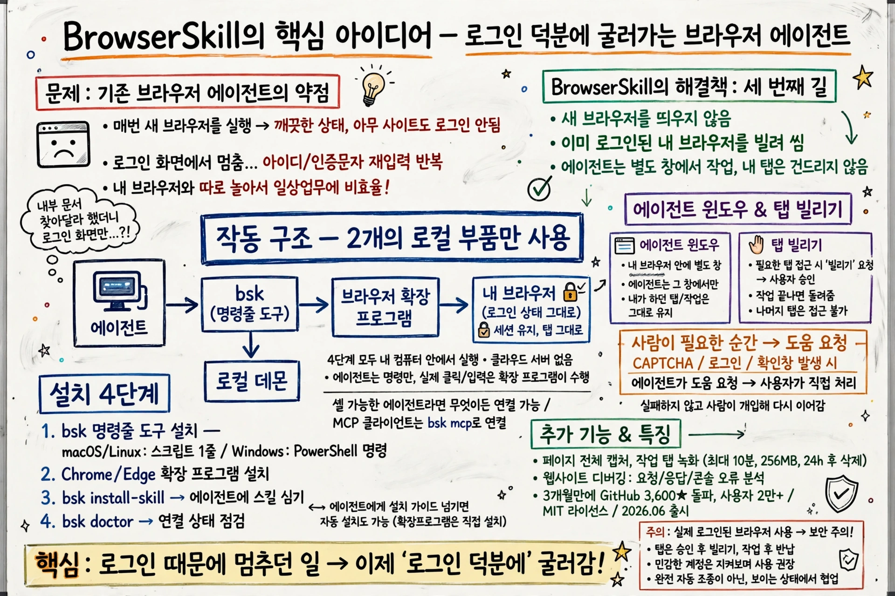
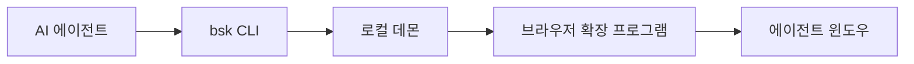
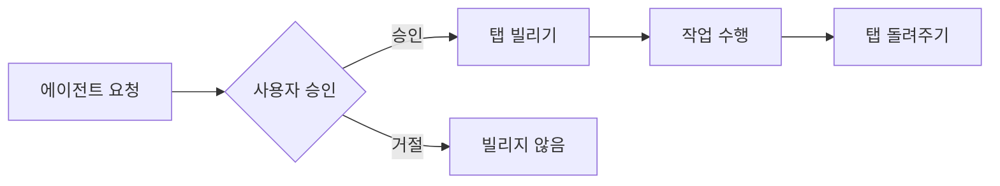

# BrowserSkill: 에이전트가 새 브라우저를 띄우는 대신, 이미 로그인된 내 브라우저를 빌려 씁니다

> **Summary**
> BrowserSkill은 로그인된 브라우저를 활용해 AI 에이전트가 별도 창에서 작업하도록 하며, 기존 탭은 사용자의 승인 없이 건드리지 않습니다. 로컬에서 작동하고, CAPTCHA나 로그인처럼 사람의 개입이 필요한 단계에서는 도움을 요청해 안전하고 투명한 브라우저 자동화를 지원합니다.

---

- 브라우저 에이전트에게 일을 시키면, 에이전트는 늘 새 브라우저를 띄웁니다. 그 브라우저는 아무 사이트에도 로그인돼 있지 않습니다.
- BrowserSkill은 이 순서를 뒤집습니다. 새 브라우저를 띄우는 대신, 이미 로그인된 내 브라우저를 빌려 씁니다.
- 에이전트는 별도 창에서 일하고, 내 탭이 필요하면 빌리기 전에 먼저 승인을 받습니다. 로그인 상태는 그대로, 내 작업은 건드리지 않습니다.

에이전트한테 내부 문서 하나 찾아달라고 했는데, 로그인 화면만 바라보고 멈춰 선 적 있으시죠? 에이전트가 연 브라우저는 깨끗합니다. 너무 깨끗해서 문제입니다. 어느 사이트에도 로그인돼 있지 않으니까요. 아이디를 다시 치고, 인증 문자를 다시 받고, 그제야 일을 시작합니다. 매번 반복되는 이 장면이, 사실은 브라우저 자동화의 오래된 약점이었습니다!

🎥 [동영상 보기](https://www.youtube.com/watch?v=9tmd703wkq0)

### 왜 에이전트의 브라우저는 늘 로그아웃 상태일까요?

기존 브라우저 에이전트들은 대부분 자기만의 브라우저를 띄웁니다. 테스트용 계정으로 로그인하거나, 아예 로그인 없이 일합니다. 이 방식은 테스트와 스크래핑에는 깔끔합니다. 매번 같은 조건에서 시작하니까요. 그런데 일상 업무에는 맞지 않습니다. 내가 매일 쓰는 브라우저는 이미 로그인돼 있고, 세션도 살아 있고, 북마크와 탭도 그대로인데 말이죠. 에이전트가 쓰는 브라우저와 내가 쓰는 브라우저가 따로 노는 겁니다.

그래서 누군가는 에이전트에게 내 브라우저를 통째로 넘기기도 합니다. 앞에 떠 있는 탭에서 직접 일하게 하는 방식입니다. 일은 되지만, 내 작업이 멈춥니다. 에이전트가 클릭하는 동안 나는 기다려야 합니다. BrowserSkill은 이 둘 사이에서 세 번째 길을 택했습니다. 내 브라우저를 쓰되, 내 앞에서는 일하지 않는 방법입니다!

### 에이전트는 브라우저와 어떻게 연결될까요?

BrowserSkill의 구조는 놀랍도록 단순합니다. 두 개의 로컬 부품만으로 돌아갑니다. 명령줄 도구 `bsk`와 브라우저 확장 프로그램입니다. 클라우드 서버는 없습니다. 에이전트의 요청이 다른 회사 서버를 거치지 않습니다. 에이전트가 셸에서 `bsk` 명령을 실행하면, 명령은 로컬 데몬으로 넘어갑니다. 데몬은 확장 프로그램과 로컬 웹소켓으로 대화하고, 확장 프로그램이 실제 브라우저 작업을 수행합니다. 네 단계를 거치는데, 네 단계 모두 내 컴퓨터 안에서 일어납니다.

에이전트가 직접 브라우저를 만지지 않는다는 점이 핵심입니다. 에이전트는 명령만 내리고, 실제 클릭과 입력은 확장 프로그램이 맡습니다. 이 설계 덕분에 셸 명령을 실행할 수 있는 에이전트라면 무엇이든 연결됩니다. 지원 목록에는 여러 코딩 에이전트가 올라가 있지만, 본질은 더 넓습니다. 셸을 쓸 수 있으면 `bsk`를 쓸 수 있습니다. MCP 클라이언트라면 `bsk mcp`로 연결하는 길도 열려 있습니다. 특정 모델이나 특정 도구에 묶이지 않는 구조입니다.

### 에이전트 윈도우가 뭐가 다른가요?

BrowserSkill이 일을 시작하면, 내 브라우저 안에 **에이전트 윈도우**라는 별도 창이 열립니다. 에이전트는 그 창 안에서만 일합니다. 읽고, 클릭하고, 입력하고, 스크린샷을 찍습니다. 내 창은 그대로입니다. 내가 하던 작업은 멈추지 않고, 탭도 건드리지 않습니다. 에이전트가 뭘 하고 있는지는 에이전트 윈도우를 보면 바로 보입니다. 보이지 않는 곳에서 돌아가는 자동화가 아니라, 눈에 보이는 창에서 돌아가는 자동화입니다.

그런데 가끔은 에이전트 윈도우만으로 부족할 때가 있습니다. 내가 이미 열어둔 탭에, 주소만으로는 다시 만들 수 없는 상태가 담겨 있을 때입니다. 예를 들어 로컬 개발 서버가 돌아가는 탭이 그렇습니다. 이럴 때 BrowserSkill은 탭을 그냥 가져가지 않습니다. **빌리기**라는 절차를 거칩니다. 에이전트가 탭을 빌려달라고 요청하고, 사용자가 승인하면 빌리고, 작업이 끝나면 돌려줍니다. 빌리는 동안에도 내 브라우저의 나머지 부분은 에이전트의 손이 닿지 않습니다.

이 장면이 저는 가장 인상 깊었습니다. 기본 자세가 "사용자 것을 건드리지 않는다"로 정해져 있다는 게, 코드 한 줄보다 더 크게 다가오니까요!

### 사람이 아니면 못 하는 단계는 어떻게 할까요?

CAPTCHA가 뜨거나, 로그인 화면이 나오거나, 확인 창이 뜰 때가 있습니다. 에이전트가 혼자 넘을 수 없는 단계입니다. BrowserSkill은 이 순간을 실패로 처리하지 않습니다. 에이전트가 도움을 요청하고, 사용자가 직접 그 단계를 처리한 뒤, 에이전트가 멈췄던 자리에서 다시 이어갑니다. 도움을 요청하는 기능이 처음부터 설계에 들어 있습니다. 자동화가 사람을 밀어내는 게 아니라, 사람이 필요한 자리에서는 사람을 부르는 구조입니다.

### 설치는 어떻게 할까요?

설치는 네 단계입니다. 먼저 `bsk` 명령줄 도구를 설치합니다. macOS나 Linux에서는 설치 스크립트 한 줄이면 됩니다. Windows에서는 PowerShell 명령을 씁니다. 다음으로 Chrome 웹 스토어나 Edge 추가 기능에서 확장 프로그램을 설치합니다. 그다음 `bsk install-skill` 명령으로 쓰는 에이전트에 스킬을 심어줍니다. 마지막으로 `bsk doctor` 명령으로 연결 상태를 점검합니다. 에이전트에게 설치 가이드를 통째로 넘기면, 에이전트가 알아서 설치를 진행해 주는 길도 있습니다. 확장 프로그램 설치만 사용자가 직접 하면 됩니다.

### 그 밖에 할 수 있는 일은 무엇일까요?

읽고 클릭하고 입력하는 기본 동작 외에도 몇 가지가 더 있습니다. 화면 캡처는 기본이고, 긴 페이지를 통째로 캡처하는 기능도 있습니다. 작업 중인 탭을 조용한 영상으로 기록하는 기능도 있습니다. 녹화는 선택 사항이고, 한 번에 10분까지, 영상 하나당 256MB까지로 제한됩니다. 녹화본은 24시간 뒤에 사라집니다. 웹사이트 디버깅 기능도 있습니다. 사이트에서 무슨 요청이 오갔는지, 응답이 어땠는지, 콘솔에 무슨 오류가 찍혔는지 에이전트가 함께 살펴볼 수 있습니다. 버그를 재현하기 전에 기록을 시작해 두면, 증거를 모아서 원인을 찾는 데 쓸 수 있습니다.

공개된 지 3개월 만에 별 3,600개를 넘겼고, 확장 프로그램 사용자도 2만 명을 넘겼습니다. MIT 라이선스로 공개돼 있습니다. 저장소는 2026년 6월에 만들어졌습니다. 숫자가 말해주는 건 하나입니다. 로그인 문제를 겪은 사람이 그만큼 많았다는 사실입니다!

### 주의할 점은 없을까요?

한 가지는 짚고 넘어가야 합니다. BrowserSkill은 진짜 로그인된 브라우저를 씁니다. 그래서 보안이 중요합니다. 설계 자체는 보수적입니다. 탭은 빌리기 전에 승인을 받고, 끝나면 돌려주고, 나머지는 건드리지 않습니다. 그래도 돈이나 개인정보, 공개 발행과 닿은 계정에서 일할 때는 지켜보는 게 좋습니다. BrowserSkill이 주는 것은 완전한 자동 조종이 아니라, 보이는 상태에서의 협업입니다. 에이전트 윈도우를 열어두고, 뭘 하는지 보면서, 필요하면 개입하는 방식입니다.

브라우저 에이전트의 문제는 속도보다 로그인 상태였습니다. BrowserSkill은 새 브라우저를 띄우는 대신, 이미 로그인된 내 브라우저를 빌려 쓰는 쪽을 택했습니다. 에이전트는 별도 창에서 일하고, 내 탭은 승인받고 빌리고, 사람은 막히는 자리에서 이어받습니다. 로그인 때문에 멈추던 일이, 이제는 로그인 덕분에 굴러갑니다!

