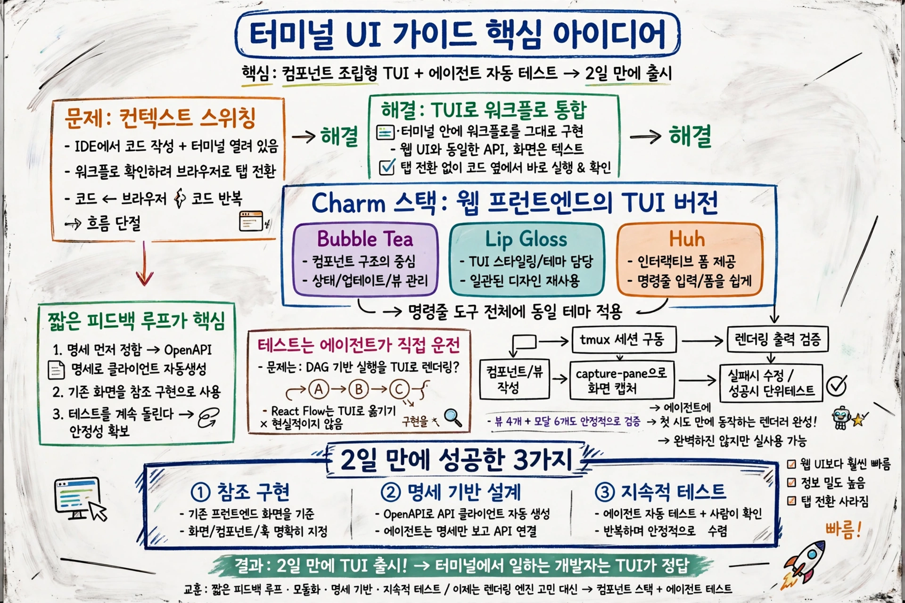
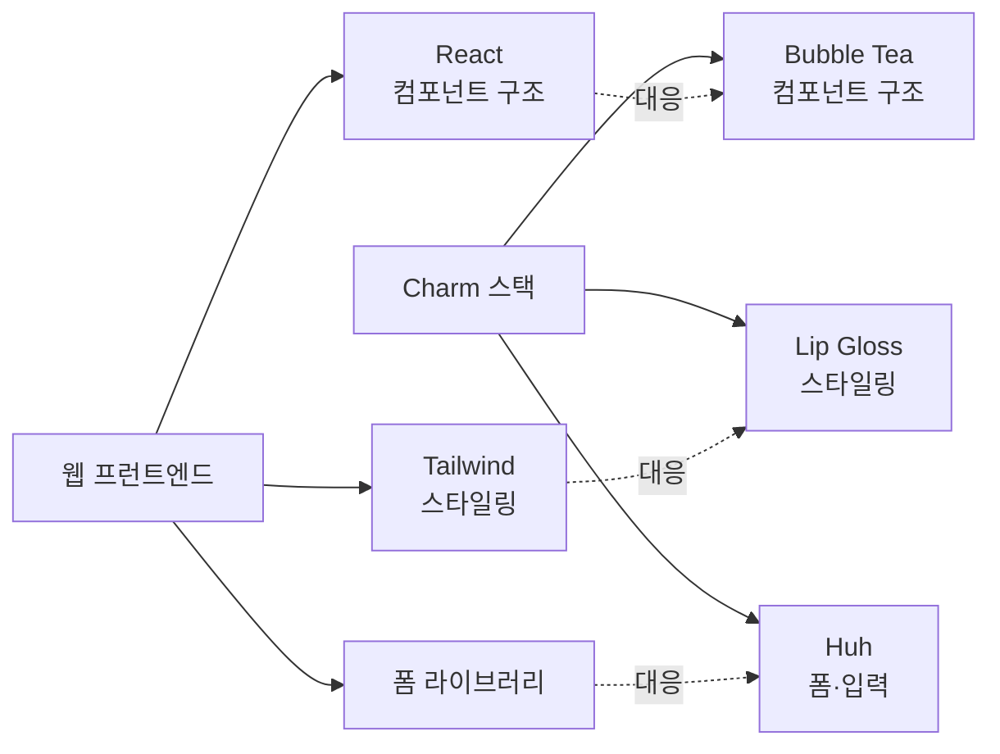
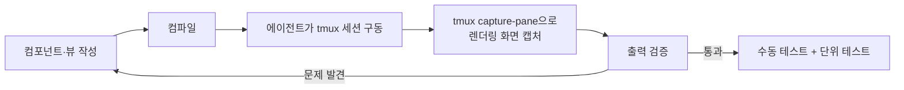
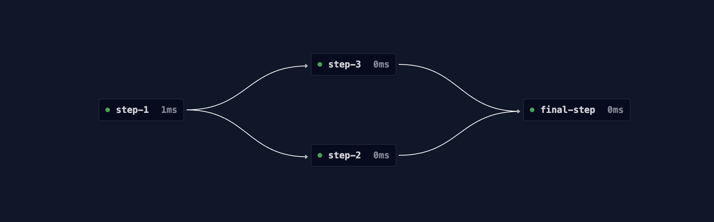
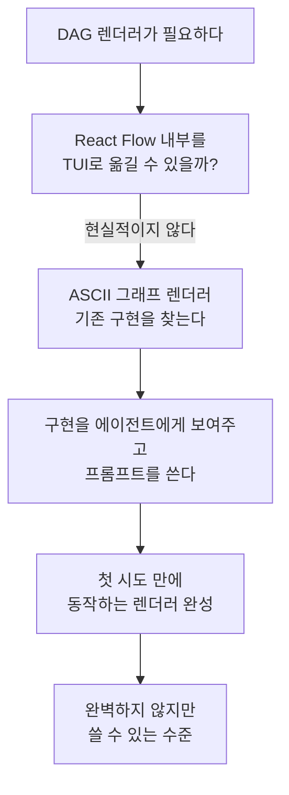

# Bubble Tea: 터미널 UI, 이제 웹처럼 컴포넌트로 조립하면 됩니다

> **Summary**
> Bubble Tea·Lip Gloss·Huh로 이루어진 Charm 스택을 쓰면 터미널 UI를 웹 프런트엔드처럼 컴포넌트로 조립할 수 있습니다. 코딩 에이전트가 tmux 세션을 직접 몰면서 화면을 캡처해 검증하니, 한 팀은 단 2일 만에 TUI를 만들어 출시했습니다. 비결은 명세 기반 설계와 기존 화면을 참조 구현으로 삼는 짧은 피드백 루프입니다.

---

- 터미널 UI를 만드는 일이 웹 프런트엔드처럼 컴포넌트 조립이 됐습니다. `Bubble Tea`·`Lip Gloss`·`Huh`로 이루어진 Charm 스택이 그 중심입니다.
- 코딩 에이전트가 터미널 세션을 직접 몰면서 테스트까지 자동화하니, 한 팀은 단 2일 만에 TUI를 만들어서 출시했습니다.
- 비결은 짧은 피드백 루프입니다. 명세를 먼저 정하고, 기존 화면을 참조 구현으로 쓰고, 테스트를 계속 돌리는 구조가 에이전트를 안정적으로 굴립니다.

## 워크플로 확인하려고 브라우저로 넘어간 적 있으시죠?

IDE에서 작업하고 있습니다. 코드도 보고, 터미널도 띄워놨습니다. 그런데 워크플로가 지금 어떻게 돌아가는지 확인하려면 브라우저로 탭을 옮겨야 합니다. 코드 보다가, 브라우저 보다가, 다시 코드로 돌아오다가 흐름이 끊깁니다. 이런 적 있으시죠?

이 불편함을 없애는 방법이 있습니다. 터미널 안에 워크플로를 그대로 그려 넣는 것입니다. 웹 UI와 똑같은 API를 쓰는데, 화면은 텍스트로 빽빽하게 채워져 있습니다. 한 팀이 이걸 단 2일 만에 만들어서 출시했습니다!

🎥 [동영상 보기](https://www.youtube.com/watch?v=B7QCo75GAwQ)

## 왜 터미널 UI일까요?

터미널 UI, 즉 TUI는 화면을 그래픽이 아니라 문자로 그리는 인터페이스입니다. 웹 UI와 똑같은 API를 쓰는데, 사용자 반응은 달랐습니다. "웹 UI보다 훨씬 빠르다"는 피드백이 출시 며칠 만에 저절로 들어왔습니다!

빠른 이유는 세 가지입니다. 첫째, 텍스트 중심이라 군더더기가 없습니다. 둘째, 정보 밀도가 높아서 한 화면에 들어가는 내용이 많습니다. 셋째, 코드 옆에 그대로 살아서 탭 전환이 사라집니다. 이 팀의 사용자는 주로 IDE 안에서 작업을 만드는 개발자라서, 터미널에서 워크플로를 보고 실행하는 경험이 딱 맞았습니다.

## 웹 스택에 대응하는 Charm 스택이 있습니다

웹 프런트엔드를 만들 때 `React`·`Tailwind` 같은 조합을 쓰듯이, TUI에도 대응하는 스택이 있습니다. `Charm`이라는 팀이 만든 라이브러리 모음입니다. 핵심은 세 가지입니다.

`Bubble Tea`는 컴포넌트 구조의 중심입니다. `Lip Gloss`와 `Huh` 테마로 TUI 전체에 일관된 스타일을 입혔습니다. 스타일은 TUI 안에서만 쓰인 게 아닙니다. 명령줄 도구 전체에 같은 테마를 재사용해서, 웬만한 명령어가 기본적으로 인터랙티브 폼으로 동작합니다.

`Bubble Tea` 바깥의 커스텀 구성은 조금 어렵습니다. 그래도 렌더링 엔진을 직접 만드는 것보다는 훨씬 단순합니다. 문서와 예제도 풍부해서, 이름의 귀여움에 속으면 안 됩니다.

## 테스트는 에이전트가 직접 운전합니다

이 글에서 저는 가장 인상 깊었던 부분이 테스트 방식이었습니다. 터미널 기반 코딩 에이전트는 터미널 기반 도구를 직접 모는 데 유난히 강합니다. 개발 과정은 이렇게 흘러갔습니다.

`tmux capture-pane`으로 렌더링된 화면을 캡처해서 올바른 출력인지 확인하는 방식입니다. 첫 번째 테스트 패스를 자동화하는 데 remarkably 효과적이었습니다. 뷰가 늘어나도 렌더링 확인이 안정적으로 돌아갔습니다. 이 TUI는 기본 뷰 4개에 모달이 6개 넘게 딸려 있는데도 말입니다.

에이전트가 첫 패스를 끝낸 뒤에는 사람이 각 뷰를 직접 확인하고, 중요한 부분에는 단위 테스트를 붙였습니다. 몇 번 반복하니 수렴하는 느낌이 들었습니다. ASCII 환경에서 반복하는 일은 언어 모델이 원래 잘하는 일입니다.

## 가장 어려웠던 DAG 렌더러는 어떻게 풀었을까요?

가장 어렵다고 예상한 부분은 DAG 기반 렌더러였습니다. 이 제품은 단일 작업, durable 실행, DAG 기반 실행을 모두 지원합니다. 웹에서는 `React Flow`가 DAG 렌더링의 복잡함을 대신 처리해 줍니다. 그런데 그 내부를 TUI로 옮기는 건 현실적이지 않았습니다.

그래서 다른 길을 택했습니다. ASCII 기반 그래프 렌더러를 이미 만든 구현을 찾아서, 그걸 에이전트에게 보여주고 몇 단락짜리 프롬프트를 썼습니다. 첫 시도 만에 동작하는 DAG 렌더러가 나왔습니다!

완벽하지는 않지만 동작합니다. 이 장면이 저는 가장 와닿았습니다. 어려운 문제를 정면으로 풀지 않고, 이미 있는 구현을 참조점으로 삼아 에이전트에게 맡긴 판단이 핵심이었습니다!

## 2일 만에 나온 결과, 무엇이 달랐을까요?

전체 작업은 약 2일이 걸렸습니다. 그런데 이 팀은 예전에 비슷한 시도로 크게 데인 적이 있습니다. 프런트엔드를 에이전트 중심으로 고치는 작업을 일주일 만에 만들고, 다섯 주 동안 버그를 잡다가 결국 폐기했습니다. 빠르게 되긴 했는데, 미묘한 버그 위에 버그가 쌓이면서 무너졌습니다.

이번에는 무엇이 달랐을까요? 세 가지가 달랐습니다.

첫째, **참조 구현**이 있었습니다. 기존 프런트엔드 화면을 기준으로 삼아서, 에이전트에게 구체적인 화면·컴포넌트·훅을 가리키며 지시했습니다. 업무 로직과 API 호출은 `React` 훅에 몰아넣고, 화면은 단순하게 유지하는 구조라서 경계가 분명했습니다.

둘째, **명세 기반 설계**입니다. `OpenAPI` 명세로 서버 인터페이스와 REST API 클라이언트를 자동 생성했습니다. 에이전트는 명세와 자동 생성된 클라이언트만 보고 API와 붙었습니다.

셋째, **지속적인 테스트**입니다. 에이전트가 첫 패스를 돌리고 사람이 확인하고 단위 테스트를 붙이는 루프가 계속 돌았습니다. 교훈은 결국 뻔한 것들입니다. 짧은 피드백 루프, 모듈화, 명세 기반 설계, 지속적 테스트. 그런데 이번에는 그 뻔한 것들이 실제로 돌아갔습니다!

## 터미널 UI, 이제 시작해 볼까요?

TUI를 만들고 싶다는 생각, 해보신 적 있으시죠? 예전에는 렌더링 엔진부터 고민해야 했지만, 이제는 컴포넌트 스택과 에이전트 테스트라는 지름길이 있습니다. 2일이면 충분하다는 사례까지 나왔습니다. 터미널에서 일하는 개발자라면, 다음 작은 도구는 TUI로 만들어 보는 게 어떨까요?

