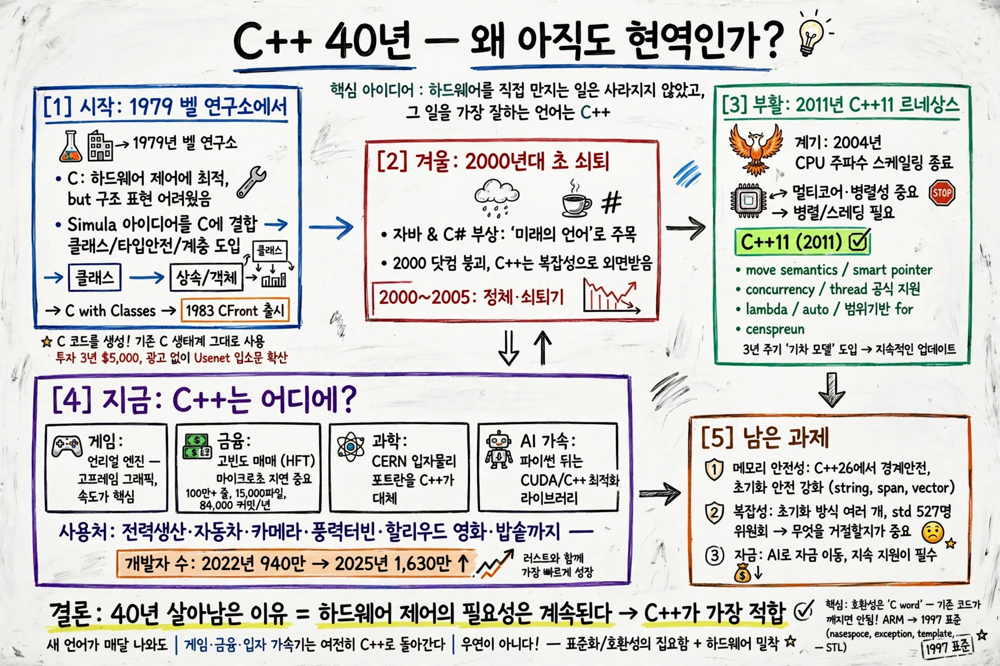
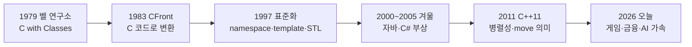
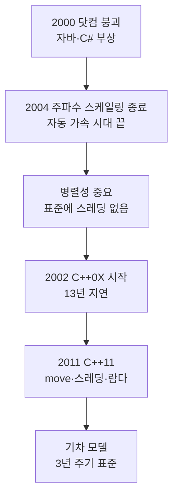
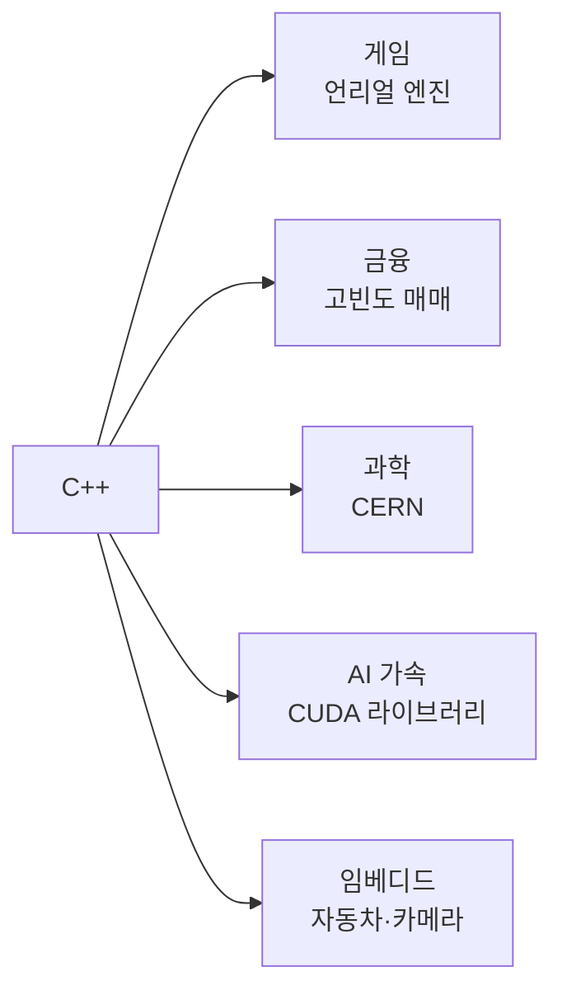

# C++ 40년사: 겨울이 와도 안 죽는 언어, 하드웨어를 직접 만지기 때문입니다

> **Summary**
> C++는 1979년 벨 연구소에서 시작해 40년 넘게 게임·금융·입자 물리·AI 가속까지 돌리는 언어로 남았습니다. 2000년대 초 자바와 C#에 밀려 겨울을 맞았지만, CPU 주파수 향상이 멈추자 병렬성이 중요해지며 C++11로 부활했습니다. 다큐멘터리는 이 40년을 만든 사람들과 사건으로 정리했습니다. 하드웨어를 직접 만지는 일은 사라지지 않았습니다.

---

- C++는 1979년 벨 연구소에서 시작해 40년 넘게 게임·금융·입자 물리·AI 가속을 돌리는 언어로 남았습니다.
- 2000년대 초 자바와 C#에 밀려 겨울을 맞았지만, CPU 주파수 향상이 멈추자 병렬성이 중요해지며 C++11로 부활했습니다.
- 다큐멘터리는 이 40년을 만든 사람들과 사건으로 정리했습니다. 하드웨어를 직접 만지는 일은 사라지지 않았습니다.

40년 된 프로그래밍 언어가 아직도 현역이라는 말, 어떻게 들리시나요? 새 언어가 매달 쏟아지는데 게임 엔진도, 증권 거래도, 입자 가속기도 여전히 C++로 돌아갑니다. 그런데 이 다큐멘터리를 보고 나면, 그게 우연이 아니라는 걸 알게 됩니다!

🎥 [동영상 보기](https://www.youtube.com/watch?v=lI7tMxzSJ7w)

## 벨 연구소에서, 왜 C에 Simula를 얹었을까요?

1979년, 벨 연구소에서 분산 시스템을 만들던 연구원은 고민에 빠졌습니다. 장치 드라이버, 네트워크 인터페이스, 메모리 관리자까지 다루려면 하드웨어를 완전히 제어하는 저수준 언어가 필요했습니다. C는 그 일을 해냈습니다. 그런데 프로그램이 커지자 문제가 생겼습니다. 모듈, 통신 채널, 프로토콜 같은 구조를 표현하기가 너무 어려웠습니다.

그래서 그는 캠브리지에서 쓰던 Simula 아이디어를 C에 얹었습니다. 강한 타입 안전성, 사용자 정의 타입, 클래스, 클래스 계층 말입니다. Simula 자체는 너무 느리고 메모리를 많이 썼습니다. 빠른 C에 Simula의 뼈대만 넣은 겁니다. 그게 `C with Classes`, C++의 시작이었습니다.

초기 구현인 `CFront`는 1983년에 나왔습니다. 기계어를 직접 만들지 않고 C 코드로 변환했습니다. 기존 C 인프라와 라이브러리를 그대로 쓸 수 있었으니까요. 이름도 재밌습니다. C의 `++` 연산자가 증가를 뜻하니까 의미상으로는 `++C`가 맞습니다. 색인과 참조 편의를 위해 C++가 됐습니다.

당시 투자는 상상보다 작았습니다. 범용 언어 보급에 3년간 5,000달러가 배정된 적도 있습니다. 그런데도 언어는 퍼졌습니다. 광고도 후원자도 없었습니다. `comp.lang.c++` 같은 Usenet 그룹과 컴퓨터 잡지가 입소문을 탔습니다.

## 호환성은 왜 그렇게 집요했을까요?

`CFront` 2.0에서 다중 상속 처리 버그가 발견된 적이 있습니다. 이미 약속한 핵심 기능이 현장에 나가면 고칠 수 없는 방식으로 깨질 수 있는 상황이었습니다. 며칠 안에 수정본을 만들어 배포했습니다. 같은 릴리스 번호를 유지해야 했기에 버전은 2.0.1 대신 2.0.0으로 나갔습니다. 호환성은 농담처럼 "C word"라고 불릴 만큼 지배적인 요구였습니다. 기존 코드가 깨지면 아무도 안 쓰니까요.

표준화도 같은 이유에서 시작됐습니다. 여러 벤더가 각자 C++ 구현과 `template` 설계를 만들면서 호환성이 갈라졌습니다. IBM, HP, Sun 대표들이 표준화를 요구했습니다. `Annotated Reference Manual`, 즉 `ARM`이 표준화 입력 문서가 됐고, 1997년 11월 표준이 나왔습니다. `namespace`, `exception`, `template`, `STL`이 들어갔습니다.

`STL` 이야기가 특히 인상 깊었습니다. 알고리듬을 모든 자료구조에서 동작하게 하자는 아이디어였습니다. 그런데 제안이 표준화 일정상 너무 늦고 너무 크다는 반대에 부딪혔습니다. 주요 회사도 반대했습니다. 발표와 논의를 거쳐 위원회 약 80%가 찬성해 표준에 들어갔습니다. 이 장면이 저는 가장 인상 깊었습니다. 좋은 아이디어도 설득 없이는 표준이 안 된다는 게 증명되니까요!

## 겨울은 왜 왔고, 어떻게 끝났을까요?

2000년 닷컴 붕괴와 함께 자바가 "미래의 언어"로 부상했습니다. 자바는 C++의 복잡성에 대한 명시적 반응으로 등장했습니다. 마이크로소프트에서는 비주얼 베이직의 쉬운 개발과 C++의 성능을 결합하려 했고, 그 결과 C#이 만들어졌습니다. 2000년부터 2005년 사이, C++는 단순한 정체가 아니라 쇠퇴를 겪었습니다.

그런데 2004년경, 프로세서 주파수 스케일링이 끝났습니다. 하드웨어가 자동으로 프로그램을 빠르게 만들어주던 시대가 끝난 겁니다. 멀티코어와 병렬성이 중요해졌는데, 당시 C++ 표준에는 스레딩이 전혀 없었습니다. 이 문제를 부각한 메일이 계기가 됐습니다.

`C++0X`는 2002년에 시작돼 2007~2009년 완료를 목표로 했지만, 중요한 기능을 더 넣기 위해 계속 지연되면서 13년이 걸렸습니다. 2011년 나온 C++11은 `move semantics`, `concurrency`, `auto`, 범위 기반 `for` 루프, 스마트 포인터, 람다, `constexpr`을 도입했습니다. C 계열 언어 중 스레딩을 공식적으로 다룬 첫 표준이었습니다. 더 쉽고 안전한 언어 기능과 하드웨어 성능을 최대한 활용하려는 필요가 맞물리면서 르네상스가 됐습니다. 이후 정해진 시간에 표준을 내는 기차 모델이 도입됐고, 위원회는 3년 주기를 택했습니다.

## 지금 C++는 어디에 있을까요?

오늘날 C++는 "대략 어디에나" 있습니다. 전력 생산, 풍력 터빈, 밥솥, 볼링장, 할리우드 영화, 자동차, 금융, 카메라까지요. CERN 같은 고에너지 물리 분야에서는 포트란 중심 개발을 C++가 바꿨습니다. 게임에서는 유니티가 C#을 쓰는 반면 언리얼은 C++를 씁니다. 높은 프레임률과 빠른 그래픽이 필요한 게임은 속도 때문에 C++를 씁니다.

금융도 마찬가지입니다. 프로그램 매매와 고빈도 매매가 등장하면서 마이크로초 단위 지연시간이 중요해졌습니다. 한 거래 회사의 코드베이스는 100만 줄 이상, 15,000개 파일이고, 2025년에만 약 800명이 84,000개 커밋을 만들었습니다. AI 가속에서도 C++는 중요합니다. 표면에서는 파이썬을 쓰더라도 실제 계산은 고도로 최적화된 CUDA 라이브러리가 담당합니다.

개발자 수도 늘었습니다. 다큐멘터리가 제시한 수치로는 C++ 개발자가 2022년 940만 명에서 2025년 1,630만 명으로 늘었습니다. 빠르게 성장하는 언어로 러스트와 C++가 꼽혔습니다. 전력 효율이 중요한 분야에서는 C++가 대체하기 어려운 사용처를 확보했습니다.

## 남은 과제는 무엇일까요?

물론 과제도 있습니다. 첫째는 메모리 안전성입니다. 팬데믹 기간 정부와 규제 기관에서 메모리 안전성을 기본으로 제공하지 않는 C++에서 벗어나려는 움직임이 있었습니다. 다큐멘터리는 이를 가장 중요한 문제로 제시합니다. C++26에서는 초기화되지 않은 변수가 더 이상 미정의 동작이 아니게 되고, `string`, `span`, `vector` 같은 공통 타입에 경계 안전 옵션이 제공됩니다. `static reflection`은 코드가 코드를 볼 수 있게 하는 기능으로, 표준화된 단일 기능 중 가장 영향력이 큰 기능으로 평가됩니다.

둘째는 복잡성입니다. 변수 초기화 방식이 여러 가지라는 비판을 받습니다. 표준위원회도 527명 규모로 커졌습니다. 추가는 가능하지만 제거는 거의 불가능하기 때문에, 무엇을 넣을지보다 언제 거절할지가 중요한 문제가 됐습니다.

셋째는 자금입니다. 대형 플레이어들이 AI로 이동하면서 C++ 자금이 줄어들 수 있다는 우려가 있습니다. 언어가 살아남는 건 설계만으로 되는 일이 아니라는 겁니다!

정직하게 짚을 점도 있습니다. 개발자 수나 거래 회사 코드베이스 같은 수치는 다큐멘터리가 제시한 수치입니다. C++26은 아직 진행 중인 표준이라 다룬 기능이 최종 표준에 그대로 들어간다고 단정할 수는 없습니다. 그래도 방향은 분명합니다. 안전성을 높이는 쪽으로 움직이고 있습니다.

40년 동안 언어가 살아남은 이유는 뭘까요? 다큐멘터리의 답은 단순합니다. 하드웨어를 직접 만지는 일은 사라지지 않았고, 그 일을 가장 잘하는 언어가 C++였기 때문입니다. 새 언어가 나와도 이 자리는 남습니다!

