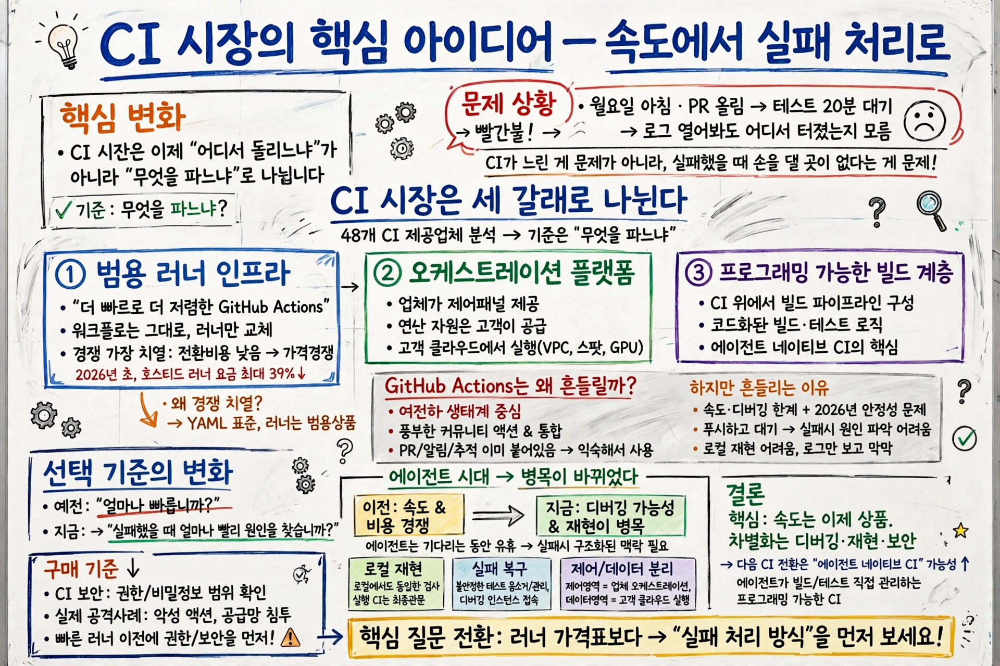
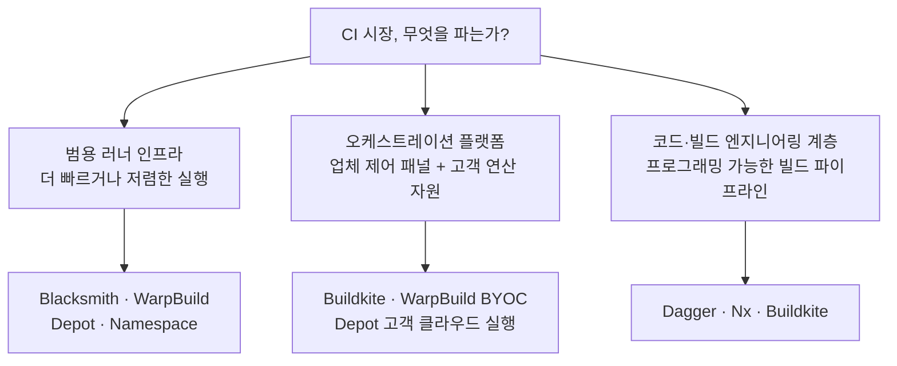
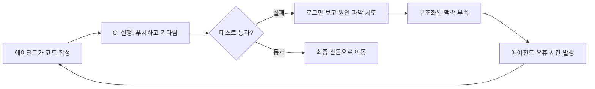

# CI가 빨라졌는데 왜 빌드는 여전히 느릴까요? 시장은 이미 세 갈래로 나뉘었습니다

> **Summary**
> CI 시장은 이제 "어디서 돌리느냐"가 아니라 "무엇을 파느냐"로 나뉩니다. 범용 러너 인프라, 오케스트레이션 플랫폼, 프로그래밍 가능한 빌드 계층, 세 갈래입니다. GitHub Actions는 생태계 때문에 여전히 중심이지만, 속도와 디버깅의 한계에 2026년 안정성 문제까지 겹치며 흔들리고 있습니다. 에이전트 시대에는 빠른 러너보다 로컬 재현과 실패 원인 파악이 먼저입니다. 다음 전환은 에이전트 네이티브 CI가 될 가능성이 큽니다.

---

- CI 시장은 이제 "어디서 돌리느냐"가 아니라 "무엇을 파느냐"로 나뉩니다. 범용 러너 인프라, 오케스트레이션 플랫폼, 프로그래밍 가능한 빌드 계층, 세 갈래입니다.
- GitHub Actions는 생태계 때문에 여전히 중심이지만, 속도와 디버깅의 한계에 2026년 안정성 문제까지 겹치며 흔들리고 있습니다.
- 에이전트 시대에는 빠른 러너보다 로컬 재현과 실패 원인 파악이 먼저입니다. 다음 전환은 에이전트 네이티브 CI가 될 가능성이 큽니다.

월요일 아침, PR 하나를 올렸습니다. 테스트가 끝나기만 기다리면 되는데, 20분이 지나도 초록불이 안 뜹니다. 그러다 빨간불이 떴습니다. 원인을 보려고 로그를 열었는데, 어디서 터졌는지 알 수가 없습니다. 이런 적 있으시죠? CI가 느린 게 문제가 아니라, 실패했을 때 손을 댈 곳이 없다는 게 문제입니다!

🎥 [동영상 보기](https://www.youtube.com/watch?v=K4FKwdNMDyI)

## CI 시장은 왜 세 갈래로 나뉘었을까요?

48개 CI 제공업체를 분석한 결과, 시장은 세 하위 범주로 나뉩니다. 기준은 단순합니다. 무엇을 파느냐입니다.

첫째는 **범용 러너 인프라**입니다. 기본적으로 "더 빠르거나 더 저렴한 GitHub Actions"를 파는 곳입니다. 워크플로는 그대로 두고, 실행되는 기계만 바꿔 끼웁니다. 둘째는 **오케스트레이션 플랫폼**입니다. 업체가 제어 패널을 제공하고, 연산 자원은 고객이 공급합니다. 셋째는 **코드·빌드 엔지니어링 계층**입니다. CI 위에서 더 프로그래밍 가능한 빌드 파이프라인을 구성하는 곳입니다.

세 갈래 중 경쟁이 가장 치열한 곳은 첫째, 러너 인프라입니다. 왜일까요? 전환 비용이 거의 없기 때문입니다! `YAML`이 표준으로 자리 잡았고, 러너가 범용 상품이 됐습니다. 워크플로를 유지한 채 러너만 교체하면 되니, 갈아타는 데 드는 비용이 작습니다. 그래서 업체들은 베어메탈, `NVMe` 캐싱, 초 단위 과금 같은 차별화 포인트로 싸웁니다. 2026년 초에는 호스티드 러너 요금을 최대 39%까지 내리는 가격 경쟁까지 벌어졌습니다. 한 회사의 CI 병목 사례가 아니라, 시장 전체가 갈리는 구조 변화입니다.

## GitHub Actions는 왜 흔들릴까요?

GitHub Actions는 여전히 생태계의 중심입니다. 커뮤니티 액션과 통합 기능이 풍부합니다. 그런데 선택 이유를 잘 보면, 최고 수준의 도구라서가 아닙니다. PR, 알림, 추적 기능에 이미 통합돼 있기 때문입니다. 익숙하고, 붙어 있고, 그래서 씁니다.

하지만 흔들리는 이유도 분명합니다. 속도와 디버깅의 근본적인 한계에, 2026년의 안정성 문제까지 겹쳤습니다. 푸시하고 기다리는 방식은 그대로입니다. 빌드 여부를 확인하려고 CI에 푸시해야 하고, 불안정한 테스트가 파이프라인을 막고, 실패한 실행을 디버깅하기도 어렵습니다. 로컬에서 재현하는 도구(`act`)가 있어도, 일반적인 작업 흐름은 크게 달라지지 않았습니다. 생태계가 강해도, 실행 경험이 약하면 우위는 서서히 깎입니다.

## 에이전트 시대, 속도가 아니라 무엇이 병목일까요?

2026년 이전에는 속도와 비용만으로 경쟁할 수 있었습니다. 그런데 에이전트가 코드를 쓰기 시작하면서, 디버깅 가능성도 병목이라는 사실이 드러났습니다. CI 지연과 불안정한 테스트는 이제 에이전트의 유휴 시간으로 이어집니다. 에이전트는 기다리는 동안 아무것도 못 합니다. 더 큰 문제는 실패를 처리하는 기계가 수정에 필요한 구조화된 맥락을 갖지 못한다는 점입니다. 로그 한 줄만으로는 무엇을 고쳐야 할지 알 수 없습니다!

그래서 단순 실행 속도보다 실패 처리와 로컬 재현 기능이 중요해지고 있습니다. 불안정한 테스트를 음소거하고 관리하는 기능, 디버깅 가능한 인스턴스에 직접 접속하는 기능, 실패를 스스로 복구하는 CI가 그 예입니다. 같은 검사를 로컬에서도 실행할 수 있으면, 에이전트는 로컬에서 검사를 마치고 CI를 최종 관문으로만 씁니다. CI의 역할이 테스트 실행기에서 프로덕션 배포 전 다시 확인하는 최종 관문으로 이동하는 것입니다. 이 지점에서 빌드 계층은 러너와 결합해야 합니다. 현대적인 구성은 제어 영역과 데이터 영역을 분리합니다. 업체가 오케스트레이션하고, 고객 클라우드에서 연산을 실행하는 방식입니다. 스팟 요금, `VPC` 접근, 맞춤형 하드웨어 같은 요구에 대응할 수 있기 때문입니다.

## 그래서 무엇을 골라야 할까요?

선택 기준도 달라지고 있습니다. 에이전트의 접근 권한이 늘면서 CI 보안 수준이 구매 기준이 될 전망입니다. GitHub Actions에는 기본적으로 고정되지 않는 액션 버전, 과도한 권한, 부적절한 비밀정보 접근 범위 같은 함정이 있습니다. 실제 공격 사례도 이미 나왔습니다. 공급망을 통해 확산한 악성코드 사건과, 널리 쓰이던 액션이 공격당한 사건이 그 예입니다. 빠른 러너를 고르기 전에, 권한과 비밀정보 범위를 먼저 봐야 합니다!

현재 개발자 커뮤니티에서는 러너 업체의 존재감이 큽니다. 상당한 벤처 투자도 유치했습니다. 그런데 러너 업체가 당분간 GitHub 이탈 사용자를 흡수하더라도, 개선은 더 저렴하거나 빠른 실행에 머무릅니다. 근본적인 해법으로 기대되는 것은 **에이전트 네이티브 CI**입니다. 에이전트가 빌드와 테스트를 직접 관리할 수 있는, 프로그래밍 가능한 CI 말입니다. 다만 아직 불확실합니다. 프로그래밍 가능한 빌드 인프라가 너무 일렀던 것인지, 아니면 2026년의 잇따른 장애가 임계점을 넘어 이탈이 이제 시작되는 것인지, 아직 모릅니다. 기존 후보들이 충분히 오래 살아남거나, 아직 만들어지지 않은 새로운 도구가 등장해야 합니다.

CI를 고를 때 물어야 할 질문이 바뀌었습니다. "얼마나 빠릅니까?"가 아니라 "실패했을 때 얼마나 빨리 원인을 찾습니까?"입니다. 속도는 이제 상품이 됐습니다. 차별화는 디버깅과 재현, 그리고 보안에서 나옵니다. 다음에 CI를 고른다면, 러너 가격표보다 실패 처리 방식을 먼저 살펴보시는 게 어떨까요?

