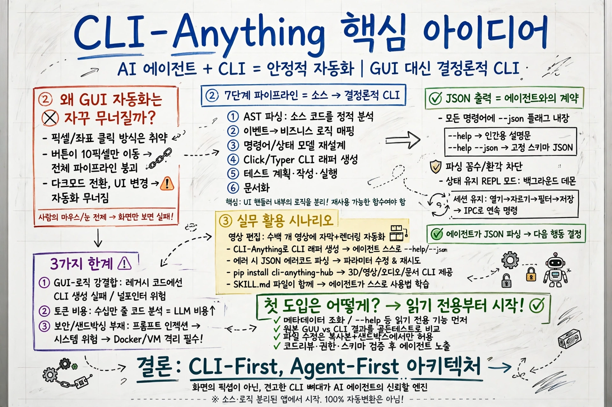
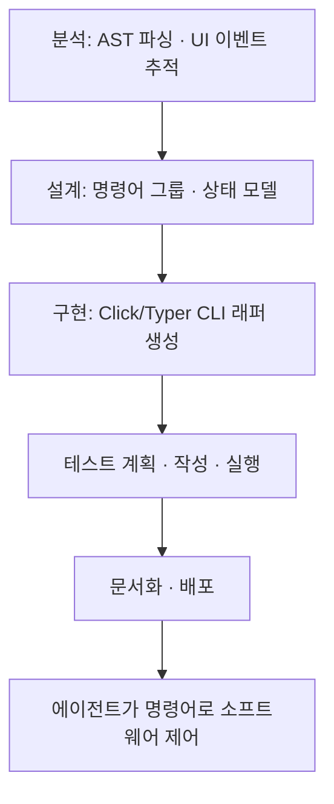
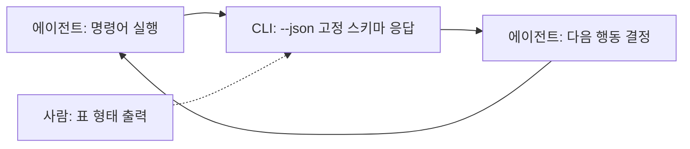
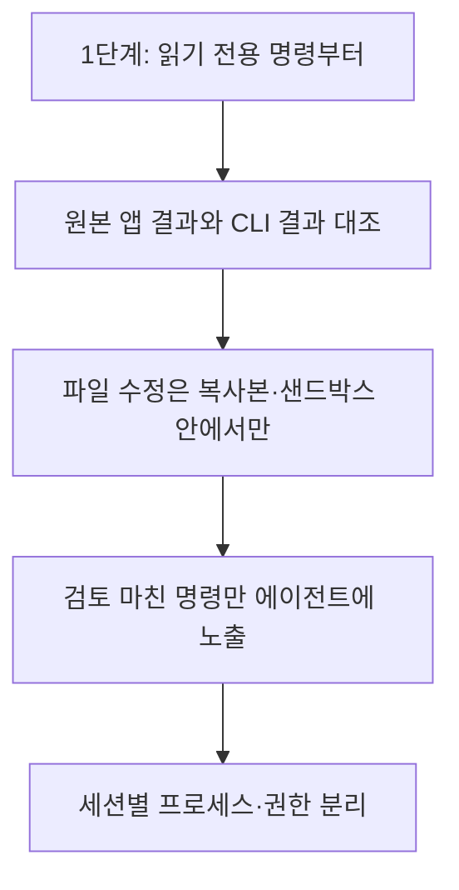

# CLI-Anything: 에이전트 시대의 인터페이스는 클릭이 아니라 명령어입니다

> **Summary**
> AI 에이전트에게 GUI 소프트웨어를 시키면 화면 픽셀을 클릭하는 방식은 버튼이 조금만 움직여도 무너집니다. CLI-Anything은 소스가 있는 소프트웨어의 UI 이벤트 뒤에 숨은 비즈니스 로직을 찾아 결정론적 CLI로 바꾸는 7단계 파이프라인으로, 9개 앱에서 1,436개 테스트를 통과했다고 합니다. 다만 소스가 없거나 로직이 UI에 엉킨 앱에는 그대로 쓸 수 없어, 읽기 전용 명령부터 작게 시작하고 샌드박스 안에서 검증하는 게 맞습니다.

---

- AI 에이전트에게 이미지 100장의 배경을 지우라고 시키면, 화면의 버튼 위치가 조금만 바뀌어도 자동화가 통째로 무너집니다.
- CLI-Anything은 소스가 있는 소프트웨어의 UI 이벤트 뒤에 숨은 비즈니스 로직을 찾아 결정론적 CLI로 바꾸는 7단계 파이프라인입니다.
- 9개 앱에서 1,436개 테스트를 통과했다고 하지만, 소스가 없거나 로직이 UI에 엉킨 앱에는 그대로 쓸 수 없어 읽기 전용 명령부터 작게 시작하는 게 맞습니다.

블렌더를 켜서 며칠 전 만든 3D 모델의 광원을 조금 바꾸고 렌더링을 돌려달라고 에이전트에게 시켜본 적 있으시죠? 코드는 잘 짜던 에이전트가 순식간에 멈춥니다. 거대한 데스크톱 소프트웨어는 사람의 마우스 클릭과 눈을 전제로 만들어졌기 때문입니다.

🎥 [동영상 보기](https://www.youtube.com/watch?v=96Hmw0szgDc)

## 왜 GUI 자동화는 자꾸 무너질까요?

화면의 픽셀을 읽고 버튼 좌표를 클릭하는 방식은 본질적으로 취약합니다. 소프트웨어 업데이트로 버튼이 10픽셀만 옮겨져도, 다크 모드를 켜기만 해도 파이프라인 전체가 무너집니다. 화면을 캡처해서 보여주고 마우스를 조작하게 하는 방식도 같은 한계에서 벗어나지 못했습니다. 이 간극이 바로 리뷰에서 말하는 에이전트와 소프트웨어 사이의 장벽입니다!

## 7단계 파이프라인은 뭘 자동화할까요?

핵심은 LLM의 추론과 정적 분석을 결합한 7단계 파이프라인입니다. 소스 코드를 AST 수준으로 파싱하고, Qt나 GTK 같은 UI 프레임워크의 이벤트 리스너 뒤에 숨은 실제 비즈니스 로직을 매핑합니다. 메뉴 구조를 명령어 그룹과 상태 모델로 다시 설계하고, Click이나 Typer 기반의 실행 가능한 CLI 래퍼를 생성합니다. 그 뒤에는 테스트 계획, 작성, 실행, 문서화, 배포가 이어집니다.

이 흐름이 잘 맞으려면 UI 핸들러가 호출하는 핵심 로직이 재사용 가능해야 합니다. `onClick` 안에 UI 스레드와 전역 상태, 데이터베이스 트랜잭션이 섞여 있으면 래퍼가 GUI 런타임 없이는 동작하지 않을 수 있습니다. 정적 분석이 호출 경로를 찾는 것과 안전한 공개 API를 만드는 것은 다른 일입니다!

## 왜 JSON 출력이 에이전트의 계약일까요?

사람이 읽기 좋은 표는 에이전트에게는 파싱해야 할 쓰레기 텍스트에 불과합니다. CLI-Anything이 만드는 모든 명령어는 태생적으로 `--json` 플래그를 내장하고 있습니다. 사람이 쓸 때는 읽기 좋은 문장으로, 에이전트가 쓸 때는 고정된 스키마의 JSON으로 답합니다. 에이전트는 깔끔한 JSON 응답을 받아 다음 행동을 명확하게 결정합니다. 파싱 꼼수로 인한 환각과 오작동을 원천 차단하는 구조입니다!

여기에 상태 유지 REPL 모드가 더해집니다. 무거운 그래픽·영상 편집 툴을 명령어마다 띄웠다 죽였다 하면 초기화 비용이 큽니다. 백그라운드 데몬으로 애플리케이션의 런타임 상태를 띄워두고, 에이전트가 REPL을 통해 연속 명령을 IPC로 전달합니다. 열기, 자르기, 필터 적용, 저장 같은 흐름을 세션으로 유지하면서도 속도는 빠르고 예측 가능합니다.

## 실무에서는 어떻게 쓸까요?

가장 직관적인 시나리오는 로컬 에이전트와 레거시 소프트웨어의 결합입니다. 마케팅 부서에서 쏟아지는 수백 개의 영상 에셋에 자막을 입히고 특정 포맷으로 렌더링하는 작업을 떠올려 보겠습니다. 영상 편집 소프트웨어의 소스를 CLI-Anything에 밀어 넣어 CLI 래퍼를 생성합니다. 에이전트는 스스로 `--help`를 호출해 생성된 명령어의 구조를 읽고, `--json` 플래그를 붙여가며 파이프라인을 구축합니다. 렌더링 에러가 나면 JSON 에러 코드를 파싱하고 파라미터를 수정해 재시도까지 합니다. 낯선 소프트웨어의 사용법을 스스로 탐색하고, 인간의 개입 없이 복잡한 도구를 오케스트레이션하는 진짜 에이전틱 워크플로우입니다!

이미 만들어진 CLI가 있으면 굳이 생성부터 할 필요가 없습니다. `pip install cli-anything-hub`로 패키지 매니저를 설치하면 이미지 편집, 3D, 오디오, 영상, 문서 도구의 CLI를 받아 쓸 수 있습니다. 생성된 CLI마다 `SKILL.md` 파일이 함께 나와서, 에이전트가 명령어 사용법을 따로 설명 없이 읽습니다.

## 한계는 없을까요?

세 가지 한계가 분명합니다. 첫째, GUI와 비즈니스 로직의 강결합입니다. 아키텍처 패턴이 엄격하게 지켜진 모던 프로젝트에서는 AST 파싱이 잘 동작합니다. 하지만 10년 넘게 얽힌 사내 레거시 툴이라면, 버튼의 이벤트 핸들러 안에 UI 조작과 DB 트랜잭션이 한 덩어리로 뭉쳐 있습니다. 이런 코드에 파이프라인을 들이밀면 생성된 CLI가 런타임에 GUI 컨텍스트를 찾지 못해 널 포인터 예외나 세그멘테이션 폴트로 무너질 수 있습니다. 쓰레기 코드를 넣으면 쓰레기 CLI가 나온다는 소프트웨어 공학의 진리는 여기서도 빗나가지 않습니다.

둘째, 컨텍스트 윈도우와 토큰 비용입니다. 7단계 파이프라인이 수십만 줄의 코드를 분석하고 테스트 코드를 짜는 과정은 엄청난 LLM API 호출을 동반합니다. 엔터프라이즈급 소프트웨어를 통째로 변환하려면 토큰 비용만으로도 부담이 큽니다. 로컬 오픈소스 모델을 쓰자니 추론 성능이 부족해 생성된 CLI의 안정성이 떨어집니다.

셋째, 보안과 샌드박싱의 부재입니다. GUI 시절에는 UI라는 물리적 제약이 있었습니다. 하지만 CLI가 뚫어놓은 고속도로를 통해 에이전트가 로컬 파일 시스템과 애플리케이션 코어에 직접 접근합니다. 프롬프트 인젝션 공격에 노출되면 악의적인 명령 하나가 시스템 권한을 탈취하거나 데이터를 날리는 재앙으로 이어질 수 있습니다. 실무에 도입하려면 Docker나 경량 VM 수준의 엄격한 격리 환경 구축이 선택이 아니라 필수입니다!

## 첫 도입은 어디서 시작할까요?

이 리뷰는 2026년 8월에 한 번 더 다듬어졌고, 그때의 결론은 더 조심스럽습니다. 어떤 GUI든 100% 자동 변환하는 도구로 보면 안 된다는 것입니다. 소스가 있고, UI와 비즈니스 로직이 잘 분리된 앱에서 CLI 생성을 돕는 도구로 보는 게 맞습니다. 생성된 테스트가 모두 통과해도 원본 GUI와 같다는 보장은 없습니다. 생성 코드와 테스트가 같은 잘못된 가정을 공유할 수 있으니, 사람이 만든 수용 사례와 누락 기능, 오류 복구를 별도로 확인해야 합니다.

그래서 첫 개념 증명은 메타데이터 조회나 `--help` 같은 읽기 전용 기능부터 시작하는 게 순서입니다. 원본 앱의 결과와 CLI 결과를 골든 테스트로 비교하고, 파일 수정은 복사본과 샌드박스 안에서만 허용합니다. 코드 리뷰와 권한, 스키마 검증을 통과한 명령만 에이전트에 노출해야 합니다. 상태 유지 데몬을 쓴다면 세션별 프로세스와 작업 디렉터리, 타임아웃, 충돌 복구, 메모리 상한까지 함께 검증해야 합니다.

지난 수십 년간 우리는 인간이 더 편하게 클릭할 수 있는 UI를 깎아왔습니다. 하지만 앞으로의 10년은 다를 것입니다. 소프트웨어가 시장에서 살아남으려면 인간을 넘어 AI 에이전트가 얼마나 쉽고 결정론적으로 접근할 수 있는지를 증명해야 합니다. GUI의 화려함에 가려져 구시대의 유물 취급을 받던 CLI의 가치가, AI의 시대를 맞이하며 가장 범용적이고 신뢰할 수 있는 인터페이스로 부활하고 있습니다. 화면의 픽셀이 아니라, 에이전트가 완벽하게 읽고 제어할 수 있는 견고한 뼈대를 설계하는 것, 그게 바로 CLI-First, Agent-First 아키텍처입니다.

