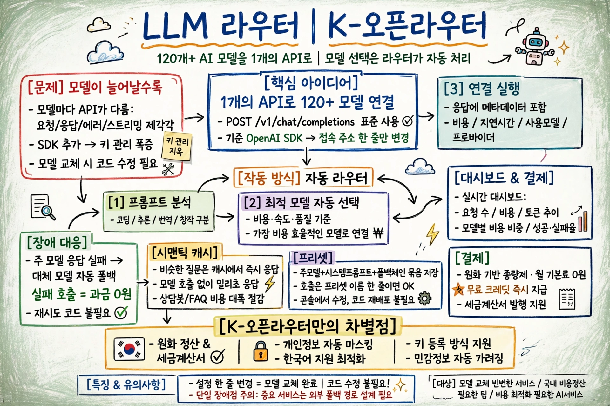
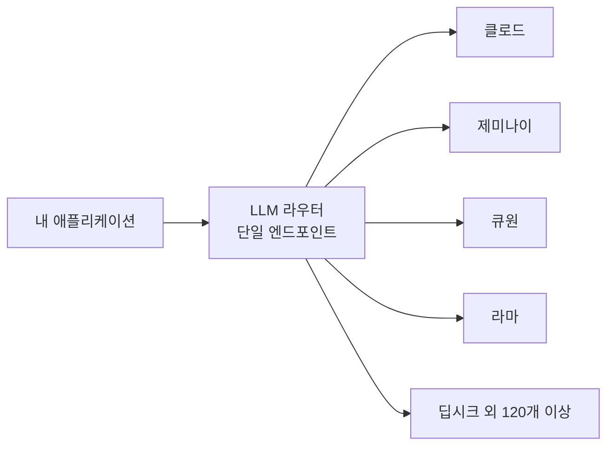
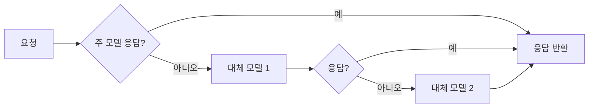
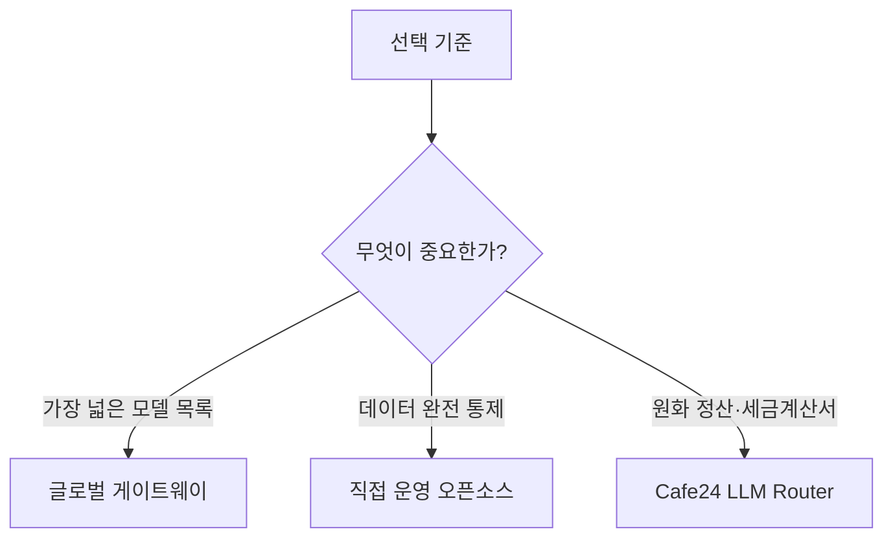

# Cafe24 LLM Router: 모델 고르는 일을 API에 맡기면, 코드는 한 줄도 안 바뀝니다

> **Summary**
> 카페24가 2026년 6월 23일 공개한 LLM 라우터는 120개 이상의 AI 모델을 단일 엔드포인트로 통합 호출하는 인프라입니다. 자동 라우터가 프롬프트를 분석해 코딩·추론·번역·창작 중 작업 유형을 판별하고 비용이 가장 잘 맞는 모델을 골라 연결합니다. 장애 시 대체 모델로 자동 전환하고 실패한 호출은 과금하지 않으며, 원화 종량제와 세금계산서 발행까지 지원합니다.

---

- 120개 이상의 AI 모델을 하나의 API로 부르는 인프라가 나왔습니다. 모델을 고르는 일은 라우터가 맡습니다.
- 프롬프트를 보고 코딩·추론·번역 중 어떤 일인지 가려서, 비용이 가장 잘 맞는 모델로 자동 연결합니다.
- 장애가 나면 대체 모델로 바로 갈아타고, 실패한 호출은 과금하지 않습니다. 원화 정산과 세금계산서까지 됩니다.

새 모델이 나올 때마다 SDK를 하나 더 붙여본 적 있으시죠? 처음엔 하나였습니다. 그러다 두 개, 세 개가 됐고, 어느새 키 관리만 따로 챙겨야 하는 지경이 됐습니다. 2026년 6월, 국내 전자상거래 플랫폼 기업이 이 문제를 정면으로 건드렸습니다. 이름은 LLM 라우터입니다!

🎥 [동영상 보기](https://www.youtube.com/watch?v=V_K6PCmdtRg)

## 모델이 늘수록 코드도 늘어야 할까요?

모델마다 API 모양이 다릅니다. 요청 본문도, 응답 형식도, 에러 코드도, 스트리밍 방식도 제각각입니다. 모델을 하나 바꾸려면 코드를 뜯어야 했습니다. 그런데 2024~2025년을 거치며 `POST /v1/chat/completions` 형식이 사실상 업계 표준이 됐습니다. 이 라우터는 그 표준 위에 서 있습니다.

기존에 쓰던 OpenAI SDK가 있다면, 바꾸는 건 접속 주소 한 줄뿐입니다. 요청은 라우터가 받아서 알맞은 모델로 넘기고, 응답은 같은 형식으로 돌려줍니다. 응답에는 비용과 지연 시간, 실제로 쓴 프로바이더와 모델까지 메타데이터로 붙어 옵니다. 로그를 보면 어떤 요청이 어디로 갔는지 바로 보입니다.

## 프롬프트를 보고 모델을 고른다고요?

이 서비스에서 가장 눈에 띄는 기능은 자동 라우터입니다. 프롬프트를 분석해 작업 유형을 판별합니다. 코딩인지, 추론인지, 번역인지, 창작인지 가린 뒤, 그 일에 비용이 가장 잘 맞는 모델을 자동으로 골라 연결합니다. "React 무한 스크롤 코드 만들어줘" 같은 요청은 코딩으로 감지돼 코드에 강한 모델로 갑니다.

사용 범위를 미리 정해둘 수도 있습니다. 자동 연결은 정해둔 모델 안에서만 일어납니다. 일일이 모델을 비교하고 고를 필요가 사라집니다. 다만 단서가 있습니다. 작업이 섞인 프롬프트는 판별이 빗나갈 수 있습니다. 코딩인데 번역이 섞인 요청 같은 경우 말이죠. 그래서 운영에 올리기 전에는 로그를 보고, 자동 선택이 품질 기대에 맞는지 확인하는 과정이 필요합니다!

## 장애가 나면 어떻게 됩니까?

모델 API도 결국 HTTP API입니다. 장애는 납니다. 주 모델이 응답하지 않으면, 미리 정해둔 대체 모델이 바로 이어받습니다. 코드에 재시도 로직을 짤 필요가 없습니다. 실패한 호출은 과금에서 빠집니다. 예컨대 첫 모델이 멈추면 두 번째로, 그것도 안 되면 세 번째로 넘어가는 식입니다.

프로바이더 라우팅은 한 겹 더 들어갑니다. 같은 모델을 여러 프로바이더가 제공할 때, 비용·속도·처리량 기준으로 우선순위를 정합니다. 허용·차단 목록으로 쓸 프로바이더를 고를 수도 있습니다. 다만 대체 모델의 품질이 주 모델과 다를 수 있다는 점은 알고 써야 합니다. 폴백이 품질을 보장하는 건 아니니까요!

## 비슷한 질문은 아예 안 부른다고요?

시맨틱 캐시는 아예 다른 접근입니다. 이전 질문과 의미가 비슷한 질문이 오면, 모델을 부르지 않고 저장된 답변을 밀리초 단위로 돌려줍니다. 문자열이 똑같아야 하는 게 아니라, 의미가 비슷하면 같은 질문으로 봅니다. 자주 반복되는 질문이 많은 상담 봇이나 FAQ 서비스에서 토큰 비용이 크게 줄어듭니다. 반대로 매번 다른 요청만 오는 서비스에서는 적중률이 낮습니다. 캐시가 만능은 아닙니다!

프리셋은 설정을 코드에서 떼어내는 기능입니다. 주 모델과 시스템 프롬프트, 샘플링 값, 다단계 폴백 체인을 하나로 묶어 저장합니다. 호출은 프리셋 이름 한 줄이면 됩니다. 조정은 콘솔에서 하고, 코드 재배포는 필요 없습니다. 개발·스테이징·운영 환경마다 다른 설정을 묶어두기에도 잘 맞습니다.

## 내 키로 쓰고, 내 돈은 내가 본다고요?

이미 갖고 있는 키를 그대로 등록하는 방식도 있습니다. 보유 중인 키로 요청을 보내면 비용을 직접 통제할 수 있습니다. 로그와 모델에 전달되는 데이터의 민감 정보는 자동으로 가려집니다.

실시간 대시보드에서는 요청 수와 비용, 토큰 추이, 모델별 비용 비중, 성공·실패 비율을 한 화면에서 봅니다. 요청 단위 상세 로그까지 확인됩니다. 플레이그라운드에서는 코드 없이 모델별 응답 품질과 속도, 비용을 바로 비교할 수 있습니다.

요금은 크레딧 종량제입니다. 월 기본요금은 0원이고, 가입하면 무료 크레딧이 바로 지급됩니다. 원화 기반 과금에 세금계산서 발행까지 지원합니다. 달러 정산과 해외 카드가 번거로웠던 팀에게는 이 부분이 의외로 크게 다가옵니다.

## 그래서, 누구에게 맞을까요?

이미 이 시장에는 쟁쟁한 이름들이 있습니다. 전 세계에서 가장 큰 게이트웨이는 400개 이상의 모델을 품고 있고, 직접 운영하는 오픈소스 대안도 있습니다. 그런데도 이 서비스에 "K-오픈라우터"라는 별명이 붙은 이유가 있습니다. 원화 정산과 세금계산서, 개인정보 마스킹, 한국어 지원 같은 한국 시장 최적화가 차별점입니다.

한 가지는 짚고 넘어가야 합니다. 라우터 자체가 단일 장애점이 될 수 있다는 점입니다. 라우터가 멈추면 그 뒤의 모든 모델이 함께 멈춥니다. 중요한 서비스라면 직접 연결을 바깥 폴백으로 두는 겹겹이 설계가 안전합니다. 모델 수는 공개 보도 기준 120개 이상입니다. 클립에는 100개 이상으로 적혀 있었는데, 집계 시점에 따라 숫자가 달라집니다.

모델을 고르는 기준이 코드 안에 있으면, 모델이 바뀔 때마다 코드가 바뀝니다. 기준을 라우터로 옮기면, 바뀌는 건 설정 한 줄입니다!

