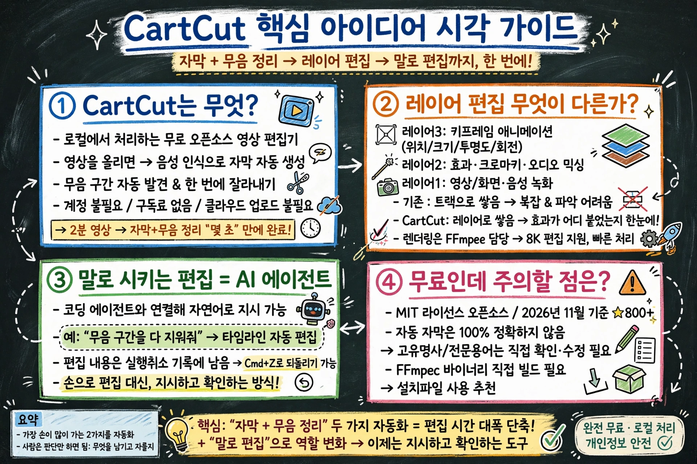
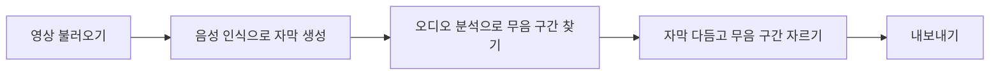
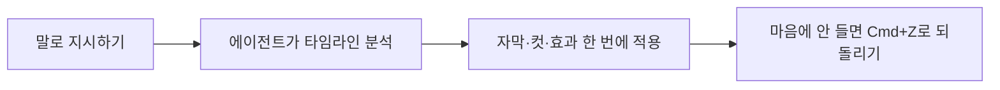

# CartCut: 자막 달고 무음 자르는 일, 이제 돈 내고 기다릴 필요가 없습니다

> **Summary**
> CartCut은 자막 생성과 무음 구간 제거를 자동화하는 무료 오픈소스 영상 편집기로, 레이어 편집, 키프레임, 녹화와 8K 렌더링을 지원합니다. 코딩 에이전트에 자연어로 편집을 지시할 수 있으며, 영상은 로컬에서 처리되고 변경 사항은 실행 취소로 되돌릴 수 있습니다. 자동 자막은 검수가 필요하고 직접 빌드할 때는 추가 설정이 필요합니다.

---

- CartCut은 자막 생성과 무음 구간 정리를 로컬에서 처리하는 무료 오픈소스 영상 편집기입니다. 영상을 올리면 음성을 인식해 자막을 만들고, 말 없는 구간을 찾아 잘라냅니다.
- 트랙이 아니라 레이어로 쌓는 편집 방식에 키프레임 애니메이션과 화면·음성 녹화까지 들어갔고, 렌더링은 `FFmpeg`이 맡습니다.
- 코딩 에이전트와 연결하면 말로 지시해 편집할 수도 있습니다. "무음 구간을 다 지워줘"라는 한 문장이 타임라인 편집이 됩니다.

강의 영상 하나를 편집하려고 앉았는데, 자막 다는 데만 한 시간이 간 적 있으시죠? 말하는 구간을 일일이 듣고, 침묵 구간을 찾아 자르고, 자막 줄을 맞추고. 영상은 2분짜리인데 편집은 저녁을 먹습니다.

🎥 [동영상 보기](https://www.youtube.com/watch?v=Ujpr5-VgvP4)

## 자막부터 무음까지, 한 번에 처리됩니다

이 도구의 출발점은 단순합니다. 영상 편집에서 가장 손이 많이 가는 두 가지, 자막과 침묵 정리를 자동화하는 것입니다. 영상을 불러오면 음성 인식 모델이 말을 텍스트로 바꿔 자막을 만듭니다. 자막 스타일도 타임라인에서 바로 다듬을 수 있습니다.

무음 구간은 오디오 분석이 찾습니다. 말 없는 구간을 일일이 눈으로 찾을 필요가 없습니다. 찾은 구간은 한 번에 잘라낼 수 있습니다. 소개된 사용 사례에서는 2분짜리 영상의 무음 구간 정리와 자막 생성이 몇 초 만에 끝났다고 합니다. 속도는 컴퓨터 성능에 따라 달라지지만, 흐름 자체는 분명합니다. 듣고, 자르고, 자막을 다는 일을 기계가 먼저 합니다!

## 레이어로 쌓는 편집, 뭐가 다를까요?

대부분의 편집기는 트랙으로 쌓습니다. 이 도구는 레이어로 쌓습니다. 효과 하나를 레이어 하나에 얹는 방식이라, 어떤 효과가 어디에 붙었는지 한눈에 보입니다. 레이어가 많아져도 구조가 흐트러지지 않습니다.

레이어 위에는 키프레임 애니메이션이 있습니다. 위치, 크기, 투명도, 회전을 시간에 따라 움직일 수 있습니다. 오디오 믹싱, 크로마키, 효과와 전환, 화면·음성 녹화도 들어갔습니다. 렌더링은 `FFmpeg`이 맡아 빠르게 처리하고, 8K 편집까지 지원합니다. 레이어가 트랙과 뭐가 다른지, 저는 처음엔 갸우뚱했습니다. 그런데 효과 하나를 레이어 하나에 얹는다고 생각하니 감이 왔습니다!

## 말로 시키면 편집이 됩니다?

이 도구에서 가장 눈에 띄는 부분은 에이전트 연동입니다. 살아 있는 타임라인을 외부에 노출해서, 코딩 에이전트가 직접 편집할 수 있게 했습니다. 플러그인을 설치하면 에이전트가 대본에서 잘라내고, 자막을 붙이고, 클립을 다듬고, 움직임과 효과를 넣습니다.

지시는 평범한 문장으로 합니다. "무음 구간을 다 지워줘"처럼 말하면 됩니다. 에이전트의 편집은 실행 취소 기록에 그대로 남습니다. 마음에 들지 않으면 `Cmd+Z` 한 번으로 되돌릴 수 있습니다. 편집을 맡겼다고 통제가 사라지는 게 아닙니다!

## 공짜인데, 대가는 없을까요?

이 도구는 `MIT` 라이선스 오픈소스입니다. 계정이 필요 없고, 구독료도 없고, 영상을 클라우드에 올릴 필요도 없습니다. 2026년 11월 기준으로 별 800개가 넘었고, 한국어 안내 문서도 함께 제공됩니다. 기존 도구의 무료 요금제는 분석 한도가 따라오는 경우가 많습니다. 이 도구는 코드부터 무료라 한도를 셀 필요가 없습니다!

다만 알아둘 점이 있습니다. 자동 자막은 음성 인식이 틀릴 때가 있습니다. 고유명사나 전문 용어는 눈으로 한 번 읽고 고치는 과정이 필요합니다. 소스에서 직접 빌드하려면 `FFmpeg` 바이너리를 따로 받아야 하는 등 손이 갑니다. 설치 파일로 받는 쪽이 훨씬 편합니다. 무료라고 해서 검수가 사라지는 건 아닙니다!

자막과 무음 정리, 이 두 가지만 자동화돼도 편집 시간은 눈에 띄게 줄어듭니다. 거기에 말로 시키는 편집까지 얹으면, 편집기의 역할이 달라집니다. 손으로 만지는 도구가 아니라, 지시하고 확인하는 도구가 됩니다. 편집의 진입 장벽은 낮아졌고, 무엇을 남기고 무엇을 자를지는 여전히 사람의 판단입니다.

