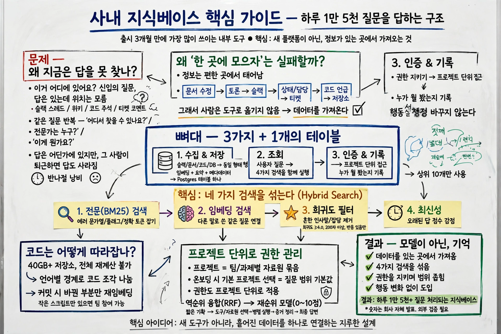
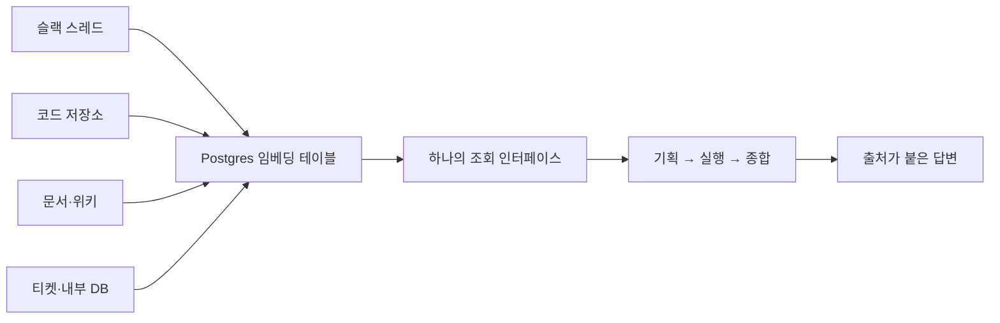
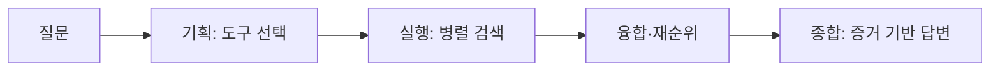

# Cerebras: AI 경쟁의 다음 전장은 모델이 아니라 회사의 기억입니다

> **Summary**
> Cerebras Knowledge는 슬랙, 코드, 문서, 티켓 등 기존 자료를 하나의 Postgres 테이블에 통합하고 전문·임베딩·희귀도·최신성 검색을 결합해 회사 지식을 찾습니다. 프로젝트별 범위와 권한을 적용하고 출처 기반으로 답변해 하루 1만 5천 건 이상의 질문에 대응하며, 핵심은 새 플랫폼을 강요하기보다 정보를 있는 곳에서 가져오는 것입니다.

---

- 직원들이 하루 1만 5천 개 넘는 질문을 던지는 사내 지식베이스, 출시 3개월 만에 회사에서 가장 많이 쓰이는 내부 도구가 됐습니다.
- 비결은 새 플랫폼이 아닙니다. 정보가 이미 있는 곳에서 그대로 가져오는 것, 그게 전부입니다.
- 하나의 테이블에 모으고, 네 가지 검색을 섞고, 권한을 끝까지 지키는 구조가 뼈대입니다.

"이거 어디에 있어요?" 신입이 물으면, 답을 아는 사람은 있습니다. 그런데 그 답이 어디에 적혀 있는지는 아무도 모릅니다. 슬랙 어딘가의 스레드, 위키 한 구석, 코드 주석, 티켓 코멘트. 찾다 보면 반나절이 갑니다. 이런 적 있으시죠?

매년 수백 명이 새로 들어오는 회사에서는 같은 질문이 계속 반복됐습니다. "어디서 찾을 수 있나요?" "이 분야 전문가는 누구인가요?" "이게 뭔가요?" 답은 회사 어딘가에 있는데, 그 어딘가를 아는 사람이 퇴근하면 답도 함께 사라집니다. 그래서 만든 것이 사내 지식베이스입니다. 이름은 `Cerebras Knowledge`입니다.

🎥 [동영상 보기](https://www.youtube.com/watch?v=eCx3SSCcISo)

## 왜 '한 곳에 모으자'는 매번 실패할까요?

분기마다 누군가 같은 제안을 합니다. "모든 정보를 한 플랫폼에 기록하자!" 꿈은 그럴듯합니다. 그런데 현실은 다릅니다. 정보는 만들기에 편한 곳에서 태어납니다. 문서 수정 제안은 문서 안에, 엔지니어링 토론은 슬랙에, 코드 언급은 저장소에, 상태와 담당자는 티켓에 남습니다. 각 도구는 자기 일에 맞게 수년간 다듬어진 물건입니다. 풀 리퀘스트 토론을 문서 도구에서 하라고 하면, 아무도 안 합니다.

그래서 이 팀은 방향을 바꿨습니다. 사람을 도구로 옮기는 대신, 데이터를 도구에서 가져오기로 했습니다. 행동을 바꾸지 않는 것, 이게 첫 번째 설계 결정입니다.

## 뼈대는 어떻게 생겼을까요?

지식베이스가 하는 일은 세 가지입니다. 내부 데이터를 모으고 저장하는 일, 그 데이터를 조회하는 일, 그리고 인증과 권한을 지키며 누가 뭘 봤는지 기록하는 일입니다. 마지막이 빠지면 회사 안에서 쓸 수 없습니다. 남이 보면 안 되는 자료까지 답에 섞이면, 그날로 시스템은 끝입니다!

구조는 일부러 단순하게 만들었습니다. 핵심은 `Postgres` 테이블 하나입니다. 슬랙 스레드든, 코드든, 문서든, 내부 데이터베이스든, 모든 자료가 임베딩과 요약, 메타데이터를 담은 같은 모양의 행으로 들어갑니다. 테이블에 들어간 순간, 출처가 어디든 같은 방법으로 검색할 수 있습니다. 새 자료원은 연결 방법과 가져올 주기만 정하면 됩니다. 이 단순함이 확장의 비결입니다.

## 슬랙이 왜 가장 어려운 자료였을까요?

가장 중요한 자료원은 슬랙이었습니다. 최신 엔지니어링 토론이 모이는 곳이니까요. 그런데 벡터 검색만으로는 부족했습니다. 메시지마다 정보 밀도가 천차만별이고, 짧은 메시지가 긴 설명보다 유사도에서 이기는 일이 잦았으며, 한 줄의 뜻은 앞뒤 대화에 달려 있기 때문입니다.

그래서 네 가지 검색을 함께 돌렸습니다. **전문 검색**은 에러 문자열이나 플래그 이름, 호스트 이름 같은 정확한 토큰을 잡습니다. **임베딩 검색**은 다른 말로 쓴 같은 질문을 연결합니다. "복원이 멈춘다"고 묻는 사람과 "체크포인트가 멈춘다"고 답한 사람은 같은 단어를 쓰지 않으니까요. **희귀도**는 흔한 인사말을 걸러냅니다. "좋아요, 감사합니다!"는 많은 질문과 비슷해 보이지만, 희귀한 단어가 없어 점수가 거의 안 나옵니다. **최신성**은 오래된 답을 깎습니다. 6개월 전 스레드는 이미 사라진 인프라를 설명할 수 있으니까요. 네 가지가 각자 순위를 매기고, 쿼리 시점에 합쳐집니다. 어느 하나만 믿지 않습니다.

여기에 두 가지 가공이 더해집니다. 긴 스레드는 모델이 질문·요약·해결책·관련 시스템·코드 참조로 정리한 뒤, 그 정리본을 임베딩합니다. 원문 그대로 넣는 것보다 정확도가 크게 올랐다고 합니다. 그리고 스레드 요약에 안 들어간 한 마디를 살리기 위해, 같은 사람이 연달아 보낸 메시지 묶음도 따로 임베딩합니다. 단, 희귀도 4.0 이상이고 200자 이상이며 반응이 붙은 묶음만 통과합니다. 기준을 못 넘기면 저장하지 않습니다.

## 코드는 어떻게 따라잡을까요?

코드 저장소를 임베딩해야 할까요? 처음에는 "grep이면 충분하지 않나?"라는 의견도 있었습니다. 그런데 40GB가 넘는 저장소가 여럿 있고, 커밋마다 전체를 다시 계산할 수는 없습니다. 결국 오픈소스 임베딩 프레임워크를 골랐습니다. 언어별 경계로 코드를 나누고, 커밋이 생기면 바뀐 조각만 다시 임베딩합니다. 동기화 상태와 임베딩 저장소가 같은 데이터베이스에 있어, 이 방식이 잘 맞았다고 합니다.

자기 데이터베이스를 옮기기 싫은 팀도 있었습니다. 그래서 작은 스크립트 하나면 참여할 수 있게 했습니다. 자기 시스템에서 읽어 같은 모양의 행으로 써넣기만 하면, 나머지 스택은 그대로 동작합니다. 저장소도, 문서도, 커스텀 데이터베이스도 같은 조회면으로 들어옵니다.

## 질문은 어떻게 답이 될까요?

질문이 들어오면, 먼저 짧은 기획 단계를 거칩니다. 모델이 어떤 도구와 자료원이 필요할지 고릅니다. 통합 검색, 슬랙 직접 검색, 코드 검색, 최근 풀 리퀘스트, 전문가 찾기 같은 도구들입니다. 고른 도구는 병렬로 돌고, 결과는 하나의 증거 형식으로 정리됩니다. 마지막 모델이 증거만 보고 답을 만듭니다. 증거가 없으면 모른다고 하는 쪽이 낫습니다!

순위 매기기도 두 단계입니다. 서로 다른 검색기들의 목록을 역순위 융합으로 합칩니다. 여러 목록에서 골고루 상위에 오른 문서가, 한 목록에서만 1등인 문서보다 이깁니다. 상수 60이 그 균형을 잡습니다. 그다음 작은 재순위 모델이 후보 20개를 0점에서 10점으로 매기고, 상위 10개만 남깁니다. 마지막으로 위키 구역이 잘리면 앞뒤 구역을 붙여, 맥락이 빠진 조각을 내지 않습니다.

## 누가 무엇을 볼 수 있을까요?

자료가 늘면 "전부 다 검색"은 금방 쓸모가 없어집니다. 컴파일러 팀은 인프라 운영 매뉴얼을 보고 싶지 않고, 반대도 마찬가지입니다. 그래서 **프로젝트**라는 단위를 만들었습니다. 프로젝트는 팀이나 과제에 맞는 자료원의 묶음입니다. 같은 자료원을 여러 프로젝트가 공유할 수도 있습니다.

온보딩 때 기본 프로젝트를 하나 고르면, 그 프로젝트가 질문의 기본 범위가 됩니다. 신입은 어떤 채널과 저장소가 중요한지 먼저 배울 필요가 없습니다. 기본값이 알아서 좁혀줍니다. 권한도 프로젝트 단위로 걸립니다. 볼 수 있는 것만 답에 들어갑니다.

## 그래서, 모델이 아니라 기억입니까?

좋은 모델을 사는 것보다 어려운 일이 있습니다. 회사가 이미 알고 있는 것을, 필요할 때 꺼낼 수 있게 만드는 일입니다. 이 시스템이 보여준 것은 화려한 기술이 아닙니다. 데이터를 있는 곳에서 가져오고, 여러 검색을 섞고, 권한을 지키고, 범위를 좁히는 지루한 설계가 모여 하루 1만 5천 개의 질문을 받는 도구가 됐다는 사실입니다.

물론 숫자는 회사 자체 발표입니다. 외부 검증이 있는 수치가 아니라는 점은 알고 봐야 합니다. 하지만 설계 자체는 어디서든 따라 해볼 수 있습니다. 우리 회사에도 "이거 어디에 있어요?"라는 질문이 쌓여 있다면, 새로 정리할 곳을 만들기 전에 먼저 물어볼 일입니다. 정보가 이미 있는 곳은 어디일까요?

