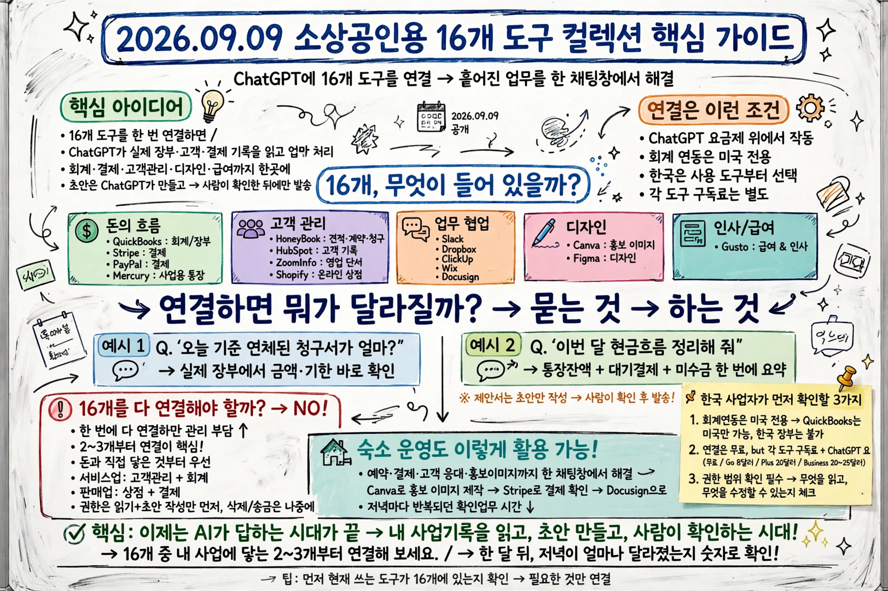
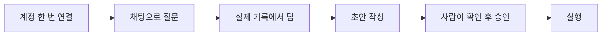
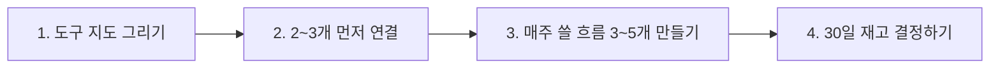

# ChatGPT Small Business Collection: 16개 도구를 연결하면 답변이 아니라 일이 됩니다

> **Summary**
> ChatGPT 소상공인 컬렉션은 회계·결제·고객 관리·디자인 등 16개 도구를 연결해 실제 사업 기록을 바탕으로 답하고 초안을 작성하도록 돕습니다. 필요한 도구 2~3개부터 연결하고 권한을 최소화하는 것이 좋으며, 구독료가 별도로 들고 회계 연동은 미국 전용이라 한국 사업자는 사용 가능 여부를 확인해야 합니다.

---

- 2026년 9월 9일, 소상공인용 도구 16개를 묶은 컬렉션이 공개됐습니다. 계정을 한 번 연결하면 ChatGPT가 실제 장부와 고객, 결제 기록을 읽고 일을 처리합니다.
- 회계·결제·고객 관리·디자인·급여까지 사업에 필요한 도구가 한데 모였고, 초안은 사람이 확인한 뒤에만 보냅니다.
- 다만 연결은 ChatGPT 요금제 위에서 돌아가고, 회계 연동은 미국 전용이라 한국 사업자는 쓸 수 있는 도구부터 골라야 합니다.

월말이 되면 장부 정리하느라 밤을 새운 적 있으시죠? 청구서는 메일에, 결제는 카드사에, 고객 메모는 메신저에 흩어져 있습니다. 하나씩 열어 확인하는 일만으로도 저녁이 지나갑니다. 그런데 이제 그 흩어진 기록을 한 채팅창에서 묻게 됐습니다!

🎥 [동영상 보기](https://www.youtube.com/watch?v=cl0a1QQFuRg)

## 16개, 무엇이 들어 있을까요?

돈의 흐름을 맡는 도구가 먼저 눈에 띕니다. `QuickBooks`가 회계와 장부를, `Stripe`와 `PayPal`이 결제를, `Mercury`가 사업용 통장을 봅니다. 고객 쪽은 `HoneyBook`이 견적·계약·청구를 한 번에 묶고, `HubSpot`이 고객 기록을, `ZoomInfo`가 영업 단서를, `Shopify`가 온라인 상점을 맡습니다. 일하는 방식은 `Slack`·`Dropbox`·`ClickUp`·`Wix`·`Docusign`이, 디자인은 `Canva`와 `Figma`가, 급여와 인사는 `Gusto`가 맡습니다. 16개, 하나하나가 사업의 한 자리를 차지하고 있습니다.

## 연결하면 뭐가 달라질까요?

핵심은 "묻는 것"이 "하는 것"으로 바뀌었다는 점입니다. "오늘 기준으로 연체된 청구서가 얼마예요?"라고 물으면 실제 장부에서 금액과 기한을 가져옵니다. "이번 달 현금 흐름을 정리해 줘요"라고 하면 통장 잔액과 대기 중인 결제, 미수금을 한 번에 보여줍니다. 제안서 초안도 만들어 주지만, 보내는 건 사람이 직접 확인한 뒤입니다. 초안은 초안일 뿐입니다!

## 16개를 다 연결해야 할까요?

아닙니다! 한 번에 다 연결하면 관리할 게 더 늘어납니다. 먼저 지금 쓰는 도구가 16개 안에 있는지 확인하고, 돈과 직접 닿은 것부터 2~3개만 연결하는 게 순서입니다. 서비스업이면 고객 관리와 회계가, 물건을 파는 사업이면 상점과 결제가 먼저입니다. 권한도 필요한 범위만 주는 게 좋습니다. 읽기와 초안 작성까지만 열어두고, 삭제나 송금은 나중에 넓혀도 늦지 않습니다!

## 한국 사업자가 먼저 확인할 것은요?

세 가지를 챙겨야 합니다. 첫째, 회계 연동은 미국 전용입니다. `QuickBooks` 연결은 미국 `QuickBooks Online` 고객에게만 열려 있습니다. 한국 장부에는 바로 쓸 수 없습니다. 둘째, 연결 자체는 무료지만, 각 도구의 구독료는 따로 듭니다. ChatGPT 요금제도 기본 무료, `Go` 월 8달러, `Plus` 월 20달러, `Business` 월 20~25달러로 나뉩니다. 셋째, 권한 범위를 확인해야 합니다. 도구마다 읽을 수 있는 것과 바꿀 수 있는 것이 다릅니다. 연결하기 전에 각 도구가 무엇을 할 수 있는지부터 보는 게 순서입니다.

## 숙소 운영에도 쓸 수 있을까요?

숙박업을 운영하는 입장에서는 이렇게 보입니다. 예약·결제·고객 응대·홍보 이미지까지, 흩어진 일을 한 채팅창에서 묻게 된다는 점이 가장 큽니다. `Canva`로 홍보 이미지를 만들고, `Stripe`로 결제 내역을 확인하고, `Docusign`으로 계약서에 서명을 받는 흐름이 한 곳에서 이어집니다. 물론 회계 연동이 미국 전용이라는 점은 아쉽습니다. 그래도 쓸 수 있는 도구부터 연결하면, 저녁마다 반복되던 확인 작업이 줄어듭니다!

AI가 답을 잘하는 시대는 지났습니다. 이제는 내 사업 기록을 읽고, 초안을 만들고, 사람이 확인한 뒤에 일을 끝내는 시대입니다. 16개 중 내 사업에 닿은 2~3개부터 연결해 보세요. 한 달 뒤, 저녁이 얼마나 달라졌는지 숫자로 확인하면 됩니다.

