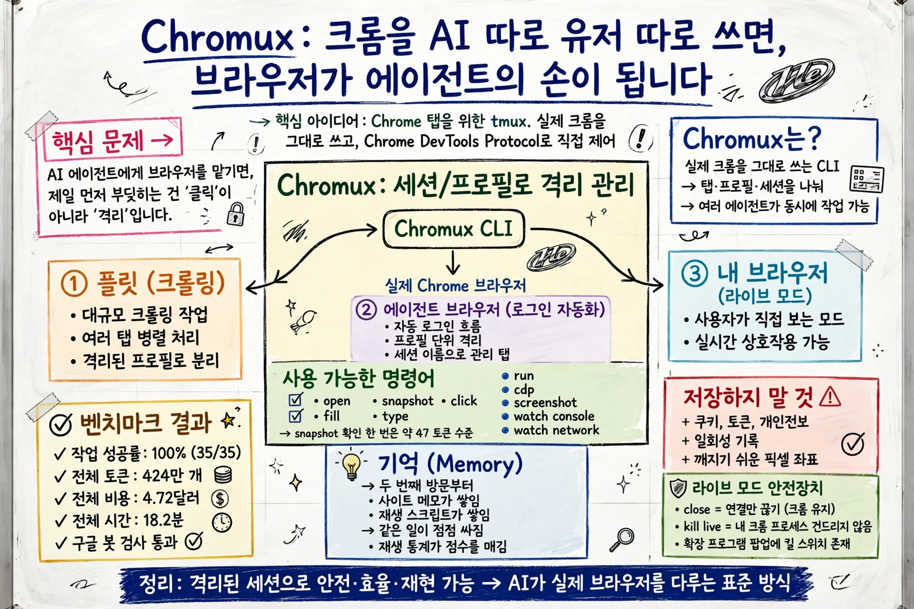
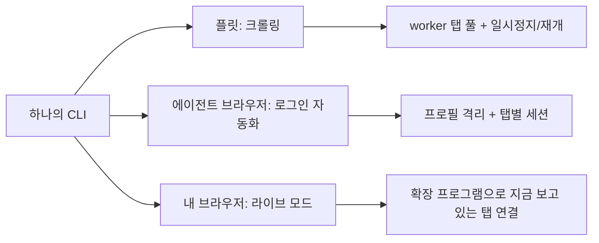
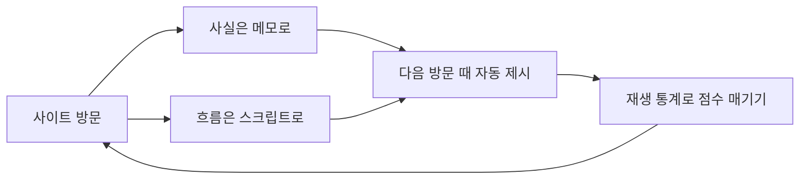
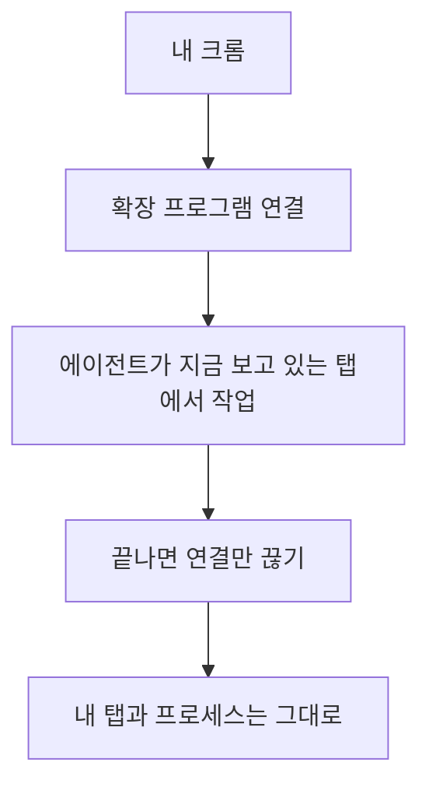

# Chromux: 크롬을 AI 따로 유저 따로 쓰면, 브라우저가 에이전트의 손이 됩니다

> **Summary**
> Chromux는 실제 크롬을 그대로 쓰면서, 탭·프로필·세션을 나눠 여러 에이전트가 동시에 일하게 만드는 CLI입니다. 별도 Chromium 없이 Chrome DevTools Protocol로 직접 제어하고, 세 가지 모양(크롤링 플릿·로그인 자동화·라이브 모드)을 하나의 명령 집합으로 묶었으며, 확인 한 번이 토큰 47개 수준으로 끝납니다. 직접 비교에서 작업 성공률 100%(35/35)와 가장 낮은 토큰·비용·시간을 기록했고, 사이트 메모와 재생 스크립트가 쌓여 두 번째 방문부터 같은 일이 점점 싸집니다.

---

- AI 에이전트에게 브라우저를 맡기면, 제일 먼저 부딪히는 건 클릭이 아니라 격리입니다.
- Chromux는 실제 크롬을 그대로 쓰면서, 탭·프로필·세션을 나눠 여러 에이전트가 동시에 일하게 만드는 CLI입니다.
- 두 번째 방문부터는 사이트 메모와 재생 스크립트가 쌓여, 같은 일이 점점 싸집니다.


AI한테 웹에서 뭘 좀 찾아달라고 했는데, 로그인부터 막힌 적 있으시죠? 자동화 브라우저는 따로 뜨니까, 사람이 쓰던 로그인은 안 통하거든요. 그래서 매번 새로 로그인하거나, 아예 로그인이 필요 없는 일만 시키게 됩니다. Chromux는 이 지점에서 출발했습니다. 가짜 브라우저를 하나 더 띄우는 대신, 사람이 이미 쓰고 있는 진짜 크롬을 에이전트 손에 쥐여주는 겁니다!

🎥 [동영상 보기](https://www.youtube.com/watch?v=mCj4kx_P2Ak)

## Chrome 탭을 위한 tmux, 그게 뭐죠?

한 줄로 말하면 **Chrome 탭을 위한 tmux**입니다. 터미널에서 tmux가 세션을 나눠 여러 작업을 동시에 돌리듯, Chromux는 크롬 탭을 세션 이름으로 나눠 관리합니다. 프로필 단위로 크롬 인스턴스를 격리하고, 각 탭은 세션 이름으로 부릅니다. 에이전트 셋이 각자 다른 탭에서 동시에 일해도 서로의 탭을 침범하지 않습니다.

핵심은 브라우저를 새로 만드는 게 아니라는 점입니다. Playwright나 Puppeteer처럼 별도의 Chromium을 들고 오지 않습니다. 실제 사용자의 Google Chrome을 쓰고, 브라우저 제어는 Chrome DevTools Protocol을 직접 씁니다. 덕분에 에이전트는 실제 크롬 프로필, 로그인 상태, 쿠키, 확장 프로그램이 있는 환경에서 그대로 일합니다.

## 에이전트 브라우저가 세 가지 모양이라고요?

브라우저 일이 세 가지 모양으로 갈린다는 게 이 도구의 출발점입니다. 크롤링하듯 수천 개 URL을 훑는 일, 로그인된 상태로 오래 붙어서 일하는 자동화, 그리고 지금 내가 보고 있는 페이지를 그대로 만지는 일. 지금까지는 모양마다 도구가 따로 필요했습니다. Chromux는 이 세 가지를 하나의 CLI로 묶었습니다. 명령은 똑같고, 프로필만 바뀝니다!



## 명령은 몇 개나 될까요?

일부러 작게 유지했습니다. `open`으로 탭을 열고, `snapshot`으로 페이지 구조를 보고, `click`·`fill`·`type`으로 만지고, 복잡한 일은 `run`이나 `cdp`로 처리합니다. 필요하면 `screenshot`, `watch console`, `watch network`로 증거와 진단 정보도 남깁니다.

```bash
chromux open inbox https://mail.example.com
chromux open research https://news.ycombinator.com
chromux snapshot inbox --interactive
chromux click inbox @3
chromux snapshot inbox --diff
```

`snapshot`은 접근성 트리를 `@3` 같은 짧은 참조로 바꿔줍니다. 덕분에 확인 한 번이 토큰 47개 수준으로 끝납니다. 페이지가 아무리 커져도 찾는 비용은 거의 그대로입니다. 잘 되는 흐름은 `script`로 얼려두면, 다음부터는 모델 호출 없이 그대로 재생됩니다!

작업 스킬도 같이 있습니다. 에이전트가 바로 일을 시작하지 않고 먼저 정찰합니다. 로그인 상태, 페이지 구조, 차단 여부, 속도 제한, 병렬 가능성을 확인하고, 안전한 경우에만 하위 에이전트를 나눠 병렬로 돌립니다.

## 숫자가 말해주는 게 있나요?

2026년 7월 13일에 진행한 직접 비교가 있습니다. 똑같은 모델이 똑같은 브라우저 임무 20개를 세 가지 도구로 수행했고, 세션은 35개였습니다. 결과는 이렇습니다.

- 작업 성공률: Chromux **100% (35/35)**, Playwright CLI 97% (34/35), agent-browser 94% (33/35)
- 전체 토큰: Chromux **424만 개**, Playwright CLI 534만 개, agent-browser 521만 개
- 전체 비용: Chromux **4.72달러**, Playwright CLI 5.65달러, agent-browser 8.08달러
- 전체 시간: Chromux **18.2분**, Playwright CLI 26.4분, agent-browser 20.3분
- 구글 봇 검사: Chromux만 **통과 (27.1초)**, 나머지 둘은 실패
정직하게 밝혀둘 점도 있습니다. 이 비교는 0.18.0 시점 측정이고, 이후 나온 버전의 새 기능은 표에 안 들어 있습니다. 그래도 방향은 분명합니다. 토큰은 판단에 쓰고, 풍경 구경에는 아끼는 겁니다.

## 두 번째 방문이 왜 싸질까요?

대부분의 브라우저 도구는 매번 0에서 시작합니다. Chromux는 다릅니다. 사이트마다 얻은 사실을 메모로 남기고(`note`), 검증된 흐름은 재생 스크립트로 저장합니다(`script`). 다음에 같은 호스트를 열면 메모와 스크립트가 자동으로 따라옵니다. 재생 통계가 아직 통하는 기억에 점수를 매겨서, 안 통하는 흐름은 자연히 가라앉습니다. 두 번째 방문이 첫 번째보다 싸고, 열 번째 방문은 거의 공짜에 가까워집니다.



단, 저장하지 말아야 할 것도 명확합니다. 쿠키, 토큰, 개인 정보, 일회성 작업 기록, 깨지기 쉬운 픽셀 좌표 같은 건 지식이 아니라 부채입니다. 이 도구의 자기 개선은 "무엇을 더 기억할까"보다 "무엇을 영구화하지 않을까"에 가깝습니다. 입력한 글자와 비밀은 기록에서 가려지고, 민감한 필드는 스냅샷에서도 가려집니다.

## 내 크롬을 건드리면, 내 탭은 안전할까요?

라이브 모드가 답입니다. 확장 프로그램을 한 번 연결해두면, 지금 내가 보고 있는 탭을 에이전트가 그대로 만질 수 있습니다. 로그인도, 2단계 인증도, 내가 열어둔 세션도 그대로 씁니다. 안전장치도 분명합니다. `close`는 탭을 닫지 않고 연결만 끊고, `kill live`는 내 크롬 프로세스를 건드리지 않습니다. 확장 프로그램 팝업에는 킬 스위치가 있습니다. 사람의 브라우저를 오염시키지 않으면서 로그인 상태를 빌려 쓰는 겁니다!



## 그래서, 누구한테 좋을까요?

에이전트한테 브라우저 일을 맡기는데, 로그인 때문에 매번 막히는 분께 좋습니다. 여러 에이전트를 병렬로 돌리는데 탭이 서로 섞이는 게 걱정인 분께도요. 다섯 개 스토어에서 같은 제품 가격을 한 번에 비교하는 일처럼, 탭이 안 부딪혀야 하는 병렬 작업이 특히 잘 맞습니다. 에어팟 프로 가격을 다섯 개 스토어에서 동시에 확인한 데모에서는 구글 129~249달러, 아마존 169.99달러, 이베이 179.95달러, 월마트 199.99달러, 뉴에그 179.99달러가 한 번에 나왔습니다. 물론 가격은 그때그때 달라지니, 구조만 참고하시면 됩니다.

시작은 가볍습니다. `Node.js` 22 이상과 크롬만 있으면 되고, 의존성은 없습니다. 저장소에 있는 설치 안내를 따라 설치하고 스킬 두 개를 등록하면, 에이전트가 바로 크롬을 쓸 수 있습니다. 브라우저 에이전트의 병목이 클릭이 아니라 운영이라는 걸 깨달았다면, 이 작은 CLI가 꽤 좋은 출발점이 될 겁니다.

